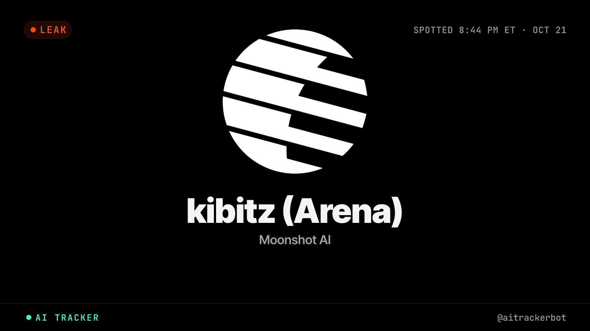
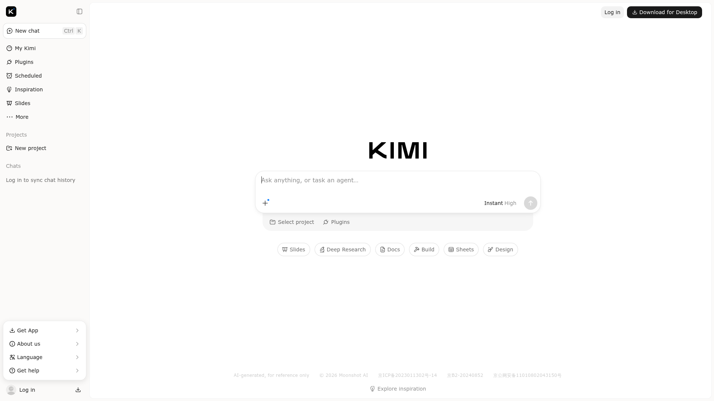
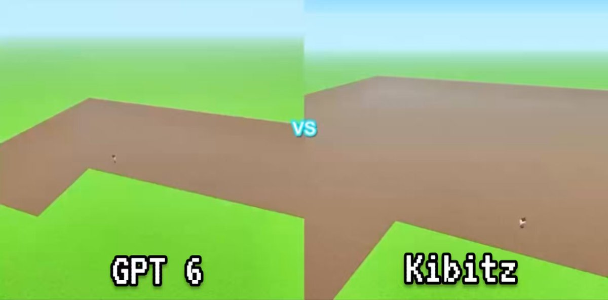

# Arena 神秘模型 Kibitz，社群押月之暗面 Kimi K3.1：这是预发布信号，不是官宣

*图：AI Tracker 公开页「kibitz (Arena)」封面（状态标注为 Leaked, not yet released）。来源：[live.aitracker.bot/kibitz-arena](https://live.aitracker.bot/kibitz-arena)*

2026 年 10 月 21–22 日，LMSYS Chatbot Arena 上冒出匿名模型 **Kibitz**。社群几乎一边倒地押：**月之暗面（Moonshot AI）的 Kimi K3.1**。命名习惯、分词器指纹、Kimi Code 切换提示、以及 K3 当年「提前约 30 小时进 Arena」的节奏，都被拿来串成一条证据链。

**先说死一句：这是预发布信号，不是官宣。** Moonshot 尚未发布模型卡、价格表、API 文档或可复现基准；AI Tracker 自己的结论也是「Most likely … but the version isn't confirmed」。下面所有「指向 K3.1」的说法，都标成 **未官宣 / 社群推断**——热可以热，别把推断写成新闻通稿。

---

## 1. 为什么全网都在猜：四条证据链

### ① 命名：Ki* 匿名号又来了

Linux.do 等讨论整理了近年 Kimi 在 Arena 的匿名代号习惯（**社群归纳，非官方命名表**）：

| 曾用匿名号 | 社群对应 |
| --- | --- |
| Kiwido | K2.5 |
| Kiwire | K2.6 |
| Kivine | K3 |
| **Kibitz** | **被押 K3.1** |

同一晚还出现了另一个匿名号 **Kalmia**。两条线不要拧成一股：Kibitz 的 Ki* 模式更像 Kimi 系；Kalmia 另当别论（见下文「噪音」）。

### ② 分词器指纹：AI Tracker 的「聊天框读 tokenizer」

AI Tracker（[@aitrackerbot](https://x.com/aitrackerbot/status/2113069020781875472)）在 2026-10-22 发帖称：仅靠 Arena 聊天框即可探测 tokenizer——Kibitz 在两轮测试里，把 **11 个 Moonshot 专属测试 token** 全部「弄乱」，表现与已测过的 Kimi 模型一致；来自另外 7 家实验室的模型则能正确复现这些 token。

公开页结论写得很克制：指向 Kimi 分词器，**「Most likely the K3.1 … but the version isn't confirmed」**。这是目前最硬的技术旁证之一，但仍是 **侧写，不是官方身份披露**。

### ③ Kimi Code：K3 → K3.1 切换提示

*图：AICrier 报道页公开封面图。来源：[aicrier.com 该帖](https://aicrier.com/post/pdurwjrf7lbiez33iioq)*

AICrier（2026-10-22）报道：Kimi Code 侧出现与 **K3 / K3.1** 相关的模型切换确认配置；Linux.do 帖也给出了 `model_switch_confirm` 的复现路径讨论。解读合情合理——**内部已在准备会话迁移**——但配置字符串 ≠ 已公开发布。仍属 **未官宣 / 社群推断**。

### ④ Arena 暗测节奏：K3 曾提前约 30 小时

社群回忆：K3 正式发布前约 **30 小时**以匿名身份进过 Arena。若 Kibitz 真是下一棒，有人据此押「本周五夜间」或「下周二前」发布窗口——这是 **节奏类比**，不是日历承诺。ChrisGPT 等账号甚至直接写「Kimi k3.1 (Kibitz) will release before Tuesday next week」，属于个人时间线猜测，**勿当官宣排期**。

---

## 2. 表现很热闹，噪音也不少

创意与编程侧讨论升温很快：Linux.do 楼内更新 SVG、3D 庭院、与 Opus / GPT‑6‑Astra Max 的并排对比；有人反馈 Arena Code 模式高概率抽到 Kibitz。单次对话里模型「自称 Moonshot 开发」——**仅供参考**，模型自我介绍历来不可当作身份证明。

另一类高传播内容是 **非官方成本叙事**。例如 ChrisGPT 帖用 Minecraft「build what you think you look like」对比（**非官方截图/演示**）：

*图：X 用户 @ChrisGPT 演示视频截帧（标注：非官方对比，非正式基准）。文中数字称 GPT‑6 Astra 约 5,738 blocks / \$5.31，Kimi K3.1 约 13,707 blocks / \$0.38。来源：[x.com/ChrisGPT/status/2113180444858667485](https://x.com/ChrisGPT/status/2113180444858667485)*

这类 demo **好看、好传，但不等于硬基准**：样本量、提示词、计费口径、是否同一档 thinking effort，都未公开复现。热度可以追，结论要留白。

### 同日还有 Kalmia：别和 Kibitz 绑死，也别写死成 Qwen

10/22 凌晨 Arena 同时出现 **Kibitz** 与 **Kalmia**。Linux.do 楼主明确写：Kalmia 身份「无法判断」。另有社群用分词器侧写把 Kalmia 往 Qwen 系靠（AI Tracker 亦发帖称 Kalmia 非 Kimi、更像 Qwen tokenizer），但这仍是 **并行猜测**：

- 不要把 Kalmia 写成「已确认的 Qwen 4」；
- 更不要把 Kibitz / Kalmia 混成同一家实验室的同一个故事。

两条匿名线各自成立、各自待官宣。

---

## 3. 若坐实：对 coding / agent 性价比赛道意味着什么

假设 Kibitz 最终揭晓为 Kimi K3.1（**仍是假设**），真正激动市场的未必是「又一个榜一」，而是 **开放权重 / 可接入 coding‑agent 栈的性价比**：

- K3 一代已在长上下文、工具调用、agent 工作流上站稳；社区吐槽更多集中在 **贵、额度紧**，而不是「完全不能用」。
- 若 K3.1 在保持（或小幅抬升）编程与 agent 能力的同时压低有效成本，会对「闭源旗舰 vs 国模开源」的中间地带再挤一把——尤其是 IDE、代码 Arena、多步 tool-use 场景。
- 反过来：若只是小版本迭代、价格不动，热度会很快回到「等等看模型卡」。

一句话：**坐实之前，它改写的是预期；坐实之后，才改写账单与技术栈选型。**

---

## 4. 读者该怎么做：别急着换栈

1. **等三样东西再动手**：官方模型卡、价格 / 速率限制、可复现评测（公开基准 + 你自己的业务集）。  
2. **Arena 匿名分 ≠ 生产 SLA**：暗测模型可能随时下线、换权重、改 system prompt。  
3. **把 Minecraft / SVG 热帖当趣味样本**，不要当采购依据。  
4. **Kibitz 与 Kalmia 分账记**：一个更像 Kimi 线索，一个另有猜测；写死成「Kimi vs Qwen 同台官宣」为时尚早。  
5. 现有 K3 / 其他 coding 模型能稳住业务，就 **先别为代号搬家**。

---

## 收个尾

Kibitz 出现在 Arena，叠加 Ki* 命名、tokenizer 指纹、Kimi Code 切换提示与历史暗测节奏，**社群押 Kimi K3.1 很合理**——合理不等于已发布。AICrier 的表述值得原样记住：**「a release signal—not a release。」**

接下来真正有信息量的节点，只会是 Moonshot 自己的公告：叫什么、卖多少、能复现什么。在那之前，享受猜谜可以，换生产栈请按暂停键。

---

## 来源与核实说明

| 素材 | 核实结果 |
| --- | --- |
| [AICrier：Kimi K3.1 Surfaces Across Kimi Code, Arena](https://aicrier.com/post/pdurwjrf7lbiez33iioq) | **已核实**（2026-10-22；强调预发布信号、非官宣） |
| [AI Tracker：kibitz (Arena)](https://live.aitracker.bot/kibitz-arena) | **已核实**（检测到 2026-10-21；标注 Moonshot / Leaked, not yet released） |
| [X · @aitrackerbot](https://x.com/aitrackerbot/status/2113069020781875472) | **已核实**（tokenizer 指纹论述；版本未确认） |
| [X · @ChrisGPT](https://x.com/ChrisGPT/status/2113180444858667485) | **已核实**（非官方 Minecraft 成本叙事 + 个人发布窗口猜测） |
| [X · i/trending/2113194116553257028](https://x.com/i/trending/2113194116553257028) | **未能核实**（按帖 ID 查询返回 Not Found；可能为 Trending 页而非普通帖） |
| [Linux.do 讨论（镜像）](https://feedbbs.com/linuxdo/170563) / [原帖](https://linux.do/t/topic/3056564) | **已核实**（Ki* 链、约 30h 节奏、SVG/3D 热议、Kalmia 身份未定） |

**文内立场再强调一次：全文「Kibitz = Kimi K3.1」均为未官宣 / 社群推断；Kalmia 亦勿写死为某一厂商已发布型号。**
