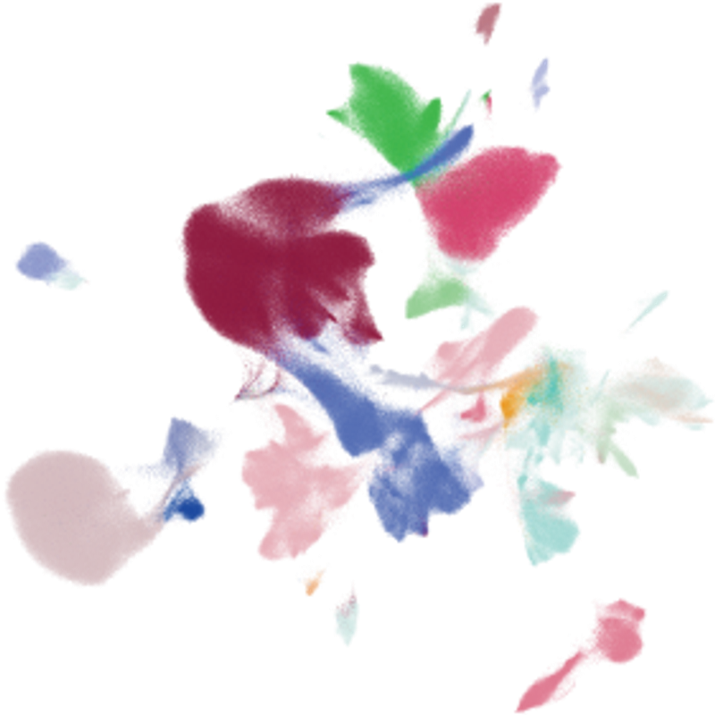
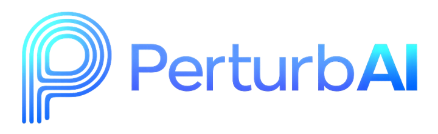
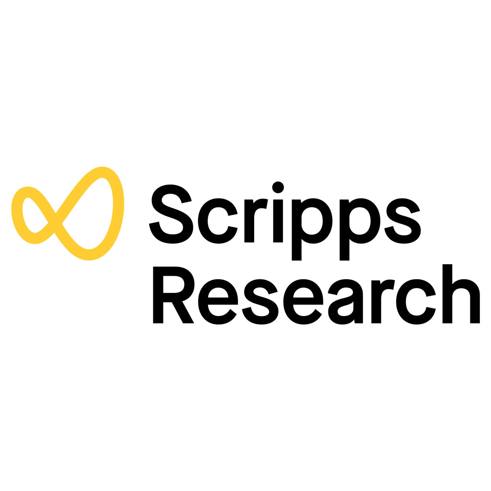

# OpenAI 用数千个 AI agent，约 32 分钟扫完小鼠全脑 CRISPR 图谱：这对普通人意味着什么？

<video controls width="100%" poster="./assets/2026-10-22-openai-gpt-rosalind/openai-hero.png">
  <source src="./assets/2026-10-22-openai-gpt-rosalind/openai-agents-biological-data-zh.mp4" type="video/mp4">
</video>

*视频：OpenAI 官方介绍片（已烧录中文字幕）。若页面无法内嵌播放，可直接打开 [mp4 文件](./assets/2026-10-22-openai-gpt-rosalind/openai-agents-biological-data-zh.mp4)。来源：[OpenAI 博文](https://openai.com/index/scaling-ai-research-for-complex-biological-data/) / [Vimeo](https://player.vimeo.com/video/1237313920)*

2026 年 10 月 21 日，OpenAI 与 PerturbAI、Scripps Research 合作发布一项实验：用由 GPT‑Rosalind 驱动的**数千个** AI agent，在约 **32 分钟**内，分析了小鼠全脑 CRISPR atlas——一份覆盖数百万脑细胞的现有实验数据。它们产出一份公开的「推理图谱」（reasoning atlas），把基因扰动、细胞反应、相关文献和可能机制连在一起，并提出若干可检验的假说。

*图：PerturbAI 新闻稿中的全脑基因组图谱可视化（细胞/扰动聚类示意）。来源：[PerturbAI 新闻稿](https://perturb.ai/news/perturbai-launches-ai-reasoning-agents)*

对普通人来说，这件事的价值不在于「你也能在家敲 CRISPR」，而在于：**科研里最耗人的那一段——把海量数据翻成可追的线索——开始可以被规模化加速**。医学与健康受益的路径，往往是间接的：假说提得更快、值得做的实验排得更清，真正进医院的进展仍靠后续验证。

---

## 先看清：AI 在干什么

这套方法叫 **distributed biological reasoning（分布式生物推理）**。大致是：

1. 把「分析整张图谱」拆成大量小任务；
2. 每个 agent 盯住一个基因扰动：看细胞怎么反应、去文献里找线索、写一段解释；
3. 把所有报告汇总成 reasoning atlas——一张把基因、效应、文献和可能机制串起来的推理图。

官方对比很直白：同一模型和资源下，**单个 agent** 在最大工作量时大约只引用 **11** 篇文献；**分布式 agent** 引用超过 **700** 篇。盲测里，专家约 **75%** 更偏好分布式报告。人类若按「一个扰动一个扰动」做同类分析与文献综述，估计要**数月到一年**；agent 在复现人类分析发现的同时，还挖出额外线索，且对新颖性与科学价值的判断，与盲测中人类专家大体一致。

图谱已公开，科学家可以自己去探索。文中举了两个例子：小脑神经元里 **Tsc1** 与 **Tsc2** 的差异（与结节性硬化症相关）；**DCTN1** 扰动后胆固醇相关基因表达上升，并据此提出「是否与神经退行有关」这类**可检验**假说。

---

## 这对普通人有什么价值

不必硬吹「人人都能用 CRISPR」。更贴地的理解有三层。

**第一，多智能体在加速的是「读数据、找线索」，不是替你做手术。**  
现代生物学实验往往一次产出海量数据。瓶颈常不在「能不能测」，而在「测完之后，谁有时间把每个基因扰动都啃一遍文献」。把这件事拆给数千个 agent 并行干，等于把「排队数月的文献综述」压缩到半小时量级。普通人感受到的，不会是自己点开一个 App 就治病，而是：**某些疾病研究从「数据躺着积灰」到「有人（或 agent）提出可追问题」的周期变短**。

**第二，间接影响医学与健康，靠的是线索质量与实验优先级。**  
药物与疗法的路径很长：观察 → 假说 → 实验验证 → 临床。AI 若能更系统地从现有 atlas 里捞出「Tsc1/Tsc2 差异」「DCTN1 与胆固醇通路」这类钩子，实验室就更可能把有限经费砸在更值得做的验证上。普通人受益的方式，通常是若干年后某个适应症多了一条被认真验证过的机制线索——而不是今天立刻下载一张图谱就能自诊。

**第三，看懂「AI 做假说」和「AI 做实验」的差别，能少被标题带跑。**  
- **做假说**：在已有数据与文献上推理——「这个扰动之后，某类基因表达变了，文献里某通路曾出现过，或许值得测一下」。GPT‑Rosalind 这批 agent 做的，主要是这一层：找模式、串证据、写出可检验的说法。  
- **做实验**：进实验室改细胞、给药、测表型、重复、对照、统计——决定假说成不成立。OpenAI 文中也写明：**科学家仍在发现的中心**；AI 帮找更多值得做的线索，人决定追什么、设计实验、解读结果。

把两者混为一谈，容易得出「AI 已经发现新药 / 已经治好病」的误读。更准确的说法是：**AI 在把「值得做的实验清单」做得更密、更快；清单上的每一项，仍要靠实验说话。**

---

## 为什么「很多个小 agent」比「一个大模型硬啃」更适合扫大数据

单模型不是不会分析，而是面对「数百万细胞 × 大量基因扰动 × 海量文献」时，很难在一次推理里既深又广。分布式做法的直觉很像课题组扩编：不是让一个人读完所有论文，而是每人认领一个基因扰动，再汇总成图。

官方数字把这一点钉死了：同样上限下，单 agent 文献覆盖约 11 篇，分布式超过 700 篇；专家盲测更偏好后者。这说明瓶颈往往不在「模型聪不聪明」，而在**任务能不能拆、证据面能不能铺开**。对普通人，这是理解近年「多智能体」热潮的一个干净例子——它解决的是规模与覆盖，不是魔法。

---

## 收个尾：理性期待就好

这件事值得关注，是因为复杂生物数据第一次以这种并行推理的方式，被较快地整理成可公开探索的图谱，并提出可检验假说。它**没有**宣称替代湿实验，也**没有**把终点画成「普通人直接用 AI 改基因」。

更稳妥的期待是：以后类似 atlas 会更多，推理图会更常作为研究入口出现；真正改写医学的，仍是那些被假说点名、又被实验坐实的环节。AI 把前半段加速了，后半段还在人的手里——这本身就是好消息：加速的是发现节奏，不是把责任甩给模型。

---

## 相关机构

这次工作由三方合作推进，官网与新闻入口如下（标识来自各自官网/新闻页，便于核对出处）：

- **OpenAI**：[官方博文](https://openai.com/index/scaling-ai-research-for-complex-biological-data/)（文首配图即其公开宣传图）
- **PerturbAI**： — [新闻稿](https://perturb.ai/news/perturbai-launches-ai-reasoning-agents) · [官网](https://perturb.ai/)
- **Scripps Research**： — [官网](https://www.scripps.edu/)

预印本：[bioRxiv — Distributed AI agents enable comprehensive discovery of biological insights at scale](https://www.biorxiv.org/content/10.64898/2026.10.15.759436v1)

---

**来源**：[OpenAI — Scaling AI research for complex biological data](https://openai.com/index/scaling-ai-research-for-complex-biological-data/)（2026-10-21）
