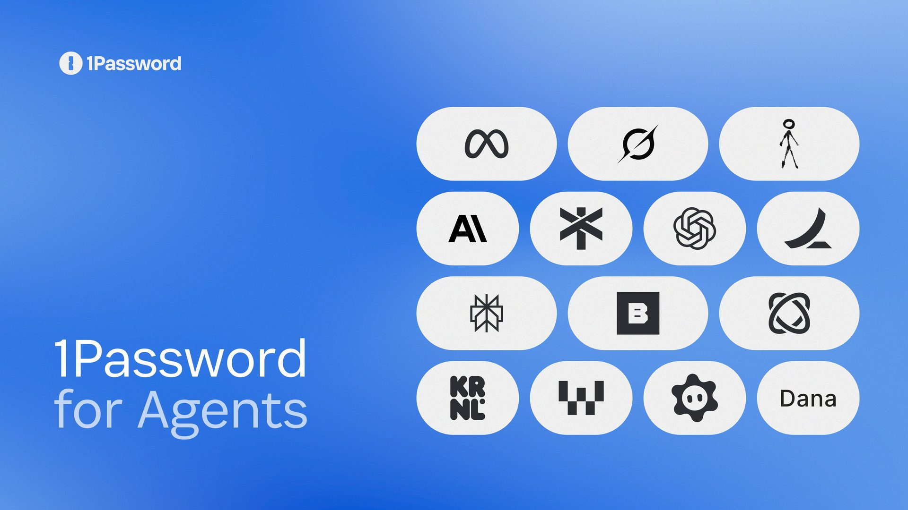

# 1Password for Agents：让 agent 代你登录，但不让它看见密码

*图：1Password 博客头图。来源：[1password.com/blog/1password-for-ai-agents](https://1password.com/blog/1password-for-ai-agents)*

2026 年 10 月 22 日，1Password 宣布 **1Password for Agents**：面向个人 AI agent 的登录协作能力——agent 可以继续帮你订票、下单、进后台干活，但**密码和一次性验证码不进对话、不进模型**。

**一句话说清：你在设备上点批准 → 1Password 往网站里填密 → agent 完成任务，却看不到凭证。**  
这对天天用 Muse、Grok Bot 等「会自己开网页」的助手的人，比又一篇「AI 安全白皮书」更贴地：不是禁止 agent 登录，而是把「看见密码」从链路里拿掉。

---

## 1. 普通人立刻懂：代劳可以，密码不能交给它

agent 越能干，越常撞上登录页。以前大致三条路，都不舒服：

1. **你接手手动填**——慢，打断流程；  
2. **把密码贴进对话**——凭证进了模型上下文，任务结束后还可能留痕；  
3. **指望浏览器记住的密码**——官方指出：浏览器式密码管理并不是为「agent 代登录」设计的，agent 往往用不了，还是得你亲自上。

1Password for Agents 给的第四条路：

- agent 停在登录页，**向 1Password 申请使用某条已存登录**；  
- **你在 1Password 里审这项请求并批准**；  
- **1Password 直接在目标网站自动填充**；  
- 按官方表述：**密码 / 一次性验证码不对 agent 暴露**，agent 也拿不到你整库 vault。

官网举例：用 Muse 办派对——建邀请、跟 RSVP、按预算搜物资；Muse 需要进 RSVPify、Oriental Trading 时分别申请，你选哪条登录给它用，它办完事，却看不到密码，也摸不到 vault 里别的东西。

---

## 2. 产品机制：审批在你手上，填充在 1Password

流程可以压成三步（按官网）：

| 步骤 | 谁做 | 发生什么 |
| --- | --- | --- |
| 1 | Agent | 碰到登录，请求使用 1Password 里的某条凭证 |
| 2 | 你 | 在设备上的 1Password 审阅并批准（或不批） |
| 3 | 1Password | 向**目标站点**自动填充；凭证不交给 agent / 模型 |

官方强调的控制点：

- **按需、可见、可断**：你能看到要分享什么，随时断开集成；  
- **不是整库开放**：连接某 agent ≠ 它能扫你全部 vault；只针对你批准的具体登录；  
- **多 agent 同一套 vault**：密码改一次，各已连接 agent 用的是当前登录，不必到处同步；  
- **各集成的保障细节可能不同**：官网写明 *safeguards and controls vary by integration*。

社区公告补充：这些是**可选、需你主动连接**的集成；1Password 会校验请求来自已审核架构的授权合作方，并要求**经认证的用户批准**后才给凭证访问。

---

## 3. 对接进度：以官网名单为准（勿当成全员已通）

1Password 博客列出的个人 agent 对接（**状态以官网原文为准**）：

| 产品 | 官网表述的状态 |
| --- | --- |
| **Muse**（Meta） | 未来数日在各平台陆续推出（rolling out） |
| **SpaceXSI Grok Bot** | 未来数日在各平台陆续推出（rolling out） |
| **Anthropic Claude Duet** | 即将推出（coming soon） |
| **OpenAI ChatGPT Work 与 dots** | 即将推出（coming soon） |
| **Town Townie** | Web 与 iOS 即将推出（coming soon） |

另外写明「即将」扩展的名单：Instinct、Browserbase、Browser Use、Dana、KERNEL、Perplexity、Ramp、Tomo、Wajo——**本文不扩写官网未写明的能力细节**。

对 Grok Bot 用户：伙伴页写明，批准后 1Password 填充登录，**Grok Bot 看不到密码或一次性验证码**，也无需把二者贴进对话；可随时断开。

**可用性（官网）：** 目前对 **1password.com** 上的 Individual / Family 账户**不另收费**；**1password.eu / 1password.ca 暂不支持**；具体平台与能力因合作方集成而异。

---

## 4. 冷静段：不是万能保险，agent 越能干登录权越危险

三点别被标题带跑：

1. **「密码不进模型」≠「账户不会被乱操作」。**  
   批准登录后，agent 仍可能在该账户里下错单、订错票、发错帖。1Password 伙伴页也提醒：登录会让 agent 接触该账户内的信息与操作，批准前要审任务与账户。Engadget 等报道同样强调：凭证可以不外泄，误操作风险仍在。

2. **仍依赖你的审批习惯与集成深度。**  
   若你习惯「一律点允许」、不看是哪个站、哪次任务，安全模型会塌成「便捷的自动放行」。各 agent 的保障与控件并不完全相同（官网原话）。

3. **勿吹成「已解决所有 agent 安全」。**  
   这解决的是**凭证暴露给模型 / 对话**这一类问题，不是 prompt 注入、恶意站点、会话劫持、越权 API、供应链投毒的全家桶。agent 能力越强，**你批准的那一次登录**权重越大——工具在减密文泄露，责任仍在审批人。

**一句话：1Password for Agents 把「代登录」从「把密码交给 AI」改成「人批、保险库填」；它降低的是凭证进模型的风险，降低不了的是你把账户钥匙交给一个会点按钮的助手之后的操作风险。**

---

## 5. 读者行动

1. 已用 Muse / Grok Bot 且账号在 **1password.com**：关注官方「未来数日」 rollout，连接后用一次「低风险站点」练审批流。  
2. 等 Claude Duet / ChatGPT Work / dots / Townie：按 coming soon 盯，勿按「今天全员可用」写进流程。  
3. 审批时养成习惯：**看站点 + 看任务 + 必要时事后断开**；高价值账户（银行、主邮箱、云控制台）默认更严。  
4. .eu / .ca 用户：以官网「暂不支持」为准，别假设同款能力已开。

---

## 来源

- 1Password 博客（2026-10-22）：[Introducing 1Password for Agents](https://1password.com/blog/1password-for-ai-agents)
- 1Password 产品页：[Personal AI agent integrations](https://1password.com/personal-ai-agent-integrations)
- 1Password × Grok Bot：[1Password for Grok Bot](https://1password.com/partners/spacexsi-grokbot)
- 1Password 社区公告：[Introducing 1Password for Agents](https://www.1password.community/announcements-52/introducing-1password-for-agents-25883)

*对接名单与「rolling out / coming soon」、.com 可用性及「密码不对 agent 暴露」均按上述官方页核对；未把 coming soon 写成已上线，未声称已解决全部 agent 安全问题。*
