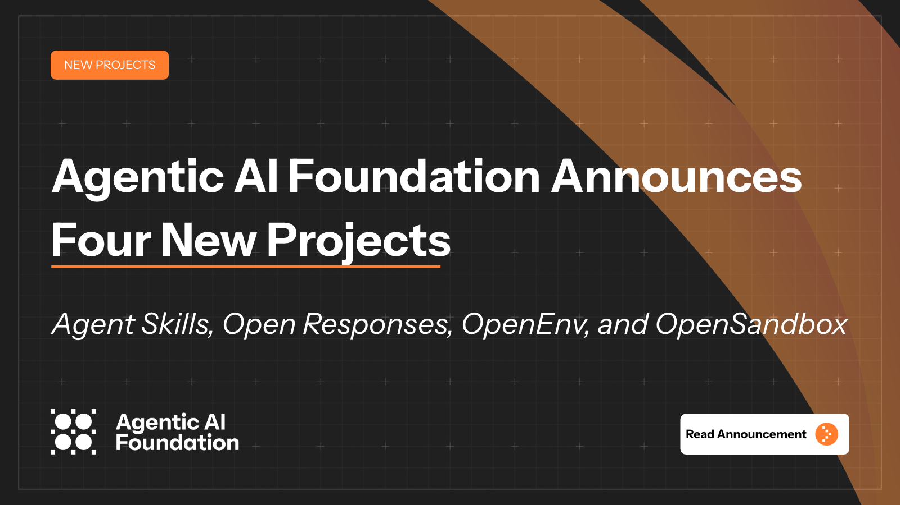

# 你在 Cursor / ChatGPT 装的 Skill，要进公共标准了：对我们有什么用，对 AI 生态意味着什么

*图：Anthropic 新闻页配图。来源：[anthropic.com/news/donating-agent-skills-to-the-agentic-ai-foundation](https://www.anthropic.com/news/donating-agent-skills-to-the-agentic-ai-foundation)*

2026 年 10 月 22 日，Anthropic 把 **Agent Skills** 开源标准捐给 Linux 基金会旗下的 **Agentic AI Foundation（AAIF）**。同一天，OpenAI 的 **Open Responses**、Hugging Face 的 **OpenEnv**、阿里的 **OpenSandbox** 也一并进了 AAIF。

先别急着当成「又一个基金会新闻」。如果你天天在 Cursor、ChatGPT、GitHub Copilot、VS Code 里装技能包，这件事更像：**技能格式要从「各家私货」往「公共约定」挪一步**——装得更省事、换工具少重学、生态里写一次技能有机会多处跑。

**一句话：这是给我们用的人降格式摩擦，给整个 AI agent 栈补一块公共拼图；不等于 Anthropic 通吃，也不等于明天所有助手突然一样好用。**

---

## 1. 对我们有什么用（先说人话）

官方称自 2025 年 12 月标准发布以来，已有 **70+** agent 平台接入，名单含 **ChatGPT、Cursor、GitHub Copilot、VS Code**；约 **100 万** skills 已发布、近 **2.8 亿** 次安装（原文：*1 million skills published and nearly 280 million installed*）。这些数字热不热，不如问：落到你自己的工作流，能省什么、不能省什么。

### 对天天用 AI 写代码 / 写稿的人

| 你在意的事 | 可能变好的地方 | 别指望立刻发生的 |
| --- | --- | --- |
| **装技能** | Skill 本质是「含 `SKILL.md` 的文件夹 + 脚本/材料」；格式公共化后，跨产品安装路径更可预期 | 各家商店、审核、配额仍各搞各的 |
| **换工具** | 你在 Cursor 写好的技能，理论上更容易被其他跟版平台 loader 读到 | 「兼容声明」≠ 一键无痛迁移；深度跟版要看产品 |
| **少学一套目录** | 同一套 `SKILL.md` 心智模型，换 IDE / 助手时少背一种私有结构 | 产品能力、价格、权限模型不会因为捐标准而统一 |

**你真正能省下的，是格式迁移成本；省不下的，是各家产品能力和安全责任。**

### 对写 Skills、做 agent 产品的人

- **少写 N 套 loader**：公共标准 + AAIF 治理，降低「为每家 IDE 单独适配」的摩擦；版本化发布、提案流程、安全指引都进了官方路线图。
- **技能可复用叙事更硬**：对外可以说「跟 agentskills.io / AAIF」，而不是「只适配某家私有格式」。
- **仍要自己扛的**：技能质量参差、供应链投毒、企业合规审批——标准不自动替你审第三方 skill。

### 今天就能盯的三件事

1. **本机 / IDE 是否跟版**：更新说明是否指向 [agentskills.io](https://agentskills.io) / AAIF 规范版本；旧 loader 是否还能读新字段。
2. **技能从哪装**：优先可信渠道与可审计仓库；对「一键安装、要高权限脚本」的 skill 保持怀疑。
3. **安全默认会不会变严**：官方拟议安全指引落地后，沙箱策略、权限提示、企业能否关第三方技能——比「捐给基金会」四个字更决定你敢不敢在生产环境装。

---

## 2. 对整个 AI 生态有什么影响

*图：AAIF 新闻页公开配图（四新项目公告）。来源：[aaif.io/news/agentic-ai-foundation-announces-four-new-projects](https://aaif.io/news/agentic-ai-foundation-announces-four-new-projects)*

同一天四项目进门，AAIF 自称第一年从启动时 **3** 个项目增至 **10** 个（既有 A2A、Agent Router、agentgateway、AGENTS.md、goose、MCP 等）。宣布场合：AGNTCon + MCPCon North America（San Jose）。

| 项目 | 贡献方 | 一句话定位（按官方表述） |
| --- | --- | --- |
| **Agent Skills** | Anthropic | agent「技能」开放标准（`SKILL.md` 文件夹约定） |
| **Open Responses** | OpenAI | 基于 OpenAI Responses API 的多厂商可互操作 LLM 接口规范 |
| **OpenEnv** | Hugging Face | 可互操作 RL 环境框架（容器化；agent 接口、MCP、Gym 训练协议） |
| **OpenSandbox** | Alibaba | 通用沙箱平台（多语言 SDK、统一 API、Docker/K8s；生命周期与执行协议） |

拼在一起看，行业在推一张 **agent 基建拼图**：

- **怎么教 agent 做事** → Skills（可复用能力包）
- **怎么跟模型说话（多厂商）** → Open Responses
- **怎么训、怎么评** → OpenEnv
- **怎么安全跑** → OpenSandbox
- **怎么连工具 / 上下文** → 此前已有的 **MCP** 等

### 三层生态含义（吸睛但不吹破）

1. **从「模型军备」到「协议军备」**  
   巨头继续卷模型，但公开战场越来越多落在：技能怎么装、接口怎么通、环境怎么评、代码怎么在沙箱里跑。谁掌握标准话语权，谁就影响生态默认路径——捐进基金会，是把话语权部分交给公共治理，而不是私下一家说了算。

2. **互操作从口号变成「项目清单」**  
   Skills + Responses + Env + Sandbox + MCP 同屋檐下，长期有利于「接口—环境—沙箱—技能」串联评测和开源组合；短期仍取决于各厂商跟版速度和商业利益是否对齐。

3. **技能市场会重新划界**  
   什么算官方规范、什么算第三方市场、安全审核谁做、企业能否自建私有目录——这些会跟着「公共标准」重画。对创业者和工具商：机会是「写一次、多处跑」；风险是兼容深度参差 + 恶意 skill 供应链。

背景补充（Anthropic 博文）：AAIF 在 Linux Foundation 下；Anthropic 去年与 Block、OpenAI 共同创立，并曾捐出 **MCP**。Agent Skills 维护由 Anthropic、Google、OpenAI 等公司工程师以**个人身份**进行；Lead Maintainers 为 David Soria Parra、Mahesh Murag。捐赠范围含名称与 logo、GitHub organization、**agentskills.io** 域名；官方写明：**可不加入 AAIF 继续使用或贡献**。下一步拟议：版本化发布、正式提案流程、编写/安装技能的安全指引。

---

## 3. 冷静段：捐标准 ≠ Anthropic 通吃，≠ 生态立刻统一

三点别被标题带跑：

1. **捐出的是标准资产，不是「所有 Skills 市场归 Anthropic」。**  
   名称、logo、GitHub org、域名进基金会，治理要走公共流程；并不等于 Cursor / ChatGPT / Copilot 的产品策略、计费、内容审核都听 Anthropic 的。

2. **「70+ 平台接入」≠「兼容深度一致」。**  
   接入可以是读 `SKILL.md`、可以是部分字段支持、也可以是营销层面的「兼容声明」。真正影响体验的是：安装稳不稳、脚本权限怎么控、跨 IDE 是否真能一键迁移。

3. **商业条款与安全审核仍待看。**  
   官方下一步才「拟议」安全指引；技能市场谁来审、恶意 skill 怎么下架——这些比「捐给基金会」四个字更决定你敢不敢在生产环境装第三方技能。

**公共标准降低的是格式摩擦；降低不了的是产品利益、安全责任和执行质量。**

---

## 4. 一句话收束

- **对我们**：技能更像「可流通的插件约定」，装、迁、复用有望少踩格式坑；盯跟版、来源、安全，比转发新闻更有用。  
- **对生态**：agent 栈的「教做事 / 调模型 / 训评 / 沙箱」正在被基金会项目清单钉住；互操作有了地图，落地仍看跟版与治理。  
- **别神话**：这是标准捐赠与基建结盟叙事，不是某一家通吃，也不是明天所有 AI 助手突然同质化。

---

## 来源

- Anthropic（2026-10-22）：[Donating the Agent Skills standard to the Agentic AI Foundation](https://www.anthropic.com/news/donating-agent-skills-to-the-agentic-ai-foundation)
- AAIF（2026-10-22）：[Agentic AI Foundation Announces Four New Projects](https://aaif.io/news/agentic-ai-foundation-announces-four-new-projects)
- 规范站点：[agentskills.io](https://agentskills.io)

*数字与名单均按上述官方稿核对；未添加未经出处的平台清单或安装量推算。*
