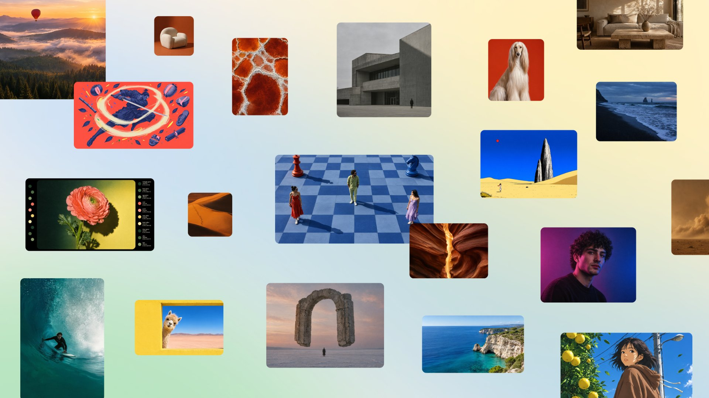

# Canva 自研图像模型 Craft 上线：先规划版式再出图，不是又一张「死图」生成器

*图：Canva 新闻页配图。来源：[canva.com/newsroom/news/canva-craft](https://www.canva.com/newsroom/news/canva-craft/)*

2026 年 10 月 22 日前后，Canva 发布自研图像生成模型 **Canva Craft**——公司称这是 Canva Research 从零训练的第一款图像基础模型，面向设计场景，已对全球 Canva 用户开放，并可通过 Public API 调用。

**一句话说清：Craft 不是「再出一个好看死图的模型」，而是先规划构图与文字，再渲染成约 2K 图，并尽量接进可编辑图层。**  
对天天做海报、社媒图、演示页的人，热度在「出图后还能改」；对开发者，热度在 API 模型名 `craft_v1_2k` 和即将接入的 Canva MCP。DesignArena 上的「第几名 / 第二实验室」是官方引用的榜单口径，下面单独冷静写。

---

## 1. 对普通人 / 创作者为什么在乎

你在 Canva 里最烦的，往往不是「AI 画不出来」，而是：

- 出了一张图，**标题糊、字歪、层级乱**，还得自己重排；
- 想改「只要把天空改紫、树留着」，结果整图重抽，风格全变；
- 社媒竖图、海报横图、故事画幅来回切，比例对不上。

Craft 官方卖点正对这几件事：

| 你在意的 | Craft 官方怎么说 | 落地入口 |
| --- | --- | --- |
| **版式先想清楚再画** | 两阶段：先规划元素、空间关系、层级与文字，再渲染 | Dream Lab（左下角面板） |
| **分辨率与画幅** | 最高约 **2K**；产品侧称 **30+** 画幅，也可自定义比例 | Dream Lab |
| **出图后可编辑** | 结构便于转成 **Magic Layers**（JSON 边界框），把生成图拆成可编图层 | Canva 编辑器 |
| **多语言文案进图** | 提示词任意语言；图内文字支持 **55** 种语言 | 产品内生成 |
| **开发者接入** | Public API 模型值 **`craft_v1_2k`**；**Canva MCP 即将接入**（Coming Soon） | [Connect API](https://www.canva.dev/docs/apps/rest-apis/reference/generations/create-image-generation-job/) |

TechCrunch 补充：Canva 过去在站内用过多家图像模型；自研有利于控质量、速度与成本。2024 年收购的 Leonardo.ai 团队也参与了本模型。

**对你真正有用的一句：** 若你本就在 Canva 做营销物料，Craft 的价值优先看「字清不清、层拆不拆得开、改局部稳不稳」，而不是看它在某张排行榜上排第几。

---

## 2. 和「只会出死图」差在哪：两阶段架构

*图：TechCrunch 报道配图（标注 Image Credits: Canva）。来源：[techcrunch.com/2026/10/22/…](https://techcrunch.com/2026/10/22/canva-releases-its-first-image-generation-model/)*

常规文生图多是「提示词 → 直接出像素」。Canva 称 Craft **把构图规划与图像渲染拆开**：

1. **规划阶段**：解读提示，写出构图计划——出现哪些元素、空间关系、相对尺度、视觉层级、图里要出现的文字。  
2. **渲染阶段**：把计划画成高保真图，最高约 **2K**，覆盖 **30+** 画幅。

官方说法是：先显式建模构图与排版，再渲染，复杂版式、可读文字、物体摆放会更稳；也更适合做**局部修改**而不必整图重画。同一套结构，让输出更适合进 **Magic Layers**，把生成图变成可编辑设计元素——这就是「为设计而生」和「只会出一张死图」的分界线。

训练侧官方强调：不只训照片，还大量用 Canva 内容库里**真人做过的模板**（海报、社媒帖、演示、信息图、菜单、强排版版式等），再用设计师反馈做监督微调与强化学习。内部评估称专业设计师与研究者对比了 **2.5 万+** 组头对头图；自动化指标与人类判断冲突时，以设计师为准。

---

## 3. 怎么用：Dream Lab、API、MCP（将接入）

- **产品内**：全球 Canva 用户今日起可用；打开左下角 **Dream Lab** 开始「crafting」。  
- **Public API**：在 `POST /v1/image-generations` 把 `model` 设为 **`craft_v1_2k`**（文档仍标为 preview；需用户 token、`asset:write`，并消耗 AI 额度）。社区帖称单次任务常见约几十秒量级，下载链接约 24 小时有效。  
- **Canva MCP**：**Coming Soon**——官方写明将接到 AI 助手与自动化工作流，让 agent 在更大任务里直接生成「可进设计」的图。**今天还不能写成「已全员可用」。**

后续路线：官方称更快、更便宜的 **Craft-fast / Craft-ultrafast** 在路上；并会继续抬细字、技术图纸等能力。

---

## 4. 冷静段：自家榜 / 营销口径 ≠ 你立刻该换栈

三点别被标题带跑：

1. **「全球第二先进的图像实验室」「总榜第 4」是 DesignArena + 官方叙事。**  
   Canva 新闻写：按 DesignArena（众包设计评估）排名，Craft 让 Canva Research 成为「全球第二先进」的图像生成实验室；模型本身在 DesignArena 图像生成总榜上**第四**；子类上称人物肖像、风景自然 **#1**（分别在 87 / 85 个模型中），抽象与图案 **#2**，产品 **#4**。  
   **这是可核的官方引用数字，不是我们独立复测的「全球第一」或客观真理。** 榜单规则、样本、时间窗都会变；写稿勿夸成已通吃。

2. **产品「30+ 画幅」≠ API 现在就有 30 个比例枚举。**  
   新闻写产品侧 30+ 画幅；开发者文档当前列出的 aspect_ratio 枚举更少（如 square / landscape / portrait 等），并提示更多比例后续补齐。接 API 前以文档为准。

3. **可编辑、可读字、局部改，仍取决于场景与额度。**  
   Magic Layers、JSON 边界框是「更适合进编辑器」的架构叙事，不等于每张图都能完美拆层。API 仍是 preview、吃 AI 积分；MCP 尚未正式上线。商业上，自研也意味着 Canva 想少依赖外部模型 API——对你是功能，对公司是成本与控制权。

**一句话：Craft 值得试在「要字、要版式、要进 Canva 继续改」的任务上；别把 DesignArena 名次直接当成选购唯一依据。**

---

## 5. 读者行动

1. **本就用 Canva**：打开 Dream Lab，用一张「带标题的海报 / 信息图」提示词对比旧模型——盯字是否可读、层级是否稳。  
2. **要进工作流**：用 Public API 钉死 `craft_v1_2k` 做小批量 A/B；注意 preview 与额度。  
3. **盯 MCP**：需要「助手一步出可进设计图」时，等官方 MCP 正式可用再写进生产链路。  
4. **读榜**：看 DesignArena 时连同子类与时间一起看，别只截「第二实验室」五个字转发。

---

## 来源

- Canva Newsroom：[Introducing Canva Craft](https://www.canva.com/newsroom/news/canva-craft/)
- TechCrunch（2026-10-22）：[Canva releases its first image generation model](https://techcrunch.com/2026/10/22/canva-releases-its-first-image-generation-model/)
- Canva 开发者文档：[Create image generation job](https://www.canva.dev/docs/apps/rest-apis/reference/generations/create-image-generation-job/)（模型值 `craft_v1_2k`）
- Canva 开发者社区：[Connect API: Canva Craft is now available…](https://community.canva.dev/t/connect-api-canva-craft-is-now-available-for-image-generation/8999)

*能力、画幅、语言数、DesignArena 名次与「第二实验室」表述均按上述官方/报道核对；MCP 按官方「Coming Soon」处理，未写成已上线。*
