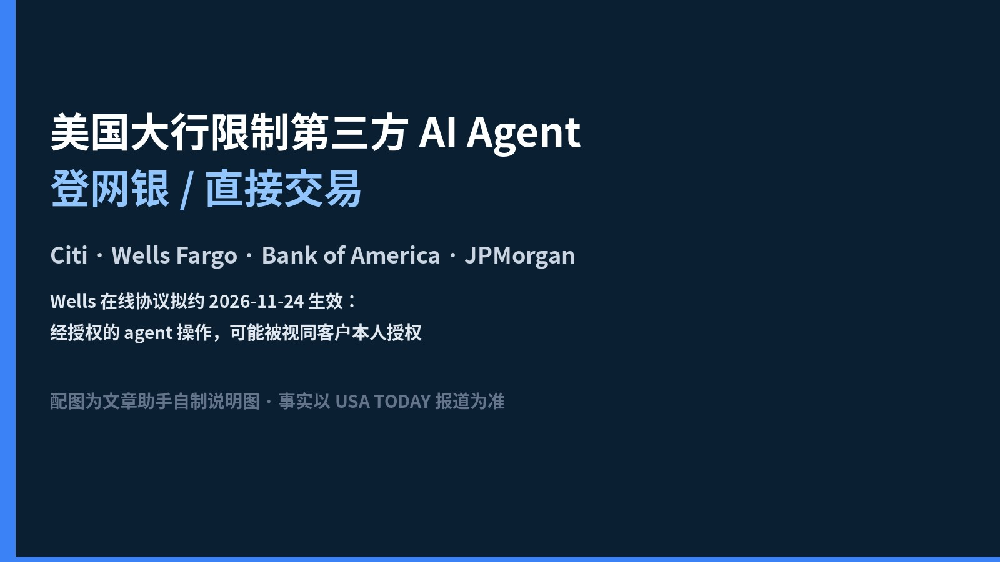

# 美国大行限制第三方 AI agent 登网银：Muse 能动你的银行卡吗？

*图：文章助手自制说明图（USA TODAY 原配图 CDN 不可用）。事实以 [USA TODAY 报道](https://www.usatoday.com/story/money/2026/10/23/banks-move-to-limit-ai-agent-access/92385119007/) 为准。*

2026 年 10 月 23 日，USA TODAY 报道：**花旗（Citi）、富国（Wells Fargo）、美国银行（Bank of America）、摩根大通（JPMorgan Chase）** 等已采取措施，限制第三方 AI agent 访问其平台与服务；其他机构也在跟进。此事 Axios 更早有报道。

**一句话说清：银行在堵「助手拿你的登录态进网银代操作」；你批准的 agent 若真进了去，责任边界也可能被写进协议。**  
对用 Muse 等个人助手的人，热度不在「AI 会不会炒股」，而在：**它能不能动我的卡，出事算谁的。**

---

## 1. 普通人立刻懂：助手 ≠ 自动出纳

你让 agent「帮我查余额 / 付账单 / 转一笔」，在银行眼里，常见风险是：

- 分不清点按钮的是**人**还是**agent**；  
- 即便认出是 agent，也难证明它**真在执行你的授权**，而不是越权、被劫持或「自作主张」。

Ping Identity CEO Andre Durand 对 USA TODAY 说，眼下的挑战正是：**如何检测是 agent 而不是人在请求；若是 agent，又如何确认它在人的授权下行动。** 他把现状形容为各方都暴露在 AI 被武器化速度下的 **「window of vulnerability」（脆弱窗口）**。

所以大行的第一步很直白：**先别让未受控的第三方 agent 直接登进你的网银去交易。**

---

## 2. 各行怎么说（以 USA TODAY 可核表述为准）

| 机构 | USA TODAY 写到的要点 |
| --- | --- |
| **Citi** | 发言人：不允许第三方 AI agent / 助手**登录客户账户**或在数字银行平台上**直接交易**；客户可通过**部分 Citi 批准的开放银行（open banking）提供商**授权 **有限、只读**的账户信息访问；称尚未看到 agent 进入客户账户的报告 |
| **Bank of America** | 限制 AI agent 访问**消费者存款**；CEO Brian Moynihan（10/15 对 Bloomberg）：把凭证给 agent 等于你在授权支付，行业需把**人留在环内**——付款前再确认；并称正与公司合作制定 agent 协议 |
| **JPMorgan Chase** | CEO 上周对 Bloomberg 确认：也在**阻断外部 agent 访问客户账户信息**（对 USA TODAY 置评请求未立即回复） |
| **Wells Fargo** | 发言人：已采取措施**阻止未授权 agent 访问客户账户**；并更新**在线访问协议**（见下） |
| **Charles Schwab** | 自建助手 Charley：**不能下单**，可问答与例行任务；CEO 称正在拦截「数十」量级的主要 AI agent 试图访问并操纵客户资金的尝试 |

另据报道，美国银行、Capital One 等与另外四家全球银行曾在 **9 月**组建联盟，警告 agent 技术快于行业标准与防护，并特别点出 **AI 购物 agent** 风险。Palo Alto Networks 2026 年调研：金融与软件领域 CISO 中约三分之二把 agentic AI 列入网络安全前三风险，逾三分之一列为头号担忧。

文中还提到 Meta 称 Muse 在 **10 月 21 日**达到 **1000 万**用户——agent 普及速度，正是银行紧张的背景之一。

### Wells 协议：约 11/24 生效，「授权 agent 操作」可能视同本人

USA TODAY 引述 Wells Fargo 更新后的在线访问协议要点（**拟于 11 月 24 日生效**）：

- 经授权代表或受托人（含 **agents**）发起的交易，**视为已获授权**——除非用户明确通知银行「未授权」，且银行有合理时间处理该通知；  
- 用户同意：**自行负责监督** agents；银行可按 agents 的指令行事；经授权代表（含 agents）采取的**全部交易**——**包括你并不想要或并非本意的那些**——均视为已授权；  
- 若你允许 AI Agent 或其他第三方访问服务，即承认这可能削弱你原本同意的商业上合理安全程序，并**接受由此带来的风险**。

**读人话：不是「银行欢迎 Muse 随便转账」，而是——一旦你放行，协议可能把 agent 干的活算在你头上。**

---

## 3. 和昨稿 1Password for Agents：两道闸，不是同一题

| | **1Password for Agents** | **银行侧限制** |
| --- | --- | --- |
| 在解决什么 | 登录时**密码不进模型**，人审批后由保险库往网站填密 | **认不认、允不允许**第三方 agent 进网银 / 直接交易 |
| 不解决什么 | 批准登录后账户里的误操作、越权下单 | 凭证保管本身；也不等于永久封死一切银行 AI 能力 |
| 对你的直觉 | 「代登录可以更安全一点」 | 「网银大门可能根本不让第三方 agent 进」 |

轻对比即可：**保险库管的是「密文别泄漏」；银行管的是「人机身份与授权」。** 两道闸叠在一起，才是普通人真正面对的局面——勿把两篇热点复读成同一句「AI 安全了 / AI 完了」。

---

## 4. 冷静段：堵的是「人机身份与授权」，不是永久宣判

1. **不等于所有 agent 银行功能永久封死。**  
   Citi 仍谈开放银行通道下的**有限只读**；多家也在谈「人在环内」的支付协议。方向更像：**先挡未受控登录与直接交易，再谈受控、可审计的连接。**

2. **各国、各行政策不一。**  
   本稿事实锚在美国大行与 USA TODAY 引述；不要外推成「全球银行统一禁令」，也不要脑补未点名银行的细则。

3. **协议条款 ≠ 产品已全面开放 agent 交易。**  
   Wells 把「授权 agent 的操作」写进责任归属，是风险与法律责任的重新划界；同时发言人仍强调阻止**未授权** agent。两句要一起读，别只截「视为本人授权」当广告或当恐吓。

**一句话：大行在关的是「任意第三方助手拿着你的登录态当出纳」；开放银行只读、自建助手、人在环内支付，才是他们更想走的路——Muse 能不能动你的卡，短期答案多半是：别指望它直接登进网银代你转。**

---

## 5. 读者行动

1. **别把网银账号密码交给任何 agent 对话。**（与银行公开口径一致的方向。）  
2. 若协议更新邮件/App 弹窗出现（尤其 Wells 类条款），**先读「授权 / 监督 / 非本意交易」几段再点同意。**  
3. 需要自动记账：优先看银行认可的 **open banking / 只读** 通道，而不是让助手「假装成你」登录。  
4. 继续用 Muse 等助手时：把「查资讯、订票、写邮件」和「动银行卡」分开想——后者正在被单独设闸。

---

## 来源

- USA TODAY（2026-10-23）：[‘Window of vulnerability’: Banks move to restrict AI agent access](https://www.usatoday.com/story/money/2026/10/23/banks-move-to-limit-ai-agent-access/92385119007/)

*银行表态、Wells 协议生效日与条款摘要、Moynihan / Durand 引语、Schwab 拦截量级与 Muse 用户数均按该文核对；未扩写文中未写明的各行内部政策细节。*
