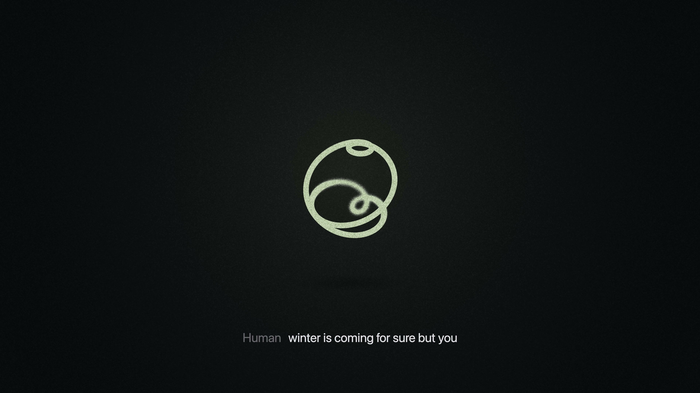

# Block Dessa：只用语音训练、能边听边笑——语音助手还别扭吗？

*图：Block [Dessa 官网](https://block.xyz/dessa) 官方营销图。事实以官网与 [The Verge 报道](https://www.theverge.com/ai-artificial-intelligence/1017906/jack-dorsey-block-dessa-ai-voice-speech) 为准。*

2026 年 10 月 23 日前后，Jack Dorsey 旗下 **Block** 公开了自家小实验室做的语音模型 **Dessa**：官网自称「the Conversation Model trained only on speech」——从零、只用人类对话音频训练；能**全双工**边听边说，示范里会出现中途笑、接话、小声「oh my god」。

**一句话说清：多数语音助手把你的话先压成文字，情绪和节奏一起丢了；Dessa 想跳过这条「语音→文字→再语音」的弯路。**  
对普通人，热度不在「又一个会说话的 AI」，而在：**聊天还会不会一顿一顿、笑得像按了笑点按钮。**

---

## 1. 普通人立刻懂：现在的语音助手为什么别扭

你跟 Siri / 多数「语音版 ChatGPT」说话，常见链路是：

1. **听**你说话 → 转成文字；  
2. **文字**进大模型想答案；  
3. 再把答案 **念**出来。

中间那道文字闸，把语气、停顿、讽刺、叹气、声音发颤全砍掉了。Block 官网原话很直：当前语音 AI「turns your voice into text and throws away an incredible amount of information text alone can’t carry」——最强的 AI 也「can’t hear how you feel」。

结果就是你熟悉的别扭感：

- 你还没说完，它已经抢答或傻等；  
- 你讲完笑话，它等你停稳再「哈哈」——像念台词，不像跟人聊；  
- 情绪对不上：你急了它还慢条斯理。

Dessa 想做的，是 **audio in, audio out** 的真·语音到语音，并且**边听边说**（full-duplex），学人什么时候插话、什么时候「yeah!」「got it!」「ooh」应一声。

---

## 2. 可核事实（官网 + The Verge）

| 点 | 可核表述 |
| --- | --- |
| **谁发的** | Block 旗下「(very) small AI research lab」；成员来自原 Toronto 深度学习创业公司 Dessa；**直接向 Jack Dorsey**（Block 联合创始人、Chairman、Block Head）汇报。The Verge 标题亦写「Jack Dorsey’s Block」。 |
| **怎么训的（自称）** | 「We trained Dessa from scratch on nothing but human conversation. Sounds! **No text, no pretrained models.**」真·speech-to-speech，「everything it knows came from human speech」。官网还写「As far as we know」——自称据其所知，是首个仅从人类语音训练、又能做逼真实时对话的 AI。 |
| **全双工行为** | 同时听与说；会中途笑（「laughs the moment something’s funny, mid-sentence」）；会接话、会 backchannel；示范里有音量变大、倒吸一口气的「oh my god」等。官网强调 demo 为真人与 Dessa 的 live 录音，无人实时操控话术。 |
| **本机跑** | 「runs locally on a **MacBook Pro M4 Max or better**」；推理「faster than real time」。 |
| **训练规模自述** | 相对 LLM，自称用「hundreds of times fewer words」学会语言；并称在 **一台 NVIDIA GB200 NVL72** 上完成训练。 |
| **为什么做** | 好奇心、更好理解人与 AI、安全（怕语音 AI「deaf to the emotion」——例如人很痛它还接着往下聊）。 |
| **谁能用** | **不是公开商用 App。** 官网「Calling all safety researchers」：给**一小群 AI 安全研究者** early access；联系 `ragavan+dessa@block.xyz`（Dessa lead：Ragavan Thurairatnam）。The Verge 同口径复述。 |

The Verge（Jay Peters，2026-10-23）还提醒：公开 demo 偶尔尴尬、不自然（例如一度把说话人听成「Ronaldo」）——听感更像「awkward new friend」，不是完美客服。

---

## 3. 冷静段：研究 / 早鸟预览，别写成「助手别扭已解决」

1. **定位是研究展示 + 安全研究者早鸟，不是全面商用。**  
   官网没有参数量、公开权重、通用 API 价目或「人人可下载装手机」的承诺；入口写的是小范围安全研究 early access。勿写成「已经能替换你手机里的语音助手」。

2. **「本机跑」有硬件门槛。**  
   原文是 **MacBook Pro M4 Max or better**，不是任意笔记本、也不是「所有苹果设备」。没有 M4 Max 级机器的读者，现阶段主要是听 demo，而不是自己本地开聊。

3. **「只用语音训练 / 世界第一」是 Block 的主张，带「as far as we know」自留余地。**  
   外界尚无独立基准与开放评测可复核；训练数据规模、口音与嘈杂场景表现，官网未给出可核数字。The Verge 也主要靠官网表述与精选录音。

4. **全双工会笑、会接话 ≠ 通吃所有语音场景。**  
   Demo 证明方向有趣（情绪与节奏少走文字弯路），不证明嘈杂环境、多语、长任务、工具调用、支付类指令都已搞定。别吹成「所有助手别扭已根治」。

**一句话：Dessa 在攻「语音被压成文字后丢了人味」这件事，方向清楚、demo 吸睛；但对普通人，它眼下是研究预览与安全早鸟，不是已经装进口袋的完美聊天搭子——听录音可以兴奋，别急着清掉旧助手。**

---

## 4. 读者行动

1. 想听真实感：去 [block.xyz/dessa](https://block.xyz/dessa) 听官网 live 录音（带字幕，事后加的）。  
2. AI 安全研究者若符合官网「small group」邀请：按页内说明联系 `ragavan+dessa@block.xyz`。  
3. 普通用户：继续把「好听的 demo」和「能日常依赖的产品」分开看；本机尝试前先确认自己是否有 **M4 Max 或更好** 的硬件路径（以官方日后放出的实际安装说明为准）。  
4. 对比旧助手时，盯三件事即可：是否还要「说完再等」；笑和接话是不是卡在句末；急/难过时它听不听得出来——这比参数榜更贴肉。

---

## 来源

- Block 官网：[Dessa - the Conversation Model trained only on speech](https://block.xyz/dessa)  
- The Verge（2026-10-23，Jay Peters）：[Jack Dorsey’s Block made an AI model that talks to you like an awkward new friend](https://www.theverge.com/ai-artificial-intelligence/1017906/jack-dorsey-block-dessa-ai-voice-speech)

*训练方式、全双工、本机硬件门槛、安全研究者 early access、团队向 Jack Dorsey 汇报等均按官网核对；The Verge 日期、awkward demo 观感与 early access 口径作交叉印证。未扩写官网未写明的参数量、公开上线日期、定价或通用下载渠道。*
