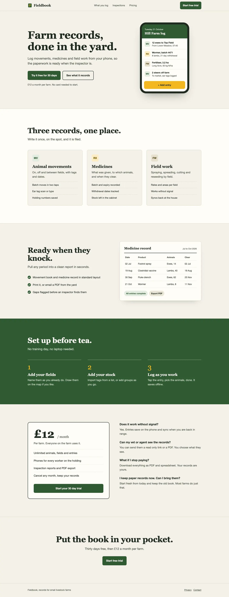
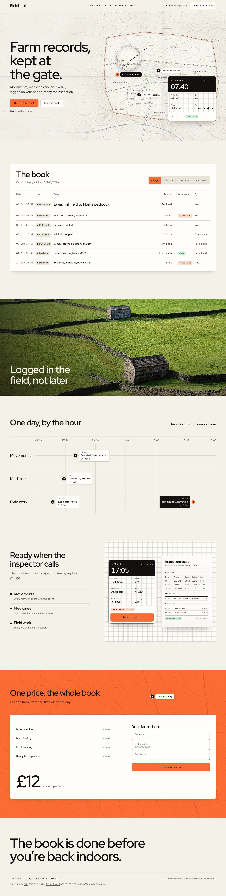
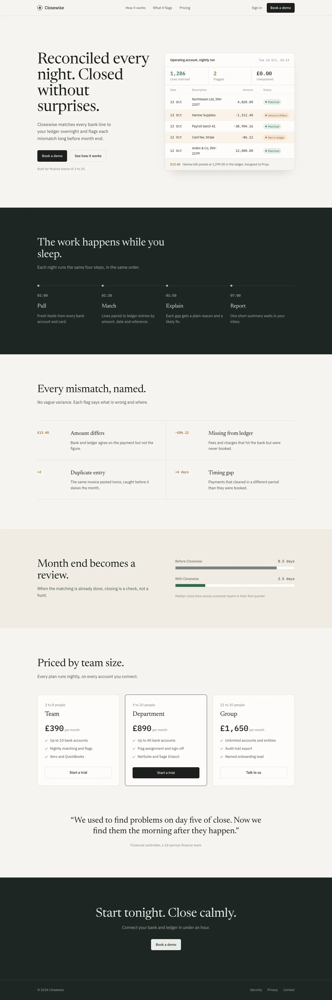
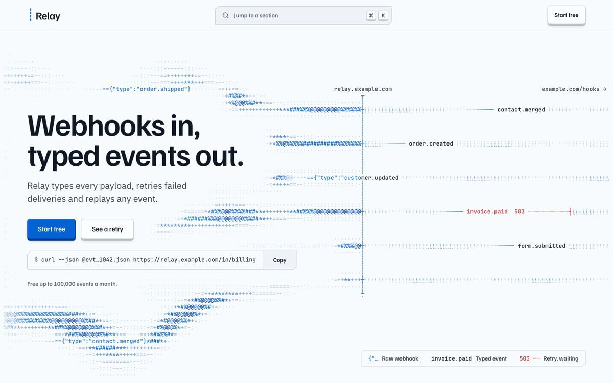

# Agent 写落地页一眼假？Hallmark：48 套主题 + 三道门禁，专治 AI 味


你要是用 Cursor / Claude Code / Codex 让 Agent 出过落地页、营销页，多半见过那套「一眼假」：标题上飘一行 eyebrow、某个词单独上色、满屏空框或全是图、页脚永远挂邮箱订阅、表单点完只说谢谢却不提交。

[Hallmark](https://github.com/Nutlope/hallmark) 就是冲着这件事来的。Together AI 出的 **反 AI 味前端设计 skill**，装进 Claude Code、Cursor、Codex、OpenCode——口号写在官网上：[The design skill that ends AI slop](https://www.usehallmark.com)。

MIT；GitHub 约 **3.3 万**星；暂无正式 release tag，跟 `main` / README 走。

---

## 对我们有什么影响

主旨就一句：**别再只催模型「再好看一点」——把风格和门禁装进 Agent 工作流。**

- **自己用 Cursor / Claude Code 出页**：一条 `npx skills add nutlope/hallmark -g`，之后用 `/hallmark` 建页、`/hallmark redesign <路径>` 保内容换风格、`/hallmark audit <路径>` 只出报告。  
- **交付落地页 / 营销站**：Hallmark 先问你要真照片、真数字、真截图，不瞎编；再从 **48** 套材质主题里抽三套（也可说 custom）；页面在真浏览器里跑 **sloplint**，多宽度扫 + 子代理终审。  
- **和 Impeccable 同赛道**：Hallmark 更轻——换风格、少出烂页；Impeccable 更重——Rust、60+ 确定性检测、偏 CI 门禁。可以一起用，别当成二选一宗教战。

官网同一提示词对照：左边裸模型，右边 Hallmark 主题页。Fieldbook 农场记录页，linter 计数从 **26 issues → 0**——数字来自 Hallmark 自己的检查器，不是人工观感分。





Closewise 银行对账页同一套对照：




---

## 它怎么卡「AI 味」

不是又一个「漂亮 CSS 包」。README 把门禁写成三层：

| 层 | 干什么 | 挡不挡发版 |
| --- | --- | --- |
| **Floor** | 硬底线：对比度、焦点、减弱动效、瞎编事实、手机布局炸裂等 | 硬拦，不过不发 |
| **Reflex** | 模型坏习惯：eyebrow、字距大写标签、标题里单独上色的词、空框堆砌、英雄区对不齐屏、每页结尾邮箱订阅、假感谢表单等 | 默认可拦；有理由可记在案后覆盖 |
| **Finish** | 工艺细节 | 不挡发版 |

主题侧：每套是纸张 / 字体 / 色板 / 组件与质感，单文件 **≤ 8KB**；布局每次重抽，同一主题两句提示词不会长成同一页。Hedgerow → Five Mile Gin，Cobalt → Relay，是官网上能点开的成稿方向：




Kiln 陶艺课一类成稿，看的是「材质定调 + 版式重做」，不是套皮肤：


自带 **sloplint**：真浏览器多宽度扫，再丢给子代理终审。浏览器检查需要 `puppeteer-core` + Chrome；没有也能跑静态检查。

安装（Node ≥ 18）：

```bash
npx skills add nutlope/hallmark -g
```

装完在 Claude Code 里是 `/hallmark …`；Codex 是 `$hallmark …`；Cursor / OpenCode 会找已装副本。只装某一个 harness 可加 `--agent claude-code`（或 `codex` / `cursor` / `opencode`）。

---

## 冷静一下

**3.3 万星 ≠ 生产 SLA。**  
无正式 tag，跟 main；主题和门禁会变。接进交付流水线前，自己用 `audit` 扫一遍现有页。

**Linter 的 26→0 是官网演示口径。**  
换成你的业务站、你的组件库，数字不会自动复刻。Hallmark 读写你的 tokens / `design.md`，但「像不像你们品牌」还得人眼过。

**它不替你想清楚产品。**  
建页前会追问照片、买家、主按钮——素材糊，版式再干净也是空壳。

**别神化「反 AI 味」。**  
门禁拦的是可枚举的机器痕迹；品味、转化、文案对不对，仍在你这边。

---

## 对我们有什么启发

1. Agent 出前端，光靠「再精致一点」不够——**主题目录 + 可执行门禁**比口头审美稳定。  
2. 已有站点：先 `/hallmark audit`，再决定 `redesign` 还是只 polish；别一上来整站重写。  
3. 选型：要轻量换皮、少出一眼假 → Hallmark；要重检测、进 CI → 看 Impeccable；两条可以叠。  
4. 入口：[GitHub · Nutlope/hallmark](https://github.com/Nutlope/hallmark) · [usehallmark.com](https://www.usehallmark.com)
