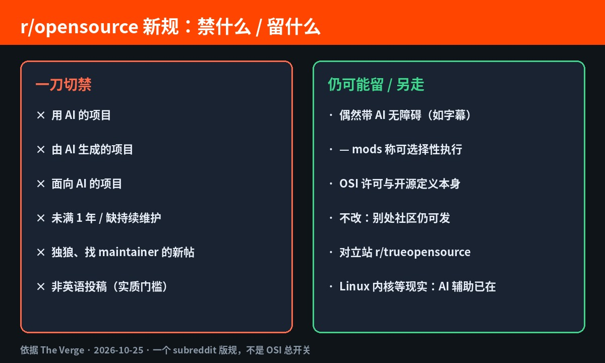
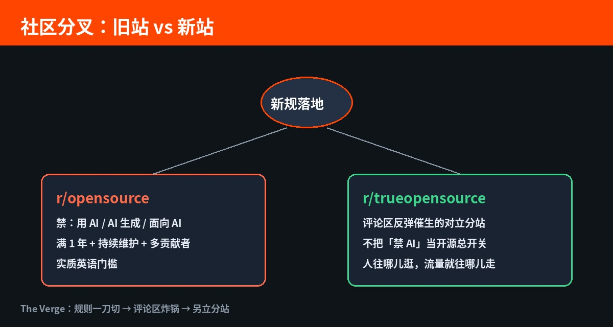

# Reddit 开源区一刀切：用 AI / 给 AI / AI 写的，全不欢迎

你在 Reddit 的 **r/opensource** 发过项目吗？或者刷过别人求 star、找贡献者？

**2026 年 10 月 25 日**，[The Verge](https://www.theverge.com/ai-artificial-intelligence/1018217/reddit-opensource-ai-ban) 报道：这个板块管理员甩出新投稿规则——**用 AI、由 AI 生成、面向 AI 的项目，一律不欢迎。**

原文开场写得很硬：

> If your project uses AI, is made by AI, or is intended for AI, it’s not welcome on r/opensource. AI, as it exists today, is incongruent to this Open Source community.

不是「开源基金会宣布反 AI」。是 **一个 subreddit 的版规**。但发开源项目、逛 Reddit、做 AI 工具的人，这条直接撞脸——你以前习惯往那儿丢链接的那扇门，窄了。

评论区炸锅。对立分站 **r/trueopensource** 跟着起来。

---

## 对我们有什么影响

主旨就一句：**社区入口开始按「跟 AI 沾不沾边」筛人；开源许可过了关，版规不一定过。**

- **自己发开源项目**：仓库挂着 OSI 许可不够。想在 r/opensource 露脸，还得过「非 AI、满一年、持续维护、多名贡献者」这几道门；想找 maintainer 的新人帖，mods 说他们已经接不动了。
- **做 AI 工具 / agent / 模型周边**：面向 AI 的项目点名不欢迎。流量别默认押在这个板块——人往哪儿逛，帖就往哪儿发。
- **非英语母语的开发者**：规则写明不会英语就去找别的社区，理由是分不清 AI 写的和 AI 翻的。发帖语言也成了门槛。

别读成「开源全面反 AI」。社区里有人拿 Linux 内核已有部分 AI 生成代码来怼：严格读规则，连用内核的项目都可能踩线。那是工具链现实，不是这一个版的总开关。

---

## 能核的硬货：禁什么、留什么

按 The Verge 转述的版规与 mod 表态，对照可以压成一张表：

| 项 | r/opensource 新规 | 说明 |
| --- | --- | --- |
| 用 AI 的项目 | 禁止 | 规则开场三点之一 |
| 由 AI 生成的项目 | 禁止 | 同上 |
| 面向 AI 的项目 | 禁止 | 同上 |
| 偶然带 AI 无障碍功能 | 可能放过 | Moderator Wolvereness：有 nuance，可选择性执行；举例含自动字幕 |
| 项目年龄与维护 | 须至少满 1 年、持续维护、多名贡献者 | 挡掉找帮手的新人与独狼新项目 |
| 求 maintainer / 贡献者 | mods 称不再接 | 原文：we can no longer field requests asking for maintainers or people to contribute |
| 非英语投稿 | 实质禁止 | If you don’t speak English, you need to find a different community. |

新旧站对照：

| | r/opensource | r/trueopensource |
| --- | --- | --- |
| 怎么来的 | 老站，新规落地 | 评论区反弹催生的对立分站 |
| AI 相关项目 | 一刀切不欢迎，执行自称有选择性 | 对立叙事下的另一条流量线 |
| 你该盯什么 | 版规门槛抬高 | 人往哪儿迁 |

---

## 冷静一下：一个版规，不是开源总开关

**禁的是一个 Reddit 板块的投稿，不是 OSI、不是 GitHub、不是许可证本身。**  
项目还能开源，还能发别处。变窄的是「默认往 r/opensource 一扔就有曝光」这条习惯路径。

**规则写得硬，执行自称有 nuance。**  
Wolvereness 举例：偶然带 AI 无障碍功能的软件可能放过。别把标题读成「每一行 AI 补全都会被踢」。

**评论区戳的是现实张力。**  
开源文化叙事 vs 开发者已经把 AI 当日常工具——张力真实。别吹成「开源阵营全面反 AI」。

落地记住一句：曝光渠道开始按版规筛 AI 沾边，**许可证过关 ≠ 社区入口过关**。

---

## 对我们有什么启发

1. **发帖前先读目标版规**：r/opensource 现在不只看许可证——AI 沾边、年龄、维护人数、语言都卡。硬事实核对 [The Verge](https://www.theverge.com/ai-artificial-intelligence/1018217/reddit-opensource-ai-ban)。  
2. **曝光别单押一个板块**：AI 相关、未满一年、独狼求贡献者——去 r/trueopensource 或其他语言 / 主题社区测水，别假设老站还能接。  
3. **README 和发帖文案把「核心是不是 AI」写清楚**：若只是偶然带无障碍字幕一类功能，按 mod 说法仍可能有选择性空间——事实写清楚，比空吵「开源该不该反 AI」更管用。
