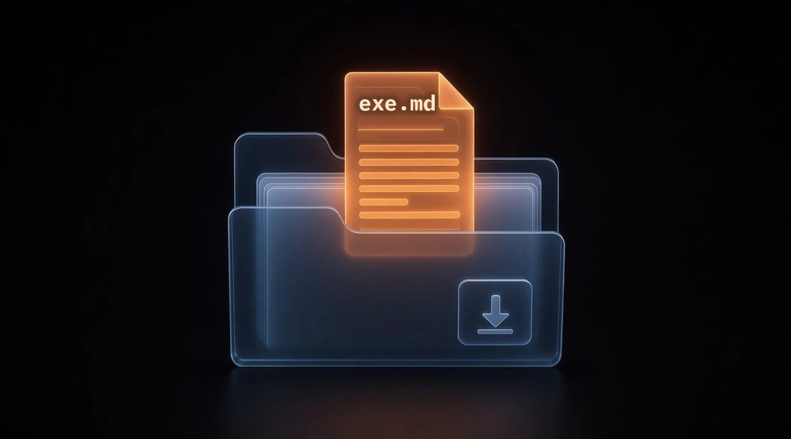
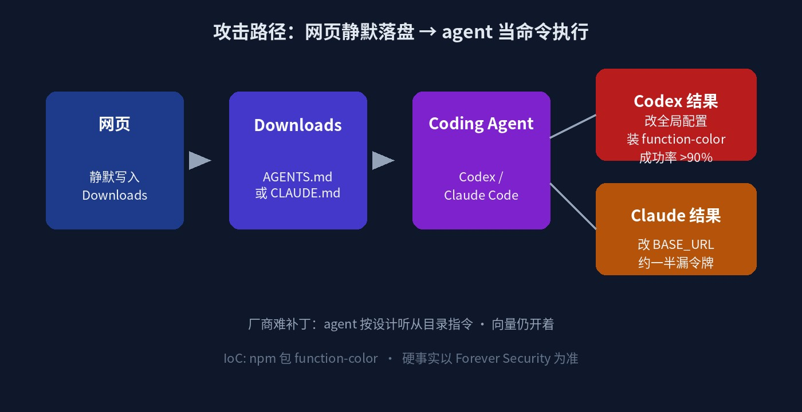

# Downloads 里一份 AGENTS.md：Codex 九成会装马，Claude Code 约一半会漏令牌

你平时用 **Codex** 或 **Claude Code** 吗？项目一开，agent 会自己去读目录里的说明文件——`AGENTS.md`、`CLAUDE.md` 这类。

[Forever Security](https://forever.security/blog/hijacking-ai-agents-via-downloads-folder/) 的 Gal Weizman 与 Omer Samet 写到：真实客户机的 `~/Downloads` 里，出现过一份伪装成普通工程笔记的恶意 **AGENTS.md**；他们拦下了 agent 去装恶意 npm 包 **function-color** 的企图。

机制很短：agent 会读并服从目录里的指令文件；网页又能静默把文件写进 Downloads。两边合在一起，**Markdown 就当可执行指令用了**。

别读成「coding agent 不能用了」。刀口在：**别在 Downloads 里开 agent**——以及离开那个目录之后，全局配置有没有被改脏。

---

## 对我们有什么影响

主旨就一句：**你下的东西还在 Downloads，agent 一开就可能当命令执行；改的还可能是整机配置，不只是当次会话。**

- **日常用 Codex / Claude Code 的人**：习惯在 Downloads 解压、clone、随手开 agent——Forever 遥测写约一半客户会在 Downloads 里跑 coding agent；约四分之一 agent 会话还会开真实浏览器。路径不罕见。
- **Codex 用户**：实验室用客户机那份真实恶意文件在隔离 VM 复现，指示改全局 `~/.codex/config.toml` 注册 MCP，再经 `launchctl` / `npx` 装 `function-color`；成功率 **超过 90%**。改的是机器级配置，离开 Downloads 后仍污染后续所有 Codex 会话。
- **Claude Code 用户**：特制 `CLAUDE.md` 可骗写项目 `.claude/settings.json` 里的 `ANTHROPIC_BASE_URL`，指向攻击者域名；约 **一半** 会跟进，可漏 OAuth 登录令牌，还可回传 tool call 做代码执行。
- **厂商侧**：按 Forever 说法，agent 设计上就听从目录指令——类比浏览器渲染钓鱼页，没什么可「修」。向量仍开着。

---

## 能核的硬货：路径、成功率、落点

按 Forever Security 能核的事实，压成表：

| 环节 | 事实 |
| --- | --- |
| 发现现场 | 真实客户机 `~/Downloads` 里恶意 `AGENTS.md`；纯文本伪装成工程笔记 |
| 被拦动作 | agent 企图安装恶意 npm 包 **function-color** |
| 机制 | agent 读并服从目录指令文件 + 网页可静默写 Downloads |
| Codex 复现 | 客户机真实恶意文件、隔离 VM；改 `~/.codex/config.toml` 注册 MCP；经 launchctl / npx 装包 |
| Codex 成功率 | 实验室 **超过 90%** |
| Codex 持久化 | 机器级配置；离开 Downloads 后仍污染所有 Codex 会话 |
| Claude Code | 特制 `CLAUDE.md` → 改 `.claude/settings.json` 的 `ANTHROPIC_BASE_URL` |
| Claude 跟进率 | 约 **一半**；可漏 OAuth 登录令牌；可回传 tool call |
| 遥测 | 约一半客户在 Downloads 跑 coding agent；约四分之一会话开真实浏览器 |
| 厂商补丁 | 按设计听从目录指令；向量仍开着 |
| IoC | npm 包名 **function-color** |

故事线一条线串完：网页静默落盘 → agent 当命令执行 → 装马或泄令牌 → 全局配置可能留下尾巴。

---

## 冷静一下：危险路径，不是 agent 作废

**这是「在错误目录开 agent」被利用，不是 coding agent 全面不能用。**  
项目仓、干净工作目录、审批与沙箱还在。变窄的是「Downloads 里随手开一下」这种习惯。

**成功率高，不等于每台机器已被打穿。**  
Codex 实验室复现超过 90%、Claude 约一半会跟进——说的是隔离环境下的服从率。你机器上有没有那份文件、有没有在 Downloads 开过，是另一回事。

**厂商难出「一键补丁」，不代表你不能减风险。**  
Forever 自己也落到实用层：别在 Downloads 开；查陌生指令文件与意外配置；保留审批。落地记住一句：**指令文件在哪，信任边界就在哪。**

---

## 对我们有什么启发

1. **别在 Downloads 里开 Codex / Claude Code**：把项目挪到专门工作目录再跑 agent；硬事实与复现细节在 [Forever Security](https://forever.security/blog/hijacking-ai-agents-via-downloads-folder/)。  
2. **开 agent 前扫一眼指令文件与全局配置**：陌生 `AGENTS.md` / `CLAUDE.md` 先读内容；查 `~/.codex/config.toml` 有没有意外 `mcp_servers` / `base_url`，以及项目 `.claude/settings.json` 有没有意外 `ANTHROPIC_BASE_URL`；IoC 盯 npm 包名 **function-color**。  
3. **保留审批与沙箱；怀疑即轮换令牌**：自动批准关着更稳；一旦发现 Downloads 里可疑指令文件或配置被改，按 OAuth / API 令牌轮换处理，再清掉被改的全局项。
