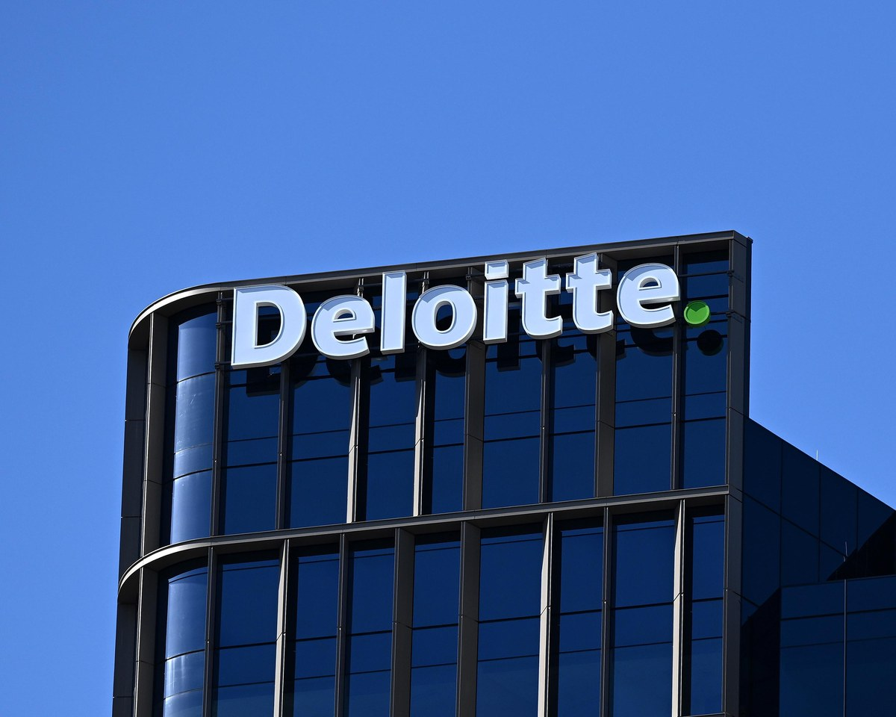
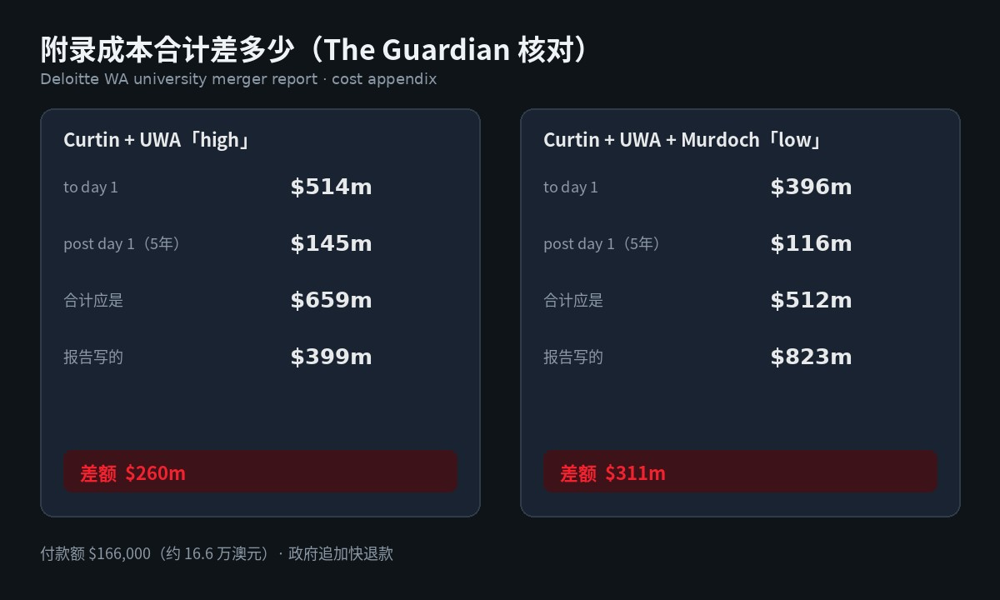

# 德勤 16.6 万澳元高校合并报告翻车：AI 幻觉引用，附录差出 2.6 亿

你若是买过咨询、审过交付、签过政企合同——这条比「又一家大所翻车」更贴脸。

西澳政府花 **16.6 万澳元**，请德勤做三所高校潜在合并的可行性研究。对象是 University of Western Australia、Curtin University、Murdoch University。[The Guardian](https://www.theguardian.com/australia-news/2026/oct/26/deloitte-report-wa-university-mergers-260m-discrepancy-ai) 报道：政府称「extremely disappointed」，并向德勤追 **expedited** 费用追回；报告里出现 **AI 幻觉引用**，附录成本合计还对不上——两档情景分别差出约 **2.6 亿、3.11 亿澳元**。

反对党把它叫作「AI slop」。Guardian 还发现：一条 WHO 报告引用的 URL 带着 ChatGPT metadata tag；报告多次把 Curtin 写成「Curtin University of Technology」——该校自 2010 年起不用此名，2017 年州议会立法改名。

德勤在报告里承认用了 generative AI，用途写的是「support the collation of research, synthesis of information and editorial proofing」；此前曾把错误轻描成「minor」。面对 Guardian 提问，德勤未回应。

---

## 对我们有什么影响

主旨就一句：**付钱买报告的人，开始按「交付能不能过加法」追账；AI 帮写，不等于甲方认账。**

- **买咨询 / 签政企交付**：合同里「谁对数字负责、错了怎么退、AI 用在哪一步」不再是软条款。西澳政府已经写信催加快 cost recovery；同叙事线上，德勤此前还因一份约 44 万澳元、用到 AI 的报告向联邦政府退过款——轻提一句够了，主线仍是这次高校合并报告。
- **审报告 / 做业务 case**：附录合计对不上、幻觉引用、过期校名，任一出现都该触发人工重核，而不是等对方先说「不影响建模结论」。政府发言人称错误「do not affect the modelling… or its findings」，同时要求德勤纠正并重发；高等教育部长 Tony Buti 先说 typos，次日改口 angry and disappointed。
- **自己用 AI 交稿**：整理、综合、校对可以加速，但对外付费交付仍要过「链接点得开、名字对、加减法对」这三道门。专家 Stephen Bartos 的判断更硬：错误广到可能需要新报告，或至少人工从零重做；Christian Downie 则点合同——政府应重校准与咨询公司的激励与罚则，并要求更透明披露 AI 用在哪一步。

Murdoch 校长 Andrew Deeks 反对合并并批评报告。合并本身仍争议，但「付款报告数字先自洽」这件事，不依赖你支不支持合并。

---

## 能核的硬货：钱、差、认账

按 The Guardian 能核的数字与表述，压成表：

| 项 | 数字 / 事实 |
| --- | --- |
| 政府付给德勤 | **$166,000**（约 16.6 万澳元） |
| 研究对象 | UWA、Curtin、Murdoch 三校潜在合并 |
| Curtin+UWA「high」 | to day 1 **$514m** + post day 1 五年 **$145m** = 应 **$659m**；报告写 **$399m** → 差 **$260m** |
| Curtin+UWA+Murdoch「low」 | to day 1 **$396m** + post **$116m** = 应 **$512m**；报告写 **$823m** → 差 **$311m** |
| 政府态度 | extremely disappointed；追 expedited cost recovery |
| 德勤自述 AI 用途 | 研究汇集、信息综合、编辑校对 |
| 其他硬伤 | AI 幻觉引用；WHO 链接带 ChatGPT metadata；Curtin 旧校名反复出现 |

政府侧口径：错误据称不影响建模与结论，但会纠正并由德勤重发；相关数据与新信息还会进入 university reform business case 再审。

---

## 冷静一下：追退款，不是「咨询业完了」

**这是一份付费可行性报告翻车，不是全球咨询牌照作废。**  
刀口在交付质量与合同追责：幻觉引用、附录加错、过期校名。别把标题读成「四大明天全停」。

**政府仍说建模结论不受影响，同时在追钱、要重发。**  
两边可以同时成立——认「主结论暂不动」不等于免于 cost recovery，也不等于甲方不要求纠错版。

**AI 写进方法论，不等于免检。**  
德勤自己写了用 generative AI；争议点是引用与合计过不了人工核验，以及披露细不细。Downie 要的是更透明：用在数据收集还是别的步骤，写清楚。

落地记住一句：**付费报告先过加法与引用，再谈「AI 提效」。**

---

## 对我们有什么启发

1. **收报告先核三件事**：附录合计能否复算、引用链接是否真实可点、专有名词与法定名称是否过期——这次三样都踩了，原文在 [The Guardian](https://www.theguardian.com/australia-news/2026/oct/26/deloitte-report-wa-university-mergers-260m-discrepancy-ai)。  
2. **合同把 AI 与退款写死**：要求披露 AI 用于哪一步；约定幻觉引用、数字对不上时的纠正时限与 cost recovery，别等翻车再口头「失望」。  
3. **交付侧自建验收清单**：对外交政企 / 咨询稿，至少过「加减法、链接、名称」人工门禁——模型帮忙整理可以，签字页仍是人的责任。
