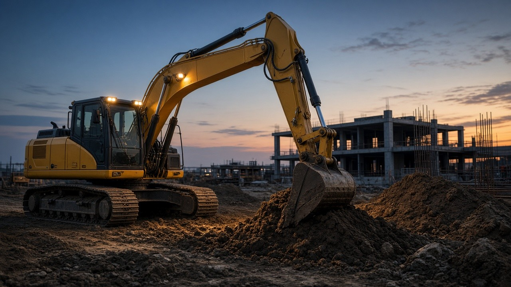
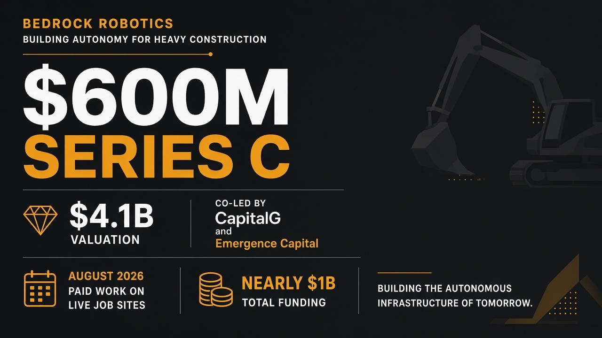

# 无人挖机真在工地干活了：Bedrock 约 6 亿美元 C 轮、估值约 41 亿

工地上那台挖机还在挖土，驾驶室里可以没有人——不是演示片，是付了钱的商业活。

[Bedrock Robotics 通稿](https://www.globenewswire.com/news-release/2026/10/26/3388197/0/en/bedrock-robotics-raises-600-million-series-c-to-scale-autonomous-construction-equipment-across-u-s-sites.html) 在 **2026 年 10 月 26 日** 写清：公司拿下 **6 亿美元 Series C**，投后估值 **41 亿美元**，CapitalG 与 Emergence Capital 联合领投。更硬的一句在八月中旬里程碑——**全自动挖掘机已在真实商业工地做付费工作**。

主旨就一句：**实体 AI 里少见的能报「真实工地、付费实单」的挖土故事；钱用来把更多改装过的挖机铺到美国承包商手里——不是建筑业已经全自动。**

---

## 对我们有什么影响

- **路过工地、关心基建的普通人**：以后更可能看到「无人驾驶室」的挖机在干土方；通稿说的是跟现有班组一起干活，不是把工人整批换掉。
- **承包商 / 土方 / 总包**：客户量自 2025 以来超翻倍；最新伙伴 Haydon 在德州偏远工地做全自动土方，并计划扩到先进制造、交通、水务、数据中心、医疗等项目。新客户还扩到明尼苏达 Wagner、佛罗里达 Smith Trucking、弗吉尼亚 B&S、科罗拉多 Native Excavating、密苏里 Clarkson、乔治亚 C.W. Matthews、阿肯色 ArchKey 等。
- **做实体 AI / 重工改装 / 工地软件的人**：叙事是 **retrofit 现有重型设备**——先从挖掘机起步，朝混合车队自编排扩展；不是先卖一整台全新无人挖机。本轮用途写得很直：扩大美国商业工地上 Bedrock 装备机器的数量，帮承包商更安全、可预期、更高产能地用好现有重型设备。
- **看融资与劳动力缺口的人**：通稿给的背景是到 2035 年雇主每年约需填 170 万个岗位；建筑业 87% 公司报小时工缺口，88% 说比一年前更难招。累计融资近 10 亿美元；股东名单里有 NVIDIA。

---

## 能核的硬货：金额 × 里程碑 × 改装叙事

按通稿能核的数字与表述，压成表：

| 项 | 原文能核 |
| --- | --- |
| 轮次与金额 | 6 亿美元 Series C |
| 估值 | 投后 41 亿美元 |
| 领投 | CapitalG 与 Emergence Capital 联合领投 |
| 新投资方 | US Innovative Technology Fund、Bessemer Venture Partners、Temasek |
| 老股东含 | 8VC、Georgian、Valor Equity Partners、Xora、Eclipse、Perry Creek Capital、NVIDIA 等 |
| 累计融资 | 近 10 亿美元 |
| 关键里程碑 | 2026 年 8 月中旬：全自动挖掘机在真实商业工地做付费工作 |
| 产品叙事 | 可 retrofit 到现有重型设备；先从挖掘机起步，朝混合车队自编排扩展 |
| 公司 | 2024 年创立于旧金山；前 Waymo 工程师团队；CEO Boris Sofman |

辅助报道可点开 [TechCrunch](https://techcrunch.com/2026/10/26/this-startups-self-driving-excavators-help-dig-up-600m-in-new-funding/) 看工地侧写；金额、估值、里程碑以通稿为准。

---

## 冷静一下：别写成「建筑业全自动化了」

**这是「付费实单上的全自动挖机」扩规模，不是工地无人化终局。**  
通稿强调的是跟现有班组、现有流程一起干活，并把能力交付给更多承包商当日常产能的一部分。

**改装现有挖机，不等于所有机型、所有工序都已无人。**  
About 写的是从挖掘机起步、再走向混合车队自编排；Haydon 一侧还在测更先进的沟槽作业与更大机型。

**劳动力缺口是背景，不是「人可以不来了」。**  
数字用来解释承包商为什么要自动化；CEO 表述仍是帮有经验的班组更安全地接更多项目。

落地记住一句：**先认「八月付费实单」这道门槛，再谈 6 亿怎么铺机器——别把融资稿读成全行业已自动。**

---

## 对我们有什么启发

1. **跟工地/基建打交道的人**：把「是否已在真实商业工地付费干活」当成实体 AI 的验货标准——演示片、封闭场地、付费实单是三档；Bedrock 通稿卡在第三档，才值得跟进部署节奏。  
2. **做改装与现场交付的人**：盯 retrofit + 现场运维，而不是只卖「更聪明的模型」——通稿把钱指向更多 Bedrock 装备机器、以及每台机器背后的现场与商业基础设施。  
3. **对外只讲能核的四张卡**：6 亿美元 C 轮、投后 41 亿、CapitalG + Emergence 领投、2026 年 8 月付费实单——别加成「建筑业已被机器人接管」。
