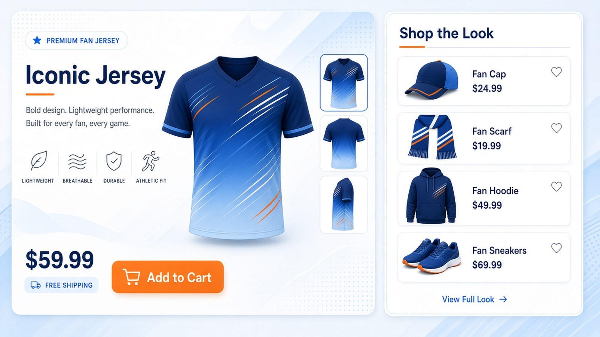
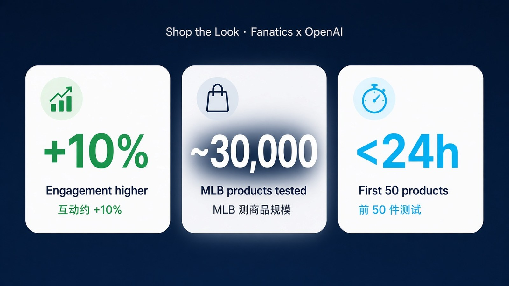

# 点球衣就配整套：Fanatics × OpenAI Shop the Look 上了 NFL/NBA/MLB/NHL 店，互动约 +10%

你若是球迷——打开球队店看一件球衣，旁边直接弹出帽子、卫衣、围巾，凑成一套比赛日穿搭。不用自己翻目录找「搭不搭」。

[OpenAI 官方案例](https://openai.com/index/fanatics-streamline-fan-experience) 在 **2026 年 10 月 26 日** 写清：Fanatics 新版 **Shop the Look** 用 OpenAI 模型推荐成套周边，已铺到 Fanatics.com 以及 **NFL / NBA / MLB / NHL** 官网店。球迷看球队球衣时，商品页会推成套、在库、匹配球队与风格的单品；造型每日随目录刷新。

主旨就一句：**点球衣就能配整套；Codex 几天搭出推荐工具，约 3 万件 MLB 测下来互动约高 10%——不是「电商完了」。**

---

## 对我们有什么影响

- **普通球迷**：去 Fanatics 或四大联盟官网店看球衣时，能直接试新版 Shop the Look——推荐的是在库、跟球队与风格匹配的单品，少翻几页目录。
- **做电商 / 推荐 / 商品运营的人**：可核的故事不是「模型很强」，而是交付节奏——用 Codex，OpenAI 与 Fanatics 工程团队几天内搭出定制推荐工具；前 50 件不到 24 小时测完，几天迭代后当周批准 MVP，再扩到数千 SKU。约 3 万件 MLB 商品上，互动比旧版约高 10%。
- **管工程交付与指标的人**：这条链路把「丰富商品数据 → 找兼容商品 → 评估推荐 → 为每件生成造型」压进可测节奏；Fanatics 还在 Corporate / Commerce / Collectibles / Betting and Gaming 用 ChatGPT Work 与 Codex——轻提即可，主线仍是 Shop the Look。

---

## 能核的硬货：交付节奏 × 测得数字

按 OpenAI 案例页能核的数字与流程，压成表：

| 项 | 原文能核 |
| --- | --- |
| 上线范围 | Fanatics.com 及 NFL / NBA / MLB / NHL 官网店 |
| 产品能力 | 看球衣时推荐成套、在库、匹配球队与风格的单品；造型每日随目录刷新 |
| 搭建工具 | Codex；几天内搭出定制推荐工具 |
| 测试速度 | 前 50 件商品测试不到 24 小时；几天迭代后当周批准 MVP；再扩到数千 SKU |
| 测得规模 | 约 3 万件 MLB 商品 |
| 互动对比 | 比旧版 Shop the Look 约高 10% |

模型侧用丰富商品数据 + 球队与库存信息；Fanatics 商品规则约束兼容与相关——推荐不是裸奔生成，有目录与规则兜底。

---

## 冷静一下：别写成「电商完了 / OpenAI 通吃」

**这是球迷店里的成套推荐升级，不是全品类电商终局。**  
案例写的是 Shop the Look 新版与互动对比，不是「所有购物决策交给 AI」。

**+10% 是约 3 万件 MLB 上的互动相对旧版，不是全站 GMV 暴涨。**  
Engagement higher、Testing scale、Testing speed 是案例页三张数字卡；别把互动直接读成成交额。

**几天出 MVP，靠的是 Codex + 双方工程 + 可测指标，不是一句「AI 自动上线」。**  
前 50 件、当周 MVP、再扩数千 SKU——节奏可复述，别吹成无人值守。

落地记住一句：**先去店里点开球衣看推荐，再决定要不要把「几天 + 可测互动」写进自己的交付叙事。**

---

## 对我们有什么启发

1. **球迷本周就能试**：打开 Fanatics.com 或 NFL / NBA / MLB / NHL 官网店，点进一件球队球衣，看 Shop the Look 推的成套是否在库、是否合风格——原文在 [OpenAI 案例](https://openai.com/index/fanatics-streamline-fan-experience)。  
2. **做产品的人盯「几天交付 + 可测指标」**：把推荐拆成可测步骤——数据 enrichment、兼容检索、评估、按 SKU 出造型；用前 50 件 / 不到 24 小时这类门禁卡节奏，而不是等完美再上。  
3. **对外只讲能核的三张卡**：互动约 +10%、约 3 万 MLB SKU、前 50 件不到 24 小时——别加成「全站转化翻倍」或「电商被 OpenAI 吃掉」。
