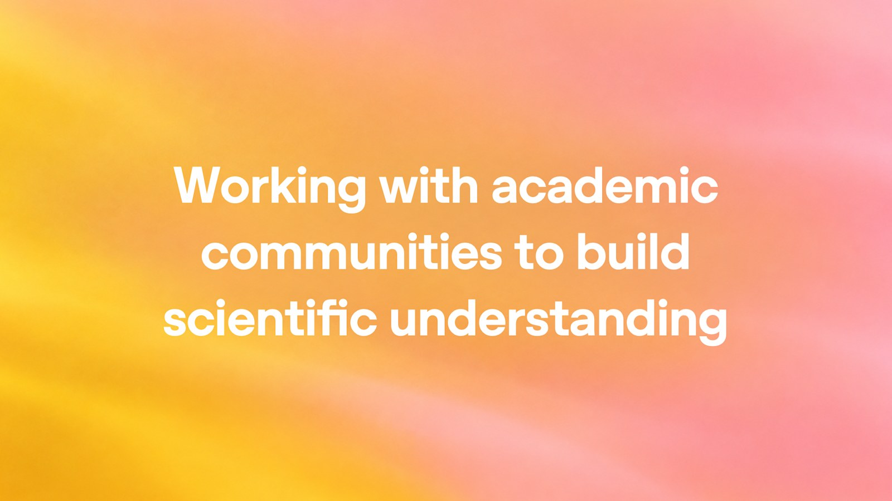
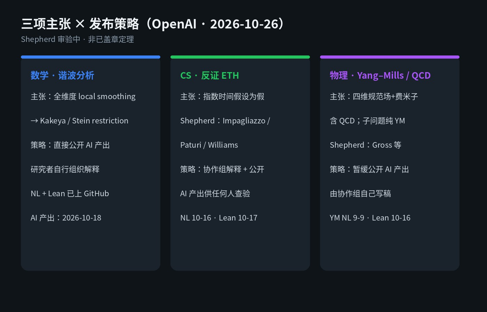

# OpenAI 甩出三项硬猜想主张：Kakeya / 反证 ETH / Yang–Mills，专家 shepherd 正在验货

你若是跟学术、产品叙事、技术公关打交道——别先欢呼「AI 攻克千禧年难题」。

[OpenAI 官方博客](https://openai.com/index/building-scientific-understanding-with-academic-communities/) 在 **2026 年 10 月 26 日** 宣布三项主张：谐波分析里全维度 local smoothing、计算机科学里反证指数时间假设 ETH、物理里四维含规范场与费米子的相互作用量子场论存在性。后一项含 QCD，并把纯 Yang–Mills 存在性当作子问题——那是 Clay 千禧年问题之一。

关键句在发布方式，不在口号：OpenAI 把这些手稿当 **raw research data**，请外部专家当 **shepherd**，组织群体去理解结果。数学与 ETH 的自然语言稿加 Lean 形式化已上公开 GitHub；物理材料 **暂缓公开**，由协作组自己写稿。

主旨就一句：**AI 自称攻克硬猜想，专家正在验货——还不是盖章定理。**

---

## 对我们有什么影响

- **跟学术 / 科研叙事的人**：以后刷到「AI 证明了某某猜想」，默认问两句——有没有外部 shepherd、产出有没有公开、物理这类是否仍压着材料。OpenAI 自己写了四条原则：不签 NDA、不求学术署名、协作组应得理解与写稿的认可、自愿无偿且结论独立。
- **做产品 / 技术公关的人**：可以讲「AI 产出硬结果 + 学界验货」的流程，别写成「已经证完」。三项主张对应三套发布策略，本身就是可复述的产品叙事。
- **写代码、读论文、跟复杂度 / 物理沾边的人**：数学与 ETH 可直接去 GitHub 看自然语言稿和 Lean；ETH 被反证若成立，会重开「这些任务能快多少」——博客明确写了，被数百篇论文当作条件硬度的假设，现在要重新打开。

Simons Foundation 另有一笔由基金会管理发放的 **500 万美元**，用于工作坊等帮助学界理解 AI 结果——轻提即可，主线仍是三项主张与 shepherd。

---

## 能核的硬货：三项主张 × 发布策略

按 OpenAI 博客能核的名称与时间线，压成表：

| 领域 | 主张 | 发布策略 | 公开状态 / 时间线 |
| --- | --- | --- | --- |
| 数学 · 谐波分析 | 全维度 local smoothing → Kakeya、Stein restriction | 直接公开 AI 产出，研究者自行组织解释 | NL 2026-10-18；次日 Lean；已上 GitHub |
| CS · 复杂度 | 反证 Exponential Time Hypothesis | 外部协作组解释，同时公开 AI 产出供任何人查验 | NL 10-16；Lean 10-17；已上 GitHub |
| 物理 · QFT | 四维规范场+费米子相互作用存在性，含 QCD；子问题纯 Yang–Mills | 外部协作组决定，**暂缓公开** AI 产出，由协作组写稿 | YM NL 9-9；QCD 9-18；YM Lean 10-16 |

**CS shepherd**：Russell Impagliazzo、Ramamohan Paturi、Ryan Williams。要求原始数据公开；OpenAI 承诺资助一场会议讨论影响。

**物理 shepherd**：David Gross 牵头，含 Michael Douglas、Arthur Jaffe、Igor Klebanov、Nikita Nekrasov；沟通邮箱 YANGMILLS4D@gmail.com。

数学背景按原文：Sogge 1991 提出 local smoothing；2019 Guth/Wang/Zhang 证了 2D；2025 Wang/Zahl 证了 3D Kakeya。新证明基于 novel auxiliary PDE，主张覆盖所有维度。

---

## 冷静一下：验货中，不是「AI 已盖章千禧年」

**这是待社区验明的硬猜想主张，不是刷分榜。**  
博客把稿子叫 raw research data；shepherd 组织理解，不等于定理已入库。

**三套策略本身说明不确定性。**  
数学直接放、CS 边放边解释、物理压着材料——OpenAI 写明「还不知道哪套最有用」，欢迎反馈。别把「已上 GitHub」读成「社区已接受」。

**Yang–Mills 更要压住标题欲。**  
纯 Yang–Mills 存在性是 Clay 千禧年问题的一部分；物理侧 AI 产出暂缓公开，协作组自己写稿。在 shepherd 与公开材料到位前，别写成「千禧年问题已解」。

落地记住一句：**先看 shepherd 与公开材料，再决定要不要把「AI 攻克」写进对外叙事。**

---

## 对我们有什么启发

1. **转发前先核发布策略**：数学 / ETH 去公开 GitHub 看 NL + Lean；物理先认「暂缓」——原文在 [OpenAI 博客](https://openai.com/index/building-scientific-understanding-with-academic-communities/)。  
2. **对外叙事拆成两句**：一句写「AI 产出了主张」，一句写「外部 shepherd 正在组织理解」——别合成一句「已经证明」。  
3. **跟复杂度 / 算法的人盯 ETH 验货结果**：若反证站得住，原先依赖 ETH 的条件硬度叙事要重估「能快多少」；博客也写了，找到更快算法并落到实践，还要大量后续研究。
