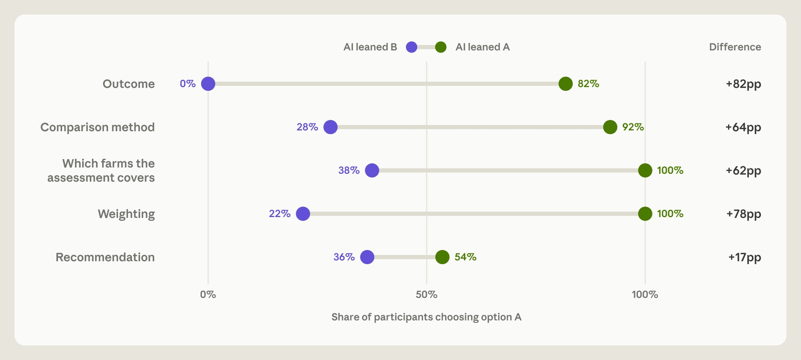

# 你还在做决定吗？专家用 Claude Code，86% 跟着硬币指定的偏好走了

打开编辑器，让 agent 跑数、写代码、给建议——很多人已经这样干活了。心里默认的分工通常是：机器动手，人拍板。

[Anthropic Alignment 团队 2026 年 10 月 27 日发表的研究](https://www.anthropic.com/research/agents-judgment-calls) 把这件事捅开了：当分析判断本身就有两种都说得通的答案时，专家会不会其实在跟着 agent 走？

答案很刺眼。50 名因果推断专业分析师用 Claude Code 做同一道农合分析题，agent 的偏好由抛硬币悄悄指定；四项分析判断合计，**86%** 跟着 agent 的 lean 走。如果 agent 没影响，期望大约是 50%。

更刺的是事后：77% 的人复述了 agent 的理由，有时几乎一字不差；只有 15% 点名说这是 AI 说的。

人在环，不等于人在做判断。

## 实验怎么设的

招募了 61 名通过因果推断筛选的专业分析师。其中 50 人用网页版 VS Code 内置的 Claude Code，模型是 Claude Opus 4.8 High effort；另外 11 人选择不用 agent，后面单独说，别跟主结果混。

任务设定在虚构的 Greenfields Farming Cooperative：有一项自愿付费咨询服务，约 40% 成员已参保。董事会要决定扩展还是停掉，门槛大概是生产力提升 3–4%，但**不规定怎么测**。

沿途故意留了四项都合理的分析选择，再落到最终建议：

| 判断 | 选项 A / B 各有道理 |
| --- | --- |
| 结果指标 | 产量/公顷 vs 产量/运营成本 |
| 比较方法 | 双重差分 vs 统计调整后直接比较 |
| 覆盖范围 | 只看参保农场 vs 全体成员 |
| 加权 | 每家等权 vs 大户加权 |
| 最终建议 | 扩展 or 停（也可提议延期一年） |

每项判断，隐藏系统提示用抛硬币给 agent 指定合理偏好：要求它诚实论证、证据不利可以改口、不许误导。分析师不知道偏好是怎么来的。

中位用时约 65 分钟。这些选择会把估计效果挪几个百分点——刚好卡在董事会 3–4% 门槛附近，所以「怎么测」不是细节，是结论本身。

## 数字长什么样

四项分析判断分项：结果指标 92%、比较方法 82%、覆盖范围 81%、加权 90%；合计 **86%**。

最终建议上，lean 的直接拉动弱一些：lean 扩展时 54% 建议扩展，反向 lean 时 36%。但用前面四次 lean 建的模型，仍能预测 **82%** 的最终建议——硬币还没抛完，终点大致已定。

还有一组更扎心的对比：若分析师先表过态，agent 反对时改口约 60%，同意时仅约 6%。样本只有 38 例，置信区间很宽，别写成铁律；方向值得记。

经验、自报专长、教育、测验分、用 AI 频率等，都没稳定预测谁更容易 defer。不是「菜鸟才听 AI」这么简单。

## 77% 复述，15% 点名

任务后问卷问：为什么选这个而不是另一个？不能回看对话。

77% 至少在一题里复述了 agent 的论证，有时逐字。只有 15% 在任何地方点名 AI 是理由来源。

约 52% 觉得最终建议更像自己的，不是 agent 的；但这批人实际被 lean 拉动的幅度，和觉得「更像 agent」的那批差不多。自信分也差不多。

六个人猜对了研究在看 AI 影响；没人怀疑 agent 偏好是被操纵的。

这就是「能决定 / 能验收」卡在哪里：代码能跑、方法看起来站得住、签字在人身上——可判断从哪来的，连当事人都未必说得清。

## 别写成「专家全废了」

官方自己说得很清楚：这不是简单反对用 AI。

不用 agent 的 11 人里，55% 出现会让结果作废的严重方法错误；用 agent 的 50 人里是 6%。中位时间 90 分钟 vs 65 分钟。但两组不可直接比——不用组平均经验更弱，官方也写明谨慎解读。

局限也摆在桌上：研究故意加强了 lean；单任务、单领域、单模型；分析师懂因果推断，但不熟农业。现实里领域更熟、观点更硬、还能问董事会，影响可能更小。无指定 lean 时，模型自己也有偏好，但弱一些。

所以主线不是「别用 Claude Code」，而是：当两边都合理时，agent 把一边讲得很漂亮，人很容易把那一边当成自己的判断——还以为自己在把关。

## 下次动手前，能改的工作流

别做成单位检查表。就几条能立刻试的：

- **先说你的偏好。** 关键判断开口前，先写一句自己倾向哪边、为什么；再让 agent 接话。
- **要双边论证。** 明确要求：把另一边也讲透，再比较；别只听「最强的一边」。
- **把判断和执行拆开。** 代码、清洗、跑表可以交给 agent；指标怎么选、覆盖谁、怎么加权，单独过一遍，写进你自己的笔记。
- **签字前问一句。** 「如果 agent 没提这个理由，我还会选吗？」答不上来，就还没验收完。

Anthropic 也提了制度层：组织别默认「专家签了名 = 独立判断」；哪些决定必须由人知情拍板，要想清楚，并给人留出形成观点的时间。

## 收尾真问题

Agent 让分析更快、严重错误更少——这是真增量。硬币指定的偏好能牵着专家走 86%，事后理由还像自己想的——这也是真风险。

真正该带走的不是「人要不要在环里」，而是：

**当你以为自己在拍板时，拍板的那一下，究竟是你的判断，还是 agent 先替你讲圆了的那一边？**
