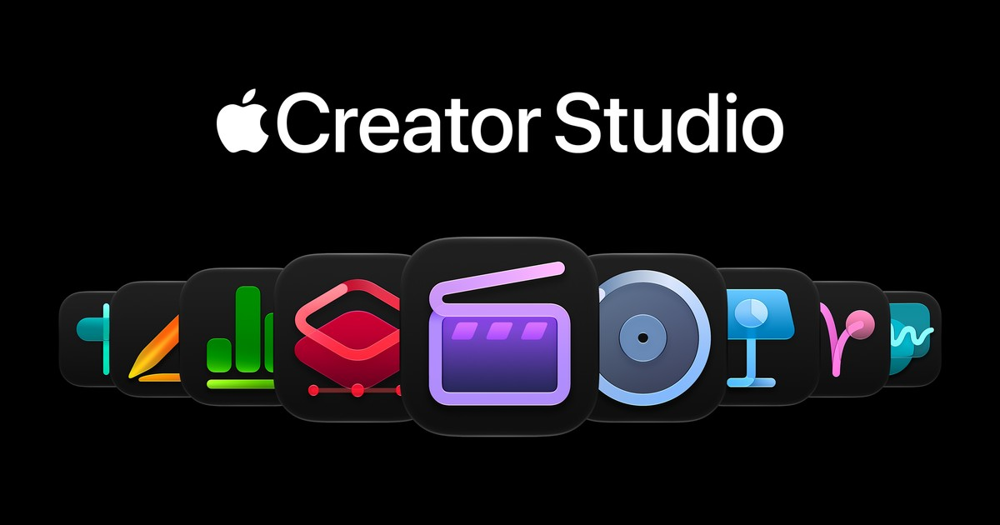
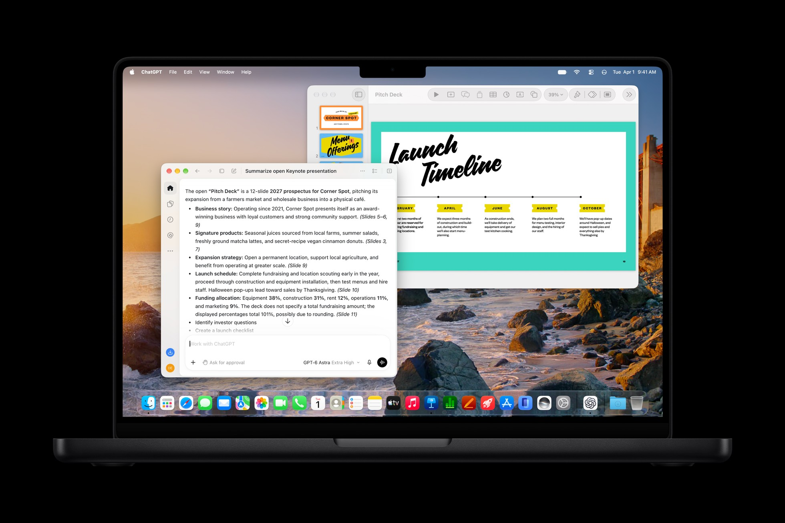

# 你天天用的 Pages 幻灯片表格，Apple 让外部 AI 也能动手改了

写周报、改 PPT、整一张表——这些事很多人一周能碰好几次。Apple 这次更新，真正值得盯的不是又多了一个聊天框，而是：助手能读懂当前文档，外部 agent 还能通过 MCP 直接动手改。

2026 年 10 月 27 日，[Apple 新闻稿](https://www.apple.com/newsroom/2026/10/apple-creator-studio-adds-powerful-new-ai-features-and-even-more-creative-tools/) 宣布 **Creator Studio** 更新。现有订阅用户从 11 月起可在 App Store 免费升级；新订美区 $12.99/月或 $129/年，教育价 $2.99/月或 $29.99/年，新订有 1 个月试用，购新 Mac 或合格 iPad 可享 3 个月。

Final Cut、Logic 也有一堆创意工具更新，但普通人更常碰到的，是 **Pages / Keynote / Numbers**。

## 三件套里，助手到底能干什么

新闻稿写得很直白：Keynote、Pages、Numbers 引入 beta 智能助手，基于 Apple 模型与 OpenAI，能理解**当前文档上下文**，帮你做事时不用跳出应用。

| 应用 | 助手能做什么 |
| --- | --- |
| Keynote | 设计、动画、打磨幻灯片 |
| Pages | 起草、重组、精修文稿 |
| Numbers | 计算、可视化、整理数据；一键预览推荐图表；用世界知识建自定义表 |

这不是「把全文丢进某个网页聊天框再复制回来」。它强调的是：助手就在文档里，知道你正在改哪一份东西。

免费版 Keynote / Pages / Numbers / Freeform 还在，新机也继续附带。智能功能面向 Creator Studio 订阅者。

## 更硬的一句：外部 agent 可以读写、执行操作

内置助手之外，新闻稿单独点出了 **Model Context Protocol（MCP）** 支持。

按原文：外部 AI agent 与工具可以直接读取内容、执行编辑，并在 Keynote、Pages、Numbers 里完成自动化操作。前提是 **macOS 27 或更高**。

这一句比「助手会写大纲」更值得写进工作流笔记。

过去很多办公 AI，停在侧边栏建议、生成一段文字、再让你手动粘贴。MCP 这条线说的是另一件事：agent 不必只当顾问，可以按协议进文档做事——读、改、跑自动化。

Keynote 还加了 **Keynote Interchange Format（.keyx）**：开放的 JSON-based bundle，方便外部工具、开发者工作流和 AI agent 读写。格式开放 + MCP，是同一方向上的两块砖：让文档对机器更可操作。

## 先把边界摆清楚

能力很诱人，前提也不少。新闻稿脚注写明：

- 助手目前是 **beta**
- 需要支持 **Apple Intelligence** 的设备
- 系统要求 **iOS 27 / iPadOS 27 / macOS 27** 或更高
- 目前仅 **美式英语**
- MCP 单独要求 **macOS 27+**

也就是说：不是「所有 Mac 用户明天打开 Pages 就能用中文让 agent 改整本幻灯片」。语言、系统、设备、订阅，缺一环都不在官方描述的可用范围内。

定价上，新订美区 $12.99/月或 $129/年；教育 $2.99/月或 $29.99/年。现有订阅者 11 月起免费更新。这些数字以新闻稿为准，别把宣传页上的别的套餐混进来。

## 顺带一提：Pixelmator Pro 的 Generate Fill

同一波更新里，Pixelmator Pro 上了 **Generate Fill**：圈选区域，用自然语言描述想怎么改；自动匹配周围光影、透视和纹理，并带 Super Resolution；生成内容可合入现有图层，或作为新图层加智能蒙版继续调。

对天天做图的人这是增量功能；对主线叙事来说，它说明 Creator Studio 这轮 AI 不只落在文档，也落在图像编辑。Final Cut、Logic 的大更新可另开一篇，这里不展开。

## 怎么评，比怎么吹更重要

别急着写成「微软 Office 完了」。新闻稿没这么说，工作流也没这么简单。

更扎实的看法，是拆成几层看：

| 你在问什么 | 可以怎样核对 |
| --- | --- |
| 内置助手懂不懂当前稿 | 打开一份已有文档，让它改结构或补一段，看它是否接上上下文，而不是另起炉灶 |
| MCP 真能不能改 | 在 macOS 27 上接一个外部 agent，试读、试改、试一条自动化，记录权限与失败点 |
| .keyx 对开发者有没有用 | 导出一份 Keynote，看外部工具能否稳定解析并回写 |
| 值不值得订 | 对照自己是否天天碰三件套、是否已有能用的系统与设备、语言是否卡在美式英语 |

「能编辑」叙事之所以清晰，是因为它比「会聊天」更容易验收：改没改到文件里、改对没改对，打开文档就知道。

## 你现在能做的，和还该问的

如果你已经是 Creator Studio 订阅用户，盯 11 月 App Store 更新，并确认设备是否支持 Apple Intelligence、系统是否到得了 27。若你主要写中文文档，先把「仅美式英语」当成硬前提，而不是假设上线即全球可用。

开发者和 agent 用户可以更早盯两件事：MCP 在三件套里暴露了哪些读写与执行能力；.keyx 能不能进现有工具链。

真正该带走的问题不是「Apple 有没有 AI」，而是：

**当文档、幻灯片、表格开始对外部 agent 开放读写时，你愿不愿意让机器直接改你的工作文件——权限、审计和撤回，准备好了吗？**
