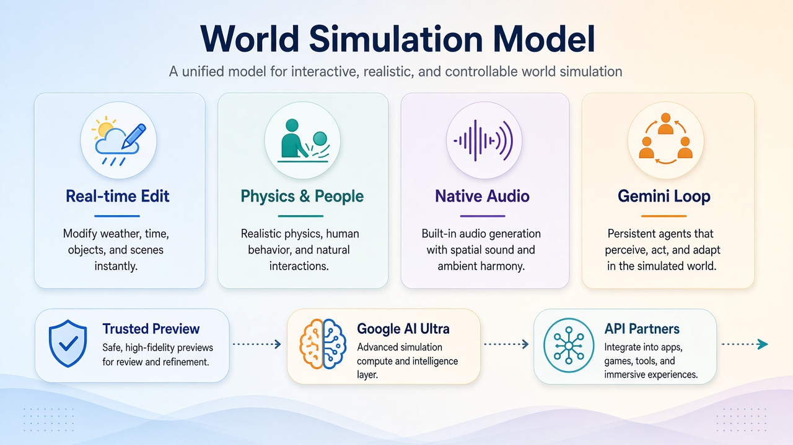

# 走进可改可听可对话的实时世界：DeepMind Genie 4 上线研究预览

以前看 AI「世界」，多半是一截会动的画面。现在你可以走进去：改天气、听环境音、跟人说话，世界当场接着演下去。

[DeepMind 博客](https://deepmind.google/blog/genie-4-a-new-generation-of-world-simulation/) 在 **2026 年 10 月 27 日** 宣布 **Genie 4**：新一代世界模型，主打真实感与实时可交互仿真，并且是**原生多模态**——画面之外，还能同时生成类音乐/环境音、环境噪音，以及可交互对白。

主旨就一句：**世界模型从「能看」往「能进去玩」迈了一步；先给可信测试者研究预览，再开给 Google AI Ultra 的 Project Genie 与 API 伙伴——不是游戏和仿真行业已经翻篇。**

---

## 对我们有什么影响

- **普通人、短视频党、会刷 Demo 的人**：想象成本降了——不是「看一段生成片」，而是键盘逛、用自然语言改场景，还能听见风声、海浪和角色对白。
- **做内容/预可视化/游戏概念的人**：可信测试者里已有创意、新闻、教育、游戏、工程行业；用例写到预可视化、档案照片变成可逛场景、游戏概念原型、企业从零到一场景生成。
- **做机器人 / agent 训练环境的人**：博客把用途直接指向机器人与 agent 的训练环境，以及新的可交互体验创作；Gemini 与 Genie 环内协作，用来仿真多步事件再上真机。
- **订阅 Google AI Ultra、盯 API 的人**：节奏写死了——先可信测试者预览收反馈，随后面向 Ultra 用户的 Project Genie，以及 Gemini API / Google AI Studio 早期合作伙伴；可加入 Project Genie 候补名单。

---

## 能核的硬货：四能力 × 发布节奏

按博客能核的表述，压成表：

| 能力 | 原文能核 |
| --- | --- |
| 实时自然语言改仿真 | 改天气、移镜头、加人/物；Gemini 按场景适配提示，并在输入间隙监控、引导场景连贯推进 |
| 物理与人类动作真实感 | 气动、碰撞等；人物可自然移动、对环境有机反应，并可实时引导 |
| 世界如何发声 | 首个原生生成音频的实时世界模型；环境音 + 可交互对白，角色会随你的输入或事件当场反应 |
| 与 Gemini 一起仿真复杂事件 | Gemini 3.8 Flash 作环内引导 agent：观察、拆步骤、核进度；另有 Gemini 4 Argon + Genie 4 实验，并接到 Gemini Robotics |

| 发布项 | 原文能核 |
| --- | --- |
| 底座 | Gemini Omni 锚定真实世界外观与行为；其他 Gemini 模型提供复杂推理，维持连贯与连续 |
| 你能做什么 | 设定事件，Genie 4 仿真接下来发生什么：世界如何响应、听起来怎样、人如何移动/反应/说话 |
| 当前阶段 | 可信测试者研究预览，收集反馈 |
| 下一步 | Google AI Ultra 订阅用户的 Project Genie；Gemini API / Google AI Studio 早期合作伙伴 |
| 责任与标记 | 安全护栏；生成视频与音频带 SynthID 水印 |

---

## 冷静一下：别写成「游戏/仿真行业完了」

**这是研究预览，不是全量开闸。**  
博客写明仍是早期实验模型；先可信测试者，再消费者与开发者。

**短会话能连贯，不等于长时间随便逛都稳。**  
细节与物体恒常性可能漂移——尤其仿真跑得久、多次复杂改提示、或到处导航时。复杂物理、实时音频精度、可读文字、空间精度、长期一致性，仍是在研项。

**用途是「训练环境 + 可交互体验创作」，不是「引擎可以扔了」。**  
测试者反馈偏向草稿模式、概念原型、零到一场景；落地仍要认局限，别把 Demo 读成生产线终局。

落地记住一句：**先认「可改、可听、可对话」这三张新牌，再按四大能力核自己的工作流——别把预览稿读成行业已翻篇。**

---

## 对我们有什么启发

1. **想抢先上手的人**：去 Project Genie 候补名单排队——博客写的下一站就是 Ultra 订阅用户与 API / AI Studio 早期伙伴，名单比等二手截图管用。  
2. **做预可视化 / 概念 / 训练环境的人**：按四大能力核自己的流程——自然语言改场景、人物与物理、原生音频对白、Gemini 环内拆步骤——哪条已经卡你交付，哪条还只是 Demo。  
3. **对外只讲能核的几张卡**：原生多模态、可信测试者预览、随后 Ultra Project Genie + API 伙伴、SynthID、以及「短会话连贯、长时会漂」的局限——别加成「游戏和仿真已经完了」。
