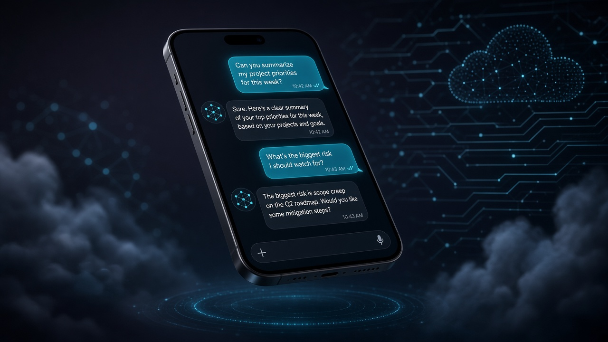
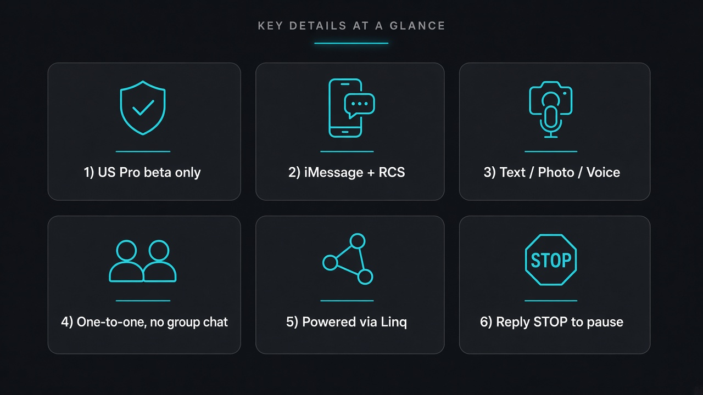

# 你的 Dot 能回短信了：个人 Agent 第一次装进手机短信框

不用开 ChatGPT App，直接在短信里跟自己的个人 Agent 说话——文字、照片、语音都行。

OpenAI 在 Whats-new 窗口 **October 26–30, 2026** 里写了这条：**Text your dot**。以 beta 向**美国 ChatGPT Pro 用户**滚动开放：用 **iMessage**，或 Android 上的 **RCS**，一对一给自己的 Dot 发消息；Dot 也能主动回短信盯事、办事。

这不是「又一个聊天入口」。对很多人来说，这是第一次把个人 Agent **装进手机短信框**——还在锁屏界面、还在日常短信列表里。

先把边界说死，再谈兴奋：美区 Pro、beta、名额有限；一对一，不是群聊；开通不会让它看见你和其他人的短信。

## Dot 早就在，短信是渠道增量

别把今天写成「Dot 首发」。

Dot 是 ChatGPT 里的 always-on agent，有自己的 cloud computer；Pro（18+，EEA / 瑞士 / 英国除外）和 Business Premium 等此前已在逐步放开。它本来就能在 ChatGPT 里聊、打电话，也能接 Slack / Teams、iOS widget / shortcuts。

今天变的是渠道：同一套 memory 和 plugins，上下文能延续——只是你可以从短信框把它叫出来，它也可以用短信把你叫回去。

名字也要拆开：

| 别混 | 是什么 |
| --- | --- |
| Dot | 你的 always-on 个人 Agent，不是普通一次对话 |
| 普通 ChatGPT 对话 | 打开 App / 网页聊完就散的那条线 |
| iMessage | 苹果侧短信通道 |
| RCS | Android 侧对应通道 |
| 短信渠道 | 文字 / 照片 / 语音消息；**不支持**群聊、电话、FaceTime |
| ChatGPT 内通话 | 仍可在 ChatGPT 里 call your dot，和短信是两条路 |

## 普通人为什么在乎

三件事，跟「会不会天天用」有关。

**第一，Agent 终于出现在你本来就会刷的界面。** 不用想起「该打开 ChatGPT」，短信响了就是它。盯航班、催审批、丢一张现场照片让它接着办——摩擦比开 App 低一截。

**第二，它能主动找你。** 官方写法是：Dot 会用对话上下文选联系渠道；你也可以指定——比如需要你注意时发短信，日常更新留在 ChatGPT。需要审批时，它会发链接到 ChatGPT 里让你审，而不是在短信里硬点确认。

**第三，隐私边界写得很硬。** 你的 Dot **只能给你**发短信，也**只有你**能给它发。开通 texting **不会**让 Dot / OpenAI 访问你和其他人的短信对话。第三方收发走 **Linq**；官方称与 Linq 合作，并做了 extensive penetration testing（frontier models + 第三方安全公司）。

兴奋可以有，别吹成「它已经读完你手机里所有短信」。

## 能做什么，不能做什么

| 项目 | 官方口径 |
| --- | --- |
| 谁能用 | 美国 ChatGPT Pro，texting 以 beta 滚动开放；access limited，未必每个 Pro 都有 |
| 谁不能 | **不在** Business / Enterprise workspace |
| 通道 | iMessage，或 Android 上的 RCS；一对一 |
| 内容 | 文字、照片、语音消息 |
| 同一套能力 | 与 ChatGPT App 共用 memory 和 plugins，上下文可延续 |
| 不支持（经 texting） | 群聊、电话、FaceTime |
| 停发 | 回复 **STOP** 可停外发短信 |
| 费用提醒 | 可能有运营商 message / data rates |
| 敏感信息 | 官方提醒要谨慎 |

开通路径按官方步骤：打开 dot profile → Texting → 验证手机号 → 保存 contact card → 发消息。iMessage 须用已验证号码发；Android 需开启 RCS。

## 上手检查表

有 Pro、人在美国、且被划进 beta 的，可以按这个清单走：

1. **确认账号边界。** 个人 Pro，不是 Business / Enterprise workspace。
2. **开 Texting。** Dot profile → 验证手机号 → 存 contact card。
3. **通道对齐。** iPhone 用已验证号码走 iMessage；Android 先开好 RCS。
4. **定渠道规则。** 跟 Dot 说清楚：急事短信叫我，日常更新留在 ChatGPT。
5. **审批走链接。** 需要你拍板时，去 ChatGPT 里审，别指望短信里把所有确认做完。
6. **敏感信息降级。** 密码、银行卡、医疗细节别往短信框里扔；不行就回 App。
7. **知道怎么停。** 回复 STOP；也记得运营商可能另计短信 / 流量费。
8. **没进 beta 别硬等功能名。** access limited——名单外先用好 ChatGPT 内消息、通话、widget / shortcuts。

## 收尾真问题

短信框是手机上最「总是在线」的界面之一。把个人 Agent 放进去，听起来像科幻落地；官方同时用美区 Pro beta、一对一、Linq、STOP、不读其他短信，把想象钉回可控范围。

对做事的人，真正该带走的不是「以后不用开 App 了」，而是——

**如果你愿意让 Agent 在短信里主动找你，你有没有先写清：什么事配发短信、什么事必须回 ChatGPT 审批、哪些内容永远不进短信框？**

官方原文：[Text your dot · Dots October 28, 2026](https://learn.chatgpt.com/docs/whats-new/dots-october-28-2026)
