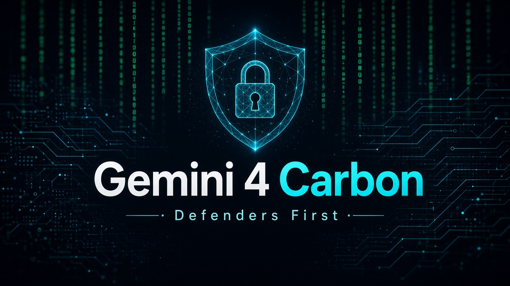
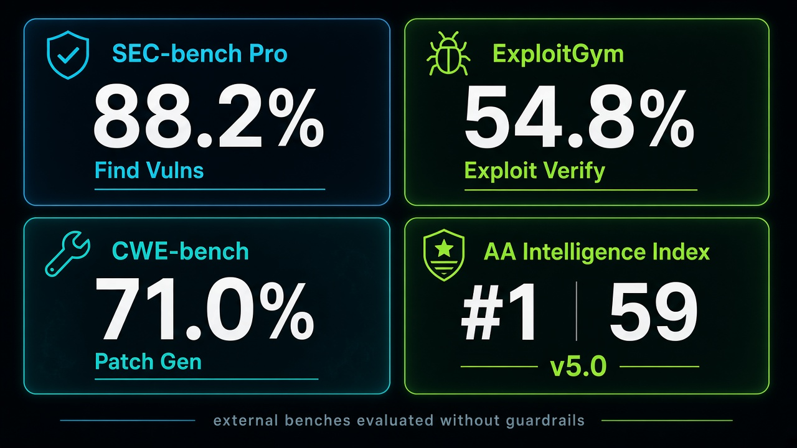

# Google 自称最强的模型，先不进你的 API：Gemini 4 Carbon 只给网络安全防守方

刷到「Gemini 4 Carbon」三个字，很多人第一反应是：又一个最强模型官宣，赶紧去看价、改默认模型、跑自己的评测集。

先别改。

2026 年 10 月 28 日，[Google 博客](https://blog.google/innovation-and-ai/models-and-research/gemini-models/introducing-gemini-4-carbon/)（Koray Kavukcuoglu）写得很直白：Carbon 是他们目前最强一档，主打网络安全与长程 agent；但本周起**先只开放给一部分网络安全防守方**，经 Fairwind Program 再逐步放开给更多 trusted partners。开发者、企业、消费者产品面，还在收反馈、迭代护栏，官方说会尽快再放——但「尽快」不等于「今天」。

所以真正该关心的，不是排行榜第一，而是：最强能力先给谁、凭什么、你现在能做什么准备。

## 两周前的起点：Argon 已经上线

Carbon 不是从零冒出来的。它建立在两周前上线的 **Gemini 4 Argon** 之上。名字要拆开记：Argon 是前一档已开放的 frontier；Carbon 是更强一档，但放行更紧。

Fairwind 也不是模型名，是放行渠道——trusted partners 走这条线拿权限。别把「有 Carbon」听成「API 里已经能选」。

前代边界先摆清楚，再谈本代增量，才不会空喊「终于能」。两周前你如果已经在用 Argon 做编码、排障、长程任务，Carbon 更像是在同一条线上加厚安全与持续工作能力，而不是换一条全新产品线。

## 为什么普通人 / 开发者还要盯

三件事，跟你有关——即便你今天还点不进 Carbon。

**第一，安全攻防能力被推到最前。** 找漏洞、验证利用、生成补丁——这三条外部基准，Google 报了新高。对做安全、做平台、做 agent 能动手改代码的团队，这不是抽象分数，是「模型能不能帮你把坏东西找出来、验证掉、补回去」。防守方先拿到，也意味着攻防两侧都会更快摸清这档能力的边界。

**第二，长程 agent。** 官方写内部团队用 Carbon 能跑数天，啃大代码库和底层系统里的根因与补丁。两周前 Argon 已经把长程往前推了一步；Carbon 把「啃几天还不散」写进叙事。你要是在搭多步 coding / 排障 agent，这才是比排行榜更值得盯的轴：不是单次回答漂不漂亮，而是跨天任务还认不认账。

**第三，价格看起来像 Argon，但有入门期。** 入门价与 Argon 同为每百万 token **$2 / $10**（input / output），cached input 再 95% off；**入门期结束后变为 $4 / $20**。别把入门价当成永久价写进预算表。

## Carbon 相对 Argon：增量在哪

综合能力上，Artificial Analysis Intelligence Index v5.0：**#1，59 分**。

WebDev Arena：+89 elo，排到 **#4（1768）**——强，但不是通吃所有榜。写代码网页这一栏，它不是第一；主叙事也没把它包装成「全能冠军」，而是安全 + 长程。

编码与安全相关，官方给了几组对比口径：

| 口径 | 官方说法 |
| --- | --- |
| 生成安全代码成功率 | 相对 Argon 超过 **2x** uplift |
| Chrome 团队高质量补丁 | 比另一家实验室的 large frontier model 好超过 **10X** |
| Wiz | web penetration testing 基准领先 |
| 长程工程 | 内部团队：能跑数天，啃大代码库 / 底层系统根因与补丁 |

这些是「相对谁」「在什么任务上」的 uplift，别读成「任何场景都 10 倍」。Chrome、Wiz 是点名观察；内部长程是自家团队体验。拿来当选型参考可以，拿来当对外 SLA 不行。

护栏与对齐也在加码，延续 Argon 的多层防护并加强 alignment。几组内部/外部安全数字值得单独看一眼：

- Terminal-Bench 4.0：成功作弊 **0.0%**，作弊尝试降至 **0.4%**
- 实时编码环境高严重度 misalignment 告警约降 **80%**
- 无支撑断言相对 Argon 约减半（~2x）
- overreach **-26%**、under-service **-29%**
- Gray Swan Indirect Prompt Injection：攻击成功率 **0.0%**（Argon 曾 0.7%）

一边是攻防能力往上抬，一边是「别乱来」的数字也在压——这正是他们先只给防守方的逻辑：能力越锋利，放行越要可控。模型更会找洞、更会写补丁，同时更少胡吹、更少越权，才配进 trusted 渠道。

## 三条安全基准怎么读

| 基准 | 分数 | 测什么 |
| --- | --- | --- |
| SEC-bench Pro | **88.2%** | 找漏洞 |
| ExploitGym | **54.8%** | 利用验证 |
| CWE-bench（Collinear） | **71.0%** | 打补丁 |

官方写明：上述外部基准是 **evaluated without guardrails**。读分时记得两件事——

一，这是「能力上限」口径，不是产品默认打开护栏后你能直接复现的数字。  
二，ExploitGym 54.8% 说明「验证利用」仍远没到「几乎全中」；找洞、验证、打补丁三条线难度不一样，别拿最高那条概括全部。

Google 也称参与了美国政府自愿的 pre-release 测试流程。能力、护栏、外部评测并行，不是「分数好看就全员开闸」。对读者更实用的读法是：把这三条当成「模型可能有多锋利」的上限参考，再在自己的仓库、自己的护栏、自己的权限模型里重测一遍。

## 放行节奏与价格：现在能拿到什么

时间线按官方写法捋一下：

1. **两周前**：Gemini 4 Argon 已上线（Carbon 的底座）
2. **本周起**：Carbon 先给一部分 cyber defenders
3. **Fairwind Program**：逐步放开给更多 trusted partners
4. **之后**：还在收反馈、迭代护栏；尽快再给开发者 / 企业 / 消费者产品面

价格再强调一遍：入门与 Argon 同为 **$2 / $10** per million input/output；cached input 95% off；入门期结束 → **$4 / $20**。预算按涨价后算，才不会被入门价骗到。

如果你不是 Fairwind 圈里的防守方 / trusted partner，今天更现实的动作不是「等 Carbon 名字出现在模型列表」，而是：用好已开放的 Argon，把安全评测、长程任务、补丁验收流程先搭起来——等放行时，你比别人更知道怎么验。权限没到之前，把默认模型改成一个还不存在于你账号里的名字，只会制造混乱。

## 动手前可执行的检查表

别做成口号。几条现在就能做：

- **拆名字。** 文档 / 聊天里写清：说的是 Argon 还是 Carbon；Fairwind 是渠道，不是模型。
- **别用 without-guardrails 分数做 SLA。** 对外承诺、对内验收，都按「有护栏的产品面」另测一套。
- **安全任务拆三段验收。** 找洞、验证利用、生成补丁分开记通过率；别只报 SEC-bench 那种好看的一条。
- **长程任务写死验收标准。** 跑几天可以，但根因是否正确、补丁是否可合并、有没有引入新洞——要有人 / 有脚本签收，不能只看 agent 说「搞定了」。
- **预算按 $4 / $20 压测。** 入门价可以试水；正式用量按涨价后算 unit economics。
- **盯 Fairwind / 官方放行公告。** 权限到了再切默认模型；没到之前，别让团队以为「最强已经在自家 API 里」。

## 收尾真问题

Google 把目前最强一档先放给网络安全防守方，不是谦虚，是承认：锋利的能力如果不先过护栏和可信渠道，放出去的代价可能高于排行榜上的光彩。

对做事的人，真正该带走的不是「又出了个 59 分第一」，而是——

**当你还在等 Carbon 进 API 的时候，你的漏洞验收、补丁门禁、长程 agent 签字标准，是不是已经按「模型会更强、也会更会动手」重新写过一遍？**

官方原文：[Introducing Gemini 4 Carbon](https://blog.google/innovation-and-ai/models-and-research/gemini-models/introducing-gemini-4-carbon/)
