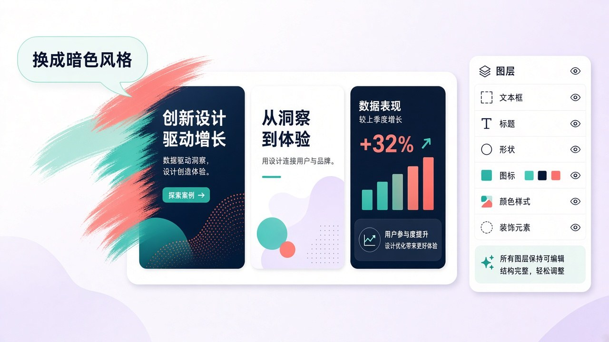
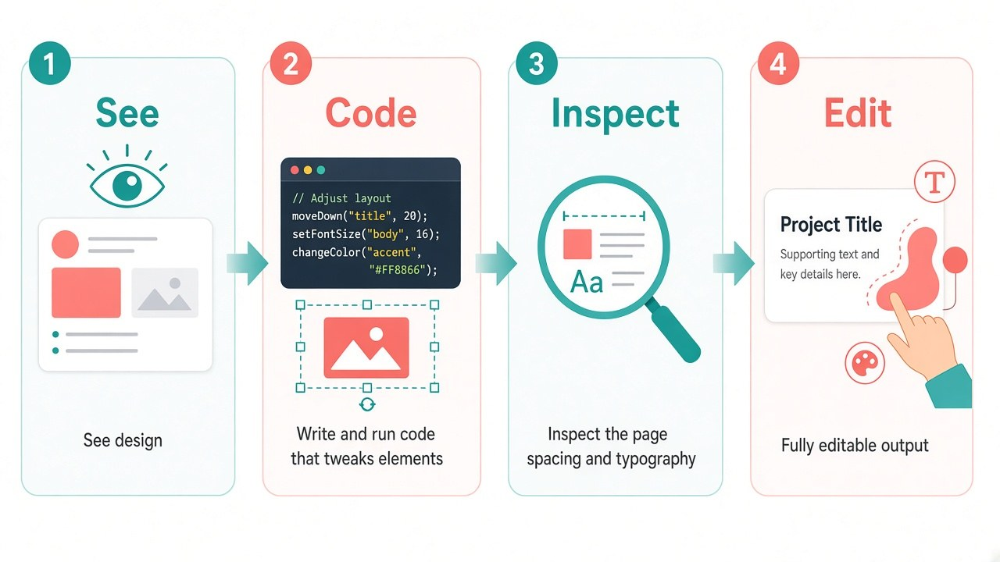

# 一句话跨页改 PPT，元素还能手改：Canva Brush 更像「真的在改设计」

你在 Canva 里最烦的，往往不是「AI 画不出来」，而是：换一句口号，整页风格跟着乱；幻灯片要统一暗色，得一页一页点；想把演示改成 Instagram 尺寸，版式散架，字还在图里焊死。

Canva Research 今天放出 **Canva Brush**：一款专为设计编辑的 vision-language model。官方说法直白——它能看见设计、理解结构，再按你的要求改，从一行文案到整套幻灯片每一页。改完不是一张死图，文字、图、颜色、版式都还能继续手改。

先把边界钉死，再谈兴奋：**Starting today**，Brush 驱动 Canva AI 里 **supported design edits**，面向 **Canva Pro**；wider availability coming soon。入口在 [canva.com/ai](https://www.canva.com/ai)，下拉里选 Brush。不是全员、不是随便一句都能改、更不是「又一个文生图」。

## 先拆清三个名字

一周前刚发过图像生成模型 **Canva Craft**。Craft 出图，Brush 改设计——别混成一个功能。

| 名字 | 干什么 | 别听成 |
| --- | --- | --- |
| Canva Craft | 图像生成：先规划版式再出图 | 「已经会改你现有设计」 |
| Canva Brush | 设计编辑 VLM：看懂结构，按指令改现有稿 | 「又一张死图生成器」 |
| 旧 design agent | 此前那套设计编辑路径 | 「Brush 只是换皮同款」 |

DesignArena 口径里，Craft 曾让 Canva 被称作世界上第二先进的图像生成 AI lab——那是生成侧叙事。Brush 要解决的是另一件事：编辑比生成更难。你得懂改什么、结构怎样、什么必须原样保留；否则一句话会改出一堆没要的东西。

Canva Research 是约 **160-person** AI lab。Craft 和 Brush 是同一条「为设计而生」线上的两步：先能出可进编辑器的图，再能对已有设计动手术刀。

## 普通人为什么在乎

三件事，跟「会不会天天用」有关。

**第一，改的是结构，不是重抽一张图。** 你说「换成暗色」「标题统一成这一句」「整套幻灯片改成品牌蓝」，它按元素动刀：文字还是文字框，形状还是形状。官方强调产出 **完全可编辑**——改完你还能自己拽间距、换字号、微调颜色。

**第二，跨多页、跨渠道一次说完。** 用法示例写得很具体：restyle；跨多页一次改；remix 到不同渠道 / 尺寸，比如幻灯片 → Instagram。做周报、路演、社媒物料的人，摩擦往往卡在「同一套内容要改十几处、适配三四个画幅」——Brush 对准的就是这类重复劳动。

**第三，速度和成本有官方 uplift，但别读成万能。** 相对旧 design agent：general design editing 最多约 **69% faster**；cost per edit task 约 **46% lower**。内部测试称多数编辑任务质量匹配或超过旧方案，尤其 restyle、适配不同格式更强。这是「编辑任务上更快更便宜」，不是「任何设计问题一句话解决」。

## 背后怎么改：看见 → 写代码调元素 → 再检查

官方把机制写成一条 **agentic loop**：写 / 跑代码去调设计元素，再 inspect 页面，指导下一步。不是「提示词 → 整页重绘像素」，而是反复看结构、改元素、验结果。

这也解释了为什么它更像「真的在改设计」：每一步动的是可编辑对象；你事后打开图层，还能接着手改。训练侧：从 leading open-weights 出发 post-train；设计专家 + 匿名 opt-in 洞察；大尺度 RL；奖励含视觉质量、设计原则、是否完成任务——「好」由专业设计师定义。

v1 之后官方还点了 Brand Kit、附件引用、图多布局改进——今天先当路线图，别写成已全开。

## 今天能上手什么：检查表

有 Pro、且任务落在 supported design edits 里的，可以按这个清单试：

1. **确认账号。** Canva Pro；非 Pro 先等 wider availability。
2. **入口对齐。** 打开 [canva.com/ai](https://www.canva.com/ai)，模型下拉里选 **Brush**。
3. **先跑 restyle。** 拿一套已有幻灯片 / 海报，只改风格或主色，看层级和文案是否还在。
4. **再试跨页统一。** 一句指令改多页标题或配色，抽查有没有「改过头」的页。
5. **做一次渠道 remix。** 比如演示 → Instagram，检查裁切后关键信息还在不在。
6. **改完必手改验收。** 官方卖点就是可继续手改——别跳过图层检查。
7. **失败任务记边界。** 不在 supported edits 里的，别硬吹「Brush 不行」；记清楚是能力还是开放范围。
8. **别和 Craft 抢活。** 从零出图用 Craft；改现有设计用 Brush。

## 收尾真问题

生成模型解决「没有图」；编辑模型解决「有图，但改不动、改一次散一次」。Brush 把后半句往前推了一步——还用 Pro、supported edits、可编辑产出，把想象钉回可控范围。

对做事的人，真正该带走的不是「以后不用动手排版了」，而是——

**如果你愿意把整套幻灯片交给一句话去改，你有没有先写清：哪些元素绝对不能动、改完用什么标准验收、失败时是回手改还是回旧 agent？**

官方原文：[Introducing Canva Brush](https://www.canva.com/newsroom/news/canva-brush/)
