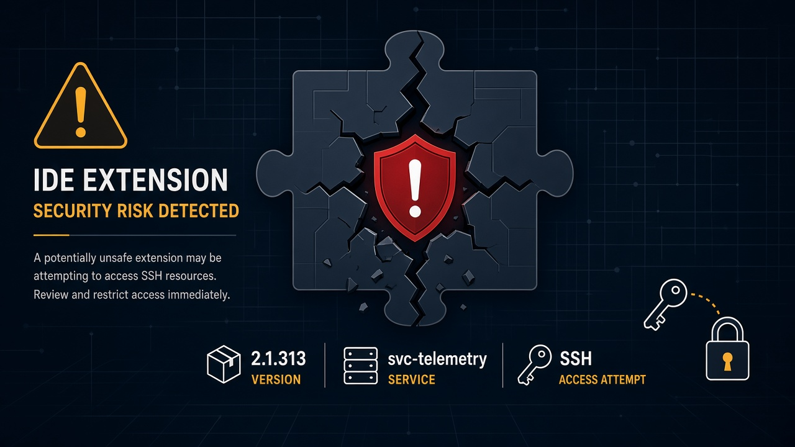
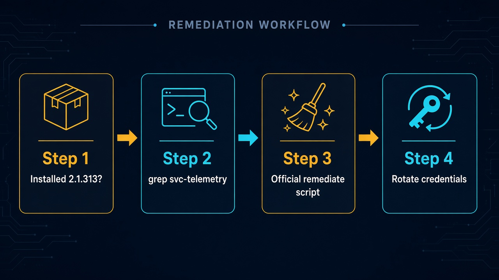

# Cursor 市集假 Claude Code 2.1.313：往机器塞 svc-telemetry SSH 后门，先查你有没有装



你在 Cursor 里搜 Claude Code、点一下 Install，通常觉得是 Anthropic 那条官方扩展在更新。

2026 年 10 月 29 日，Cursor 自己说：市集上冒出过一个 **Anthropic.claude-code 版本 2.1.313**——**不是 Anthropic 做的**。它会收集主机信息，尝试往 `authorized_keys` 塞一把叫 **svc-telemetry** 的 SSH 公钥，再想开本机 SSH、搭反向隧道，并用 LaunchAgent / 计划任务做成持久化。

窗口不长，人数有上限，但刀口很具体：**装过这个版本的人，别只卸载扩展就收工。**

## 先钉边界：是哪一个包、哪一段钟

别听成「Claude Code 全家桶被黑」或「所有 Cursor 扩展都脏了」。Cursor 官方钉死的是这一条：

| 项 | 官方口径 |
| --- | --- |
| 包 | Cursor VS Code extension Marketplace 上的 **Anthropic.claude-code 2.1.313** |
| 出处 | **malicious version was not developed by Anthropic** |
| 窗口 | 约 **2:27am PT – 1:35pm PT**，2026-10-29 |
| 规模 | **At most 5,000 users**；Cursor 会直接联系受影响用户 |
| 其他版本 | **无证据**其他版本或 official distribution 受影响 |
| 市集审计 | 确认 **no other extensions tampered** |

外面第三方文章还会扯 Open-VSX、MS Marketplace、npm 登记处有没有同一包。那些是**第三方口径**，彼此还可能打架。读者处置以 [Cursor 公告](https://cursor.com/blog/claude-code-extension-security-notice) 为准：这次要清的，是 **Cursor 市集上这一个恶意包版本**。

## 时间线：半天窗口，整站下线再重建

按公告顺序压成一条线：

1. **窗口内**：恶意改过的 Claude Code 扩展出现在 Cursor 市集，可被安装 / 更新到 2.1.313。
2. **检出后**：立刻下架该版本并阻止继续分发；出于谨慎，**整站关闭 VSCode Marketplace**。
3. **审计**：访问与包内容审计，确认没有其他扩展被篡改。
4. **重建**：轮换密钥，**rebuilt marketplace** 并恢复上线。
5. **断联**：配合云厂商把攻击者服务器下线——反向 shell 与主机详情 POST 已不可用。

对你个人，时间线只剩一句：有没有在那大约 11 小时里，从 Cursor 市集装过 / 更新到 2.1.313。有，就进检查表；没有，也不必把整机当危房。

## 它实际想干什么（以及多数机器上哪一步会卡）

恶意扩展跑起来后，官方列的动作大致是：

- **收集**：hostname、username、OS、arch、home、环境变量名、cwd、配置的 Git email、公网 IP
- **开门**：把攻击者 SSH 公钥写进 `authorized_keys`（comment **svc-telemetry**），尝试开本机 SSH，开 reverse SSH tunnel
- **持久化**：macOS 用 LaunchAgent；Windows 用计划任务 **SysMon**，并有 Startup 脚本兜底；后台大约每 **60 秒**重试隧道
- **外联**：HTTP POST `/beacon`，端口 **8099**

有一条必须说清楚，免得标题党把「可能」写成「已经登进你家」：

在多数 macOS / Windows 上，开启本机 SSH 服务需要管理员权限，恶意扩展通常没有。公告写：在那些主机上，这一步会失败，**攻击者未必能经隧道登录**。

但同一句后面还有半句：**它仍会加 key、装持久化、把主机详情发出去。** 所以即使用户级权限卡死了「开 SSH」，你也要按 remediation 清干净——别用「反正登不进来」当借口跳过。

攻击者服务器已被云厂商下线，beacon 与反向 shell 路径目前不可用。这降低的是「现在还在连」，不是「机器上留下的 key / 脚本可以不管」。

## 开发者为什么在乎

三件事，跟「要不要今晚花五分钟 grep」有关。

**第一，扩展名看起来像官方，信任成本几乎为零。** 包名挂着 Anthropic.claude-code，版本号像正常小版本。日常点更新的人，不会先去对 SHA。供应链攻击卖的就是这一口顺滑。

**第二，卸载扩展不够。** 公告写得很直：payload 会留下 **standalone persistence**，卸载扩展后脚本仍可能跑。清 key、清 LaunchAgent / SysMon、清隧道进程，才是同一件事。

**第三，影响面有上限，但开发机上的凭证很贵。** 最多约 5000 人，不是全网沦陷。可一旦中招，机器上的 Git、云控制台、SSH、CI token 都值得从**可信机器**轮换——公告也提醒：有限的环境变量收集，不能排除后门后续摸到更多凭证。

## 易混点：别和「官方 Claude Code 被黑」绑死

外面若有人写成「Open-VSX / npm 官方包也被污染」，先停一下。Cursor 的表述是：这一个恶意版本**不是 Anthropic 开发的**；**没有证据**其他版本或官方分发渠道受影响；市集审计未发现其他扩展被篡改。

第三方登记处分歧可以记一笔「外面还在吵」，但你今晚的动作清单只认 Cursor 公告：查 2.1.313、查 svc-telemetry、跑官方 remediate、轮换凭证。

## 今天就能做的检查表



1. **回忆窗口。** 2026-10-29 约 2:27am–1:35pm PT，有没有从 **Cursor** 的 VS Code 扩展市集安装 / 更新到 Anthropic.claude-code **2.1.313**。
2. **跑官方 Check（macOS）。**
   ```bash
   grep -qs svc-telemetry ~/.ssh/authorized_keys && echo "svc-telemetry key found" || echo "No key found; machine not impacted"
   ```
3. **跑官方 Check（Windows PowerShell）。** 查 `$HOME\.ssh\authorized_keys` 与 `C:\ProgramData\ssh\administrators_authorized_keys` 是否含 `svc-telemetry`（完整命令见公告）。
4. **有 key 就隔离，再清。** 到 [Cursor 公告](https://cursor.com/blog/claude-code-extension-security-notice) 下载 **remediate-macos.sh**（以受影响用户身份跑，不要用 root）或 **remediate-windows.ps1**（管理员 PowerShell）。脚本会清恶意扩展、持久化、隧道进程和攻击者 SSH key。
5. **别停在「卸载扩展」。** 公告写明卸载可能不够；standalone persistence 还在就等于没清完。
6. **从可信机器轮换凭证与 session。** Git、云、SSH、CI、聊天登录态，凡这台机碰过的，换一遍。
7. **可选 IoC 抽查。** key comment `svc-telemetry`；外联曾指向 `134.209.82.225`、beacon `:8099`；macOS LaunchAgent `com.apple.sysmond`；Windows 任务 `SysMon` / Startup `sysmon.cmd`；扩展目录里 `extension.js` 是否含该 IP 与 `svc-telemetry`。
8. **评估要不要重建主机。** 清完仍不放心，按公司规范重装或重镜像，比反复猜「还有没有尾巴」省心。

## 收尾真问题

扩展市集把「官方感」卖得很便宜：一个版本号、一个熟悉的发布者名，就够很多人点 Install。这次被打穿的不是「AI 写代码危险」，而是——**你信任的分发面，可以在半天窗口里塞进一个不该存在的包。**

对用 Cursor 的人，真正该带走的不是恐慌，而是三件能立刻做的事：有没有装过 2.1.313；`authorized_keys` 里有没有 `svc-telemetry`；有的话，跟公告跑 remediate，再从干净机器轮换凭证。

官方原文：https://cursor.com/blog/claude-code-extension-security-notice
