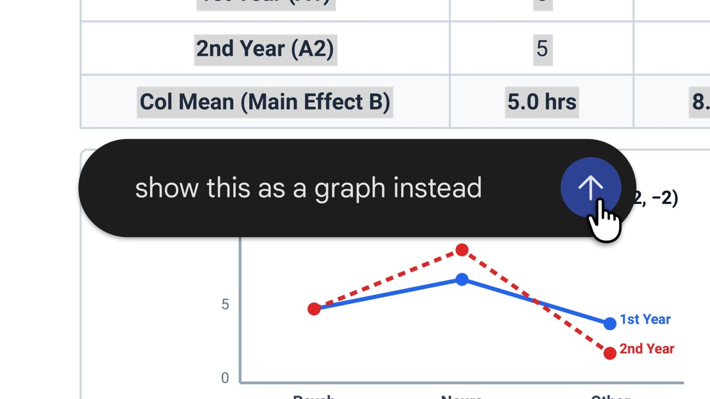
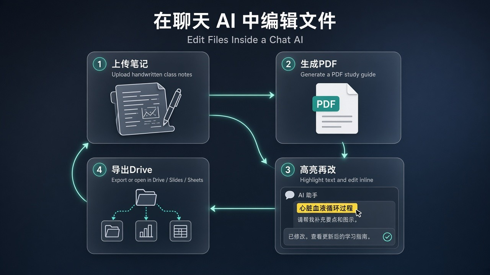

# 不用下载换软件：Gemini 聊天里直接预览、高亮再改 PDF 和 Docs

你让 AI 写完一份学习指南、一份周报、一套演示，最烦的往往不是「写不出来」，而是：下载 → 换软件 → 改两句 → 再上传 → 再问一轮。PDF 在手机上尤其别扭，改五个字都像办手续。

Google 说，这件事在 Gemini app 里可以收口了：**在对话里直接 generate、preview、edit**——文档、PDF、演示、表格、代码等。全屏展开自己打字改，高亮一段问问题，或直接让 Gemini refine。官方演示路径很短：上传手写课堂笔记 → 出 PDF 学习指南 → 手动编辑、高亮局部让它改文字或视觉、继续追问。

先把边界钉死，再谈「终于不用换软件」。

## 别和「四月那次」混成一件事

2026 年 4 月 29 日，Gemini 已经能在聊天里**生成**文件，并下载 / 导出 PDF、docx、xlsx、Docs / Sheets / Slides、LaTeX、TXT、RTF、Markdown 等。那次解决的是「有文件可拿」。改文件，你还得离开 Gemini。

这次增量是另一半：**预览 + 在对话里直接改**。不是第一次能改 Google 文档——Workspace 侧栏里的 Gemini 早就能动 Docs；Claude 聊天里也能生成 / 改文档演示。别听成「AI 第一次会改文件」，听成——**聊天里闭环：生成、预览、编辑，不必下载换软件再回传**。

| 能力 | 大致何时 | 你实际在干什么 |
| --- | --- | --- |
| 聊天里生成并导出文件 | 2026-04 | 出稿、下载、换软件改 |
| 聊天里预览 + 直接改 | 2026-10-29 | 留在对话里打字 / 高亮 / 让它 refine |
| Workspace 侧栏改 Docs | 更早 | 在 Docs 里用助手，不是同一条聊天闭环 |

四月那篇能力还在；十月这篇是把「改」拉回同一条对话。评测时别只问「能不能出 PDF」，要问「出完能不能在聊天里改完再走」。

## 谁能用、什么格式、在哪改

官方口径：Gemini app **已开放地区的全部用户、全部语言**；覆盖 Workspace 客户、Workspace Individual、个人 Google 账号。没有单独的 admin control——关掉 Gemini app 才会影响。Rapid Release 与 Scheduled Release 已可用。

格式别糊成「啥都能手机改」：

- **PDF**：网页和手机都能预览、编辑
- **其余目前主要在网页**：Google Docs、Google Sheets、幻灯片、Markdown、TXT、代码
- Workspace 补充路径：幻灯片可先预览布局，再手改或让 Gemini 调语气 / 结构，然后打开 Google Slides，或下载 PPTX / PDF；Sheets 可从 prompt 生成 tracker / 表格 / 数据模型并打开 Google Sheets；文档 / PDF 可 draft PDF、Google Docs、LaTeX、Markdown、TXT，inline 或全屏改，也可 upload to Drive

手机上优先拿 PDF 跑通；要改 Docs / Sheets / 幻灯片，先回到网页。端和格式对不上时，先查是不是「其余格式主要在 web」，再判断产品好不好用。

## 普通人为什么在乎

三件事，跟「会不会少开三个软件」有关。

**第一，摩擦从「跨应用」变成「同屏」。** 学生交笔记、老师出讲义、运营改一版方案——过去是生成完再搬家。现在路径可以是：笔记进聊天 → PDF 学习指南 → 高亮一句「把这段改成考试口吻」→ 继续追问插图或结构。官方卖的就是这条短链，不是又一个「导出按钮」。

**第二，改法有三种，不用每次重生成整份。** 全屏自己打字；高亮局部提问；或让 Gemini refine。适合「大体对了，就差五处」的人——重抽整稿往往毁语气和版式，局部改更像真人工作流。

**第三，出口还在 Google 生态里，但别当成唯一办公套件。** 改完可以进 Drive、打开 Docs / Sheets / Slides，或下载 PPTX / PDF。对已经泡在 Workspace 的人，这是闭环加强；你主战场在 Notion / Word / 本地 LaTeX，它省的是「中间那一截搬家」，不是替你换全家桶。

做演示的人还可以走幻灯片预览 → 调语气 / 结构 → 打开 Slides 或下 PPTX；做跟踪表的人可以从一句 prompt 出 tracker，再进 Sheets。场景不同，验收同一条：有没有少一次「下载换软件」。

## 演示路径怎么评：笔记 → 指南 → 高亮再改

拿官方演示当验收脚本，比空喊「生产力革命」有用：

1. **上传**一份手写 / 杂乱课堂笔记（照片或扫描都行，以你账号实际支持的上传为准）。
2. **生成**一份 PDF 学习指南，看结构是不是可用骨架，不是漂亮废稿。
3. **手动改**一两处标题或段落，确认全屏编辑真能打字，不是只读预览。
4. **高亮**一段，让 Gemini 改语气、补要点或调视觉，看它动的是局部还是整份重写。
5. **追问**一轮：加练习题、改成一页摘要、导出或打开对应 Google 文件。

过关标准很土：五分钟内你有没有少开一次 Word / Preview / 另一家聊天窗口。过不了，记清楚卡在格式、端、还是改写质量——别笼统骂「Gemini 不行」。

网页侧再加一条抽查：同一份材料，试一次 Docs 全屏改、一次 Sheets 从 prompt 出表、一次幻灯片预览后打开 Slides。三项里哪条稳，哪条仍要回旧导出路径，写进自己的默认流程。

## 今天就能做的检查表

1. **确认地区与账号。** Gemini app 已开地区；个人 Google 或 Workspace 均可试。
2. **先跑 PDF。** 网页或手机各试一次预览 + 全屏改字，建立基线。
3. **网页再试 Docs / Sheets / 幻灯片。** 别在手机上死磕「其余格式」。
4. **走一遍笔记 → 学习指南。** 用真实笔记，不拿空 prompt 自评。
5. **三种改法各做一次。** 手改、高亮提问、让它 refine，看哪种最稳。
6. **验收出口。** Upload to Drive 或打开 Docs / Sheets / Slides / 下载，确认下游还能接着用。
7. **对照四月能力。** 只会生成不会聊内编辑，说明你还在旧路径；能预览编辑才算这次增量。
8. **别和侧栏 Gemini 抢叙事。** 侧栏改 Docs 是文档里助手；这篇讲的是**聊天闭环**。

## 收尾真问题

生成文件解决「没有稿」；聊天内预览编辑解决「有稿，但改一次搬一次家」。Gemini 把后半句往前推了一步——还用端、格式、开放范围，把想象钉回可控清单。

对做事的人，真正该带走的不是「以后办公只开一个聊天窗」，而是——

**如果你愿意把下一份学习指南或周报全程留在 Gemini 里改完再导出，你有没有先写清：哪些段落必须手改验收、高亮指令怎么写才不会整份重写、失败时是回网页 Docs 还是回旧「生成后下载」路径？**

官方原文：[Edit and preview documents directly in Gemini](https://blog.google/innovation-and-ai/products/gemini-app/edit-files-directly/)
