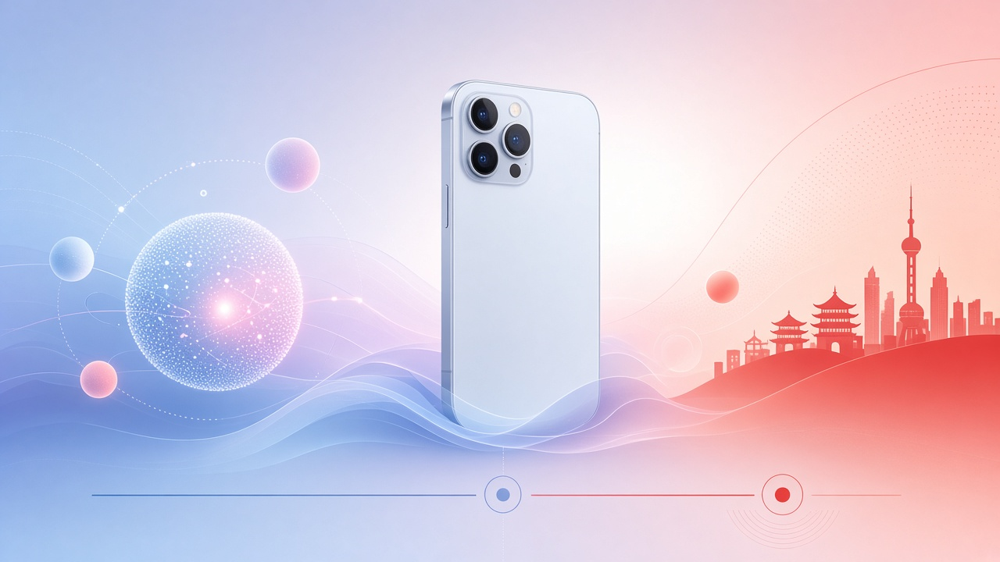
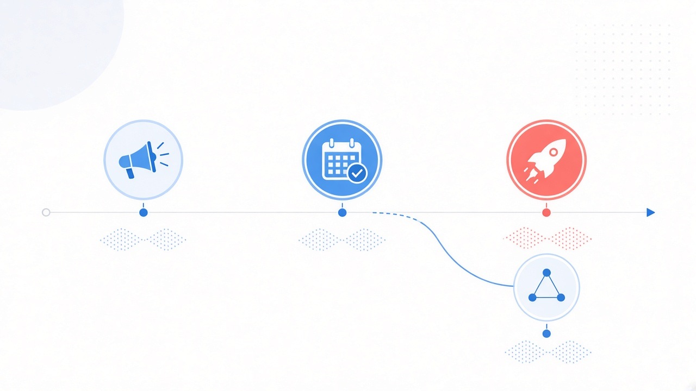

# 11 月 4 日就能测：Apple 智能进中国大陆，接千问，但不含 Siri AI

等了差不多两年。海外朋友早就在用写作工具、照片消除、智绘表情，大陆这边一直卡在「即将推出」。

2026 年 10 月 31 日，Apple 中国新闻稿把日期钉死了：**11 月 4 日起**随最新 iOS 开发者 Beta 开放测试，**12 月**随 **iOS 27.3** 正式面向中国用户推出。首发是 iPhone；Mac、iPad 等其他平台要等「必要审批」后再说。

普通人为什么在乎，其实很简单：这不是又一个要下载的聊天 App，而是系统里你天天摸得到的那一层——改邮件、抠照片里路人、面对面听翻译、让 Siri 别那么傻。

出差问路、跨语言电话、相册里一堆路人、收件箱堆成山——这些本来就在 iPhone 里发生。系统层一旦接上，路径比「再开一个模型 App」短一截。

先钉时间线和边界，再谈首批能干什么、千问怎么嵌进去。

## 时间线与边界：测什么、不测什么

| 节点 | 口径 |
| --- | --- |
| **2026-10-31** | Apple 中国新闻稿官宣：Apple 智能首批核心功能即将登陆中国 |
| **2026-11-04 起** | 随最新 **iOS 开发者 Beta** 开放测试 |
| **2026-12 月** | 随 **iOS 27.3** 正式面向中国用户推出；官网未写确切日 |
| **其他平台** | 获必要审批后推出；**本次首发 iPhone** |
| **明确不含** | **Siri AI**，以及 WWDC 2026 宣布的其他下一代 Apple 智能功能 |

两句必须一起说：

- **来了的是首批核心能力**——实时翻译、写作工具、照片消除、视觉智能、智绘表情、邮件与通知整理、转录摘要、文字对话 Siri 等。
- **没来的是下一代 Siri AI**——别把今天的 Beta 当成「Siri 彻底换脑」的预演。

模型底座：由 **Apple 构建的生成式模型**驱动日常能力；**千问**是与阿里巴巴合作、接入**部分体验**的外援，不是把整套 Apple 智能换成通义千问。

12 月正式版官网只写到月份，没有确切日。开发者想抢测，盯 11 月 4 日 Beta；普通用户把日历钉在「12 月某次 iOS 27.3」，别被自媒体「某日零点必更」带跑。

## 首批能干什么：按场景，不按参数表

官网列了一长串。对持机用户更有用的是按「你会不会天天碰到」拆开。

**跨语言**

- **实时翻译**：嵌在信息、FaceTime、电话里；面对面对话还可走支持的 AirPods。
- AirPods 侧：AirPods 5、AirPods 4（主动降噪）、AirPods Pro 2 及后续、AirPods Max 2——需最新固件，且配对的是已启用 Apple 智能的 iPhone。

出国问路、外企电话、家里老人听不懂英文菜单——翻译嵌进系统通话和耳机，比临时翻出一个翻译 App 少两步。这是普通人最先摸得到的变化。

**写与改**

- **写作工具**：改写、校对、摘要。
- **智能回复**：邮件、信息里给快速答复建议。
- 接入千问后，写作工具里的**创作功能**可让千问**从零创作**原创内容。

**看与找**

- **视觉智能**：用摄像头即时了解身边物体和场所。
- **照片消除**：去掉干扰对象，尽量保住拍摄当时的意境。
- **自然语言搜照片 / 回忆影片**：用一段描述找图或成片。
- **智绘表情**：文字描述生成表情符号。

**邮件、通知、转录**

- **优先邮件**、**邮件摘要**、**智能回复**。
- **通知摘要**、**首要通知**、**减少干扰专注模式**。
- 备忘录音频转录摘要、通话转录摘要。

**Siri 这一层**

- 可用**输入文字与 Siri 对话**；表述不够连贯也能跟上下文。
- 处理特定请求时，Siri **可接入千问**；还能针对照片，以及含 PDF、演示文稿的文档提问。
- 登录千问账户，或通过 **Apple 登录**，即可在 Apple 智能中访问千问。

开会时不想出声，打字问 Siri；相册里一张菜单或一张白板，直接问「这上面写了啥」；邮件附件里的 PDF，不必先导出再丢进别的 App。这些才是系统位该赢的地方。

这是「系统里多了一层顺手的智能」，不是「手机变成又一个独立大模型聊天窗」。预期摆对，上手才不窝火。

## 千问怎么嵌：三处入口，不是整机换脑

和阿里的合作，官网写得很具体——**部分体验**：

| 入口 | 千问能做什么 |
| --- | --- |
| **Siri** | 特定请求时接入；可问照片 / PDF / 演示文稿 |
| **写作工具** | 创作功能里从零写原创内容 |
| **视觉智能** | 文本与图像理解相关能力 |

登录方式：千问账户，或 **通过 Apple 登录**。

评产品时别混三件事：

1. **Apple 自研生成式模型**负责首批系统能力的主骨架。
2. **千问**是合作增强，落在 Siri / 写作 / 视觉智能这几条路径上。
3. **Siri AI（WWDC 2026 那套下一代）**本次明确不包含——别把「Siri 能接千问」听成「Siri AI 已上线」。

海外版里 ChatGPT 曾以类似「外挂进系统」的方式出现；大陆这次对位的是千问。对用户，价值不在品牌站队，而在：**不用跳出系统，就能在系统场景里用上本地大模型的知识与创作。**

产品同学若在做「登录即用」或「系统分享承接」，值得提前想清楚：用户一旦习惯在写作工具里直接让千问起稿，第三方写作入口的默认打开率会不会掉。这是体验迁移题，不是公关站队题。

## 你的机子能不能上：设备与语言

官网脚注把门槛写死了。

**支持的 iPhone（首批，随 iOS 27.3）：**

- iPhone 16 及后续机型
- iPhone Duo
- iPhone 15 Pro、iPhone 15 Pro Max
- iPhone Air

**语言：** Siri 与设备语言需设置为**英文或简体中文**。官网中文新闻稿写的是「英文和中文（简体）」；英文媒体多写 or。实际以系统设置为准——进设置里把 Siri 语言和系统语言对上，别只改一个。

**视觉智能：** 适用于所有启用 Apple 智能的 iPhone；部分能力可能仅限部分语言或地区。

**AirPods 实时翻译：** 见上文机型列表；没有主动降噪的旧款、以及未升固件的，别默认能开。

不在名单里的机型，再等、再换机，比蹲 Beta 更现实。

## 怎么评：别吹成通吃，也别当成「什么都没有」

三把尺子，够用了。

**第一，系统位 vs App 位。** 翻译嵌在电话和 AirPods、消除嵌在照片、摘要嵌在邮件和通知——这是系统体验升级，不是又一个要记得打开的聊天框。和「下载一个大模型 App」比，胜在**触达路径短**；别指望它一夜追上独立 App 里最激进的长对话、多 Agent 工作流。

**第二，首批 vs 下一代。** 写作、消除、智绘、优先邮件这些，海外用户已经用过一轮，大陆是补齐；Siri AI 和下一代能力被官网一刀划开。评测和选题时，把「终于能用上的基础盘」和「还没来的下一代」拆开写，读者才不会被标题带跑。

**第三，千问接入深度。** 能问 PDF、能从零创作、能挂在视觉智能上——这已经超过「营销露出」。但仍要实测：哪些请求会路由到千问、延迟如何、登录与隐私提示清不清楚、断网或未登录时回落到哪一层。官网给的是能力清单，不是 SLA。

辅读交叉：9to5Mac、The Verge、MacRumors 等与官网一致，强调时间线与「不含 Siri AI」。监管审批的七月传闻之类，若媒体有写而官网未写，当报道转述即可，不要写成 Apple 官宣细节。

再补一条别吹过头的：首批功能海外用户已用过一轮，大陆是**补齐系统位**，不是突然甩出一堆全球首发黑科技。兴奋点应放在「终于能在国区机子上点开」，而不是「碾压所有国产手机 AI」。

## 持机用户 / 产品同学今天就能做的检查表

1. **对设备。** 是否在 iPhone 16 及后续、iPhone Duo、15 Pro / 15 Pro Max、iPhone Air 名单内。
2. **对语言。** 系统语言与 Siri 语言是否为英文或简体中文；以设置页实际选项为准。
3. **开发者想抢先：** 11 月 4 日起跟最新 iOS 开发者 Beta；正式用户盯 12 月的 iOS 27.3，官网未给确切日。
4. **AirPods 要面对面翻译：** 核机型（5 / 4 ANC / Pro 2+ / Max 2）、固件、以及配对的 iPhone 是否已启用 Apple 智能。
5. **要试千问：** 准备千问账户或 Apple 登录；重点摸 Siri 提问、写作工具创作、视觉智能三条路径。
6. **预期管理：** 首批 ≠ Siri AI；其他平台尚未随本次首发。
7. **产品 / 运营同学：** 若你的 App 依赖系统分享、邮件草稿、照片导出，留意用户开始用系统写作工具和消除后，内容生产路径会不会变短——这是体验迁移，不是又一次「换个大模型品牌」的公关题。
8. **别把 Beta 当正式版验收。** 开发者包用来摸路径和缺口；对外承诺、客服口径、教程截图，等 12 月正式版再锁。
9. **隐私与账号预期：** 接千问前看清登录提示与数据说明；不需要千问的场景，确认关掉或未登录时系统能力是否仍可用。

## 收尾真问题

大陆用户要的不是又一篇「AI 终于来了」的通稿，而是两件可验证的事：**哪天能在自己的 iPhone 上点开**，以及**点开之后到底是系统能力，还是换皮聊天框**。

按官网：11 月 4 日开发者先测，12 月 iOS 27.3 面向中国用户；骨架是 Apple 自研生成式模型，千问嵌进 Siri、写作工具、视觉智能；Siri AI 和下一代能力明确不在本包。

真正该带走的问题只有一个——**11 月 4 日那天，你是先开开发者 Beta 验翻译和消除，还是等到 12 月正式版，再决定要不要把千问登录进系统？**

机子在名单里、语言设对了，剩下就是选节奏：抢测看路径，等正式版看稳定。两条路都成立，别被「错过首日」绑架。

官方原文：https://www.apple.com.cn/newsroom/2026/10/apple-intelligence-features-are-coming-to-users-in-china/
