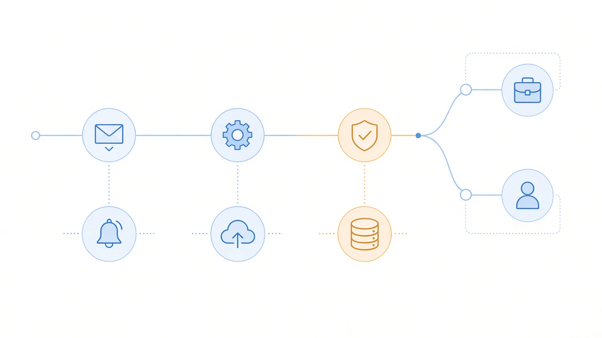

# 关了 Improve the model 也不算数：个人号 Daybreak Blue 会话仍可能训模型

你以为关掉「Improve the model for everyone」，对话就不会进训练集。

对个人账号上的 **Daybreak Blue** 会话，帮助中心现在写得很直：**即使那个开关关着，OpenAI 仍可能用你的交互内容去改进模型**——理由是加强防网络滥用防护。

这不是普通用户闲聊的问题。Daybreak Blue 本来就是给**已核验的防守工作**开的 Trusted Access：漏洞分诊、安全代码审查、恶意软件分析、检测工程、应急响应、补丁验证。你往里贴的，往往是还没公开的发现、客户资产边界、内部工单摘要。开关「不算数」，等于默认假设被拆了一截。

独立研究员更难受一点：企业有工作区默认不训，个人路径却把「能少拒答」和「训练例外」捆在一起。你为了做正事申请 Blue、绑硬件钥、过身份核验，结果最敏感的那几段会话，恰恰落在例外里。

先钉谁受影响、谁不受，再谈 Daybreak 是什么、开关为何失效、邮件日期和帮助页怎么对得上。

## 先钉边界：谁中招，谁暂时没事

| 场景 | 现口径 |
| --- | --- |
| **个人账号 + Daybreak 会话** | 可能用于改进模型，**即使 Improve the model for everyone 已关** |
| **同一账号、非 Trusted Access 会话** | Improve… 设置**仍生效** |
| **Business / Enterprise / Edu / Healthcare 工作区** | 默认**不**用内容训模型 |
| **API Platform** | 默认**不**用输入输出训模型 |
| **临时对话 Temporary chat** | **不**用于改进模型；可为安全目的最多保留约 30 天 |
| **点赞 / 点踩反馈** | 即使已退出训练，**整段对话**仍可能被用于训练 |
| **Codex** | 另有 **Include environments** 训练开关；改 ChatGPT 设置或隐私门户退出**不会**自动改它 |

两句必须一起说：

- **中招的是「个人号上的 Daybreak 会话」**，不是「凡是开了 Advanced Account Security 的人」。
- **商务 / 企业工作区默认训模型这条线没被这次 Trusted Access 段落改掉**；别把个人号危机脑补成全家桶翻车。

邮件 / 报道转述还钉了更细的「不受影响」清单：商务与企业账号不受影响；**非 Daybreak** 的 Advanced Account Security 会话不受影响；其他 ChatGPT 使用不受影响；Priority Processing / Zero Data Retention 相关处理口径不变。这些日期与范围**没有**写进帮助页 Trusted Access 段落正文——来自用户公开的邮件截图与后续报道，写进日历时别和帮助页混成一句。

## Daybreak 是什么：Trusted Access for Cyber，不是 ZDR

Daybreak Access = OpenAI 的 **Trusted Access for Cyber**。里头两档：

| 档位 | 能力边界 | 典型用途 |
| --- | --- | --- |
| **Daybreak Blue** | 在支持的主线模型上**降低拒绝**；**没有**网络专用模型；Astra 仍走标准防护 | 漏洞分诊、安全代码审查、恶意软件分析、检测工程、应急响应、补丁验证 |
| **Daybreak Red** | 网络专用模型 + 降低拒绝；审批更严；**个人一般不能申请 Red** | 获授权的渗透测试、红队、受控环境下的验证研究 |

Blue 是多数安全团队的推荐起点。多数既有防护与使用政策仍在；它只是让获批的防守工作少撞「安全拒答」。Red 面向更强审批的获授权进攻测试场景，个人申请通道基本关着——别把 Blue 用户的数据控制争议，脑补成「人人都能开网络专用模型」。

个人路径门槛也不低：合格付费计划、**Advanced Account Security**、至少一把兼容的**实体 FIDO2 硬件密钥**。软件 / 同步通行密钥不能顶硬件钥要求。现有个人用户须在 **2026-10-01** 前满足这些要求才能保留访问。审批不自动；装完钥、过完身份核验，也不等于一定拿到 Blue。

更关键的一句在 Limitations：**Daybreak 默认不授予 Zero Data Retention**。Trusted Access 和 ZDR 是两件事。以为「进了 Daybreak = 数据更干净」，帮助中心已经提前否了。需要留存承诺的，仍要跟 OpenAI 联系人谈 ZDR / 企业配置，别指望 Trusted Access 顺带打包。

## 开关为何「不算数」：Trusted Access 写进帮助页了

帮助中心 Data controls 现文，Trusted Access 段大致是这个意思：

> Trusted Access programs like Daybreak Blue support more sensitive work. During Daybreak sessions on your personal account, we may use content from your interactions to improve our models **even when “Improve the model for everyone” is off**. This helps us to strengthen safeguards against cyber misuse. Your “Improve the model for everyone” setting still applies to your other activity when not in a Trusted Access session.

翻译成人话：

1. 个人号上的 Daybreak 会话，**可以绕过**你关掉的 Improve…。
2. 官方给出的理由是**强化防网络滥用防护**。
3. **不在** Trusted Access 会话里时，Improve… 仍然管用。

对独立安全研究员、用个人 Plus / Pro 做防守工作的人，疼点很具体：

- 你关开关，是因为不想让**未公开漏洞描述、客户目标范围、内部检测规则草稿**进通用训练集。
- 程序偏让你在个人号上跑 Blue——硬件钥、身份核验都绑在个人路径上。
- 结果是：越敏感的防守会话，越可能被拿去「改进模型」。

官方理由写的是 strengthen safeguards against cyber misuse。站在平台侧能理解：防守对话里确实有人会试探滥用边界，拿真实交互去加固防护，是一条工程路径。站在研究员侧，问题变成——**我用来修洞的上下文，会不会变成别人以后探测同类问题的养料**。两边都不是空想，所以才需要把「谁受影响」钉死，而不是互相扣帽子。

安全圈子里情绪反弹不小——有人担心未公开发现进训练集，有人称会退出项目。情绪一笔带过就够；真正要带走的是产品边界，不是怒骂。

产品隐私同学也会在意：UI 上一个总开关，帮助页又开了一个 Trusted Access 例外。对外话术若还说「用户关掉 Improve… 就不会用于训练」，个人 Daybreak 场景已经不成立。设置页若只亮绿灯、不提示例外，用户会被自己的「我关过了」记忆骗到。

## 时间线：帮助页现口径 vs 邮件日期 vs 后续退出承诺

三层信息必须拆开，不然读者会以为「帮助页已经改成可退出」或「11 月 29 日才突然生效」。

| 节点 | 来源性质 | 口径 |
| --- | --- | --- |
| **帮助页现文** | 官方 Data controls | 个人号 Daybreak 会话**可能**用于改进模型，即使 Improve… 关闭；非 TA 会话仍听开关；商务 / 企业默认不训 |
| **约 2026-10-30 用户邮件** | 邮件 / 报道转述，**非**帮助页原文 | 自 **November 29** 起，个人账号上的 Daybreak Blue 会话内容可能用于改进模型，即使 Improve… 关闭 |
| **同邮件 · API** | 邮件 / 报道转述 | 个人自 **November 20** 起**不再**提供 Daybreak Blue 的 API 访问；Responses API 回到标准拒绝；密钥不撤销；个人仍可通过 Codex + Sign In with ChatGPT 用 Blue；要继续 API 需迁到 business / enterprise |
| **后续通知** | 报道转述 | 将为个人账号 Daybreak 会话提供**单独退出**选项；被安全审查标记的交互仍可能用于安全目的；细节靠近 Nov 29 再发 |
| **帮助页此刻** | 可核 | **仍保留**「关了 Improve… 仍可能用于改进」的 Trusted Access 段落——**尚未**改成「已提供单独退出」 |

读法：

- **现页口径**已经把例外写死了；不必等 11 月 29 日才「开始担心」。
- **Nov 29** 是邮件给出的个人 Blue 会话「可能用于改进」生效日——用来排工作日历，别当成帮助页上的日期。
- **Nov 20** 是个人 Blue **API** 关停日；密钥不撤销，但 Responses 侧 Blue 能力回标准拒绝；Codex + ChatGPT 登录的 Blue 路径仍在。
- **单独退出**是后续报道里的承诺，**不是**帮助页现文。写合规说明时，把「现页：关了也不算数」和「报道：靠近 Nov 29 会给单独退出」拆成两行；不要假装帮助页已经可退出。

## 怎么评：给做事的人，不给情绪

验收别停在「OpenAI 又改隐私」标题党。

**对独立安全研究员 / 个人 Blue 用户**

1. 默认假设改成：**个人号 Daybreak 会话 ≠ 退出训练有效**。
2. 未公开发现、客户资产标识、可复现到具体目标的材料——**少往个人 Blue 贴**；能脱敏就脱敏，能换工作区就换。
3. 盯 **Nov 20**：个人 Blue API 是否还要；要的话提前迁 business / enterprise。
4. 盯 **Nov 29** 与后续单独退出是否真上线、帮助页是否改写。
5. 别点赞 / 点踩敏感会话——反馈路径可把整段对话拉回训练池。
6. Codex 另查 **Include environments**；别以为关了 ChatGPT 的 Improve… 就覆盖了。

**对产品 / 隐私同学**

1. Trusted Access 是**显式例外**，不是隐藏 bug。对内话术、对外 FAQ、销售材料里的「关掉就不训」要加脚注。
2. Daybreak **≠ ZDR**。企业若要数据留存承诺，走 ZDR / 企业合同，别指望 Trusted Access 顺带解决。
3. 个人路径与工作区路径的训练默认值本来就不一样；这次把「敏感工作」和「个人训练默认」拧在同一条产品线上，冲突被放大了。

**别吹成通吃**

- 不是「所有 ChatGPT 对话从今天起强制训练」。
- 不是「商务 / 企业也被改了」。
- 不是「帮助页已经提供一键退出 Daybreak 训练」。
- 不是「进了 Daybreak 就有 Zero Data Retention」。

## 今天就能做的检查表

1. **打开 Data controls。** 核对 Improve the model for everyone 状态；同时读 Trusted Access 段——别只看开关颜色。
2. **确认自己是不是个人号 + Daybreak。** 不是 Daybreak 会话，Improve… 仍管得到；是，就按例外处理。
3. **敏感防守工作换工作区。** 有 Business / Enterprise 的，把真正带客户上下文的会话迁过去；默认不训这条线还在。
4. **个人 Blue API 用户盯 Nov 20。** 需要 Responses API 上的 Blue，迁组织 / 企业；个人侧准备改走 Codex + Sign In with ChatGPT。
5. **少往个人 Blue 贴禁运级发现。** 未公开漏洞、可定位客户的目标、未脱敏日志——先脱敏或换通道。
6. **别用反馈按钮「补偿」隐私焦虑。** 点赞 / 点踩可能让整段对话进入训练，即使你已退出 Improve…。
7. **查 Codex Include environments。** 独立开关；ChatGPT 退出训练盖不住它。
8. **需要 ZDR 就谈 ZDR。** Daybreak overview 写明：Trusted Access **默认不**给 Zero Data Retention。
9. **把 Nov 20 / Nov 29 写进日历。** API 关停、邮件口径生效、报道中的单独退出细节——三件事分开盯；帮助页改写了再更新对内说明。
10. **临时对话只适合「不想进历史」的草稿。** 它不用于改进模型，但可为安全目的保留约 30 天；不是敏感客户工作的默认保险箱。

## 收尾真问题

Trusted Access 本意是：让核验过的人，在获授权的防守工作里少撞拒答。数据控制本意是：个人用户关掉 Improve…，内容就不该再喂模型。

两边拧在个人号上时，帮助页选择了：**敏感会话优先服务「防滥用改进」，开关让路。**

真正该带走的不是「大厂又背刺」，而是三件能立刻做的事：个人 Blue 还在不在用、敏感材料有没有换出个人号、Nov 20 / 29 有没有写进自己的迁移日历。单独退出若按时落地，再回来改一次检查表——并核对：安全审查标记的交互是否仍可能用于安全目的。在帮助页改写之前，现口径仍是——关了 Improve the model，对个人 Daybreak 会话也不算数。

官方原文：  
https://help.openai.com/en/articles/7730893-data-controls-in-chatgpt  
https://help.openai.com/en/articles/20001258-openai-daybreak-trusted-access-for-cyber-overview
