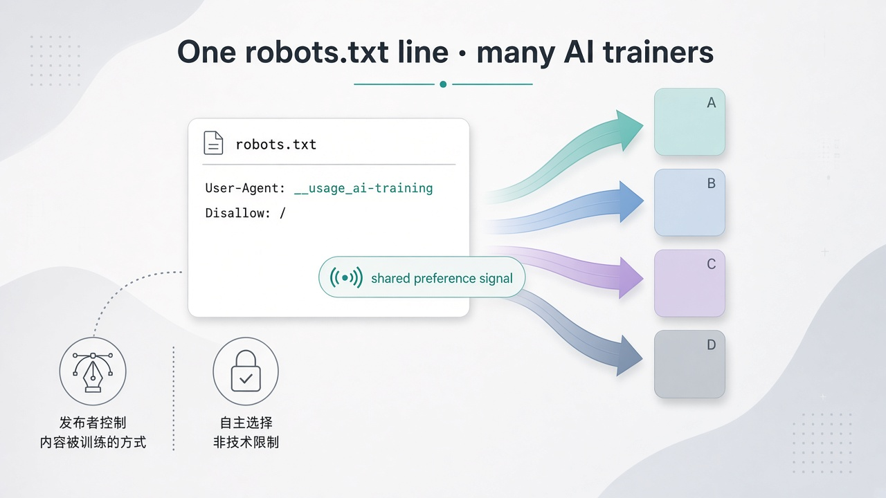
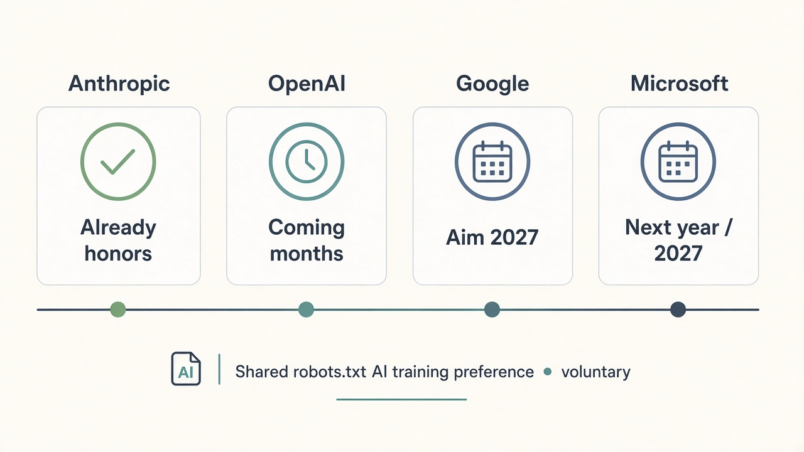

# robots.txt 写一次，OpenAI / Google / 微软 / Anthropic 一起认：别拿我内容训模型



以前站点想说「别拿我的文章去训大模型」，得给 GPTBot、Google-Extended、ClaudeBot……一家一家写规则。漏一家，就等于默许一家。

2026 年 10 月 30 日，OpenAI 宣布会在 **robots.txt 里认一个共用信号**，让网站运营方一次表达：**内容能不能用于 foundational generative AI training**。同日前后，业界报道把 Google、Microsoft、Anthropic 也写进同一条「会认」的名单里。

对出版方和创作者，这不是又一个爬虫名单，而是——**同一句偏好，终于可以同时对多家说**。

先钉边界，再谈「写一次就完事」。

## 先钉边界：是偏好信号，不是安全锁

别听成「今天起四大厂立刻全网生效」或「改了 robots.txt，旧训练集也能洗干净」。OpenAI 自己的口径更窄：

| 项 | 官方 / 可核口径 |
| --- | --- |
| 是什么 | robots.txt 里的 **common signal**，表达 foundational generative AI **训练**偏好 |
| 性质 | **Voluntary**；参与方协调认同一信号 |
| 不替代什么 | **不取代**现有 crawler controls；GPTBot / Google-Extended 等专属规则继续有效 |
| OpenAI 落地 | **aim to implement in the coming months**，细节落地时再发 |
| 技术底座 | 基于 IETF AI Preferences working group 相关工作；仍是草案协调，不是立法 |

两句必须一起说：

- **守规矩的公司**可以按这个信号少爬 / 不把你的内容拿去训基础模型。
- **不守规矩的爬虫**仍然可以无视——robots.txt 从来不是防火墙。

改文件也**不会**把已经进过训练集的内容「撤回」。这是往后的偏好表达，不是时光机。

## 谁何时落地：别把「宣布」当成「已生效」



时间线要拆开写，不然读者会以为今晚改完明天四家同时听话：

| 参与方 | 落地口径（写稿时可核） |
| --- | --- |
| **Anthropic** | 报道称 **已采纳** 该共享信号 |
| **OpenAI** | 官方：**coming months** 落地，届时再发细节 |
| **Google** | 开发者博客：计划支持 shared AI training control；**aim to support in 2027**；建在既有 Google-Extended 之上 |
| **Microsoft** | 报道称计划 **明年** 支持；并提到更细的 AI training / AI grounding 偏好，且称偏好不影响 Bing 搜索结果展示 |

再补两句别混进主叙事：

- The Verge 等报道写：共享 policy token 由 Anthropic 的 Kevin Kelley 提案、走 IETF；四家称遇到共享 token 时会限制其 AI crawlers 访问——这是**报道转述**，落地节奏仍以各家自己公告为准。
- Meta 的 Andy Stone 公开表态支持「共同信号」，但**没有**被写成「已明确承诺 honor」。别把「表态支持」写成「已经加入」。

Google 还有一条对站长很实用的衔接：若你用 policy token 选择退出训练、又没显式写 Google-Extended，Google **计划**按 disallow Google-Extended 来解释。专属规则和共享信号可以并存，不是二选一。

## 出版方 / 创作者为什么在乎

三件事，跟「今晚要不要打开 robots.txt」有关。

**第一，规则从「一家一爬虫」变成「一次写、多家认」。** 媒体站、独立博客、文档站过去最烦的不是语法，是名单会变、漏配等于默许。共用信号把「我想不想被拿去训基础模型」抽成一条跨厂商偏好——活少了，口径也齐了。

**第二，训练偏好和搜索可见性终于更容易分开讲。** Microsoft 口径里，偏好可以细到 AI training 或 AI grounding，且称不影响 Bing 里展示；Google 早就把 AI 相关控制与「还能不能出现在搜索」拆开做过。对还靠搜索吃饭的出版方，这比「一刀切封所有机器人」现实得多。

**第三，行业规则在变，但别把它吹成版权胜诉。** 这是自愿协调 + IETF 工作组方向上的工程约定，不是法院判决，也不是全球强制标准。能多约束几家大厂的爬虫习惯，已经值得站点侧提前准备；指望它单独解决「内容被白嫖」，会失望。

## 怎么评：看草案形态，也看各家时间表

IETF 侧有一份个体 Internet-Draft（非正式标准），草案里的 policy token 长这样：

```
User-Agent: __usage_ai-training
Disallow: /
Allow: /press-kit/
```

要点也很「工程师」：

- Token 名是 **`__usage_ai-training`**（草案示例，落地以各家最终文档为准）
- **不引入**新的 directive 语法；沿用 Allow / Disallow
- `User-Agent: *` 通配组 **MUST NOT** 被当成匹配这个 policy token——别指望写一行 `*` 就顺便表达了训练偏好
- 表达的是**训练偏好**，不是替代爬取管控；站点**没有**写这一组，应视为**未表达**偏好，而不是默认禁止或默认允许

评产品 / 评行业新闻时，验收别停在「四家发了稿」：

1. 共享 token 有没有进你的 robots.txt，且语法按草案 / 最终规范写对
2. 旧的 GPTBot、Google-Extended 等专属规则还在不在——OpenAI 明确说**不取代**它们
3. 各家是否已真的 honor（Anthropic 已走在前面；OpenAI 数月内；Google / Microsoft 更偏 2027）
4. 你有没有把「不想被训」和「还要出现在搜索 / 摘要」拆开配置

## 站长今天就能做的检查表

1. **先读主源。** 打开 [OpenAI 公告](https://openai.com/index/helping-websites-express-ai-training-preferences)，确认自己要表达的是 foundational generative AI **training** 偏好，不是「禁止一切抓取」。
2. **加共享 token（草案形态）。** 在 robots.txt 增加 `__usage_ai-training` 组，按路径写 Disallow / Allow；记一句：这是 IETF 草案示例，各家正式文档出来后再对一次字段名。
3. **保留专属爬虫规则。** GPTBot、Google-Extended、ClaudeBot 等继续按你现有策略维护；共享信号是加法，不是替换。
4. **别用 `User-Agent: *` 冒充训练偏好。** 草案写明通配组不得匹配该 policy token。
5. **分清「训练」和「搜索可见」。** 还要出现在 Bing / Google 搜索结果里的，别把所有机器人一锅端；按各家 granular 控制拆。
6. **别指望清历史。** 改 robots.txt **洗不掉**已经进过训练集的内容；只影响愿意遵守的参与方在落地之后的行为。
7. **盯落地窗口，不要一次宣布就当全网生效。** Anthropic 已采纳；OpenAI 数月内；Google / Microsoft 瞄明年 / 2027。改完规则后，把「何时开始验 crawler 行为」写进自己的运维日历。
8. **对不守规矩的爬虫另做防护。** 速率限制、WAF、付费墙、法律与授权谈判——robots.txt 偏好信号管不到的，别假装管到了。

## 收尾真问题

互联网默认假设过很久：公开网页 ≈ 可被索引、可被引用，后来又默默变成「可被拿去训模型」。出版方一直缺的不是愤怒，而是**一句能同时对多家说清楚的话**。

这次共用 robots.txt 信号，给的就是那句话——自愿、可并存于旧规则、落地时间不一。真正该带走的不是「四大厂一夜变乖」，而是三件能立刻做的事：共享 token 写了没有；专属爬虫规则还在不在；有没有把「训练退出」和「搜索还要露脸」拆开。

官方原文：https://openai.com/index/helping-websites-express-ai-training-preferences
