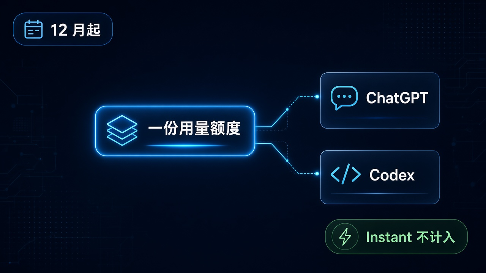
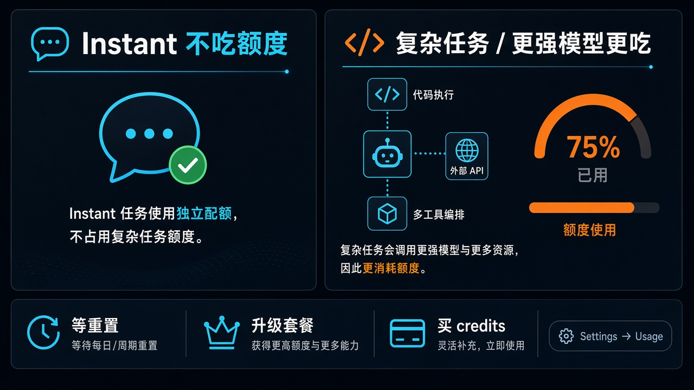

# 12 月起 ChatGPT 与 Codex 抢同一份 token 额度：Plus/Pro/Business，Instant 不算

你同时开着 ChatGPT 聊天、又用 Codex 写代码。从 **12 月**起，如果你是 **Plus / Pro / Business**，这两边会开始**抢同一份用量额度**——按 **token** 计，不是按「聊了几条」。

第一反应通常是：那聊天会不会把写代码的额度吃光？反过来呢？

先钉一句：**Instant 聊天不计入这份用量。** 会吃额度的，是会消耗 allowance 的那一类 ChatGPT / Codex 用法；更先进的模型、更复杂的任务，一般吃得更多。OpenAI 写得很直白：他们把 Work 侧的 agentic 能力往主 ChatGPT 体验里并，所以用量也要合成一份看。

具体哪一天落地、各档一共多少 token、credits 卖多少钱——帮助页没写。别把「12 月」脑补成「某日零点全网断供」。

## 边界先钉死：合并的是什么，不是什么

| 项 | 官方口径 |
| --- | --- |
| 生效 | **Starting in December**；未给具体日号 |
| 计划档 | **Plus / Pro / Business** |
| 怎么合 | ChatGPT 与 Codex 的 **usage allowance 共享** |
| 计量 | **tokens** |
| 谁更吃 | 所选模型 + 任务复杂度；更先进模型、更复杂任务一般更吃 |
| Instant | **Instant chat will not draw from your usage** |
| 过渡预期 | 认真准备、减少打断；**多数人不必比现在更频繁地等重置** |
| 去哪看 | **Settings → Usage**：合并剩余用量 + 重置时间 |
| 触顶 | 等重置 / 升级套餐 / **买 credits** 继续用 eligible features |

两句必须一起说：

- **不是「所有聊天都在抢 Codex 额度」。** Instant 明确不从这份 usage 里扣。
- **不是「人人 12 月立刻断供」。** 官方预期多数人重置频率不会比现在更糟；真顶到了，有三条路，不是死胡同。

## 生效口径：只到「12 月」，不到「某日时刻表」

帮助页 Updated 戳大约在 2026-10-31 前后，正文只用 **Starting in December**。没有「12 月几号」、没有「UTC 几点切」、没有「先切 Pro 再切 Plus」这类分批表。

能确定的只有三块：

1. **谁受影响：** Plus、Pro、Business 的 usage allowance，在 ChatGPT 与 Codex 之间共享。
2. **为什么现在说：** 把 Work 的 agentic 能力并进主 ChatGPT 体验——产品形态在合，计量也跟着合。
3. **你怎么自查：** Settings → Usage 看 **combined remaining usage** 和 **reset times**。

旧帮助页里本来就有 Work / Codex 共享、credits、Instant 与推理类额度分开等说法；Business 侧也长期区分 Instant 与 reasoning / Pro / Work / Codex。这次新页强调的是：**从 12 月起，Plus / Pro / Business 把 ChatGPT 与 Codex 合成一份 allowance。** 别把旧页上的分档数字，直接贴成「12 月新政的新数字表」——主源没给新表，就别编。

Free、Go、Enterprise 这页没写一并改。没写的就当未定。

## 普通人会立刻算的那笔账

开发者心里那本账其实很朴素：白天 Codex 啃仓库，晚上 ChatGPT 里跑长任务、开 agentic 流程——如果两边曾经各算各的，合并之后就要重新排优先级。

但账本要拆两层：

1. **Instant 那一层。** 日常随手问、不进那份 allowance 的 Instant 聊天，按官方说法不从这份 usage 里抽。别把「随便聊两句」和「重活」混成一种消耗。
2. **会吃 allowance 的那一层。** 更强模型、更绕的任务、把 Work 那套 agentic 能力用起来的流程——这些才是和 Codex 抢池子的选手。OpenAI 自己也说：选什么模型、干什么活，决定你吃多少。

所以标题党式的「聊天会不会弄垮写代码」要改口：先问清楚你用的是不是 Instant，以及你是不是在跑会啃 token 的重活。池子只有一份，但不是每一句话都从同一口井里舀水。

## 怎么评：给要干活的人，不给恐慌标题

**对天天写代码的人**

1. **把 Codex 和会吃额度的 ChatGPT 用法当成同一本账。** 12 月之后，别再假设「聊天额度」和「写代码额度」永远分家。
2. **重活提前看 Settings → Usage。** 合并剩余量和重置时间会摆在那里；顶到了再惊讶，不如开干前瞄一眼。
3. **Instant 留给轻量对话。** 能用 Instant 解决的，就别一上来上最贵模型硬刚——不是道德说教，是池子只有一份。

**对只是 Plus 聊天、偶尔点 Codex 的人**

1. **先别按「聊天全灭」理解。** Instant 不计入；你的日常闲聊未必在抢那份 allowance。
2. **如果你开始重度用 agentic / 复杂任务，再把 Codex 当第二生产力，账才会紧。** 官方说多数人不必比现在更常等重置——前提大概是你的用法别突然翻倍。
3. **别自行扩写成全站所有档位同一天换规则。** 这页点名的是 Plus / Pro / Business。

**对团队管理员**

1. **Business 要提前跟同事对齐「谁在啃同一份池」。** 聊天侧的重任务和 Codex 侧的长会话，会互相可见地耗。
2. **触顶预案写进习惯：等重置、升级、买 credits。** 帮助页就这三条，没有第四条魔法开关。
3. **过渡期别承诺「额度完全不变」。** 官方说的是多数人不必更频繁等重置，不是「用量曲线零变化」。

## 触顶检查表：三条路，外加一个入口

官方路径很短，够用就行：

| 你想做的事 | 动作 |
| --- | --- |
| 先搞清楚还剩多少 | 打开 **Settings → Usage**，看合并剩余量与重置时间 |
| 还能不能先撑过去 | **等用量重置** |
| 长期不够用 | **升级套餐** |
| 这轮还得继续用 eligible features | **买 credits** |

过渡期他们自称在认真准备、减少打断。你能做的可验证动作也很少：分清 Instant vs 会吃共享 allowance 的用法，开干前看一眼 Usage，触顶时走上面三条之一。别等 12 月某一天突然弹窗，才第一次找这个设置页。

## 收尾真问题

12 月并池之后，你真正会改的是用法，还是套餐？

如果 Instant 能扛住日常，重活才上共享池——多数人可能只是多看一眼 Usage。如果你本就把 ChatGPT 当 agent 工作台、又把 Codex 当主力 IDE，那同一份 token 额度会逼你做取舍：哪边值得烧，哪边改用更轻的路径，哪边干脆上 credits。

帮助页没给你一张「该升哪档」的对照表。它只告诉你：池子要合了，Instant 不进池，数字和重置时间去 Settings 看，顶了有三条路。

剩下的账，得你自己用真实用量算。

官方原文：https://help.openai.com/en/articles/20001625-understanding-chatgpt-and-codex-usage-limits
