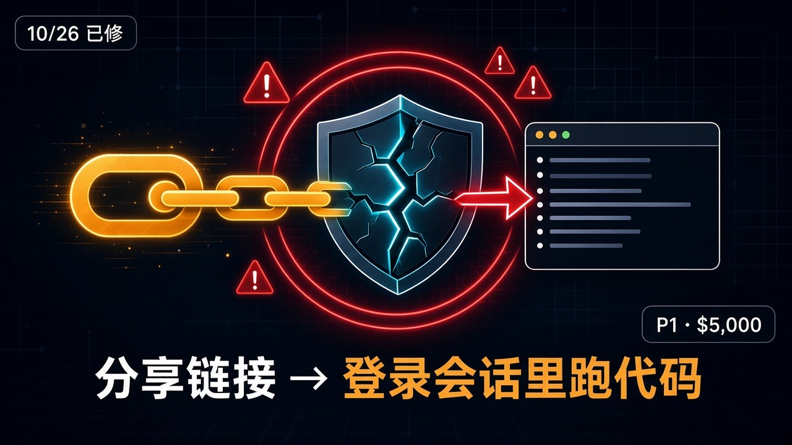
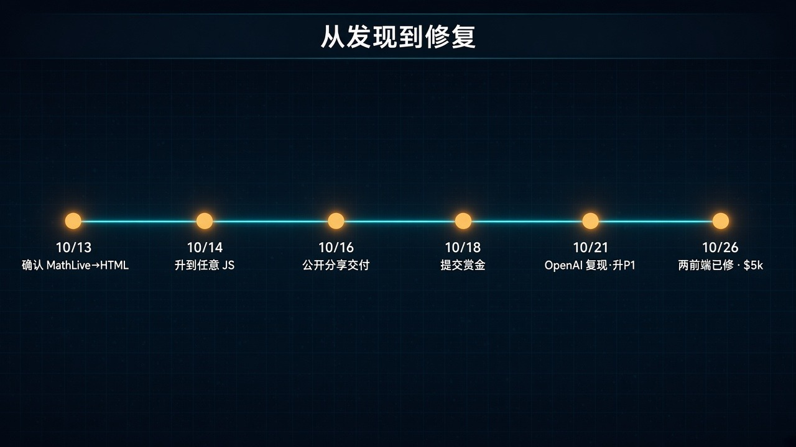

# 沙箱看起来牢：一个 ChatGPT 分享链接就能接管你的账号（10/26 已修）

你收到一条 ChatGPT 公开分享链接。点开，等几秒，页面好像正常——可代码已经在**你已登录的 chatgpt.com 会话**里跑起来了。

Parameter.ai 研究员 Mukul Goyal 在 2026 年 10 月演示过这条链：恶意公开分享 → 受害者打开 → HTML Preview 侧的消息跨过沙箱 → 主页里的 MathLive 听信后把 markup 写进页面 → 最终在受害者身份下调用已认证 API。能枚举会话列表、读出**从未分享过**的私聊片段，并往外带数据。本质上，就是代操作对方的 ChatGPT 账号。

受害者不必装 App、进 Project、粘代码、开开发者工具。自动 Preview 那一版，**打开分享链接是唯一必需动作**；更稳的复现路径里，再点一次 Preview 就够。

别慌成「今天点开就会中招」。OpenAI 已于 **10 月 26 日**按 **P1** 修完，两套 Web 前端都拒收报告里那类跨帧 MathLive 消息，赏金合计 **$5,000**。用户端**无需操作**。下面先钉边界，再拆攻击链怎么拼、时间线怎么走、做事的人今天还能带走什么。

## 先钉边界：已修，不是全网还在中招

| 项 | 披露口径 |
| --- | --- |
| 触发面 | 恶意**公开** ChatGPT 分享链接 |
| 受害者动作 | 打开链接；自动 Preview 版只需这一下，更稳路径再点一次 Preview |
| 结果 | 在受害者已登录会话里跑 JS；读未分享私聊、枚举会话、调已认证 API |
| 不必做的事 | 装 App、进 Project、粘代码、开开发者工具 |
| 沙箱本身 | Preview **不能**直接读 `parent.document`——沙箱看起来牢 |
| 真正缺口 | 主页另一个组件（图加载的 MathLive）**听信跨帧消息** |
| 修复 | **2026-10-26** 两前端拒收报告中的跨帧 MathLive 消息；**P1**；赏金 **$5,000** |
| 用户动作 | **无需操作** |

两句必须一起说：

- **危险的是「修前的恶意分享 + 已登录会话」**，不是「凡是 ChatGPT 分享都危险」。
- **10/26 之后按披露已修**；别把历史复现写成「现在点开还会接管」。

## 攻击链怎么拼：两块各自无害，合在一起穿沙箱

真正值钱的不是「又一个 XSS」，而是：Preview 被关在别的域名里，看起来隔离到位；主页却另有一个愿意代写 HTML 的听信者。

拆开看：

1. **图（graph）加载 MathLive。** 画图之外，它在主页装上 virtual-keyboard 相关的 `postMessage` 监听。
2. **HTML Preview 在另一域名沙箱里跑。** 浏览器当异站：Preview 里的代码读不到主页 DOM——这一步本身没翻车。
3. **MathLive 对那类消息 origin 校验为 none。** 任意来源都能改 layout；layout 还允许带 **HTML**。
4. **Preview 发两条消息：`update-setting` + `show`。** MathLive 把 markup 赋给主页 `innerHTML`；名叫 `createHTML` 的助手**不是消毒器**，只是把字符串标成可信再放行。
5. **`iframe srcdoc` 不带 sandbox。** 新文档继承 `chatgpt.com` 身份，能摸父页。
6. **CSP 拦了 inline，却放行 YouTube。** 用 YouTube oEmbed 的 JSONP-style callback，在错误返回前仍把 callback 拼进响应——绕过 CSP，任意 JS 落地。

公共分享要保留完整链，对话里得同时放两样：**真图初始化 MathLive**，再加**助手写的 HTML Preview 发那两条消息**。缺图就没人听；缺 Preview 就没人发。早期版本还依赖研究者可控 App 当发送端，或用原生 HTML 附件——附件能发消息，但公开导出时常丢掉图，监听装不上。把两块写进同一条普通公开对话，`/share/` 链接才变成可投递的完整载体。

## 时间线：两周从实验室到赏金

按 Parameter 披露表压成一条线：

| 日期 | 事件 |
| --- | --- |
| **10/13** | 确认生产环境上 MathLive message→HTML 路径 |
| **10/14** | UI 复现；从固定 alert 升到任意 JS |
| **10/16** | 跨账号、跨工作区公开分享交付（一次 Preview 点击） |
| **10/17** | 确认自动 Preview；硬刷新后仍可复现 |
| **10/18** | 提交 bug bounty |
| **10/19** | 补上私聊外泄证明 |
| **10/21** | OpenAI 复现；初判 P2 升为 **P1** |
| **10/22** | 一个前端已修，第二个还在更新 |
| **10/23** | CSP 变化挡住部分链，一个前端仍待更新 |
| **10/26** | 两前端均拒收报告消息；resolved；赏金合计 **$5,000** |

OpenAI 复现了两件事：JS 在受害者会话里执行，以及私聊内容可被读出。修复滚动时，CSP 先挡掉一段旧路径，并不等于根因消失——根因是主页听信者不再认那类跨帧指令。

## 怎么评：给做事的人，不给标题党

验收别停在「ChatGPT 被打穿」四个字。

**对普通用户**

1. **10/26 后按披露已修，不必恐慌清号。** 用户端没有「再点一次才能安全」的补丁动作。
2. **分享链仍当不可信输入。** 修的是这条 MathLive 缝；不等于「陌生分享永远无害」。来历不明的 `/share/`，少在已登录的工作号上随手点。
3. **别把「沙箱」四个字当免死金牌。** 这次沙箱本身没直接读 parent；垮的是主页另一个组件愿意代执行。

**对产品 / 前端 / 安全同学**

1. **`postMessage` 要同时核 origin 和 source。** 只认消息 type、不认谁发的，等于给异站留邮筒。
2. **跨窗设置勿塞 raw HTML。** layout / theme / keyboard 这类配置一旦能带 markup，后面几乎总会接到 `innerHTML`。
3. **动态文档若可被不可信帧影响，保持 sandbox。** 无 sandbox 的 `srcdoc` 继承宿主身份，是这次从「插 HTML」升到「跑 JS」的关键一跳。
4. **CSP 是备份，不是唯一屏障。** YouTube oEmbed 只是最后一公里绕法；只封这一个端点，听信者仍能往主页塞 HTML。
5. **跨功能缝隙才出洞。** 图、Preview、公开分享、MathLive、帧创建、CSP——单独看都像合理功能；合在一页才穿出来。分享面、预览面、第三方控件，要一起做跨特征测试。

**别吹成通吃**

- 不是「所有 ChatGPT 分享现在仍会接管账号」。
- 不是「Preview 沙箱完全没用」——它挡住了直接读 parent；问题在桥。
- 不是「用户必须立刻改密码 / 退登」——披露口径是已修、用户无需操作。
- 不是「只有点 Preview 才会中」——自动 Preview 版把必需动作收到「打开链接」。

## 今天就能做的检查表

1. **个人侧：确认自己在跟「已修」叙事对齐。** 10/26 后按 Parameter / OpenAI 处置，不必为这条历史洞单独清会话；陌生分享仍少点。
2. **团队侧：分享链接当不可信输入。** 客服工单、社群、邮件里甩过来的 `/share/`，用干净配置文件或退出登录的窗口看，别默认「反正是 ChatGPT 域名」。
3. **自查产品里的 `postMessage`。** 搜 virtual-keyboard、layout、theme、preview bridge；状态变更消息有没有同时校验 `event.origin` 与 `event.source`。
4. **自查「配置里能不能带 HTML」。** 任何跨窗可写的 markup，默认先当攻击者输入。
5. **自查动态 `iframe` / `srcdoc`。** 内容可能来自不可信帧时，sandbox 是否一直带着；缺了就等于把宿主身份借出去。
6. **别把 CSP allowlist 当根因修复。** 媒体域名、JSONP、旧 callback 端点——都是备份层；听信者收紧才是主开关。
7. **公开分享 + 富预览 + 第三方控件，做一次跨功能复测。** 单独测 Preview、单独测图表，测不出「图装监听 + Preview 发消息」这种缝。

## 收尾真问题

Preview 被关在别的站，图只是画图，MathLive 只是键盘，CSP 还放行了主流媒体——每一块单独讲，都能说得通。

真正该带走的不是「大模型产品不安全」，而是一句更窄、更能落地的话：**隔离强度，等于你允许跨过隔离的每一座桥。** 沙箱看起来牢的时候，先问主页还有谁在听跨帧消息、听完会不会把 raw HTML 写进自己的文档。

分享面已经默认暴露给陌生人。下一次加「一键预览」「互动图」「虚拟键盘」之前，把桥的名单过一遍，比事后解释 P1 便宜得多。

官方原文：  
https://www.parameter.ai/labs/we-found-a-gap-at-openai
