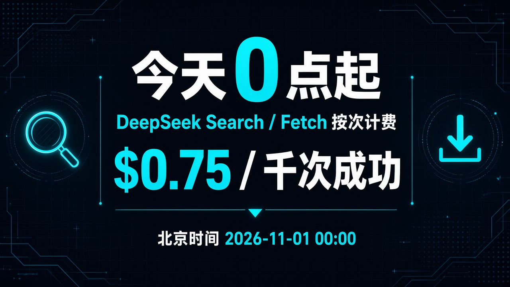
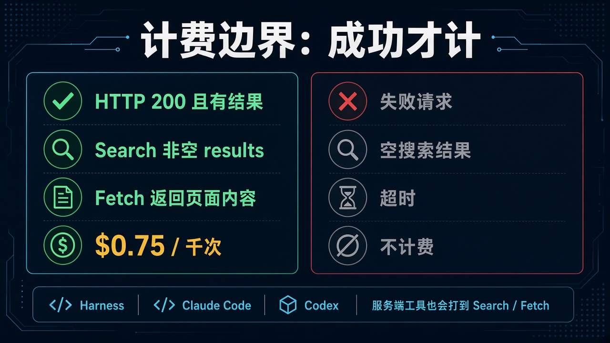

# 今天 0 点起：DeepSeek Search / Fetch 按次收费，$0.75 / 千次成功调用

跑 agent 搜网页的人，账单今天会突然变敏感。

**北京时间 2026-11-01 00:00** 起，DeepSeek 的 **Search** 和 **Fetch** 开始按次计费：各 **$0.75 / 千次成功请求**。不是按 token，也不是按返回了几条结果。

更扎心的一点：如果你经 **DeepSeek Harness、Claude Code、Codex** 在用 DeepSeek API，服务端工具调用**已经会打到**这两条 API。以前这段免费；从今天 0 点起，成功一次就计一次。

别把标题脑补成「整个 DeepSeek 聊天都开始收费」。模型 token 价没在官方口径里改；改的是搜网页、拉网页这两把工具。

## 边界先钉死：什么算钱，什么不算

| 项 | 官方口径 |
| --- | --- |
| Search | 找网页，结构化结果；`POST /v1/tools/search`；自研搜索引擎 |
| Fetch | 拉单个网页，内容以 Markdown 返回；`POST /v1/tools/fetch` |
| 单价 | Search、Fetch **各** $0.75 / 1000 次成功请求 |
| 怎么计 | **按成功请求计费**；不按 token、不按结果条数 |
| 才计费 | HTTP **200** 且产生结果：Search 须非空 `results`；Fetch 须返回页面内容 |
| 不计费 | 失败请求、空搜索结果、超时 |
| `count` | 只控制返回条数，**不影响单价** |
| 生效 | **北京时间 2026-11-01 00:00**；Harness / Claude Code / Codex 服务端工具调用一并开始收费 |
| 限流 | Search 账户级 **100 QPS**；Fetch 账户级 **25 QPS**（另有 per-domain QPS）；超限 429，与模型并发限额分开 |
| 扣款 | 充值余额或赠送余额；**优先赠送余额** |

两句必须一起说：

- **不是「搜一次就必扣钱」。** 空结果、失败、超时官方明确不计。
- **不是「只有你手写调 API 才收费」。** Harness、Claude Code、Codex 路径上的服务端工具，也会打到 Search / Fetch。

## 生效点：今天 0 点，不是「下周再说」

官方文档写得很干脆：这些服务端工具调用此前免费；按次计费自 **北京时间 2026-11-01 00:00** 起。

今天就是 11 月 1 日。能确定的只有三块：

1. **谁受影响：** 直接调 Search / Fetch 的人；以及经 Harness、Claude Code、Codex 用 DeepSeek API、让 agent 去搜/拉网页的人。
2. **怎么量：** 成功请求次数。一千次成功 Search 是 $0.75，一千次成功 Fetch 又是 $0.75——两条线分开计。
3. **什么时候开始：** 已经开始。别再按「免费工具随便扫」来估账单。

定价页扣款规则也写了：从充值余额或赠送余额扣，优先赠送余额。赠送额度还在的人，先吃赠送；吃完才动充值余额。

## 跑 agent 的人会立刻算的那笔账

开发者心里那本账其实很朴素：一个会联网的 agent，一轮任务里可能 Search 好几次，再 Fetch 几页深读。以前这部分不显眼；从今天起，它变成和模型 token 并列的另一条费用线。

账要拆两层：

1. **成功才进账单的那一层。** HTTP 200 且 Search 有非空 results、Fetch 真返回了页面内容——才按次计。空搜、挂了、超时，官方不计费。
2. **重试策略会不会把自己打穿的那一层。** 「空结果不计费」听起来很友好，但如果你的循环是「搜不到就换词再搜、再搜、再搜」，成功的那几次照样累计。失败免费不等于循环免费。

所以别只问「贵不贵」。先问：你的 Harness / Claude Code / Codex 路径有没有开搜网页；一轮任务大概会打出多少次成功 Search、多少次成功 Fetch；空结果时你是停，还是无脑重试。

粗算一张心算表就够用：成功 Search 1000 次 ≈ $0.75；成功 Fetch 1000 次 ≈ $0.75。一天真打出两万次成功 Search，单 Search 就是约 $15——还没算 Fetch，也没算模型 token。

## 怎么评：给要控账单的人，不给恐慌标题

**对天天跑联网 agent 的人**

1. **把 Search / Fetch 当成第二本账。** 模型 token 是一本；工具按次是另一本。今天起两本都要看。
2. **先摸清入口。** 直接调 API 的好认；经 Harness、Claude Code、Codex 的服务端工具，也已经会打到这两条——别假设「我没手写 search 就不花钱」。
3. **重试要有上限。** 空结果不计费，不等于无限重试零成本；成功那几次会叠上去。

**对只是偶尔让 agent 查一下网页的人**

1. **先别按「DeepSeek 全面涨价」理解。** 改的是 Search / Fetch 工具调用，不是把聊天一口价改掉。
2. **低频成功调用，账单体感可能仍很轻。** $0.75 / 千次，对偶发查询通常不是吓人数字；吓人的是无人值守循环。
3. **限流别拿二手数字。** 官方现文是 Search 100 QPS、Fetch 25 QPS；超限拿 429，跟模型并发限额分开算。

**对团队里管余额的人**

1. **看清扣款顺序：赠送优先，再充值余额。** 赠送还在时，账单曲线可能「看起来还不疼」——疼会延后到赠送耗尽。
2. **QPS 和费用是两件事。** 429 是速度顶住了；费用是成功次数叠起来了。别混成一个告警。
3. **别自行扩写成「竞品对照表」。** 这里只跟 DeepSeek 官方文档走；别的搜索 API 贵多少，另核另写。

## 检查表：今天就能做的四件事

| 你想搞清楚的事 | 可验证动作 |
| --- | --- |
| 钱从哪扣 | 打开 DeepSeek 余额 / 账单，看充值与赠送；官方优先扣赠送 |
| 会不会被工具路径打到 | 查 Harness / Claude Code / Codex 是否启用了会搜网页、拉网页的服务端工具 |
| 一轮任务大概多贵 | 估成功 Search 次数 + 成功 Fetch 次数，各按 $0.75 / 千次心算 |
| 重试会不会烧穿 | 给空结果、超时、429 设上限；成功才计费，但成功重试照样累计 |

限流备忘：Search 账户级 100 QPS；Fetch 账户级 25 QPS，另有 per-domain QPS。超限是 429，不是「悄悄多扣钱」。

## 收尾真问题

免费工具期结束之后，你改的是配额，还是改 agent 会不会乱搜？

如果本来就偶发查两页，按次计费可能只是账单多一行小数。如果你让 agent 自主规划「搜 → 读 → 再搜」，那 $0.75 / 千次成功会逼你做取舍：哪些查询值得打成功请求，哪些该缓存，哪些空结果就该停，而不是换词继续撞。

官方文档没给你一张「该不该关联网工具」的决策树。它只告诉你：今天 0 点起按成功次数收费，失败和空结果不计，Harness / Claude Code / Codex 也会打到这两条 API，限流是 100 / 25 QPS。

剩下的账，得你用真实调用次数算。

官方原文：https://api-docs.deepseek.com/guides/search.md

定价同口径：https://api-docs.deepseek.com/quick_start/pricing.md
