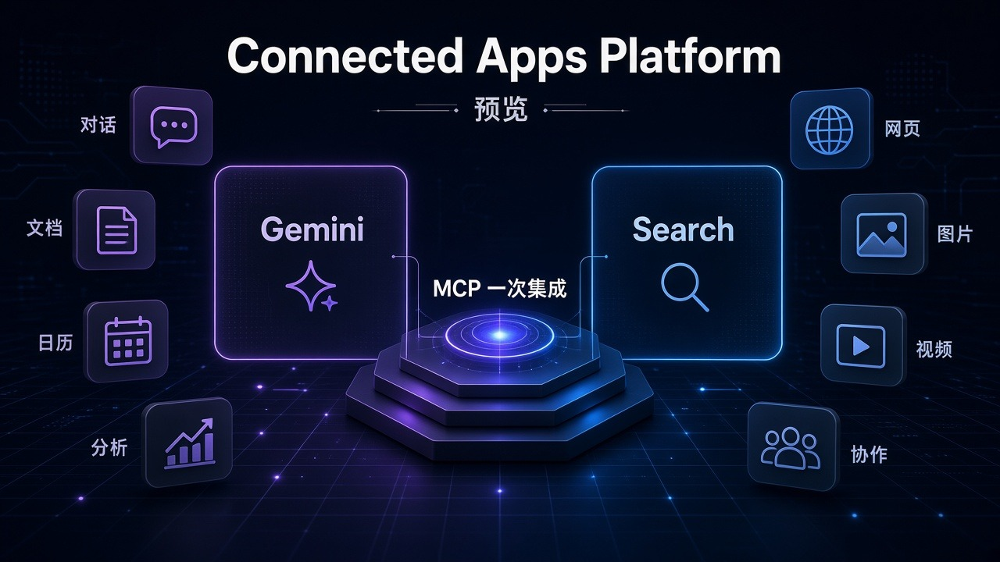
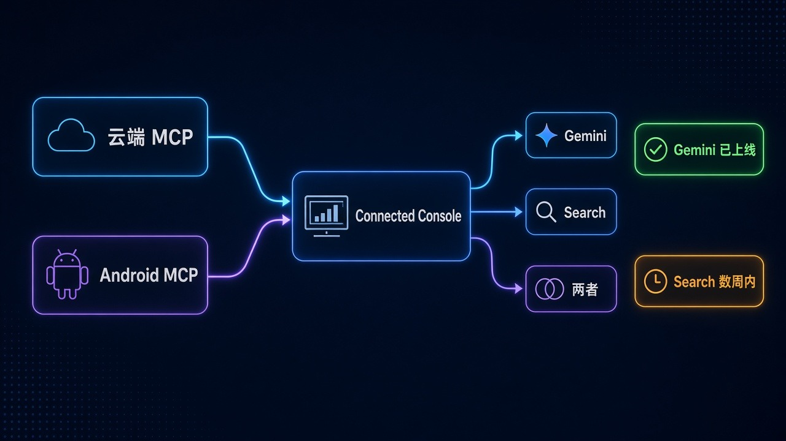

# 一次集成上 Gemini 和 Search：Google Connected Apps Platform 预览开了

你在 Gemini 里点一下，就能进 Adobe 改图、Peloton 开练、Calm 做冥想——不用再跳应用商店找入口。

Google 在 **2026-10-28** 开了 **Connected Apps Platform** 预览：开发者用 **云端 MCP** 或 **Android MCP** 做一次集成，再在 **Google Connected Console** 注册、测试、提交，评审前可选上架到 **Search**、**Gemini app**，或两者。

普通人在乎的是：聊天助手开始变成**可接第三方办事的入口**。开发者在乎的是：以前要分别摸 Search、Gemini 两条线，现在有统一入口。两边都别吹过头——这是**分阶段预览**，不是全球全量、也不是所有应用立刻两边同时上。

## 边界先钉死：开了什么，没开什么

| 项 | 官方口径 |
| --- | --- |
| 产品 | **Connected Apps Platform** 预览 |
| 日期 | **Oct 28, 2026** |
| 给谁 | 开发者统一构建与管理面向 **Search** 与 **Gemini app** 的应用 |
| 集成 | **cloud-hosted MCP server**，或 **Android MCP**（AppFunctions APIs） |
| 控制台 | **Google Connected Console**：注册、测试、提交 |
| 上架选择 | 评审前可选 **Search / Gemini app / 两者** |
| 上线后 | 可看 traffic、latency、error rates；保留品牌身份（verified logos、authenticated accounts） |
| 开放节奏 | **分阶段**；未来数月加更多开发者、市场、Google 产品 |
| 报名 | developers.google.com/connected-apps |
| 已有规模 | Search 与 Gemini 之间已有 **50+** Connected Apps |
| 本批伙伴 | **Adobe、Experian、Localiza、Peloton** 已在 **Gemini** 上线；**未来数周**带到 Search；**Calm** 将在 Search 与 Gemini **两端**上新集成 |

两句必须一起说：

- **不是「已全球全量、所有开发者立刻可上」。** 官方写的是 preview、分阶段开放。
- **不是「Adobe / Peloton 这批已经两边同时可点」。** 点名伙伴目前在 Gemini 上线，Search 是「coming weeks」；Calm 才是明确两端一起上。

## 时间线：10/28 开预览，伙伴分两拨跟进

1. **平台侧：** Connected Apps Platform 预览上线；文档与报名落在 developers.google.com/connected-apps。
2. **伙伴侧（Gemini 已上）：** Adobe、Experian、Localiza、Peloton 等已在 Gemini 对用户可用。
3. **伙伴侧（Search 跟进）：** 同一批 Connected Apps，官方说未来数周带到 Search。
4. **两端同发：** Calm 将在 Search 与 Gemini 都上新集成。
5. **存量：** Search 与 Gemini 之间已有 50+ Connected Apps，覆盖生产力、票务、健康健身等。

帮助中心有 Search / Gemini 各自的 Connected Apps 列表页——要核对「你现在到底能连哪些」，去那边查，别只盯新闻稿里的几个名字。

## 普通人为什么在乎：聊天框开始能办事

以前的路径多半是：问 AI → 得到建议 → 自己打开 App / 网页再操作。Connected Apps 想缩短的是最后一截：在 Search 或 Gemini 里直接接到第三方能力。

这对日常意味着什么？不是「AI 取代了 App Store」，而是**入口变了**：你可能还在用 Adobe、Peloton、Calm，但触发点从桌面图标，挪到了对话和搜索结果里。

也正因为入口变了，分清「Gemini 已上」和「Search 还在跟进」就很重要。同批伙伴里，Gemini 侧可以先试；Search 侧官方只给了「数周内」的窗口，没给具体日号。别在 Search 里找不着就骂「假新闻」——时间线本来就不是同步切齐。

## 开发者怎么评：一次集成，不等于一次通吃

**对想进 Gemini / Search 的应用方**

1. **路径清楚：** 云端 MCP 或 Android MCP → Connected Console 注册测试提交 → 选上架面。
2. **上架面要自己选。** 官方允许评审前选 Search、Gemini，或两者——产品策略得先想清楚，别默认「两边自动同步」。
3. **运维指标留在 Console。** traffic、latency、error rates 上线后能看；品牌侧还能保留 verified logos 与 authenticated accounts。
4. **名额是分阶段的。** 想进的人先去 developers.google.com/connected-apps 报名看文档；别假设提交了明天就全市场可见。

**对只是普通用户的人**

1. **先在 Gemini 里找这批新伙伴。** Adobe、Experian、Localiza、Peloton 官方写的是 Gemini 已上线。
2. **Search 侧先等数周窗口。** 同批带到 Search 是「coming weeks」，不是「今天同步」。
3. **Calm 留意两端。** 官方单独写了将在 Search 与 Gemini 都上。
4. **完整名单去帮助中心。** 博客只点名几家；50+ 的全貌在 Search / Gemini 的 Connected Apps 帮助页。

**对观望 MCP 生态的人**

Google 把 MCP 写进正式接入路径，等于把「助手接第三方工具」从演示推进到可提交、可监测的产品台。但预览 + 分阶段，说明门槛、审核、市场覆盖都还在扩。别把它读成「MCP 一夜统一了 Google 全产品线」。

## 检查表：你现在能做什么

| 你是谁 | 可验证动作 |
| --- | --- |
| 开发者 | 打开 developers.google.com/connected-apps，报名预览、读文档 |
| 想接移动端能力 | 评估 Android MCP + AppFunctions 是否匹配现有 App |
| 想接云端能力 | 评估 cloud-hosted MCP server 路线 |
| Gemini 用户 | 在 Gemini 里查 Adobe / Peloton 等是否已对你所在账号可用 |
| Search 用户 | 记住同批伙伴 Search 侧还在「数周内」窗口，同时去帮助中心看已有 Connected Apps |
| 产品/运营 | 分清「平台预览开放」≠「你的应用已全量上架」；上架面要显式选择 |

能做的动作就这些。没有「立刻全球通吃」的开关，也没有「所有 Google 产品明天都接上」的承诺。

## 收尾真问题

聊天助手变成办事入口之后，你更在乎的是**多几个能点的 App**，还是**谁有资格出现在这个入口里**？

对用户：Gemini 里先用起来的伙伴，和 Search 数周后跟上的同批能力，会不会变成两套习惯？对开发者：一次 MCP 集成能覆盖两边，听起来香——但分阶段名额、审核、以及选 Search 还是 Gemini，才决定你是不是真能「建一次、两边见人」。

官方给的是预览入口、50+ 存量、一小波点名伙伴，以及未来数月继续加人、加市场、加产品。剩下的，得看 Console 里真实流量，和帮助中心里那份会变长的名单。

官方原文：https://blog.google/innovation-and-ai/technology/developers-tools/connected-apps-one-place/
