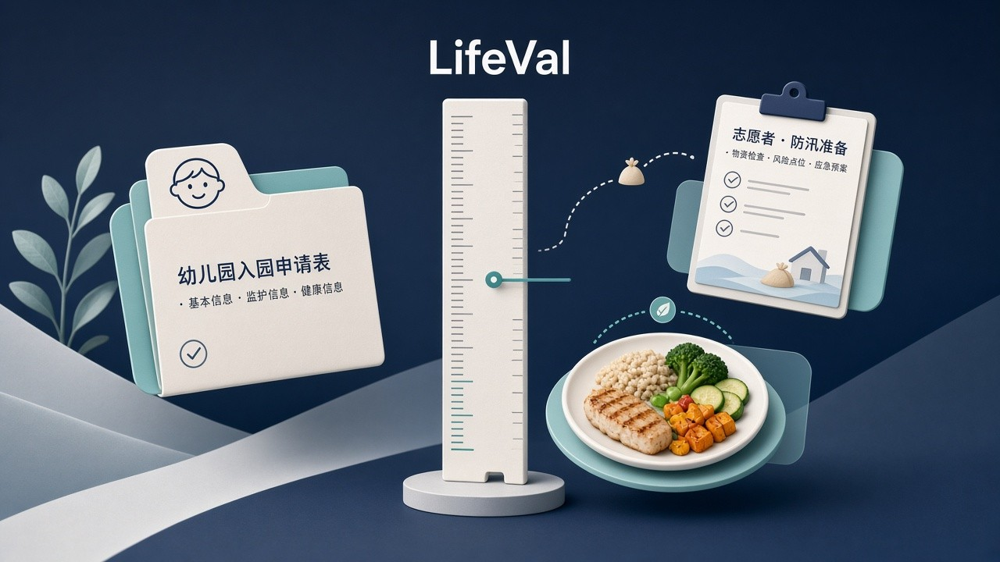
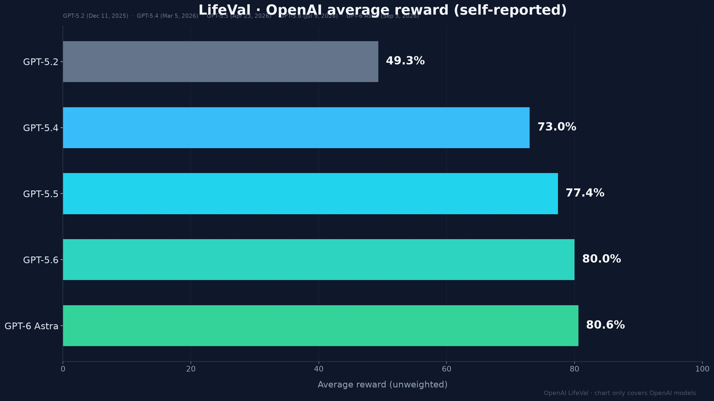

# 从入园到防汛：OpenAI LifeVal 把「好不好用」拉回过日子，Astra 均分约 80.6%

搬家之后怎么报对口幼儿园？家里有人刚确诊糖尿病，一周的备餐怎么排？汛期前怎么把志愿者排开？

OpenAI 在 **2026-11-02** 抛出一套叫 **LifeVal** 的评测：不问模型能不能刷榜，问它能不能在这些**过日子的活**上帮上忙。官方自报：最新的 **GPT-6 Astra** average reward 约 **80.6%**；大约九个月前的 **GPT-5.2** 只有约 **49.3%**。

先别鼓掌。这是 OpenAI **自建、自跑、自报** 的尺子；题库不公开，图上只有自家模型。把「好不好用」从刷榜拉回日常，是真事；把 80.6% 读成「终于能通吃生活」，是误读。

## 边界先钉死：测什么，不测什么

| 项 | 官方口径 |
| --- | --- |
| 产品 | **LifeVal**：Measuring AI progress on the tasks that matter in everyday life |
| 发布 | **November 2, 2026** |
| 题库起点 | **American Time Use Survey** + **Multinational Time Use Study**；再叠加 demographically representative survey of **3,995** respondents——人们最希望个人助手帮什么 |
| 任务域 | caregiving、health、education、household administration、personal finances、shopping、accessing government services |
| 用途 | 过去一年用来 track and drive improvement on everyday tasks |
| 叙事背景 | ChatGPT 周活超十亿；真正有用的个人助手不只聊天给建议，还要能 **take actions that get things done**；browser use / computer use / connectors 扩展了可帮的任务类型 |
| Headline 指标 | **average reward (unweighted)**；自测自报 |
| 题库 / 细则 | **未公开**；无独立复现、无他厂同台 |

两句必须一起说：

- **80.6% 不是「真实世界里百分之八十多的日常事做对了」。** 它是 OpenAI 自家 average reward；题怎么出、分怎么打，外人看不见。
- **图上只有 OpenAI 模型。** 没有 Claude、没有 Gemini、没有别的厂——别把自家进步曲线读成行业总榜。

官方页面还甩了几道「current models」单题示例：入园择校 **93.1%**、汛前管志愿者 **98.0%**、给家人找新住处 **100%**、远程陪奶奶看比赛 **96.3%**、糖尿病饮食备餐 **90.4%**。分数好看，但仍是同一套未公开尺子上的样例，不是你打开 ChatGPT 立刻能复现的通关率。

## 时间线：从时间使用调查到「过日子」尺子

1. **取材：** 先吃美/国际时间使用调查，知道人一天时间花在哪；再问近 **4000** 人：个人助手最该帮哪类事。
2. **定域：** 照护、健康、教育、家务行政、个人财务、购物、政府服务——偏「过日子要办的手续与安排」，不是刷数学竞赛。
3. **内驱一年：** OpenAI 说过去一年用 LifeVal track and drive 日常任务上的改进；能力叙事绑上 browser use / computer use / connectors——助手要从「给建议」扩到「能动手」。
4. **2026-11-02 公开：** 放出进度曲线与样例题；题库仍锁着。

## 普通人 / 开发者为什么在乎：尺子换了，不等于日子换了

刷榜党熟悉的是：同一套公开题、多家模型同台、分差到小数点。LifeVal 干的是另一件事——把评价标准挪到**入园、备餐、防汛、办证**这类场景，用时间使用调查和真实问卷定「什么叫有用」。

对普通人：你终于看到一家大厂愿意用「帮不帮得上忙」来讲进步，而不是又一张代码/数学榜。但「挂出日常题」≠「你家明天就能把入园手续甩给 agent」。单题样例漂亮，不等于跨城搬家、跨机构办证、跨系统填表都能自动过。

对开发者 / agent 产品人：这是产品优先级信号。OpenAI 明确把 everyday tasks 和改进挂钩，还点名 browser / computer use / connectors。你如果还只拿聊天体感当验收，和对方内部在推的「能办完事」会错位。另一面也硬：题库不公开，你没法用同一套题对标自己的 agent，也没法验他厂。

## 看点怎么评：曲线陡，末段扁，尺子自家定

| 模型 | 官方图日期 | Average reward |
| --- | --- | --- |
| GPT-5.2 | Dec 11, 2025 | **49.3%** |
| GPT-5.4 | Mar 5, 2026 | **73.0%** |
| GPT-5.5 | Apr 23, 2026 | **77.4%** |
| GPT-5.6 | Jul 9, 2026 | **80.0%** |
| GPT-6 Astra | Sep 3, 2026 | **80.6%** |

怎么读这条线：

1. **前半截跳得猛。** 5.2 → 5.4 大约 **+23.7** 分——日常任务这条线上，模型能力一度像开了加速器。
2. **后半截变慢。** 5.5 → 5.6 约 **+2.6**，再往 Astra 只 **+0.6**。到了八成附近，自家尺子上的边际增益已经很薄。
3. **没有外厂对照。** 你不知道 Claude / Gemini 在同一套题上会落在哪；也没法独立复现。进步是「相对自己的旧模型」，不是「相对全世界」。

单题样例普遍九十多分，headline 却是约 80.6%——说明均值被更难、更碎、更跨步骤的题拖着。挑几道漂亮题当「已经能过日子」，会漏掉整张卷子。

## 检查表：你现在能核对什么

| 你是谁 | 可验证动作 |
| --- | --- |
| 普通读者 | 打开 openai.com/index/lifeval/，确认日期是 2026-11-02、指标名是 average reward、题库未公开 |
| 关心「AI 能不能办事」的人 | 把样例题当场景清单：入园、备餐、志愿者、找房、远程陪护——对照自己真要办的手续，问缺的是聊天还是浏览器/账号/权限 |
| 做 agent / 助手产品 | 对照自家验收：是公开榜分，还是接近 LifeVal 的日常办事闭环；有没有 browser / computer use / connectors 这一环 |
| 写选型 / 采购材料的人 | 引用时写清：OpenAI 自建自报、无公开题库、无他厂对比；别把 80.6% 写成「日常任务成功率」 |
| 盯评测公平的人 | 记下「只有自家模型」和「题库不公开」两条；要同台证据，得等公开题或第三方复现 |

能核对的就这些。没有「换上 Astra 明天自动办完入园和医保」的开关，也没有「他厂已经同台输了」的结论。

## 收尾真问题

你更信一张**自家尺子**上的 **80.6%**，还是更想看到**题库公开、他厂同台**？

信前者：至少大厂开始用时间使用调查和近四千人问卷定义「有用」，把讨论从刷榜拽回入园、饮食、防汛；一年里从约 49% 拉到约 80%，说明日常任务这条线被当真推进过。信后者：没有公开题、没有外厂柱，80.6% 就只是内部进度条；末两代只再涨零点几，也提醒你——接近八成之后，继续涨分会越来越难，更别说跨出这把尺子。

LifeVal 真正挪动的，不是又一个小数点，是评价标准的锚点：从「榜上漂亮」挪到「日子里能不能办完」。锚点换了；尺子是谁刻的、能不能借给别人量，还是下一题。

官方原文：https://openai.com/index/lifeval/
