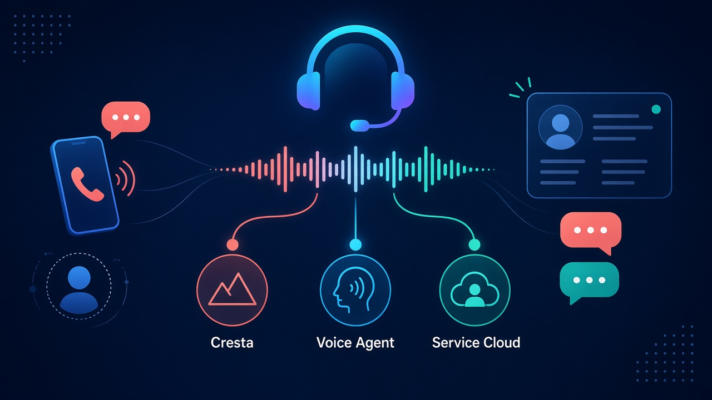
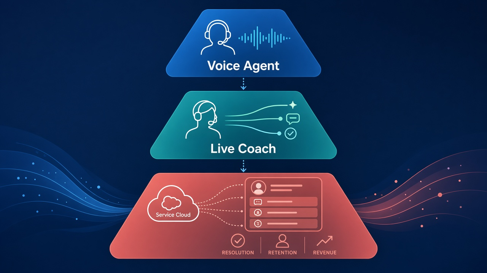

# 打客服时对面是谁：Salesforce 签协议买 Cresta，复杂通话语音 agent 并进 Service Cloud

打客服热线时，对面到底是谁？

真人接线员？端到端处理复杂通话的语音 agent？还是一边 AI 说话、一边真人被实时辅导？

**Salesforce** 在 **2026-11-02** 宣布：已签署**确定性收购协议**，收购 **Cresta**——官方定位为 customer experience 的 **voice-first operating system**。叙事很直：把能扛**复杂通话**的语音 agent，并进全球最大的 CRM，和 **Service Cloud** 绑在同一条客户—对话—结果链上。

对价官方**未披露**。The Information 报道对价约 **27 亿美元**。

先别把通稿读成「明天所有客服电话都变 AI」。这是**签协议**，不是已交割；还要过监管与惯例交割条件。也不是个人消费者产品上线公告。

## 边界先钉死：签了什么，没签什么

| 项 | 口径 |
| --- | --- |
| 事件 | Salesforce **signed a definitive agreement** to acquire Cresta |
| 日期 | **November 2, 2026** |
| Cresta 定位 | the **voice-first operating system** for customer experience |
| 语音 agent | resolve **complex customer calls end to end**；natural, real-time；handle interruptions；enterprise scale |
| 同一平台 | guides / coaches **human representatives in real time**；analyzes every interaction；people + voice agents 同台；tests and improves voice agents；两端同一质量标准 |
| 官方点名客户 | **Marriott**、**Comcast**、**Alaska Airlines** |
| 与 Service Cloud | Salesforce：customer history + systems to get work done；Cresta：conversation understanding + voice agents 驱动行动；Together → resolution、retention、revenue |
| 交割后平台 | 继续支持客户现有 **contact center / telephony** 平台——不是强制迁到 Salesforce 电话栈 |
| 交割预期 | **first quarter of fiscal year 2028**；惯例交割条件 + **regulatory approvals**；Salesforce 财年通常 2 月 1 日开年，日历窗口约落在 **2027 年 2–4 月** |
| 对价 | **官方未披露**；The Information 约 **$2.7B** |

两句必须一起说：

- **确定性协议 ≠ 交割完成。** 监管批不下来、惯例条件不满足，交易仍可能变。
- **并进 Service Cloud 叙事 ≠ 明天所有热线自动换栈。** 官方写交割后仍支持客户今天依赖的联络中心与电话平台。

## 时间线：从复杂通话到「客户—对话—结果」

1. **Cresta 先把语音当主战场：** 不只聊天机器人答 FAQ，而是端到端扛复杂、高量通话；同一套系统还给真人实时辅导、分析每一次互动，并把人和 agent 放在同一质量尺子上。
2. **2026-11-02：** Salesforce 宣布签定 definitive agreement；对外叙事是「世界第一 CRM」遇上「voice-first CX 操作系统」。
3. **产品合叙：** Service Cloud 侧有客户历史与办成事的系统；Cresta 侧有对话理解与能驱动行动的语音 agent；合在一起，把每通电话接到具体客户，再接到 resolution / retention / revenue。
4. **交割窗口：** 官方写预计 FY2028 Q1 交割，须过监管等惯例条件——按 Salesforce 财年习惯，大约对应日历 **2027 年春** 前后，不是「下周上线」。

## 普通人 / 客服负责人为什么在乎：对面是谁，事办不办得完

普通人打热线，真正在乎的往往不是「对面是不是 AI」这句口号，而是：**改签、退款、断网报修、航变改签——这通电话能不能办完。** Cresta 官方点名的场景，正是这类高利害、必须当场做对的语音服务。

对客服负责人 / Contact Center：难点从来不是再加一个 IVR 菜单，而是复杂通话——打断、情绪、跨系统查单、边说边办。Cresta 的卖点是语音 agent 能扛这类通话，同时给真人实时辅导，并把每次互动拿来改进下一通。Salesforce 要买的，是把这条能力嵌进已有 CRM / Service Cloud 客户上下文，而不是另起一个孤岛录音盒。

对做 agent / 客服产品的人：这是大厂用真金收购表态——**语音复杂通话**和**实时辅导**被当成一等公民，直接并进全球最大 CRM 的服务叙事。另一面也硬：交割前什么都还没并完；交割后官方仍承诺兼容现有联络中心与电话栈，别提前写成「全家必须迁 Salesforce 电话」。

## 看点怎么评：三块拼在一起才像一笔收购

**语音 agent 扛复杂通话**

官方写得很满：natural、real-time、能处理打断、企业级规模；客户侧点了 Marriott、Comcast、Alaska Airlines。这不是「按 1 查余额」那种按键树，而是把高利害通话本身当成可被 agent 办完的工作。

**实时辅导真人 + 同一质量标准**

同一平台 guides / coaches 人工坐席，分析每一次互动，并测试、改进语音 agent——人和 agent 用同一把质量尺子。叙事重点不是「取代所有人」，而是人和 agent 同台进化。

**对话接到客户，再接到结果**

Salesforce 贡献客户历史与办成事的系统；Cresta 贡献对话理解与语音 agent 驱动行动。合进 Service Cloud 的口号是：每段对话连到客户，再连到 resolution、retention、revenue。缺任何一截，就只是「多了一个会说话的机器人」，不是 CRM 级的服务闭环。

对价这一层：Salesforce **官方未披露**金额。The Information 报道对价约 **27 亿美元**。引用时分清——未披露是官口径，27 亿是外媒旁证，别写成「Salesforce 官宣 27 亿」。

## 检查表：你现在能核对什么

| 你是谁 | 可验证动作 |
| --- | --- |
| 普通读者 | 打开 Salesforce 新闻页，确认日期是 2026-11-02、动作是 signed a definitive agreement、对价页上未写数字 |
| 打过复杂客服电话的人 | 对照自己那通「改签 / 退款 / 报修」：你更在乎对面身份，还是更在乎当场办完？把这两问分开想 |
| 客服 / Contact Center 负责人 | 核对官方三点：复杂通话 end to end、真人实时辅导、交割后仍支持现有 contact center / telephony |
| 做 Service Cloud / Agentforce 的人 | 读 Kishan Chetan 引语：voice 最难也最重要；把 customer、conversation、outcome 放到一处——对照自家集成路线图缺哪截 |
| 采购 / 法务盯并购的人 | 记下 FY2028 Q1 交割预期 + regulatory approvals；金额以官方「未披露」为准，外媒 27 亿单独标注来源 |
| 已在用 Cresta 的品牌方 | 看交割后「继续支持领先联络中心与电话平台」一句，别默认会被强制迁栈 |

能核对的就这些。没有「下周热线自动全换 agent」的开关，也没有 Salesforce 官方确认的收购价数字。

## 收尾真问题

你更在乎接通后对面**能不能办完事**，还是更在乎自己**知不知道对面是 agent**？

信前者：Salesforce × Cresta 的叙事正砸在「复杂通话当场办完」，并把对话接到 CRM 里的客户与结果——resolution、retention、revenue。信后者：身份透明、何时披露「你在和 agent 说话」，通稿几乎没写；那是监管、品牌信任和下一次产品设计要单独答的题。

协议签了；钱官方没说；电话对面是谁，你下次拨号时多半还是先听一声「请稍候」。真正变的，是大厂愿意为「语音把事办完」写出一张确定性收购协议——交割能不能过关，要看到大约 2027 年春那扇窗口。

官方原文：https://www.salesforce.com/news/stories/salesforce-signs-definitive-agreement-to-acquire-cresta/

旁证：https://www.theinformation.com/briefings/exclusive-salesforce-acquires-startup-cresta-2-7-billion
