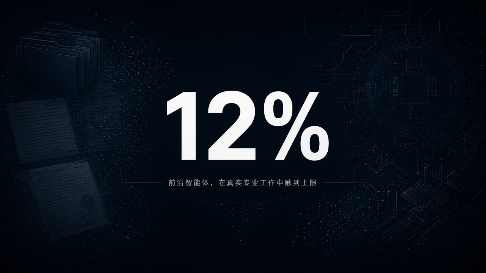

# 最好模型也只有约 12%：SemiAnalysis GDPx 把金融法律几乎打到全零

你以为最强模型已经能替你做 PE 尽调、法律 redline、芯片后端？SemiAnalysis 把它们丢进真实专业环境里跑了一圈——榜首 Claude Opus 5.5，也只有 **12.0%**。

这不是又一份「聊天体感排行榜」。**GDPx** 要测的是：agent 能不能在高价值领域里，**端到端把专业活干完**。结论很难听：日常觉得「已经很能干」的模型，离真交付还差得很远；金融和法律在严格评分下，几乎全员 **0%**。

## 边界先钉死：GDPval 测的是什么，GDPx 又加了什么

OpenAI 那套 **GDPval** 很多人听过：任务偏 spoon-fed、非交互，常见形态是一页 PDF + 让模型写文档。它能告诉你「读材料、出文档」这档事做得怎样。

**GDPx** 换了一层问题：给每个任务一套**真实、丰富的环境**。私募交易那类任务，可能是大约 **4000 个文件**的 VDR；agent 要自己找材料、做判断、交成果——不是被喂好提纲再填空。

| 项 | 口径 |
| --- | --- |
| 产品 | **GDPx**：frontier agentic 能力基准 |
| 作者 / 日期 | Max Kan、Andrew Megalaa、Dylan Patel；**2026-11-02** |
| 规模 | **11** 个领域、**14** 个合作方、**206** 道任务 |
| 选域逻辑 | 「钱会先堆到哪」——高 ROI 部署 frontier intelligence 的领域；刻意不做 government / real estate / insurance 这类 GDP 占比导向行业 |
| 默认时限 | 每任务约 **8** 小时 |
| Harness | 有原生就用原生：**Claude Code / Codex / Antigravity**；没有则默认 **OpenCode** |
| Headline | 各域等权；**pass@1 across three attempts** |
| 榜首 | Claude Opus 5.5 **12.0%**；Gemini 4 Carbon **10.9%**；GPT-6 Astra **9.6%** |
| 刺眼点 | 金融、法律在严格 binary 评分下几乎全员 **0%**；官方因此另报 partial score |

两句必须一起说：

- **12% 不是「模型只会答对十分之一闲聊」。** 它是在专业交付标准下，端到端做完任务的通过率。
- **金融法律「全零」不等于模型一句法律/金融都不会。** 严格评分要求整单交付过关；官方另给 partial，说明半程可能有分，但完整交卷几乎交不出。

## 时间线：从「聊天像专家」到「环境里交卷」

1. **选域：** Chip design、Cybersecurity、Biology、Finance、Legal、Quant trading、RSI、Hardware design、Materials science、Alignment、Software engineering——按「资本会先砸哪里」排，不按 O\*NET 职业表或 GDP 份额。
2. **找伙伴搭真环境：** Finance=Living Context；Legal=Chakra；Chip=Aria / Arcverex / Ergodex；Cyber=Arithmetic；Bio=Latch Bio；Quant=Third Moment；RSI=Extrapolate；Hardware=Beautiful Machines；Materials=ValenceForge + Emulated；Alignment=Fleet；SWE=Datacurve。
3. **上原生 harness：** 能用各厂自己的 agent 栈就用；headline 报三次尝试里的 pass@1，域与域等权。
4. **出榜：** 最好模型约 **12%**；金融、法律严格分几乎清零；safety classifier 还会额外压低部分模型在 cyber / bio / alignment 的总分。

## 普通人为什么在乎：聊天体感 ≠ 专业交付

你在对话里觉得 Claude / Gemini / GPT「已经很懂投行、很懂合同」，那是**交互体感**。GDPx 测的是另一件事：给一屋子真实文件、真实工具链、有时限，能不能把活交出来。

对普通人：别把「会聊 PE / 会改条款」直接读成「可以替你签字交卷」。对开发者 / agent 产品人：如果你的 demo 还停在干净 prompt + 短上下文，GDPx 这种环境会把虚假安全感撕开——**环境复杂度本身就是门槛**。

## 榜怎么读：谁在前面，谁被安全阀按住

| 模型 | Headline |
| --- | --- |
| Claude Opus 5.5 | **12.0%** |
| Gemini 4 Carbon | **10.9%** |
| GPT-6 Astra | **9.6%** |
| Muse Wonder Full | 9.0% |
| Claude Fable 5.1 | 8.5% |
| GPT 6.1 Sol | 8.4% |
| Claude Sonnet 5.5 | 8.2% |
| Gemini 4 Argon | 7.3% |
| Muse Wonder | 6.8% |
| DeepSeek 4.1 Flash 1017 | 5.4% |
| GPT-6 Luna | 5.1% |
| Grok 4.7 | 3.9% |
| GLM 5.3 | 2.7% |

读榜时多看两层：

1. **绝对水平。** 第一名也只有约 12%。这不是「差零点几个百分点的军备竞赛新闻」，是「整体还远」。
2. **安全策略会改名次。** Safety classifiers 会压低 Opus 5.5、GPT-6 Astra 在 cyber / bio / alignment 的得分；排除这三域后，排名另有一版。Muse Wonder Full 在 cyber 上反而能领先一截——不是它「更会黑」，更像是**各厂安全限制不一样**。

金融、法律几乎全零，是整份报告里最刺眼的截图：高价值、高合规、强交付标准的活，严格 binary 下几乎没人过线。想看「半对有没有分」，去看官方的 partial；想看「能不能交卷」，盯严格分。

## 检查表：你现在能做什么

| 你是谁 | 可验证动作 |
| --- | --- |
| 普通用户 | 打开 gdpx.semianalysis.com，先看 headline，再按域点开 spike，别只盯总榜第一名 |
| 做 agent / 自动化产品 | 对照自己 demo：是 spoon-fed 文档题，还是接近 VDR / 工具链级别的真环境 |
| 金融 / 法律场景建设者 | 把「严格分几乎全零」当基线预期；先定义可验收的 partial，再谈端到端替换人力 |
| 看安全与能力权衡的人 | 对比含 / 不含 cyber·bio·alignment 两套排名；注意 Muse 在 cyber 的相对领先来自限制差异 |
| 写采购 / 选型材料的人 | 引用时写清：pass@1、8 小时、原生 harness、各域等权；别把 GDPx 说成「聊天智商」 |

能做的动作就这些。没有「换成某家模型明天就能端到端替律师 / 投行交卷」的开关。

## 收尾真问题

如果最好模型在真环境里也只有约 12%，你更愿意改的是**预期**，还是**任务切法**？

预期侧：聊天里像专家，不等于专业交付过关；金融法律严格分接近全零，是提醒不是羞辱。任务侧：把一单端到端巨活拆成可验收的 partial，可能比空等「下一代通吃」更接近上线。

SemiAnalysis 选的是「钱会先堆到哪」的 11 个域，用原生 harness 跑 206 道题。榜单会变，但今天这条边界已经清楚：**能端到端干完专业活，离日常体感还很远。**

原文：https://newsletter.semianalysis.com/p/gdpx-measuring-frontier-model-capabilities
榜单：https://gdpx.semianalysis.com/
