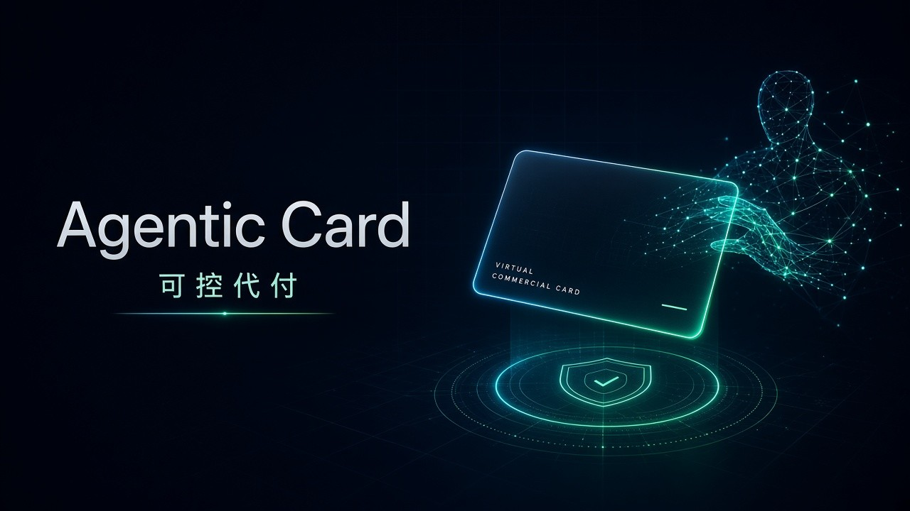
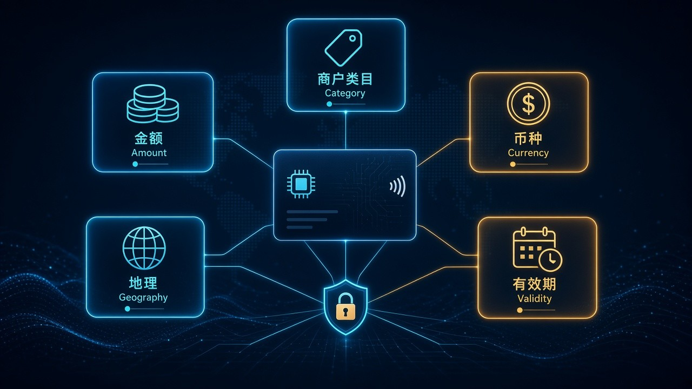

# AI 代理拿到「公司信用卡」：寻汇 Sunrate Agentic Card，框里代付已过 Mastercard Agent Pay

你的 AI 能订机票了，但钱谁付？

寻汇 **Sunrate** 在 **2026-11-02** 的 **Hong Kong FinTech Week 2026** 上扔出一张答案：**Agentic Card**——可编程、多币种的**虚拟商务卡**，授权给 AI agent，在企业设好的规则框里建卡、付款、回传结果。它已经过 **Mastercard Agent Pay** 认证。

普通人在乎的是：助手从「帮你参谋」迈到「在框里代付」。财务和开发者在乎的是：框到底锁不锁得住——商户类目、金额、币种、地理、有效期，每一步能不能留痕。两边都别吹破：这是**企业可编程虚拟商务卡 + 授权框架**，不是「AI 随便刷你个人信用卡」，也不是全球企业明天零门槛开通。

## 边界先钉死：开了什么，没开什么

| 项 | 官方口径 |
| --- | --- |
| 产品 | **Sunrate Agentic Card**：programmable, multi-currency virtual commercial card |
| 发布 | **HONG KONG, Nov. 2, 2026**；**Hong Kong FinTech Week 2026** |
| 给谁 | 企业授权的 **AI agents**，在预设规则与授权框架内代执行付款 |
| 与常规虚拟商务卡 | 常规主要给人用；Agentic Card 让授权 agent **建卡 / 管卡、发起交易、回传支付结果**；企业仍控 spending limits、permissions、approval policies |
| 认证 | 已完成 **Mastercard Agent Pay** certification（可验证身份与授权，走 Mastercard 网络上的 agent 发起交易） |
| 企业可控维度 | **merchant category、transaction amount、currency、geography、validity period**；任务完成后卡可自动过期 |
| Agent 能力 | 在授权工作流内：**create cards、configure payment parameters、initiate transactions、retrieve payment outcomes** |
| 审计 | 每步可记录、可审计 |
| 用例 | procurement、business travel、marketing expenditure、supplier payments |
| 早期场景 | **OTA**：可为单个营销活动或供应商付款发卡并预配权限；交易时 AI 按规则监控，可 flag / block 例外、自动批合规交易、高风险升级人工 |
| Sunrate.AI | 五个 agent：**Payment / FX / Compliance / Onboarding / Chat** |
| 背景 | 与 Mastercard 合著白皮书 *Beyond Automation: Defining Agentic Global Payments*；**2026 年 7 月 WAIC** 联合发布 |
| 公司 | 寻汇 Sunrate：global payment and treasury management；**2016** 成立；**190+** countries/regions；办公室含 Singapore、KL、Jakarta、Hong Kong、Shanghai、London；合作银行含 Citi、StanChart、JPM；Mastercard 与 Visa principal member |

两句必须一起说：

- **不是「AI 随便刷你的个人卡」。** 官方写的是商业虚拟卡 + 企业授权框架；oversight 仍在企业。
- **不是「全球所有企业明天就能无门槛开通」。** 官方按 launch / designed for 表述；别自己编可用性地区表。

## 时间线：从白皮书到「框里能付」

1. **2026-07 WAIC：** 寻汇与 Mastercard 联合发布白皮书 *Beyond Automation: Defining Agentic Global Payments*——先把「agent 全球支付」的边界和定义摆上桌。
2. **2026-11-02 香港金融科技周：** Agentic Card 正式发布；定位从「给财务建议」推进到「在清晰边界内执行已授权付款」。
3. **认证落地：** 完成 Mastercard Agent Pay certification——身份与授权可验证，交易可走 Mastercard 网络上的 agent 通道。
4. **产品栈并行：** Sunrate.AI 侧已有 Payment / FX / Compliance / Onboarding / Chat 五个 agent；Agentic Card 是把「付」这一环嵌进可控工作流。

寻汇 Head of AI **Li Yilong** 的口径很直：下一阶段不是让 AI 只给建议，而是在清晰边界内执行财务任务，带 controls、identity、accountability。

## 普通人 / 财务为什么在乎：参谋和代付不是一回事

过去一年，大家习惯了让 AI 比价、列行程、写采购说明——最后一截仍是人去刷卡、走报销、盯对账。Agentic Card 想缩短的，正是这最后一截：在企业事先画好的框里，授权 agent 自己建一张短命虚拟卡、把钱付出去、把结果传回来。

对普通人：这听起来像「AI 终于能替公司花钱了」。更准确的说法是——**公司先决定 agent 能动哪一类钱，再让它在框里执行**。个人消费卡、无人值守乱刷，都不在官方叙事里。

对财务 / 内控：银行与合规正在收紧「第三方 agent 直接碰资金」的路径。这条产品走的是另一条——**发卡 + 规则框 + Agent Pay 认证**：身份可验、权限可配、交易可审计。框设得松，代付就是风险放大器；框设得死，代付才可能变成可上线的流程件。

对开发 agent 产品的人：你终于有一张「能在真实卡组织网络里发起交易」的商业卡抽象，而不是 demo 里假装付款成功。代价是你必须先吃透企业侧的类目、额度、地理、有效期，以及例外升级人工的那条线。

## 看点怎么评：卡、框、认证，缺一不可

**卡本身**

可编程、多币种虚拟商务卡。Agent 可以在授权工作流里建卡、配支付参数、发起交易、取回支付结果。任务做完，卡可以自动过期——短命权限，而不是发一张长期「万能工卡」。

**框本身**

企业可设：商户类目、交易金额、币种、地理、有效期。外加 spending limits、permissions、approval policies。官方强调每步可记录、可审计。早期 OTA 场景写得很具体：为单次营销或供应商付款预配权限；合规自动过、例外 flag / block、高风险升级人工。

**认证本身**

Mastercard Agent Pay certification 不是营销贴纸。它意味着 agent 发起的交易能在 Mastercard 网络侧验证身份与授权。没有这一环，「AI 代付」很容易停在沙箱演示；有了这一环，才谈得上接进真实清算路径。

三件事叠在一起，才是这则新闻的完整形状。只吹「AI 能付款」，会漏掉框；只吹「有管控」，会漏掉卡组织认证把交易推到真网络。

## 检查表：你现在能核对什么

| 你是谁 | 可验证动作 |
| --- | --- |
| 普通读者 | 打开 PR 原文，确认日期是 Hong Kong FinTech Week 2026、产品名是 Agentic Card |
| 财务 / 内控 | 对照自家政策：类目、额度、地理、有效期、例外升级是否已有对应条款；缺哪条就先补哪条 |
| 采购 / 差旅 / 市场费用负责人 | 看官方用例是否对得上你的流程：procurement、travel、marketing、supplier |
| 做 agent / 自动化产品 | 分清「聊天里建议下单」和「持认证虚拟卡在框内发起交易」；设计时把 audit trail 当一等公民 |
| 看支付基建的人 | 核对 Mastercard Agent Pay 认证表述，以及 Sunrate 作为 Mastercard / Visa principal member 的背景；别把「launch」读成「你账号明天就能开」 |
| 关注 OTA / 供应商付款的人 | 读早期场景：单次活动发卡、预配权限、合规自动批、高风险人工——对照自己的审批链 |

能核对的就这些。没有「今晚让个人 ChatGPT 刷爆公司卡」的开关，也没有「全球无审核开通」的承诺。

## 收尾真问题

你更在乎 **agent 能代付**，还是 **框能不能真锁死**？

能代付，解决的是「最后一公里谁点确认」；框锁不死，代付只会把审批漏洞自动化。寻汇这次给出的组合是：虚拟商务卡 + 五维企业控制 + Mastercard Agent Pay 认证 + 可审计步骤，再配上 Payment / FX / Compliance 等 agent 栈。白皮书在 7 月先定义问题，11 月在香港金融科技周把产品推上台。

剩下的，不在新闻稿里：你的审批策略够不够细、例外升级够不够快、审计日志有没有人真看。框是产品给的；敢不敢把框收紧到可上线，是企业自己的题。

官方原文：https://www.prnewswire.com/news-releases/sunrate-launches-agentic-card-to-enable-ai-driven-business-payments-302919208.html
