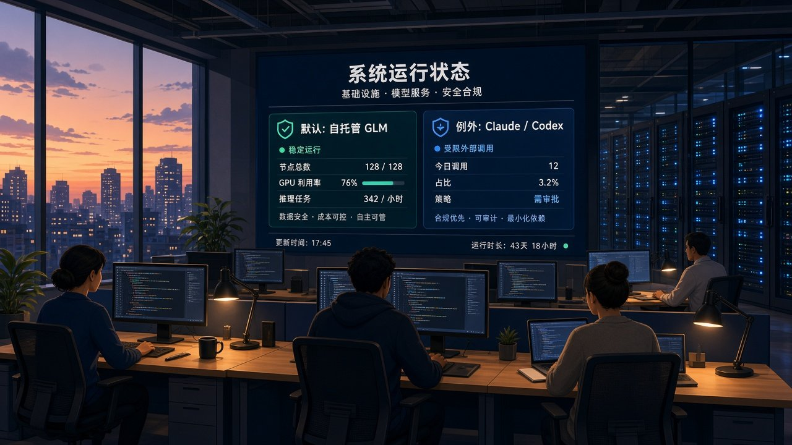
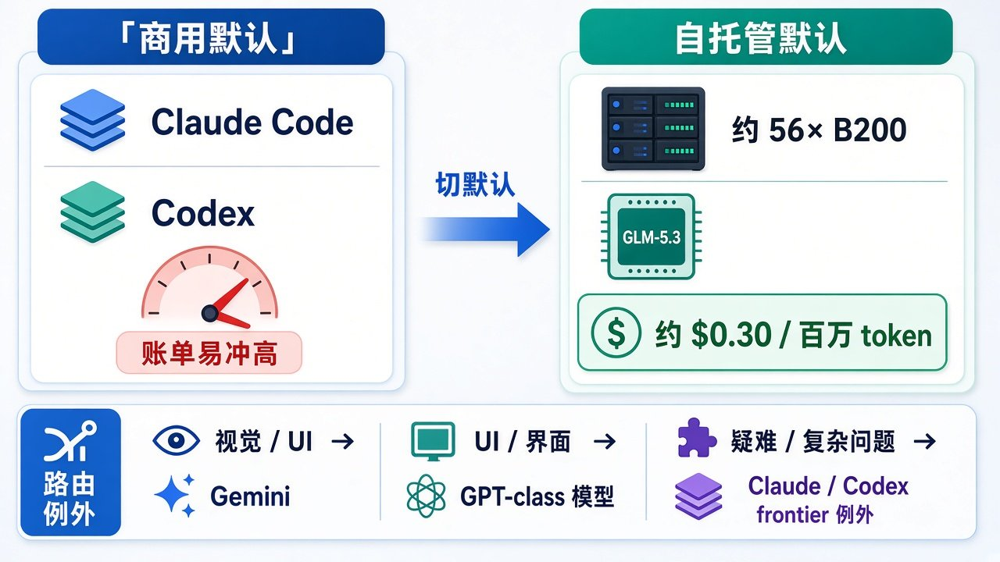

# 默认不再是 Claude：Revolut 约 2000 工程师切自托管 GLM，自称账单砍到约十分之一

工程师每月烧掉一千、一万美金的 AI coding 账单，ROI 却一般——英国 fintech **Revolut** 的 ops and infrastructure lead **David Abitbol** 在台上这么说。

于是他们换了一条默认路：把 **self-hosted** 开源权重模型设成默认，不再主要靠 Claude 这类商用服务。Abitbol 称，不到一年，**AI coding 推理成本砍了约 90%**；模型从 GLM-5.1 迁到 **GLM-5.3**，现在用约 **56 张 Nvidia B200** 在跑，开发方是中国开源权重团队 **Z.ai**。

口径要先钉死：这不是 Revolut 新闻稿或工程博客，而是 Abitbol 在纽约 **AI Engineer** 大会上的自述，经 *The Register* 等媒体转述。内部效率数字、单位成本、对比基线都没公开成审计过的财报——当台上说法读，别当已盖章的年报。

## 边界先钉死：默认切了什么，没切掉什么

| 项 | 口径 |
| --- | --- |
| 事件 | 自托管模型设为 **AI coding 默认**；商用 Claude 等不再是主路径 |
| 来源 | Abitbol 在 AI Engineer NYC 台上自述 → *The Register* 2026-11-03 报道 |
| 规模 | AI coding 工具铺到约 **2000** 工程师 |
| 效率 | coding time 约 **+60%**、lead time 约 **+70%**（内部口径；未隔离「换模型」与「取消 token 限额」等因素） |
| 成本 | 自托管 GLM 约 **$0.30 / 百万** input/output tokens；自称约为 Codex / Claude Code 的约 **十分之一**；未公布对照账单金额；**未披露** GPU 采购与运维人力是否计入 $0.30 |
| 模型 | 先 GLM-5.1，再 **GLM-5.3**；GLM-5.1 约 **7540 亿**总参数、每 token 激活约 **400 亿**；权重约占 **380 GB** 显存，另每用户上下文约 6–26 GB |
| 算力 | 约 **56× B200**（约等于 7 台 8-GPU DGX B200 的卡数） |
| 体感 | TTFT 目标 **亚 3 秒**（约 256K 上下文）；>5 秒 Slack 会被炸；交互吞吐约 **200 tok/s** 够用；下午 5 点后登录可到约 **800 tok/s** |
| Context | 「Long context is a scam」——能上 1M ≠ 有用；他们觉得真正需要的是 **256K** |
| 未取代 | GLM **纯文本**，不适合 UI 等视觉活 → model router 把 vision 打到 Gemini 或 GPT Luna 等；代码生成走 GLM；**Claude Code / Codex 仍留作难题例外** |
| 隐私自述 | 承认中国开源权重可能引发顾虑；强调大问题是走**中国境内 API**；**on-prem / 区域云自托管**则「really nothing to worry about」（其原话，转述不替监管背书） |

两句必须一起说：

- **默认自托管 ≠ 全面吊打 Claude。** Frontier 模型还在，只是变成例外；视觉 / UI 另路由。
- **约十分之一是台上成本口径。** 没公布对照基线账单，也没写清 $0.30 是否含卡钱和运维人头。

## 时间线：从怀疑账单，到把 frontier 变成例外

1. **2025 初：** 试 Gemini。
2. **2026 初：** 试 Claude Code。高度怀疑 AI 成本——有人每月 $1,000、$10,000，ROI 一般 → 上线时设严格预算上限 → token 紧。
3. **查自托管：** 便宜 token 不只是「多写几行代码」，而是敢让 AI 碰 debug、Jira、Confluence——以前要省着留给季度末或最难任务的活。
4. **模型路径：** GLM-5.1 → GLM-5.3；约 56× B200 承载服务。
5. **调优比堆卡更重要：** 超参、**NVFP4** 量化、disaggregated prefill/decode、调 context 长度。开箱曾很差；TTFT 从 >10s 量级压到工程师舒适区。
6. **工作方式变了：** 不盯 thinking stream；并行开任务，做完再看。Abitbol：「Open source is now a priority… billing is flat… no bill shock… **the frontier is the exception**.」

## 平台 / 银行场景为什么在乎：默认一换，活的种类就变了

平台负责人真正怕的，往往不是「模型聪不聪明」这句空话，而是**月末账单冲击**和**token 限额把人逼回省着用**。限额一紧，工程师只会把最难、最显眼的活留给 AI；debug、票务、文档检索这类「其实最耗人」的活，反而舍不得喂。Abitbol 的叙事正好反过来：token 便宜到近乎不限，最大瓶颈才从「写代码」挪到「把周边脏活也交给模型」。

银行 / fintech 场景另加一层：**数据能不能出域、账单能不能摊平、合规能不能讲清楚。** 自托管把推理留在 on-prem 或区域云，账单变 flat，没有月末 bill shock——这是 Abitbol 反复强调的经济结构，不是「开源一定更强」的信仰宣言。另一面也硬：56 张 B200、量化、拆分 prefill/decode、把 TTFT 压到亚 3 秒，都是工程债；开箱很差时，便宜 token 救不了你。

做 coding agent / 平台的人会注意到一句口号级的话：**frontier is the exception。** 默认走开源权重自托管，难题才打到 Claude Code / Codex；视觉另路由。这不是「只用一家模型」，而是 **router + 默认 + 例外** 的分层。

## 看点怎么评：三截拼在一起才像「砍九成」

**便宜 token 改变的是「敢不敢用」，不是魔术般的单模型胜利**

coding time +60%、lead time +70% 是内部口径。旁证讨论里有人提醒：对比未必隔离了「换模型」和「取消 token 限额」等其他变量——冷静读：更大的增益叙事，落在 debug / Jira / Confluence 这类以前不敢随便烧 token 的活上。别写成「GLM 单独打赢 Claude」。

**堆卡不够，调优才是体感**

56× B200 是容量故事；亚 3 秒 TTFT、约 200 tok/s 交互、256K 才是「真正需要」的 context，才是工程师会不会炸 Slack 的体感故事。Long context 能上 1M 被 Abitbol 直接说成 scam——能服务 ≠ 有用。

**默认 + 例外 + 路由，才是可落地的银行姿势**

GLM 纯文本 → UI / vision 走 Gemini 或 GPT Luna 等；难题仍可打 Claude Code / Codex。开源优先、账单 flat、frontier 例外——三句话要一起听。隐私上，他把风险主要钉在「走中国境内 API」，并称 on-prem / 区域云自托管「really nothing to worry about」；这是台上原话，不是监管结论，写进检查表时别替任何人背书。

## 检查表：你现在能核对什么

| 你是谁 | 可验证动作 |
| --- | --- |
| 普通读者 | 打开 *The Register* 2026-11-03 文，确认：默认自托管、约 90% 推理成本、约 2000 工程师、56× B200、约 $0.30/百万 token、frontier 例外 |
| 平台 / DevEx | 对照自家默认路由：商用是否仍是默认？有没有「难题例外」通道？token 限额是否在扼杀 debug / 票务类用法 |
| 银行 / fintech 安全 | 分清「中国开源权重」与「中国境内 API」两层；核对 on-prem / 区域云是否满足自家数据驻留；别把台上「nothing to worry about」写成已过监管 |
| 推理 / MLOps | 对照 NVFP4、disaggregated prefill/decode、context 调到 256K、TTFT 亚 3 秒；问开箱是否也曾 >10s |
| CFO / FinOps | 问清 $0.30 口径：是否含 GPU 折旧与运维人力；对照商用账单有没有公布基线金额——没有就当台上相对说法 |
| 仍在重度用 Claude Code / Codex 的团队 | 看「frontier is the exception」：难题通道还在；默认切换不等于禁用 |

能核对的就这些。没有 Revolut 官方新闻稿数字，也没有「所有银行该立刻切 GLM」的开关。

## 收尾真问题

你更怕**月末 AI 账单冲高**，还是更怕**自建推理的工程债和开箱体感**？

信前者：Revolut 这套叙事砸在「默认自托管 + 账单 flat + frontier 留例外」——约 2000 人规模下，Abitbol 自称推理成本砍约 90%，单位价约商用十分之一。信后者：56 张 B200、量化与拆分 serving、把 TTFT 从十秒级压进亚 3 秒，不是下载权重就结束；便宜 token 之前，先得有人把服务跑顺。

默认换了；例外还在。银行场景里「开源权重 + 自建推理」开始成规模落地——成不成功，不看口号，看你敢不敢把默认切过去，又敢不敢把难题和视觉诚实路由出去。

*The Register* 原文：https://www.theregister.com/ai-and-ml/2026/11/03/british-fintech-revolut-slashes-ai-coding-costs-10x-by-cutting-out-claude-and-going-self-hosted/5307345

场合：David Abitbol（Revolut ops and infrastructure lead）于 AI Engineer NYC 台上自述，经媒体转述。
