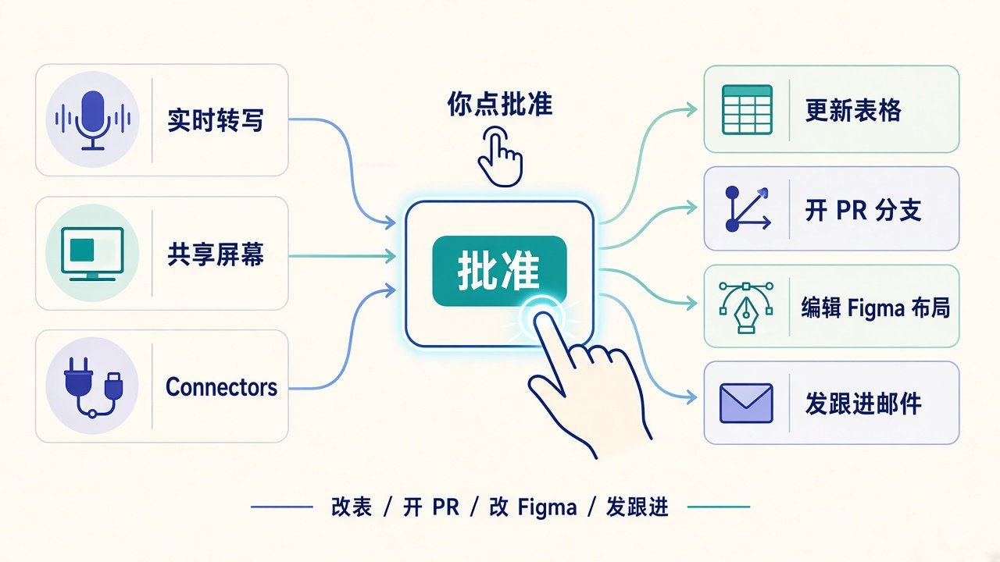

# 会还没散活先干完：Tana 把本机 Claude Code / ChatGPT 带进 Zoom·Meet·Teams，无 bot 入会

会开完了，决议写在脑子里；真正干活的邮件、PR、Figma、表格，往往要等到「谁有空再说」。

**Tana** 宣称自己是面向团队的 **first agentic meeting platform**：把你**本机已经登录**的 **Claude Code** 或 **ChatGPT** 带进 Zoom、Google Meet、Microsoft Teams，或 Tana 自有会——有 **live transcript**、能看**共享屏幕**、带着你自己的 **connectors**；**会还在开，活就开始干**。官方反复强调一句：**No bot joins the call**——没有机器人参会账号入会。

别和笔记产品搞混：这是 **Tana**（agentic meeting platform）；同公司还有 **Tana Outliner**（outliner.tana.inc 上的笔记 outliner），是**另一条产品线**。

## 边界先钉死：带进会的是谁，谁说了算

| 项 | 口径 |
| --- | --- |
| 产品 | **Tana** agentic meeting platform（≠ Tana Outliner） |
| 官方自称 | **first agentic meeting platform for teams**（官方宣称，非第三方裁定） |
| Agent 身份 | 你电脑上已登录、已有账号的 **Claude Code / ChatGPT**；带 skills、connectors、你教过它的东西 |
| 会中能力 | live transcript + shared screen + 你自己的 connectors；边谈边干 |
| 入会形态 | **No bot joins the call**；Zoom / Meet / Teams 旁开小 Tana 窗口（timeline），别人看不到你 agent 在干嘛 |
| 动手规则 | **不自行改东西**；改 Tana 前会问你；每次改动是提案，你审过才落地 |
| 转写 | 多语言；按说话人检测语言；组织在 Settings 选内容语言（**33 种**）用于 summary / outcomes / docs；界面本身是英文 |
| 隐私 | agent 走你本机自己的 Claude / ChatGPT 账号；Tana **never uses your meeting data to train a model**；已完成 **SOC 2 Type 2**；可选 **EU** 区处理与存储 |
| 要求 | Tana desktop（Mac / Windows / Linux）+ 同机 Claude 或 ChatGPT app（Linux 上 Claude Code）；Claude 账号需有 **Claude Code** 权限 |
| 今日可用 | Claude 与 ChatGPT；更多 agents 在路上；未接时可用 Tana 自带 meeting assistant |

两句必须一起说：

- **会后把 transcript 丢给 Claude**，很多会议工具已经会；Tana 宣称的增量是：你自己的 Claude Code / ChatGPT **会中**就看见转写、屏幕和 connectors。
- **提议 ≠ 已改完。** 官方写得很硬：agent 提议，你一点批准才动手；默认不擅自改。

## 怎么走的：从「会后作业」到「会中验收」

1. **以前的常态：** 会上拍板，会后谁有空谁写跟进、开 ticket、改设计——作业堆在日历缝里。
2. **今天的动作：** Settings → External agents → Sign in Claude 或 ChatGPT；会中 Agents  tab 选 Who answers，或口头说 **Hey Claude**。
3. **它听到什么：** 实时转写、聊天、别人共享的屏幕；也可以在 chat 里问，或自己听完先提议，等你点头。
4. **别人看见什么：** Agents  tab 私有（建议在这里批准 / 驳回）；Meeting  tab 共享（timeline / screenshots）；**Share with everyone** 才进 Meeting，署你的名 + agent。一人 Claude、一人 ChatGPT 可以同场各带各的。
5. **临时会：** 默认不录音；加入未上日历的 Zoom / Teams / Meet / Slack 会时，会问要不要 capture。

## 开会的人为什么在乎：作业别再拖到周一

普通人 / 产品 / 销售：最烦的不是「又一个会记纪要工具」，而是**当场说好的事，散场后还要自己回去干一遍**——跟 Priya 的跟进邮件、40 seats 年付加 SSO 的报价、launch 推迟两周后的表格和 Slack。官方例子里，agent 可以边会边起草邮件到 chat，你说 send，就从你的 Gmail 发出；prospect 问价时拉价目、HubSpot 成交史和上次 champion 说法，聊天里给出数字和两个 reference——叙事重点是**当场答得出来**，而不是「我回去查完邮件你」。

工程师 / 设计师：PM 对着屏幕上的设计讲功能，你的 Claude Code 有 repo + transcript + screen——官方例子是边讨论边开 branch，会结束时 draft PR 已开、Linear issue 已链上；Figma 在屏幕上时，口头说改 filter / empty state，agent 当场改，大家看着变。这是**能编辑、能验收**的会，不是再攒一张「周一再开」的 ticket。

对隐私 / IT：卖点反过来也是约束——agent 跑在你机器上、用你自己的账号；没有 bot 入会、旁人默认看不到你私有 Agents  tab；Tana 写明不用会议数据训模型，并完成 SOC 2 Type 2、可选 EU 区。另一面也硬：你得装桌面端、本机要有 Claude / ChatGPT（Claude 还要有 Claude Code 权限）；Linux 上走的是 Claude Code。

## 看点怎么评：三截拼在一起才像「会中干活」

**本机已登录的 agent，不是会里多一个陌生人 bot**

官方对比很直：很多工具是会后让 Claude 读 transcript；Tana 自称第一个让你自己的 Claude Code / ChatGPT **在会中**干活。架构上 Tana 跑在你机器上——Zoom / Meet / Teams 旁边一个小窗口，**没有东西入会**。信任边界写成：用你的账号、你的 connectors、你教过的 skills。

**看见转写 + 屏幕 + connectors，才谈得上「边谈边干」**

官方场景可择要对照，别夸成通吃：dashboard 上 retention 46%，agent 从 PostHog / Amplitude 拉去年数并查行业基线；计划推迟两周 → Sheets 改日期 / 负责人、Linear 建 issue 并指派、Slack 发变更；Figma / PR / 跟进邮件同上。前提都是——connectors 你本来就接好了，agent 在本机已有那套能力。

**批准门：能编辑，但默认先提案**

Agents 私有、Meeting 共享；改之前问你；每次改动是提案。这把「agent 会中动手」和「无人值守乱改生产」拆开——产品叙事偏**你能验收**，不是全自动散场。

「first」这一层：是 Tana **官方自称 / 宣称**，文中当营销主张读，别写成行业已裁定的客观排名。

## 检查表：你现在能核对什么

| 你是谁 | 可验证动作 |
| --- | --- |
| 普通读者 | 打开官方博文，确认口号含 Bring your own Claude Code or ChatGPT、live transcript / shared screen / connectors、**No bot joins the call** |
| 天天开 Zoom / Meet / Teams 的人 | 对照自己上次会后作业：跟进邮件、改表、开 ticket——哪些是「散场后才做」、哪些官方例子声称能会中做完 |
| 工程师 / 用 Claude Code 的人 | 核对要求：同机 Tana desktop + Claude Code 权限；官方 PR 例子依赖 repo + transcript + screen |
| 设计师 / 用 Figma 的人 | 看「屏幕上的文件 + 口头改 + 当场变」一例；问自己验收节奏是不是比会后 ticket 更贴 |
| 销售 / CS / PM | 对照报价、跟进邮件、计划改期三例；分清「提议进 chat」和「你说 send / 点批准才落地」 |
| 安全 / IT | 核对：本机账号、不入会 bot、不用会议数据训模型、SOC 2 Type 2、可选 EU；Business 有 SAML SSO 与 groups |
| 产品线易混的人 | 确认这是 meeting 平台 Tana，不是 outliner.tana.inc 上的 Tana Outliner |

能核对的就这些。没有「所有会立刻零作业」的开关，也没有第三方审计把「first」盖章成行业事实。

## 收尾真问题

你更想要**会散后一份漂亮 summary**，还是**会还没散、跟进 / PR / 设计 / 表格已经过你手批过一版**？

信后者：Tana 的叙事砸在「本机 Claude Code / ChatGPT + 转写 + 屏幕 + connectors」，外加无 bot 入会、改前必问。信前者：纪要工具已经够用；这套还要你装桌面端、本机 agent、接好 connectors，门槛不低。

会还在开；作业还在不在，取决于你愿不愿意让本机那个已经会干活的 agent——听着会、看着屏、**等你点头**——把活先干完。

官方原文：https://tana.inc/blog/your-own-claude-or-chatgpt-in-the-meeting
