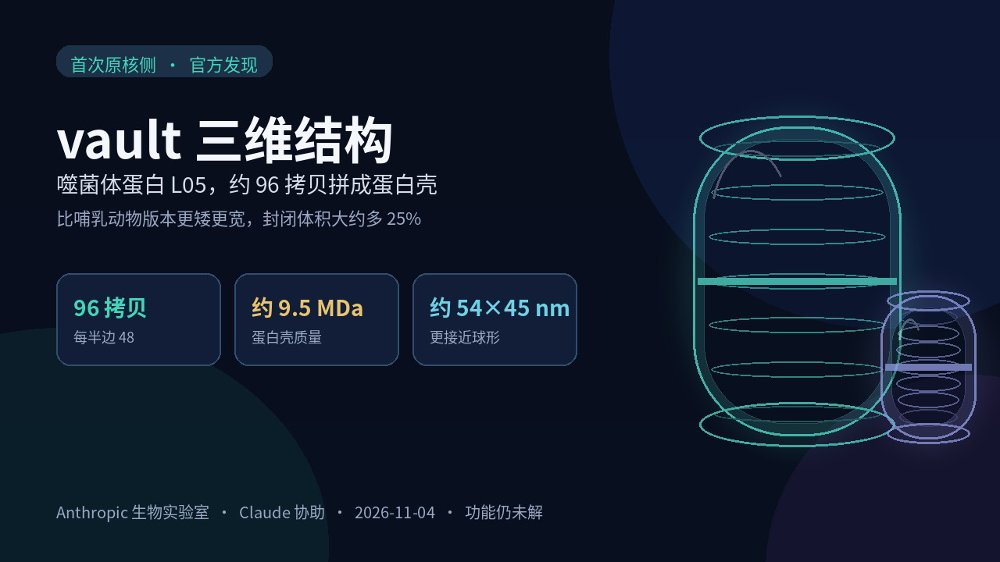

# 纯化从约 3 天压到约 90 分钟：Claude 帮解出首个原核侧 vault 三维结构，功能仍未解

一个被发现快四十年的大家伙，差不多有核糖体三倍重，人体里几乎每个细胞都有，可到今天也没人能拍板说清它到底干什么。

2026 年 11 月 4 日，Anthropic 生物实验室[发了一篇研究手记](https://www.anthropic.com/research/investigating-vault-particles-with-claude)：在人类指引下，Claude 帮他们解出了**首个来自原核侧的 vault 三维结构**。它由噬菌体蛋白 **L05** 的约 **96 个拷贝**拼成，是一只中空的蛋白壳。官方写明预印本已投向 bioRxiv，链接将随后挂上；结构和更多数据也写着「即将」放出。

普通人先要记住的不是名词，是节奏。**传统真核 vault 纯化大约要 3 天，他们优化后的路径大约 90 分钟，从细胞到电镜载网；完整结构初模大约 34 小时出来，团队估计按常规往往要数周。** 功能仍然没解开。别把它听成「AI 破译了生命谜题」，更像是「agent 第一次把湿实验里最磨人的几段活，压到普通人能听懂的时间尺度」。

## 四十年没解开，原核亲戚为什么重要

Vault 是一种又大又空的蛋白桶。1986 年，Leonard Rome 和 Nancy Kedersha 在电镜下看到肋状外壳，联想到教堂拱顶，由此得名。哺乳动物版本大约由 **78 个**主要 vault 蛋白拼成，每半边 39 个，质量大约是核糖体的三倍，算真核生物里最大的分子机器之一。

它几乎遍布真核生物树，从黏菌到人。科学家因此相信它一定有用：有人猜它在细胞核和细胞质之间运东西，有人猜它帮细胞躲开抗癌药一类有毒化合物，有人猜它跟先天免疫有关——没有一条被坐实。敲掉相关组分的小鼠照样能长大，说明它也许只在特定环境里才真正派上用场。四十年过去，功能仍是空白。

近年已有人在原核生物基因组里找到过与主要 vault 蛋白相关的序列，但据 Anthropic 团队所知，此前没人证明这些蛋白真的会组装成 vault 样颗粒。细菌更好养、更好改。若 vault 能在细菌和噬菌体这边组装起来，研究者就多了一个更简单的系统，去追它从哪来、骨架长什么样、里面到底装着什么。真核免疫通路里，细菌亲戚曾经帮人看清过起源；那些例子里，人源功能已知。Vault 刚好相反：人这边还没搞清，原核亲戚反而可能把谜底往前推一步。

对做结构、做蛋白的实验室，这几乎是日常痛点：候选蛋白一大堆，纯化像熬夜排队，冷冻电镜处理又往往耗上数周。Anthropic 想展示的是，Claude 可以嵌进整条链路——搜序列、设计 DNA 构建、优化分离、处理电镜数据——把「几天到几周」压到「个把小时到一天半」。对关注 AI 的普通人，这是目前比较完整的「agent 进湿实验」案例：有速度，有翻车，也没把未解之谜说成已解。

## 他们实际做成了什么

在人类指引下，Claude 在大约 **150 亿**条预测蛋白里搜寻同源序列。结果很拧：这类蛋白分布广，出现在 **29 个细菌门**和 **4 个古菌门**，却只占已测序物种的不到 **1%**。稀有，但谱系铺得很开。

人选定要测的蛋白，Claude 再把每条序列改写成适合宿主的 DNA，补上控制基因开闭的调控序列，并整理成可下单的设计。筛选路径是：先在不进活细胞的体系里测 **44** 个候选；表现好的转入大肠杆菌；24 个里有 **15** 个能产出可溶蛋白；电镜下 **15 个里有 7 个**看起来像 vault；冷冻电镜又确认了其中 **4 个**——两个来自噬菌体，两个来自细菌。团队选中 L05，因为它最擅长形成完整、闭合的颗粒。

详细结构写得很具体：

- L05 vault 由 **96 个拷贝**组成，每半边 48 个，总质量约 **9.5 兆道尔顿**。
- 外形比哺乳动物版本更矮更宽，大约 **54×45 纳米**，哺乳动物大约是 67×40 纳米。
- 虽然更短，但因为更接近球形，封闭体积大约多 **25%**。
- 壳壁由 **7 段**重复单元首尾相接，哺乳动物是 9 段；两端的帽更扁。
- 团队称，它属于原核生物里已知最大的一类确定蛋白壳。

帽怎么收口也有画面感：48 条链要往极点收窄，分三层，像阶梯穹顶。每三份相邻拷贝里，一份停在第一层，一份停在第二层，一份伸到顶端。墙体段序列相同，到了帽区却摆出不同构象。

他们还改了 15 种变体。有些只动帽附近的接触点，壳就封不上，变成开放的玫瑰花结，说明这片区域是盖上盖子所必需的。把壁上两段重复再复制一次，让蛋白从 7 段变成和人类一样的 9 段，颗粒会更大——官方写明，相对 L05 本身，封闭体积大约增加 **20%**。Anthropic 由此提出，vault 也许能改成尺寸可调的纳米胶囊，用来装货物或酶。这是实验室的设想，不是已经验证可交付的产品。

结构里还有个解释不了的细节：96 条链每一条中段都有一个口袋，里面清晰地托着一种尚未鉴定的小分子。Claude 观察到它的形状有点像辅酶 A。如果真是辅酶 A 或类似物，也只是功能的一丝线索，不是结论。

## 被压短的时间

| 对比项 | 常规 / 对照 | 这次 |
| --- | --- | --- |
| 真核 vault 纯化 | 约 3 天 | 优化路径约 90 分钟，从细胞到电镜载网 |
| 完整结构初模 | 团队估计往往数周 | 约 34 小时 |
| 最终电镜图 | — | 处理开始后约 1 周 |
| 项目整体 | — | 不到 4 个月 |

## L05 和哺乳动物 vault 差在哪

| 对比项 | 哺乳动物 | L05（这次） |
| --- | --- | --- |
| 蛋白拷贝数 | 78，每半边 39 | 96，每半边 48 |
| 外形与体积 | 约 67×40 nm | 约 54×45 nm，封闭体积大约多 25% |
| 壁段重复 | 9 段 | 7 段；再复制两段后体积约 +20%（相对 L05） |

## 时间线

1. **1986：** Rome 与 Kedersha 发现 vault，功能未知。
2. **此后近四十年：** 各种假说提出，没有一条被坐实；小鼠缺相关组分仍能发育。
3. **近年：** 生物信息学在原核基因组里找到远缘同源，但组装成 vault 尚未被证实。
4. **Anthropic 实验室此轮：** Claude 检索约 150 亿条预测蛋白，筛到原核与噬菌体同源；人选定候选，模型协助完成构建、分离和冷冻电镜处理。
5. **2026-11-04：** 官方发文，介绍 L05 三维结构；预印本已投 bioRxiv，结构和更多数据写明「即将」放出。

## Claude 做了哪些，人又拍了哪些板

团队写得很清楚：全程是「在我们的指引下」。Claude 搜库、把蛋白序列改写成适合宿主的 DNA、参与优化分离、在内部多智能体框架里调用开源软件 RELION 处理冷冻电镜数据。人负责选题、圈定要测的蛋白、分析决策，以及在模型即兴发挥时喊停。

改分离路径时，Claude 一度不赞成，担心杂质会和目标一起出来。人坚持试了，后来它又帮着把这条路跑通。这不是「模型全对、人只需点头」，更像一块能高速试错的副手，关键判断仍在实验室这边。

它也帮着添乱。有一次它写的方案里加了一种会干扰把 DNA 送进细胞的培养基添加剂，项目因此耽误约两周。冷冻电镜处理早期，它跳过一个常规步骤，做出一张和镜像混在一起的错误图。团队的反应很硬：「Please let’s do normal things unless they don’t work。」请先做正常的事，除非正常的行不通。

实验室笔记被拿去给训练 Claude 的同事看过，用来改进模型。团队说，随着新模型到来，构建设计的明显错误变少，也更能标出实验里可能踩坑的地方。他们自己熟悉的环节，错能很快被抓住；不熟的环节，错就真的耗时间。整体判断仍是：这样干活的收益大于代价，Claude 已经嵌进日常。

大部分工作，他们称普通实验室用现有 Claude 产品也能做；只有冷冻电镜分析为了省时间并行用了数百块 GPU，算力超出许多高校实验室的日常配置。项目整体不到四个月：筛了几十个候选，准备了电镜样品，解出原核侧第一个 vault 结构。顾问 Rome 看到结构后说，搞清 vault 干什么仍然极为困难；他高兴 Anthropic 拿出了这么多好数据，接下来会有更多人接着做。发现铺得越广，功能可能越复杂，也会是一段有意思的旅程。

## 组装看见了，功能还是空白

**硬的是「第一次组装被看见」。** 相关序列前人找过，但据他们所知，原核和噬菌体同源蛋白能装成 vault 样颗粒，这是第一次被展示，而且还给出了 L05 的完整三维结构。

**实的是时间被压短。** 约 3 天到约 90 分钟，数周到约 34 小时，不是空口号，对应的是分离路径和电镜处理被重新编排。对人来说，这比「又解出一个结构」更好懂。

**别吹成通吃，更别写成功能已被破解。** 功能仍未知。他们目前只在大肠杆菌里做出这些颗粒，还没在天然细菌和噬菌体宿主里验证它们是否也会形成。结构和额外数据也还说「即将」发布。Claude 会加速，也会把项目带进沟里。Rome 后来还问：这些 vault 是在做同一件事，还是功能会沿着进化分叉？也许它们跟人源 vault 做的是同一件事——那同样有意思。问题还在，只是现在多了一条更简单的原核线索。

## 人喊停的地方，模型翻过的车

- 候选谁圈定、哪一步 Claude 自己跑、哪里人喊停，都写在官方叙述里。
- 纯化约 3 天→约 90 分钟，初模数周→约 34 小时；压短的是这两段，不是功能谜底。
- 不合适的培养基添加剂耽误约两周；冷冻电镜跳步做出镜像混合图——团队当场喊停即兴发挥。
- 「尺寸可调纳米胶囊」是 Anthropic 的设想，不是已验证产品。

## 加速的是纯化，不是那个四十年的谜

下次再看到「AI 帮实验室做出重大发现」，可以先问一句：它加速的是分离、建模，还是把功能也说清楚了？

这次被压短的是纯化与初模，不是那个四十年的老问题。打开[Anthropic 这篇研究手记](https://www.anthropic.com/research/investigating-vault-particles-with-claude)，顺着他们自己的叙述看 Claude 做了什么、人在哪喊停——比把标题读成「谜题已解」更接近现场。
