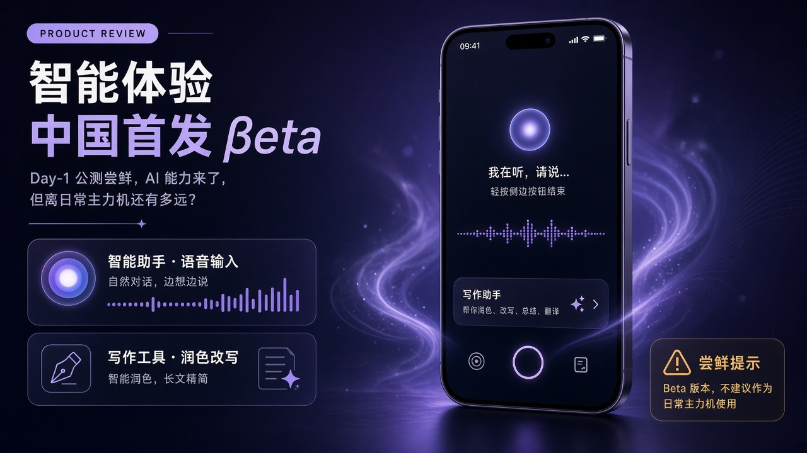
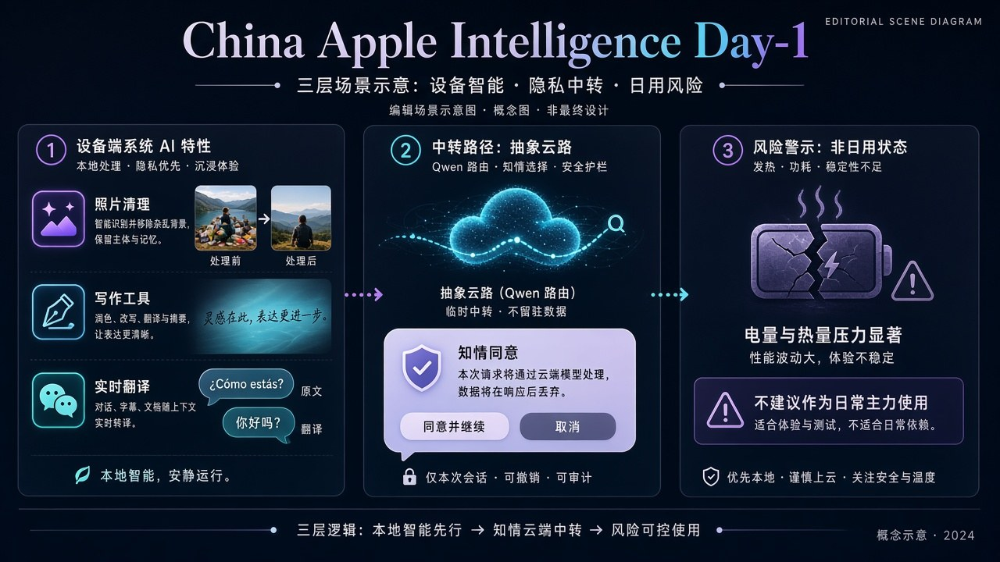

# 凌晨开测：国区 Apple 智能 Day-1，系统位够用，别刷进主力机

预告稿里留的那个选择题，今天凌晨有答案了。

北京时间 **2026 年 11 月 4 日凌晨**，苹果推送 **iOS 27.3 Developer Beta 1**，国行 **Apple 智能**开发者预览正式开测。这是大陆第一次能在国区机子上点开这层系统 AI；复杂任务侧接 **阿里通义千问**；**Siri AI** 和下一代能力仍不在本包。12 月正式版的大日历没变。

首日别急着写「终于赢了」或「完全不能用」。更准的读法还是三把尺子：**系统位到底顺不顺手**、**千问路由开不开得清楚**、**这版值不值得当主力机**。

## 系统位先摸：端侧基础盘，Day-1 完成度最高

公开报道和首批实测反馈口径比较一致：先能摸到的，是嵌在系统里的那一层，不是又一个聊天 App。

**端侧这块，首日口碑相对最稳：**

- **照片消除**：背景干净时抠路人、去干扰物，反馈偏正面。
- **写作工具**：备忘录、信息等原生界面可唤起，校对、改写、摘要能跑。
- **通知摘要、基础实时翻译、屏幕视觉识别**：可正常触发；端侧响应节奏被说成「符合预期」。
- **文字对话 Siri**：双击底部横条打字问，简单问答和基础设置指令，本地就能搞定。

这正是预告稿说的「系统位」：翻译在电话和信息里、消除在照片里、摘要在通知和邮件里——触达路径短，不用先记得打开某个模型。Day-1 证明的是：**补齐海外已经用过一轮的基础盘，路径是通的。**

别吹过头。首批反馈也写了边界：复杂图表、手写文稿的图文理解精度仍有空间；长链路多轮对话容易丢前文。系统位赢在「顺手」，不在「一夜追上独立大模型 App 的最长上下文」。

## 千问路由：能自选开通，但链路被弹窗拉长

国行版和「整机换成千问」不是一回事。复杂指令超出本地上限时，系统会引导调用千问；用户**可以自主选择是否开通**千问集成。开通后，可用 **Apple 登录** 或 **千问 App 账户**，落在三条路径：

| 入口 | Day-1 实测口径 |
| --- | --- |
| **Siri** | 复杂长任务会弹窗问是否调用千问，并提示登录 |
| **写作工具** | 可走千问做文本生成 / 创作类能力 |
| **视觉智能** | 文本与图像理解相关能力可调用千问 |

上传图片、文档前，系统会**再次弹窗确认**。公开报道转述提示口径：提交内容不会用于千问模型训练——这是界面提示层说法，当产品设计信号看，别当成第三方审计结论。

隐私可控，这点加分；代价也很直白：**连续对话被一次次确认打断**。弱网时，本地功能基本不受影响，但访问千问容易超时、输出中断。首批反馈还提到：千问上下文承载有限，长链条对话容易丢前文。

所以第二把尺子要拆开评：

1. **开没开**：设置里「Apple 智能与 Siri」打开后，千问集成仍是自选，不是静默整机接管。
2. **路由清不清**：复杂任务有弹窗、有登录，用户能感知「这一下交给云端了」。
3. **没登录时回落哪**：简单指令仍走本地；别指望未开通千问时，复杂生成照样满血。

「Siri 能接千问」≠「Siri AI 已上线」。WWDC 2026 那套下一代对话式 Siri，本包明确不含——Day-1 再次坐实。

## 别当主力机：续航、发热、闪退是首日槽点

第三把尺子，答案几乎写在苹果自己的 Beta 提示里：**只装在开发和测试设备上，别部署到主力机，先备份。**

首批反馈（界面新闻等汇总的实测者口径，非大规模实验室数据）集中在：

- **发热与耗电**：iPhone 15 Pro Max、iPhone 16 Pro 上，模型包下载后后台 AI 索引常驻，待机和轻度使用耗电高于 **iOS 27.2 正式版**。
- **稳定性**：第三方应用闪退、输入法短暂卡顿、AI 功能入口临时消失等随机 bug 多次出现。
- **定位**：开发者预览，目标是兼容性与适配，不是日常主力体验验收。

再叠存储门槛：系统更新包 + 本地模型占用不低，公开报道建议预留 **不少于约 15GB**。账号与地区也要对中国大陆；免费开发者注册即可开 Beta 通道，不必先交 99 美元会员费——这条降低了尝鲜门槛，**不等于降低主力机风险**。

硬件侧，首日反馈再次验证：A16 机型即便刷入包，设置里也不会出现 Apple 智能开关；非国行机改 Apple ID / 地区也解不开这套国行服务。机型名单以官网为准（iPhone 16 及后续、iPhone Duo、15 Pro / 15 Pro Max、iPhone Air 等）；部分报道列举到 16 全系与 15 Pro 系列，评测时以本机设置页是否出现开关为准，别只看媒体机型表。

## 想摸路径：备用机怎么开到「能点千问」

公开报道梳理的开通链路大致是这样（以本机设置为准）：

1. Apple ID 地区、设备地区都对中国大陆；完成**免费**开发者注册（App Store 里 Apple Developer 或网页），同意开发者协议。
2. **设置 → 通用 → 软件更新 → Beta 版更新**，选开发者 Beta，收下 **iOS 27.3 Developer Beta 1**。
3. 升级后进 **设置 → Apple 智能与 Siri** 打开功能；模型包下载期间预留电量和存储。
4. 要试千问：在系统引导里**自选开通**，用 Apple 登录或千问账户；复杂任务、传图传文档时留意二次确认弹窗。

语言别忘了：Siri 与设备语言设成**英文或简体中文**。只改一个、另一个还停在别处，功能可能直接不出现。

这是「摸路径」清单，不是「刷进口袋里那台」的许可证。备份、备用机、能回退——三条少一条都别硬上。

## Day-1 结论：抢测可以，赌主力机不行

对照预告稿收尾那道题——**抢测，还是等 12 月正式版？**

| 你想验证什么 | Day-1 建议 |
| --- | --- |
| 翻译 / 消除 / 写作 / 通知摘要路径通不通 | 备用机或测试机开 Developer Beta，值得摸 |
| 千问登录、弹窗、弱网回落 | 值得摸；专门盯三次确认和断网表现 |
| 续航能不能撑一整天通勤开会 | **别在这版上赌**；等正式版或至少多轮 Beta |
| 对外教程、客服口径、团队默认系统 | 等 **12 月 iOS 27.3 正式版** 再锁 |

一句话收束三把尺子：

- **系统位**：端侧基础盘 Day-1 可用度高，这是国区补齐，不是全球首发黑科技秀。
- **千问路由**：自选开通、弹窗授权、三条入口——深度超过营销露出，但交互被隐私确认拉长，弱网不稳。
- **别当主力机**：发热、耗电、闪退是首轮明确槽点；苹果自己也写了测试机原则。

有备用机、想先把路径摸清——今天就可以刷。只有一台天天依赖的手机——把日历钉在 12 月，让开发者去踩坑。两条路都成立，别被「错过首日」绑架。

相关预告：[11 月 4 日就能测：Apple 智能进中国大陆，接千问，但不含 Siri AI](./2026-10-31-apple-intelligence-china.md)

公开口径交叉：Apple 中国新闻稿时间线；MacRumors / 9to5Mac 对 Beta 与功能清单的报道；界面新闻等对首批实测（基础能力、续航稳定性、千问开通路径）的汇总。耗电幅度、bug 发生率尚无统一量化，上文按「首批反馈」表述，不作精确百分比承诺。
