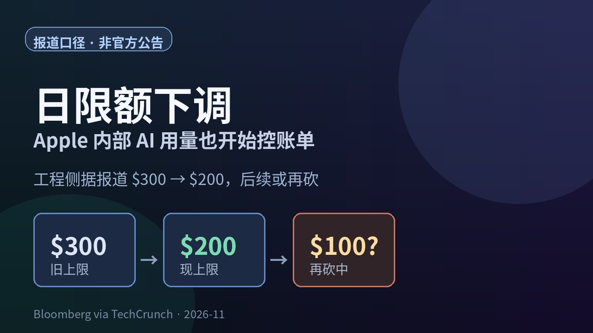
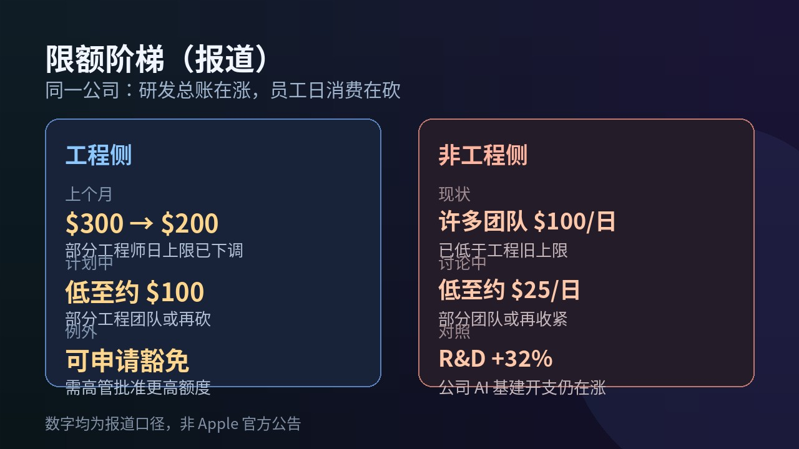

# 工程日限额 $300 砍到 $200：Apple 内部 AI 用量也开始控账单，非工程或再砍到约 $25

公司一边喊「多用 AI」，一边开始卡你每天能烧多少 token——这种拧巴，最近不只出现在订阅页。

**Bloomberg 报道、TechCrunch 转述**：2026 年 10 月，Apple **悄悄**把**部分工程师**的 AI **日消费上限**从约 **$300 砍到 $200**；后续还可能再砍，部分工程团队低至约 **$100/日**。非工程侧许多团队本来就卡在约 **$100/日**，公司还讨论过把部分团队压到约 **$25/日**。数字全是**报道口径**，不是 Apple 新闻稿。TechCrunch 写明已联系求证；Bloomberg 转载侧称 Apple 发言人**拒绝置评**。

普通人为什么先在乎：这不是又一个模型发版，是**额度焦虑进了大厂工位**——连 Apple 工程侧也开始控账单。你团队要是还在「尽量多用」，风向可能已经变了。

## 谁会立刻感到疼

1. **写代码、改 bug 的人。** 报道说预算覆盖的是 **token**——文本和数据被模型处理的计量单位；复杂编码、调试会烧掉大量 token，供应商按量计费。日上限一收，重用户最先撞墙。
2. **非工程同学。** 许多组已经是约 $100/日；若再砍到约 $25，写长方案、跑多轮改稿会比工程师更早见红。
3. **管账单的人。** 年初一波「tokenmaxxing」——尽量推员工多用 AI——账单随后到期，行业叙事从「放开用」拐向「配给制」。Apple 这条是同频信号，不是孤例。

报道还提到：员工若工作确需更高额度，可向**高管申请豁免**。

## 数字怎么排：一张表

| 对象 | 报道中的日上限 | 状态 |
| --- | --- | --- |
| 部分工程师 | **$300 → $200** | 2026 年 10 月已下调 |
| 部分工程团队 | 可能低至约 **$100** | 计划中 / 进一步削减 |
| 许多非工程团队 | 约 **$100** | 已在执行 |
| 部分非工程团队 | 讨论低至约 **$25** | 考虑中 |
| 更重用量 | 可申请豁免 | 需高管批准 |

## 时间线（按报道）

1. **更早：** 业界推「尽量多用 AI / tokenmaxxing」；账单随后到位。
2. **2026-10：** Apple 据称下调部分工程师日上限 **$300 → $200**。
3. **2026-11-04 前后：** Bloomberg Mark Gurman 报道进一步削减讨论；TechCrunch 转述并求证。
4. **同周对照：** Apple 称 FY2026 **研发支出约 +32%**，主因含基建与 AI；公司整体运营开支约 **+22% 至 $75.5B**（约合净销售额 **16%**）——**公司 AI 总账在涨，员工日消费在砍**。

## 内部怎么看：两种声音

Bloomberg 写到反应**分裂**：

- 有人说，本来就很少有人把 $300 日额度用满，旧上限偏松，砍一刀像「收回多余空气」。
- 有人读成更广的成本控制信号，叠上裁员焦虑。

报道还称：部分事业部已请外部顾问做效率评估；新 CEO **John Ternus** 推动更精简组织、更少管理层级。实际能省多少钱仍**不清楚**——很多人本来就没碰到旧上限；若继续下砍，重用户才可能被迫去申请豁免。

工具侧，报道举例员工可触达的服务包括 **ChatGPT、Claude、Gemini** 等；有团队被引导改用更便宜模型或本机模型。这是报道举例「预算买的是什么」，**不是** Apple 官方确认的供应商清单。同业对照里，Microsoft、Tesla、Uber、Meta 等也被写到有各自的内部 AI 支出收紧动作——说明这是行业相位，不是 Cupertino 独有。

## 看点怎么评

**硬的是日限额数字。** $300 → $200，再谈 $100 / $25，阶梯清楚，且明确标成知情人士口径。

**实的是「总账涨、工位砍」对照。** 同一周公司讲 R&D 与 AI 基建开支上升，却在员工 token 日消费上踩刹车——说明钱在往基础设施和产品侧堆，而不是无上限地撒在每个工位的聊天框里。

**别吹成「Apple 不用 AI 了」。** 报道同时写公司仍在推动工程与内部运营更深接入 AI；收的是**每人每天能烧多少**，不是关掉工具。也别把报道里的厂商名单当成采购公告。

## 检查表：你现在能做什么

| 你是谁 | 立刻可做 |
| --- | --- |
| 个人开发者 / 重度用户 | 看自己过去一周 API 或订阅用量曲线，标出「哪类任务最烧 token」 |
| 团队负责人 | 问清楚公司有没有**日/周/月** AI 消费上限；有的话写进 onboarding，别等撞墙才知道 |
| 财务 / IT | 把「模型档位 × 任务类型」做成默认推荐，重活走贵模型、草稿走便宜或本地 |
| 关注大厂风向的人 | 把这条和「订阅额度共享 / 限流」放一起看——外部产品与内部工位在同月讲同一件事：控账单 |

## 收尾：先问自己团队一句

你所在的组，AI 是「敞开用到财务来找」，还是「已经有日限额、只是没人说」？

打开自己的用量页或找 IT 要一嘴政策。不必猜 Apple 内部下一刀砍到哪——把自家账单看清楚，比转发一篇报道更有用。

TechCrunch（转述 Bloomberg）：https://techcrunch.com/2026/11/04/apple-is-reportedly-cutting-budgets-for-its-internal-ai-usage/

Bloomberg Mark Gurman 报道亦见 Business Standard 等转载；数字均为报道口径，Apple 发言人据转载拒绝置评。
