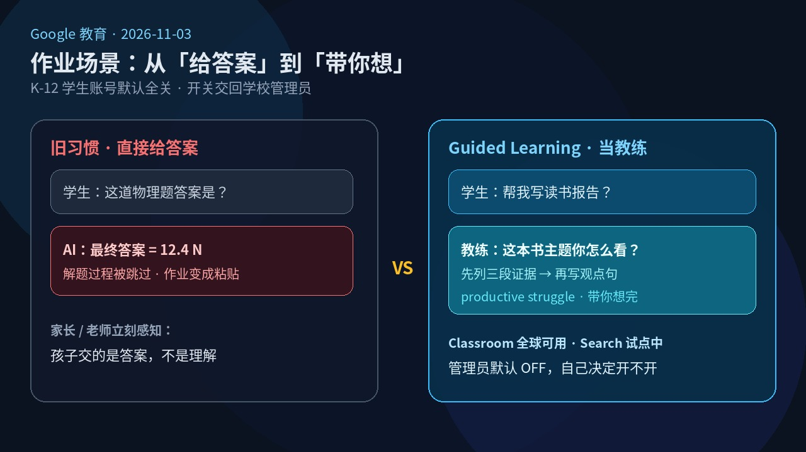
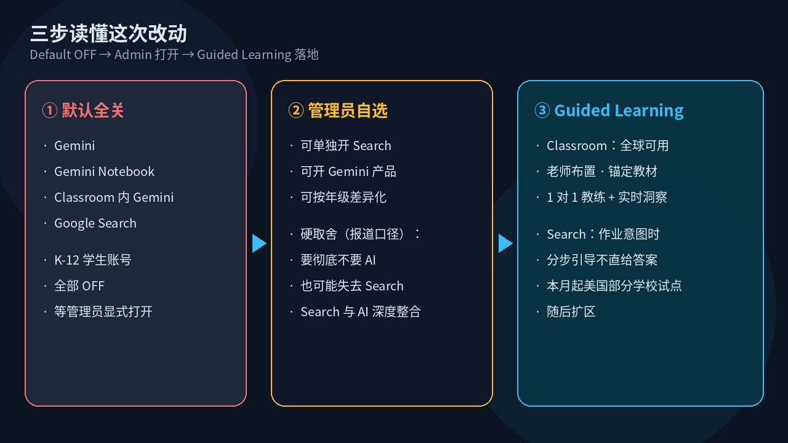

# 默认全关：K-12 的 Gemini·Search 要管理员打开；作业改教练带你想，全关 AI 也可能没搜索

孩子把物理题粘进对话框，三秒后答案到手——很多家长和老师对 AI 进作业的第一印象，就是这一幕。

**2026 年 11 月 3 日**，Google 教育负责人 Chris Phillips 发博：Guided Learning 推进 Classroom 与 Search；K-12 学生账号上 **Gemini、Gemini Notebook、Classroom 内 Gemini、Google Search** 将改为**默认全关**，等学校管理员显式打开。哲学一句话：**productive struggle**——让学生被适度卡住，而不是被直接喂答案。

这不是又一个模型发版。普通人立刻能感知的，是作业场景里 AI 从「给答案」改成「带你想」，同时把开关交回学校。另一面也要钉死：按多家报道，Search 与 AI 已深度整合——想彻底不要 AI，**也可能一并失去 Search**。

## 时间线：今天能用什么，明年要决定什么

1. **2026 年 8 月：** Classroom 里 Gemini 页签对已允许 AI 的学区打开；随后纽约市禁止学生对面 AI 至八年级、洛杉矶联合学区有一年暂停等反弹。
2. **2026-11-03：** 官方博客上线。Classroom 内 Guided Learning **全球可用**（当天起）；Search 侧 Guided Learning 本月晚些时候在**部分美国学校试点**，再扩区。
3. **未来数月：** 官方称会向学校交代控制项细节，再滚动落地默认全关。
4. **EdWeek / 9to5Google 等报道：** Phillips 称改动约 **明年年初**起；另有报道写学校可选方案约在 **2027 年初**。以学校收到的 Admin 通知为准，别把媒体时间线当成开关已拔。

## 家长、学生、老师为什么先在乎

**家长：** 关心的不是模型榜单，是孩子今晚作业还写不写得出来。默认全关 = 学区没动手前，学生账号上 Gemini / Search 可能一起不可用；学区若打开 Guided Learning，作业帮助更像教练追问，而不是秒出终稿。

**学生：** Classroom 里老师布置的 Guided Learning，是锚定教材的 1 对 1 学习工具；Search 试点则在系统判定「像在求作业帮助」（复杂物理题、读书报告等）时，分步引导，不直给答案。

**老师：** 能布置活动、看实时洞察，找班级卡点。EdWeek 引 Classroom 产品负责人 Brittany Siegal Mennuti：设置可按年级差异化——一组禁 AI、一组只走 Guided Learning、高年级保留带 AI 摘要的完整搜索体验；**但被禁止使用 AI 的组别，也会失去 Search**。

**管理员：** 拿到的是「更多控制」，也是一道硬题：默认全关；可单独开 Search、单独开 Gemini 产品、或都开。Google 在反弹后的公开说明里强调：不必为了保留 Search 而打开独立 Gemini 产品——但 **Search 仍会带 AI 能力**（如 AI Mode / AI Overviews 走引导式解题）。传统「无 AI 摘要的纯搜索」不在选项里——这是 EdWeek、AP、9to5Google 等报道口径，需与官方博客对照读。

## 看点怎么评：教练产品 + 默认关 + 搜索取舍

**Guided Learning：把「给答案」换成「带你想」**

官方写的是开放式提问与分步拆解，而不是甩最终答案。Classroom 侧：老师布置、锚定课堂材料、教师拿实时洞察。Search 侧：识别作业帮助意图后走引导——先试点，再扩。

Google 在另一篇研究博文里给过自家 RCT 数字：东京大学 300+ 学生、半天统计学自学；仅用常规网络工具提分约 **5.3** 个百分点，加上 Gemini 里 Guided Learning 约 **8.1** 个百分点，自称约 **1.5 倍**学习增益。这是 **Google 官方研究主张**，半日场次、单一学科，别当成独立第三方盖章。

**默认全关：开关交回学校，但不是「今天立刻全网断电」**

官方列死四样：Gemini、Gemini Notebook、Classroom 内 Gemini、Google Search——K-12 学生账号默认 OFF，管理员显式打开。细节与滚动节奏「未来数月」再发。别把「宣布默认关」读成「你孩子今晚 Search 一定没了」。

**硬取舍：全关 AI，也可能没 Search**

Phillips 对媒体称 Search 与 AI「深度整合」。学区可以开 Search 而不开独立 Gemini；但要 AI 完全离场，选择往往是**不要 Search**。Common Sense Media 的 Yvette Renteria 提醒：失去 Search，也失去练习「找信源、验真伪」的机会；该机构 7 月报告称，测试的 180 份作业里 AI Mode 全部给了答案——这是倡议方研究，用来理解争议，不是 Google 博客原文。

## 检查表：你现在能做什么

| 你是谁 | 立刻可做的动作 |
| --- | --- |
| 家长 | 问班主任 / 学区：学生账号上 Gemini、Classroom Gemini、Search 目前默认与计划；是否分年级；全关后作业检索走哪条路 |
| 老师 | 若学区已开 Gemini：当天即可在 Classroom 试布置 Guided Learning，看洞察是否对得上班级卡点 |
| 学区管理员 | 盯 Google Workspace / Education Admin 后续控制项说明；按年级草拟「禁 AI / 仅 Guided Learning / Search+AI」三档，并评估无 Search 时的替代检索工具 |
| 关心政策的人 | 对照官方博客与 EdWeek / AP：默认关清单以官方为准；「无 AI 就无 Search」以报道与 Google 后续澄清为准 |
| 学生 | 先问清楚学校开了什么；别把校外个人 Gemini 当成校内政策例外 |

## 收尾真问题

你家学区更想要 **「彻底无 AI」**，还是更想要 **「保留 Search，但接受引导式 AI」**？

选前者：按报道口径，可能同时失去学生账号上的 Google Search——要提前准备替代检索与信息素养课。选后者：看 Guided Learning 在 Classroom 是否真能压住「粘贴答案」，以及 Search 试点会不会把作业帮助变成可监督的分步过程。

开关在管理员手里；作业本该谁想，才是家长和老师真正要盯的验收标准。

官方博客：https://blog.google/products-and-platforms/products/education/ai-learning-era-updates-2026/

Guided Learning 研究（官方）：https://blog.google/products-and-platforms/products/education/guided-learning-uk-japan/

EdWeek：https://www.edweek.org/technology/googles-new-rules-hand-schools-hard-choices-about-ai-and-search/2026/11

AP：https://apnews.com/article/ai-schools-classroom-students-google-7ba4219e505db1c11d672f6eefe7155a
