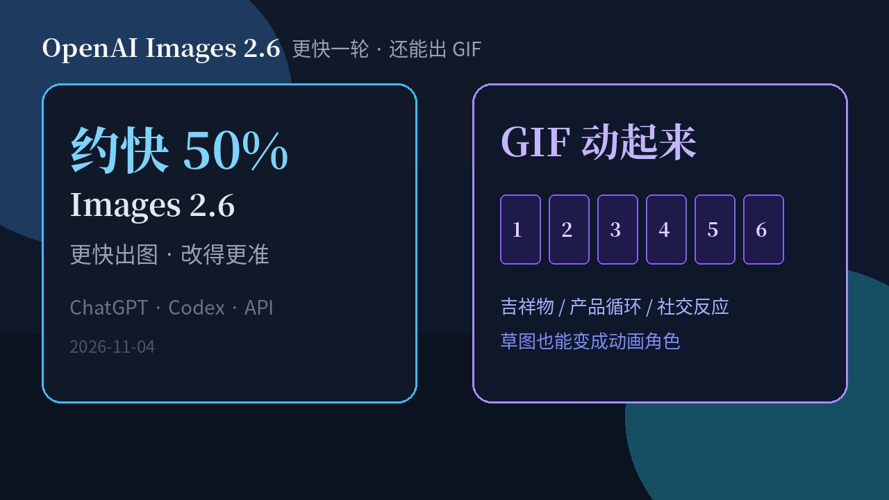
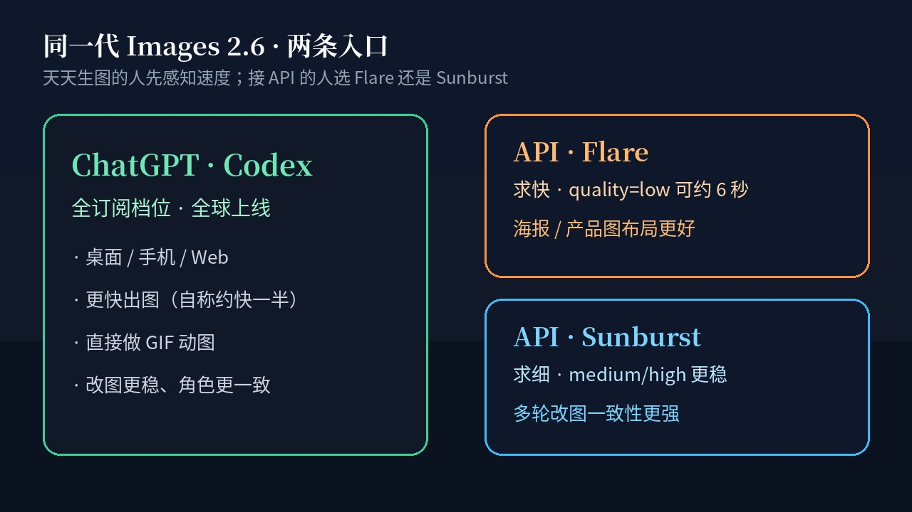

# 约快一半还能出 GIF：OpenAI Images 2.6 进 ChatGPT·Codex·API，Flare 求快 Sunburst 求细

天天生图的人，最烦的不是「模型又换了个名字」，是**等一轮、改一轮、再等一轮**——海报改标题、角色微调表情、产品图换背景，每一次转圈都在吃掉灵感。

**2026 年 11 月 4 日**，OpenAI 推出 **Images 2.6**：进 **ChatGPT、Codex 和 API**。官方自称生成速度比之前**快约 50%**；还能直接出 **GIF**——吉祥物动起来、产品循环、社交反应图，甚至一张草图也能变成动画角色。API 侧拆成两档：**GPT-Image-2.6 Flare**（求快）和 **GPT-Image-2.6 Sunburst**（求细）。

这不是又一篇模型宇宙设定。普通人立刻能感知的是：**出图更快、能动起来、开发者还能按场景选快还是细。**

## 天天点生成的人为什么先在乎

OpenAI 自己甩的量级是：跨 ChatGPT / Codex / API，人们每周大约生成 **40 亿**张图，日均超过 **5 亿**——公司口径，用来说明「这不是小众玩具」。

对你来说，数字不如体感：

1. **轮次变短。** 自称约快一半；API 上 Flare 在 `quality=low` 时，官方称最快可到约 **6 秒**。同一段文案改五版，以前喝口水才出结果，现在更像「说完就看」。
2. **静图不够用的场景，终于不用另开视频工具。** 品牌吉祥物眨眼、货架商品转一圈、社媒用的反应图——GIF 就是短循环语言。
3. **改图更敢连着改。** 官方强调角色、产品、品牌细节在多轮编辑里更稳；ChatGPT 里已有的图像标注（markup），现在也进了 API，能点着地方改。

老师做课件、运营赶活动页、独立开发者塞产品图进落地页——先感受到的是**节奏**，不是参数表。

## 时间线：今天就能摸

1. **2026-11-04：** Images 2.6 发布；ChatGPT 与 Codex **全球、全订阅档位**，桌面 / 手机 / Web 可用。
2. **同日 API：** `gpt-image-2.6-flare` 与 `gpt-image-2.6-sunburst` 上线；定价见官网定价页。
3. **能力包：** 更快生成 + GIF + SVG 导出 + markup 定点改 + 新参数 **complexity**（规划投入）与既有 **quality**（视觉精细度）拆开。

## Flare vs Sunburst：一张表看懂怎么选

| | **Flare** | **Sunburst** |
| --- | --- | --- |
| 定位 | 求快、日常迭代 | 求细、多轮一致性 |
| 官方亮点 | `quality=low` 时可低至约 **6 秒**；海报 / 产品图布局更好 | `quality=medium` 或 `high` 时更高质量、改图更稳 |
| 适合 | 草稿、批量试构图、运营赶时效 | 角色定妆、品牌资产、精细产品图 |
| 模型 ID | `gpt-image-2.6-flare` | `gpt-image-2.6-sunburst` |

ChatGPT / Codex 用户不用背这两个名字：打开就能用新一代出图。接 API 的人，才需要在「这一轮要快」和「这一轮要细」之间显式选型。

## GIF：草图也能动

官方场景很直白：活动吉祥物、产品镜头循环、社媒 meme / 反应图；做视频前也可以先用动画分镜探角色动作。OpenArt CEO Coco Mao 说 GIF 是社媒的母语，一句 prompt 就能让创作者开口。

开发侧硬参数（Image API **生成**端，`output_format: gif`；**编辑**端不出 GIF）：

| 字段 | 范围 | 默认 |
| --- | --- | --- |
| `frame_count` | 2–64 | 9 |
| `frame_duration_ms` | 20–2000（按 10ms 取整） | 200 |

另外：生成端可 `output_format: svg`（编辑端不支持 SVG）；markup 定点改已从 ChatGPT 下沉到 API。

## complexity ≠ quality：少踩坑

新参数 **complexity** 管的是「模型为这次请求规划多少」；**quality** 管的是画面精细度。官方建议：多数编辑用 **low complexity** 更快；元素多、约束密的场景再试 medium / high。不设 complexity 时默认 **high**；complexity **不另收费**。

别把两个旋钮拧成同一个——要快改背景，先降 complexity；要成片质感，再抬 quality。

## 看点怎么评

**硬的是产品入口齐。** ChatGPT、Codex、API 同一天铺开，全订阅档位都能摸到更快出图和 GIF——不是「仅 Pro / 仅实验室」。

**实的是 API 分档。** Flare / Sunburst 把「赶时间」和「抠细节」拆开，比只甩一个旗舰名对工程更诚实。

**别吹成通吃。** 「约快 50%」「约 6 秒」是官方自称；复杂 prompt 仍可能慢；文本排版、精确构图、跨次角色一致性，文档自己也承认仍有上限。GIF 有安全评估与防护（见 system card），不是无约束玩具。

早期声音里，Figma Weave 创意总监 Itay Schiff 强调的是速度和可控一起进可复用工作流——听起来像生产工具升级，而不是又一场 demo 秀。

## 检查表：你现在能做什么

| 你是谁 | 立刻可做 |
| --- | --- |
| ChatGPT / Codex 用户 | 打开任一档位账号，试一版静图看等待是否变短；再要一张短循环 GIF |
| 运营 / 设计 | 用草图或角色定妆图生成 GIF 样片，先过内部评审再开视频工时 |
| API 开发者 | 草稿与批量试构图走 Flare + 合适 quality；定妆与多轮品牌资产走 Sunburst |
| 改图流水线 | 简单局部改用 low complexity；密布局再升；需要定点时上 markup |
| 要矢量的人 | 生成端要 SVG；别指望编辑端吐 SVG |

## 收尾：下一轮先试什么

你下一张图，是「再等一分钟也行」的成片，还是「五秒内必须看到方向」的草稿？

前者可以留给 Sunburst 和更高 quality；后者直接 Flare，或在 ChatGPT 里连着改。想动起来，就开 GIF——帧数和时长先用默认 9 帧 / 200ms，再按节奏拧。

打开 ChatGPT 或 Codex 跑一张；接 API 的，今天就把 Flare / Sunburst 写进配置，别等下一轮发布会。

官方原文：https://openai.com/index/introducing-images-2-6/
