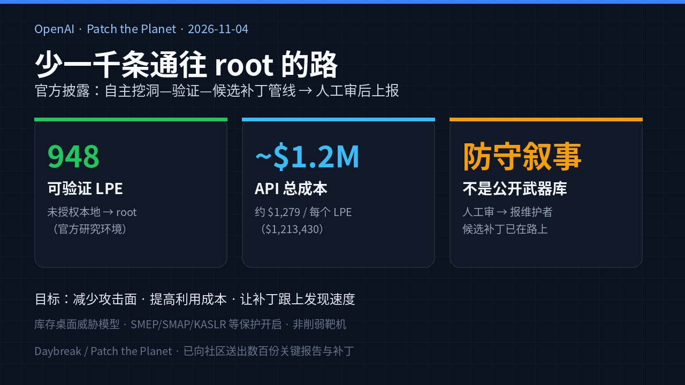
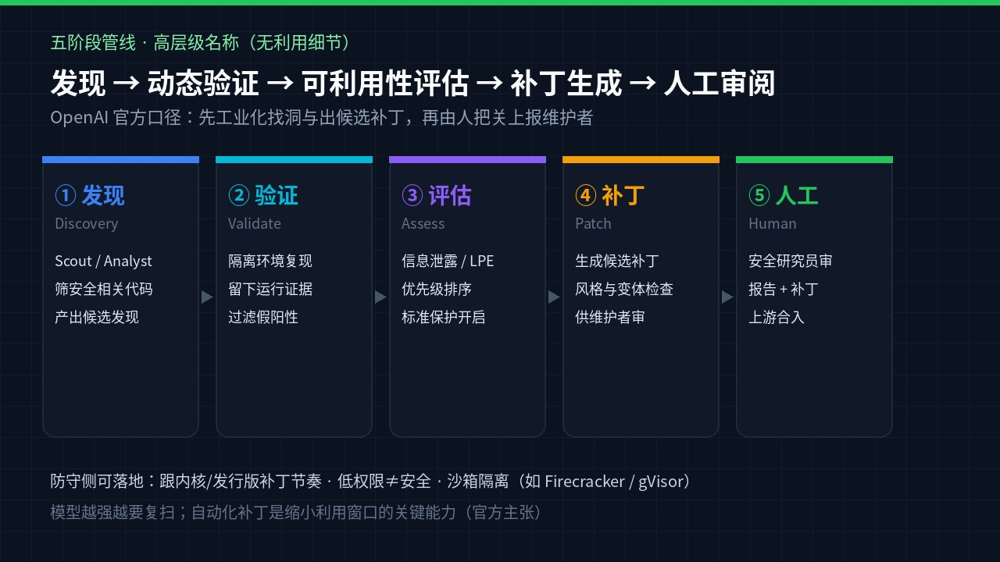

# 少一千条通往 root 的路：OpenAI 管线一次跑出 948 个 Linux 本地提权与候选补丁，API 约 121 万美元

跑 Linux 的人，平时最怕的不是「又出了个新模型」，是**低权限账号忽然等于 root**——云主机、容器节点、开发机、安卓底层，内核一破，边界就塌。

**2026 年 11 月 4 日**，OpenAI 发长文 *A thousand fewer paths to root*：自家搭的**自主漏洞发现 / 验证 / 可利用性评估 / 候选补丁**管线，用即将发布的 cyber 模型，在 **2026 年 10 月中旬**跑了一轮。数字极硬：**948** 个可工作的 Linux **本地提权**，加上候选补丁；全程 API 约 **121 万美元**。然后是人审，再按内核社区建议，从关键洞开始上报、合补丁。

先钉死边界：这是**官方研究披露 + 防守叙事**。文章写的是他们在受控环境里工业化「找洞—验证—出候选补丁」，再交给人类研究员与 Patch the Planet 伙伴上游；**不是**把 948 个利用公开成武器库，也**不要**把标题读成「全世界 Linux 今天已被攻陷」。

## 运维、开发、云上的人为什么先在乎

你不需要读懂内核子系统名称。你要知道的是三件事：

1. **低权限过时账号 ≈ root（对资源充足的对手）**——这是 OpenAI 自己写进 Reflections 的近中期判断。补丁节奏慢、节点拖着旧内核，风险模型要按这个改。
2. **发现在加速，验证与合入才是瓶颈。** 管线一次吐出两千多候选；真正贵的是复现、定严重度、写出能合的补丁。官方结论：自动化补丁生成，是跟上发现速度的必要条件。
3. **成本账站在防守方。** 这次约 **$1,213,430** API（约 **$1,279 / 每个 LPE**）。他们用历史 Pwn2Own **$2 万**、TyphoonPWN **$7 万** 的 Linux LPE 赏金做**示意性**估值：948 个 × 历史价 ≈ **$1890 万–$6630 万**，大约是管线成本的 **16–55 倍**——**不是**实际到账赏金，是「若按旧赏金尺子量，防守侧投入是否划算」的算术。

云团队、SRE、安全运营：真正能动手的，仍是**补丁节奏、隔离姿态、把「低权限」当已不可信**。

## 时间线：从 24 到 166 到 948

1. **2026 年 6 月（Patch the Planet）：** GPT-5.5 Cyber 验证并用于上报的 LPE：**24** 个。
2. **2026 年 7 月下旬：** GPT-5.6 Sol 端到端跑出 **166** 个独特 LPE，API 约 **$513,690**。
3. **2026 年 10 月中旬：** 更新的 cyber 模型 + 完整五阶段管线 → **948** 个独特 LPE，API **$1,213,430**。官方写：尽管中间有约三个月加固，新颖 LPE 仍比 7 月多 **>5 倍**。
4. **扫描窗口约 10 天内：** 已有 **61** 个 LPE 上游合入、**43** 个在 staging、约 **299** 个在公开讨论——维护者也在全速补。
5. **2026-11-04：** 长文发布；已送出**数百**份关键报告与补丁，其余与伙伴继续上游。

## 数字一张表（官方口径）

| 项 | 数字 |
| --- | --- |
| 候选发现 | **2,308** |
| 动态复现 | **1,724**（约 **74.7%**） |
| 可工作 LPE | **948**（未授权本地 → root） |
| 信息泄露 PoC | **291** |
| API 总成本 | **$1,213,430**（约 **$1,279 / LPE**） |
| Scout 审计目标 | **5,034** 处 / 约 **280 万**行（约内核 **7%**） |
| Analyst 耗时 | **12** 小时产出 2,308 候选 |
| Validation 耗时 | **30** 小时复现 1,724；分析错误仅约 **3.1%** |
| 威胁模型 | **库存桌面系统**，非削弱靶；可利用性阶段开启 SMEP / SMAP / KASLR / HARDENED_USERCOPY 等 |
| kernelCTF 改编环境 | **25** 泄露 PoC + **21** LPE；API 约 **$32,936**；对照 2026 年迄今 kernelCTF 已接受 **26** 个确认 0-day LPE；若 21 个被接受，示意赏金约 **$150 万**（约 **45×** 扫描成本） |
| 新颖利用手法 | 据称至少 **10** 类（弹性对象、页整理、data-only、类型混淆等**类别名**）；官方**故意省略**完整技术细节——这里同样不展开 |

示意赏金算术是 OpenAI 用来谈「防守投入 vs 历史市场价」的尺子，**不是**他们领到的钱，也**不是**攻击者购物清单。

## 管线怎么走：五段名字就够

高层级五段（官方命名，**不涉及**利用步骤）：

1. **发现** — Scout 圈安全相关、可达的审计目标；Analyst 静态扫出候选。
2. **动态验证** — 隔离环境里复现，留下运行证据；把「看起来像洞」变成「能复现的洞」。
3. **可利用性评估** — 在标准发行版保护开启的前提下，区分信息泄露与本地提权，排出优先级。
4. **补丁生成** — 为已验证问题生成候选补丁，并做风格、变体等检查，供维护者审。
5. **人工审阅** — 安全研究员审利用证据、补丁与严重度，再上报。

早期跑次里他们踩过坑：**200** 个「成功拿到 root」的样本中，有 **20** 个其实走的是**另一个** 0-day，而不是被指派的那个——于是收紧验证，要求独立核对「成功路径是否等于被指派漏洞」。对自主安全研究，**验证路径本身**和验证结果一样重要。

## 看点怎么评：工业化防守，不是「酷炫挖洞秀」

**硬的是规模与闭环。** 从候选到复现到 LPE 再到候选补丁，最后人审上游——这才是标题里「少一千条路」的意思：把发现变成可合入的修复，缩短利用窗口。

**软的是叙事边界。** 官方明确：完整新颖手法细节不公开；对外强调 Daybreak / Patch the Planet、与伙伴合补丁。读这篇该带走的是**防守经济学与运营姿态**，不是复现菜谱。

**维护者并不慢。** 十天窗口里上百个 LPE 已补或进 staging、近三百个在讨论——所以自动化分流必须对最新代码复验，避免重复报废洞，浪费维护者时间。

**模型变强就要复扫。** 同一套 harness，更新模型仍能挖出更早代错过的洞。大项目往往要多轮「扫—修—再扫」才能见底；专有软件同理。

## 检查表：你现在能做什么

| 角色 | 立刻可做 |
| --- | --- |
| 云 / SRE | 查发行版与内核补丁 SLA：关键节点是否还挂着已知已修版本；滚动窗口是否短于「低权限失陷」可接受时间 |
| 安全运营 | 把「低权限账号可登录的机器」按接近 root 建模；优先压攻击面、收权限、缩短补丁滞后 |
| 平台 / 多租户 | 核对隔离层：Firecracker、gVisor 或等价沙箱是否真在路径上；别只靠「用户是普通 uid」 |
| 内核 / 发行版跟进者 | 盯上游与发行版安全公告；OpenAI 称已送数百关键报告——合入节奏会反映到你的更新通道 |
| 工程负责人 | 把「自动化发现 + 人工合补丁」当成能力投资项；别假设一次审计能一劳永逸 |
| 普通开发机用户 | 本机别长期拖内核；容器 / VM 不要默认给多余能力；怀疑「这台反正不是 root」的侥幸 |

不要做的事：试图从这篇长文「还原」那 948 个利用，或把类别名当成动手说明书。官方省略细节是有意的。

## 收尾真问题

你的环境里，**未打补丁的低权限访问**，是不是已经按「约等于 root」在排优先级？

若答案是「还按旧模型：普通用户破不了内核」——这篇官方账本在说，对资源充足的对手，那个假设正在失效。能立刻改的，是补丁节奏、隔离深度，以及别把「暂时没人报洞」当成「没有洞」。

少一千条通往 root 的路，靠的是合进去的补丁，不是标题里的数字本身。

官方原文：https://openai.com/index/a-thousand-fewer-paths-to-root/
