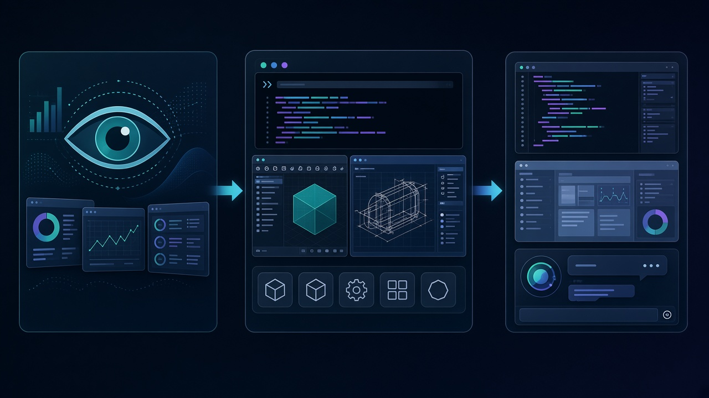

# 正式版来了：腾讯混元 Hy4 首次视觉+电脑操作，CLI+GUI 能碰 Blender·CAD，权重近期开源

聊天能写、能编，还不够——很多人真正卡住的，是**对着屏幕上手干活**：读图、点 GUI、开终端、在 Blender / CAD 里把长程任务跑完。

**2026 年 11 月 4 日**，腾讯混元发布 **Hy4 正式版**。官方自称：随着能力再次跃升，**Hy 首次跻身最强开源模型之列**——这是官方口径，不是第三方裁定。相对 **Hy4 preview**，正式版显著扩大预训练与后训练规模；**首次引入视觉**；大幅抬升指令遵循、长文理解、长程任务 / 长程智能体、深度研究等。另一刀更扎眼：**首次支持电脑操作（Computer Use）**，可把 **CLI + GUI** 合着用，并对 **Blender、CAD** 等专业软件和跨应用长程任务做了专项训练。

两句先钉死：

- **「最强开源之一」= 官方自称。** 腾讯自己也写明：与顶尖闭源仍有较大差距，尤其在内部高难测试集上。
- **「将于近期开源」≠ 今天已开源正式版权重。** 现在能用的是云与产品入口；权重、模型系统卡片还在路上。

## 边界先钉死：今天能拿到什么，拿不到什么

| 项 | 口径 |
| --- | --- |
| 日期 | **2026-11-04** 发布 Hy4 正式版 |
| 官方自称 | Hy **首次跻身最强开源模型之列**（官方口径） |
| vs preview | 显著扩大预训练 / 后训练；**首次视觉**；指令遵循、长文、长程任务 / 智能体、深度研究等抬升 |
| 视觉 | 感知 + 推理 + 工具调用 → 细粒度图像、复杂图表、数学视觉推理等 |
| 电脑操作 | **首次 Computer Use**；**CLI + GUI**；Blender / CAD 与跨应用长程任务有专项训练 |
| 参数（preview） | IT之家此前报道 / 腾讯 preview 官宣：总参 **770B**、激活 **49B**、上下文 **1M**（**2026-08-28**）；正式版一手稿**未另报**新参数量，勿当正式版已换尺码 |
| 上线 | 腾讯云 Tokenhub、**OpenRouter**；产品：**CodeBuddy / WorkBuddy**、**元宝**、**ima**；新浪还写企业微信智能助理大圆、Hermes、OpenCode；QQ / 王者 / 和平 / 微信读书 / 腾讯新闻等「持续接入中」 |
| API 价 | 与 Hy4 preview **相同**；性能显著超过 preview（IT之家） |
| 开源节奏 | **权重将于近期开源**；届时发模型系统卡片；更负责任开源，关注网络与生物安全等；联合 vLLM / SGLang、Inferact Inc. 做开源生态支持 |
| 官方自认短板 | 与顶尖闭源仍有较大差距；内部高难集：前沿数学、长程开发、模型迭代、视觉问答等 |
| 下一步 | **Hy4 flash** 计划近期发布：性价比与推理速度；新浪称在继承能力基础上大幅降低任务成本 |

## 时间线：从 preview 到「能看见、能点屏幕」

1. **2026-08-28：** 腾讯发布并开源 **Hy4 preview**——770B / 49B / 1M；编程、办公、科研叙事已起。
2. **preview 之后：** 按官方说法，正式版继续扩预训练与后训练；把视觉和电脑操作补进同一条产品故事。
3. **2026-11-04：** **Hy4 正式版**上线云与多款产品；API 价维持 preview；权重与系统卡片标「近期」。
4. **接下来：** 正式版权重开源 + **Hy4 flash**——一条偏能力，一条偏成本与速度。

## 做事的人为什么在乎：入口已经开着，别把口号当成绩单

写代码、改前端、做游戏原型的人：正式版把「会写」和「会看界面、会点软件」绑在一起。IEG 合作叙事里，UE / Unity / Godot 适配加深；相对 preview，GameDev **+19.1%**、GameLogic **+9.8%**——这是报道给出的内部 / 官方评测抬升，不是独立第三方榜单盖章。

做办公、金融分析的人：WorkBuddy 报道数字是平均效果 **83.18**、任务通过率 **96.15%**，12 场景里 9 个国内第一——官方 / 报道口径。金融侧用了数千工作空间、上万高质量任务；自建测试里幻觉率从 preview **12.95% → 7.2%**，猜测导致错误 **23.1% → 5.6%**。企微套件连通聊天 / 邮件 / 文档 / 日程 / 会议；团队协作随新版「项目」上线——叙事是**接进日常工作面**，不是又一个孤立聊天框。

跑科研、长程 agent 的人：TenureTrail **内部评测**（7 大学科、123 项可执行任务）被用来讲端到端推进；电脑操作 + CLI/GUI 专项，才是「长程」有没有落地工具的分水岭。另一面官方也没躲：内部高难集上，和顶尖闭源差距仍大。

## 看点怎么评：三截拼在一起才像「正式版」

**视觉不是贴图，是感知 + 推理 + 工具调用**

细粒度图像、复杂图表、数学视觉推理——官方把这三件绑在一条链上。对做事的人来说：读得懂截图 / 表，才谈得上后面点 GUI、调工具。

**Computer Use：CLI 和 GUI 一起用，才碰得了专业软件长程活**

首次电脑操作，加上 Blender / CAD 专项，是这篇和 preview 最硬的差集。别吹成「所有桌面软件随便接管」——报道写的是专项训练与跨应用长程任务优化。

**入口已开；权重还在「近期」；flash 另开一条成本线**

今天能测：腾讯云、OpenRouter、CodeBuddy / WorkBuddy、元宝、ima，以及新浪列出的大圆 / Hermes / OpenCode 等。价格对齐 preview，性能自称显著超过。权重未落、系统卡片未发；flash 承诺降成本、提速——把「正式版能力」和「便宜高频」拆开看，别混成同一天全部到位。

## 检查表：你现在能核对什么

| 你是谁 | 可验证动作 |
| --- | --- |
| 普通读者 | 打开 IT之家 / 新浪 2026-11-04 稿，确认：正式版、官方「最强开源」自称、首次视觉与电脑操作、CLI+GUI、Blender/CAD、近期开源权重、API 价同 preview |
| 已在用 CodeBuddy / WorkBuddy / 元宝 / ima | 产品里切到 Hy4，对照自己的前端 / 办公 / 长程任务，别只看官宣分数 |
| API / 平台接入 | 核腾讯云 Tokenhub、OpenRouter；新浪还列 Hermes、OpenCode——以你账号页实际可选模型为准 |
| 开源权重党 | 记清：**近期开源 ≠ 今天可下**；盯系统卡片与 vLLM / SGLang 生态说明 |
| 金融 / 办公 | 把幻觉率、猜测错误率当**自建测试**读；WorkBuddy 83.18 / 96.15% 当官方报道口径，拿自家任务复测 |
| 游戏 / 引擎 | 对照 GameDev +19.1%、GameLogic +9.8% vs preview；问 UE / Unity / Godot 上自己的活有没有变顺 |
| 对标闭源的人 | 把官方「与顶尖闭源仍有较大差距」和「最强开源之一」**两句一起读** |

能核对的就这些。没有「今天权重已全开」的开关，也没有第三方把「最强开源」盖成行业终审。

## 收尾真问题

你更急着**今天就在云和产品里试视觉 + 电脑操作**，还是更急着**等正式版权重落地再自建**？

信前者：入口已经铺开，价对齐 preview，正式版相对 preview 的硬差集就是视觉和 CLI+GUI——尤其 Blender / CAD 这类专业长程。信后者：开源节奏写的是「近期」，系统卡片与安全评估还没到齐；flash 还要另开性价比线。

正式版到了；「最强开源」是官方自称；权重还在路上。能编辑、能点屏幕的模型故事，验收标准只有一个——你自己的活，过不过得了。

IT之家：https://www.ithome.com/1/022/035.htm

新浪科技：https://finance.sina.com.cn/tech/shenji/2026-11-04/doc-inixpvuw9459767.shtml
