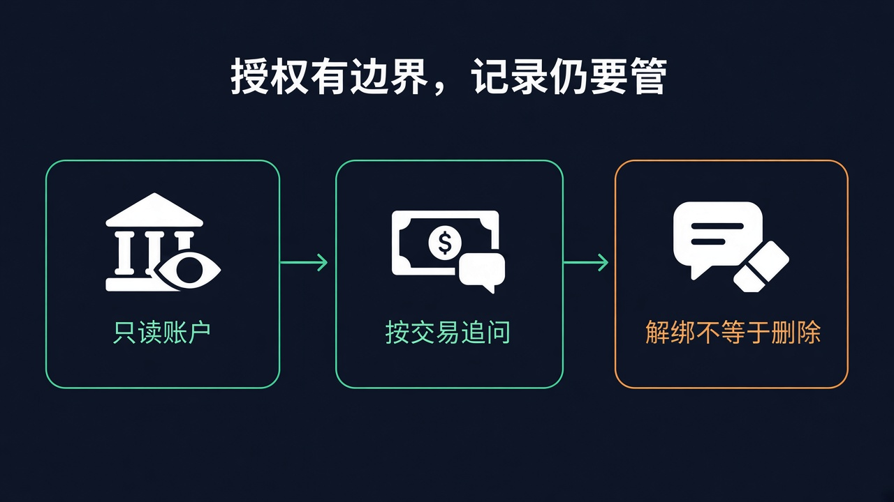

# 最多读两年流水，不能动钱：Claude 接上银行账户，解绑却不等于删记录

离发工资还有几天，你想知道这个月的钱到底去哪了。

银行卡里看余额，信用卡里翻消费，再去找那笔忘了取消的会员续费。每个 App 都有数字，问题是：**没人把它们拼成一句你能直接拿来做决定的话。**

Claude 现在想接这件事。

2026 年 11 月 5 日，[Claude Personal Finance](https://claude.com/resources/articles/introducing-personal-finance-in-claude) 开始进入公众视野，[Plaid 同日宣布为它提供账户连接](https://plaid.com/blog/plaid-anthropic-financial-insights-in-claude/)。产品正向**美国 Pro、Max、Ultra 用户逐步开放测试**，不是全球上线，也不是付费就立刻有入口。你可以接入自己选择的账户，用大白话问花销、账单和可疑收费。

边界先说死：**只读，不能转账、管理或投资你的钱，也不是为提供投资建议设计的。** 它不是接管网银的财务管家，是一个能带着真实流水回答问题的助手。

真正让人想试的，是少翻几个银行 App。真正让人犹豫的，也是同一件事：为了让答案更贴身，你得先把生活里很私密的一部分交给它读。

## 它读的是账户数据，不是拿走你的网银密码

按[官方帮助文档](https://support.claude.com/en/articles/18185620-use-personal-finance-in-claude)，你通过 Plaid 自己登录银行，选择要共享的账户，批准只读访问。Claude 不索要、也看不到你的银行密码。

这不代表它只看一眼余额。你授权后，它可以读到银行名称、账户名称和类型、账号末几位、余额与信用额度，以及**最多 24 个月的交易**，包括金额、日期、商户、类别和银行的交易描述。最多可连接 **16 家银行**，目前只支持美国银行。

帮助文档还补了一条容易被省掉的细节：Plaid 通常只给账号末四位，但如果银行把完整号码写进账户名称或交易描述，Claude 也可能在那里看到。不能把「末四位」听成「其他字段绝不可能出现完整号码」。

银行、信用卡之外，贷款和投资账户也在可连接范围里。但读得到的是上述余额、额度等数据，**不是持仓、交易、利率或合同条款**。接上投资账户，不等于多了一个能替你操盘的投顾。

Web、桌面端、iOS、Android 都在支持范围；Free、Team、Enterprise 不支持。它也不能在 Claude Code、Cowork 任务或定时任务里使用这些已连接账户。做开发的人别急着把它理解成一个随处可调的财务 agent 接口。

## 少掉的是来回翻账单，不是你最后那次核对

过去向聊天机器人问「我该怎么省钱」，如果没有你的账本，它很容易给出一套谁都能用的建议。

这次的增量不是把预算建议说得更顺，而是**把回答放到你已经授权的账户数据上**。

官方给出的场景很日常：先问「这个月钱花在哪」，把已连接账户的支出按类别加总；再追问「比平常多吗」，对照此前月份；继续问「发工资前还要扣什么」，把接下来的付款摆出来。

它也可以提示重复收费、意外手续费、逐渐上涨的账单，解释 APR 这类术语，再结合记录计算你付过的利息。想看每周支出图、到期日历或自选数字的看板，也可以继续让它调整。

这都是官方描述的能力，不是我们拿真实账户跑出的实测成绩。**提示一笔异常，不等于银行确认欺诈；列出未来账单，也不等于保证没有漏项。**

更该盯住的，是帮助文档主动写出的误差来源：余额可能滞后一两天，同一个账户通过两个登录接入可能被重复计入；某家银行读不到时，支出统计会把它漏掉，预算于是可能显示「还剩的钱」比实际更多。

这是会影响下一笔消费的误差，不是排版里的小瑕疵。

所以别停在「你这个月还能花多少」。紧接着问一句：**这个数用了哪些账户、哪些交易，哪些数据没读到？** 重要数字回银行 App 或对账单核一遍。让 AI 帮你缩短找账的路，不是省掉最后确认的那一步。

## 「不进训练」有明确范围，不等于「不留记录」

Anthropic 的承诺是：**在 Personal Finance hub 财务中枢里与 Claude 的对话，不用于训练模型。** 在中枢之外分享的内容，适用你自己的隐私设置。

范围很关键。帮助文档允许你在普通聊天里问账户问题，但不能因此把财务中枢的承诺扩写成「所有地方聊钱都不进训练」。

「不训练」也不是「数据不保存」。官方写明，财务数据会出现在对话中，并留在聊天历史里，直到你删除聊天，保存还受其数据保留规则约束。帮助文档还写了另一条边界：用过已连接账户的对话，设计上不写入 memory、事后也搜不到，也不进入月度回顾，包括标题；这仍不等于聊天历史里没有这些记录。为 Claude 提供托管的服务商也会处理银行数据，Plaid 则按自己的条款和隐私政策处理。

连通之后，Claude 默认可以在聊天中读取已连接账户，不会每次重新询问，除非你调整相关设置。你可以在聊天的 Connectors 中关闭 Plaid。**最初那次授权，不只是允许它回答眼前这一个问题。**

更容易误会的是退出。

解绑银行，会让 Claude 停止继续读取。如果解绑的是最后一家银行，看板会重置，小部件、预算设置和初始设置答卷会被删除，而且不可撤销。但聊天里已经说出的内容、作品和分享链接不会因此清掉，仍然需要你另行移除；作品即使删了对应聊天，也会留到你再去删除。官方也提醒，共享聊天链接会展示你的消息和 Claude 的回答，包括账户数字；生成的作品也可能带着银行数据。

换句话说，**关掉水龙头，不等于擦掉桌上已经倒出来的水。**

这些限制不说明产品必然不安全，也不能反过来被包装成绝对安全。只读限制的是它能对账户做什么；不进训练限制的是特定对话的一种用途；保存和分享，又是另外的事。用户需要知道自己分别同意了什么。

## 为了少翻几次账单，你愿意让它持续读到哪些生活细节

我的判断是，这个功能最值得盯的，不是「AI 又进了一个行业」，而是聊天助手开始用真实账户回答那些很小、却每天都有人要做的决定。

会员是不是重复扣了，饭钱是不是比上个月多，下次发薪前有没有一笔容易忘的账单。它不必替你投资，只要把这些问题答得更清楚，就有使用理由。

Anthropic 还在产品介绍里强调，没有广告或赞助推荐，也不提供自家的信用卡、贷款或储蓄账户。这是它对产品利益关系的表态，不是答案一定客观、一定正确的证明。

难的不只是把账户接通，还得让人看懂数字来自哪里、哪里缺了数据、授权以后会持续读什么、退出后还留下什么。一个漂亮的总余额，不该把这些问题盖住。

入口出没出现、自己在不在支持范围，可以先看[帮助文档](https://support.claude.com/en/articles/18185620-use-personal-finance-in-claude)里的地区、套餐和授权说明。不在支持范围里，就先别为了追新把完整流水手动贴进普通聊天。

到了授权按钮前，真正要停一下的不是「AI 会不会把钱转走」——产品说了不能。少翻几次账单值不值得，取决于你愿不愿意让它持续读到那些生活细节。
