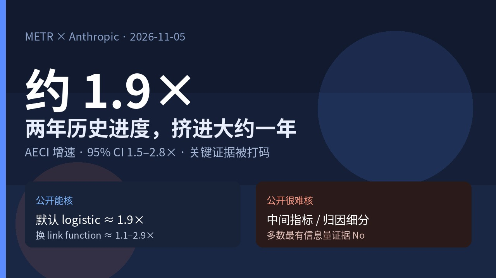
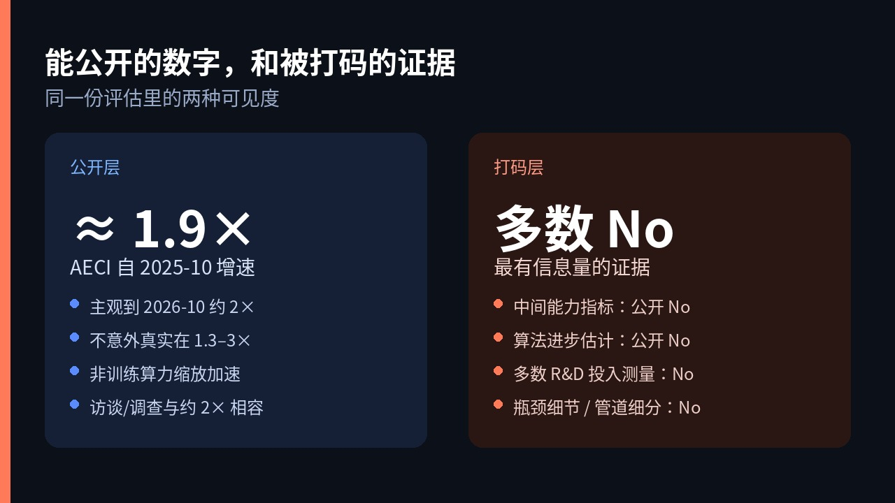

# 约 1.9×：METR 说 Anthropic 研发用 AI 把两年进度挤进一年，关键证据却被打码

你团队里如果有人已经把「用模型写代码、跑实验、改训练管线」当成日常，真正该盯的不是又一个「AI 提效」口号，而是：**能力进步的增速本身有没有被抬高，抬高多少，又有多少能被外人核到。**

2026 年 11 月 5 日，独立评估机构 METR [发了这份独立评估](https://metr.org/blog/2026-11-05-anthropic-ai-rd-acceleration-assessment/)：2026-08-12 到 2026-10-29，他们在 Anthropic 内部高权限看了一圈「AI 在多大程度上加速 AI 研发」。公开结论很硬，也有张力——**AECI（Anthropic 版 Epoch Capabilities Index）自 2025 年 10 月以来增速约 1.9×**，大约等于过去一年做出约两年历史进度；METR 主观判断到 2026 年 10 月，在定义明确的任务上，相对 2024-03 至 2025-10 大约约 **2×**，也不意外真实落在 **1.3×–3×**。同时他们写得很直：最高层风险结论可以公开，**多数最有信息量的证据被 Anthropic 打码**，公众更多只能信 METR 的判断，达不到「证据透明」。

别把它听成「AGI 已到」或「Anthropic 已经全自动造模型」。METR 写的是：现在主要是 AI **辅助**研发，不是端到端全自主；有「signs of life」暗示全自主贡献可能变大。数字是估计，归因是主观，打码是现场条件。

## AECI 约 1.9×，置信区间 1.5–2.8×

AECI 是 Anthropic 内部用的能力指数，对标 Epoch Capabilities Index 那一套思路。METR 估计：自 **2025-10** 以来，基准分数增速约 **1.9×**，95% 置信区间 **1.5–2.8×**。用他们自己的说法：一年里做出大约两年的历史进度。

这和 Haiku 5.5 system card 里写的 **1.7×** 不完全一样。METR 解释差在哪：他们纳入了更新的、未发布的内部模型数据。稳健性检查也不软——换 link function 等合理设定，加速估计大约落在 **1.1×–2.9×**；默认 logistic 仍是 **1.9×**。他们写：若真实演化显示「完全没有加速」或「超过约 3×」，会感到意外。

主观层他们更谨慎：到 **2026-10**，在定义明确任务上的能力进步速率，相对 **2024-03 至 2025-10**，多数项目成员相信大约约 **2×**；不意外真实在 **1.3×–3×**。AECI 的 1.9× 显著影响了这个判断，但他们也提醒：可能过拟合基准分布，也可能只是方法假象；AECI 点偏稀疏、相对研发加速还有滞后。

## 不是训练算力缩放突然变快

归因上，METR 有一块写得特别硬：**加速不是训练算力缩放加速导致的**。他们说对此有信心；细节被打码。

其余归因没有那么干净。他们看过招聘、数据、算法发现、其他瓶颈是否解开等。主观估计是：

- **2025 年末**那一波加速里，非 AI 因素可能占大头；许多细节同样被打码。
- 到 **2026-10**，他们猜当前加速里多数——大约 **80%**——来自 AI。这是主观判断，不确定性很大；依据是多条线索，以及「别的因素解释不了这种持续加速」。

管道各阶段更细的「累计 / 瞬时 AI 贡献」估计，公开文里被打掉了。

## 访谈约 2×，Slack 自评 uplift 到约 12×

访谈和调查，METR 说与「大约翻一倍」相容：研究者对「自己这块活因 AI 加速多少」的估计范围很宽，但中心大约落在 **2×**。

另有一条很松的证据：Anthropic 内部 Slack 投票式自评，员工用反应估「最近模型带来的加速」。到 **2026-10**，自评 uplift 大约到 **12×**。METR 明确说这是**很松的证据**，回答往往低投入；他们更关心 uplift 增速有没有变，而不是绝对值本身。个体 uplift 也不等于整体能力增速——要顶住收益递减，输入侧生产率往往也得跟着抬。

现状边界也写清了：AI 还不能在最关键的训练流程上做高度显著、**完全自主**的贡献；但有「signs of life」，暗示这类贡献可能很快变大，不同方向成熟度差很多。

## 最高层结论能看，最有信息量的证据被打码

这篇公开文一开头就摆张力：METR 可以自由写出最高层风险结论，也可以披露 Anthropic 是否行使了打码权、结论是否显著依赖被打码材料；Anthropic 对非公开信息有单方面打码权。结果是——**多数 METR 认为最有信息量的证据被打掉了**。Anthropic 的口径是：去掉「可能加速其他 AI 开发者」的机密。

METR 自己说：被打码的材料往往有多种合理解读，双方对如何合成整体图景都不确定；公众很难自己核证据、也难和其他来源对上，**达不到「证据透明」**，更多只能信 METR 的判断。

公开报告里那张表，类型大致是：

| 信息类型 | 给了 METR？ | 公开报告里有结果？ |
| --- | --- | --- |
| 内部模型基准能力 | 是 | 是 |
| 关键中间能力指标 | 是 | 否 |
| 算法进步估计 | 是 | 否 |
| AI 贡献相关证据 | 是 | 部分 |
| 关键 R&D 投入测量 | 大多有 | 否 |
| 瓶颈细节与预测 | 部分 | 否 |
| 员工访谈 | 是 | 部分 |

还被挡住的包括：管道细分加速与归因、除「不是训练算力缩放加速」之外更细的算力/数据/算法拆分、面向未来模型的指标预测等。大约 100 页的 Full Report 大部分只能停在墙后。

## 未来 12 个月未见明显瓶颈，他们自己也不自信

算法进步、训练算力、实验算力、数据——METR 说，在未来 **12 个月**里，没看到会显著卡住继续快速进步的瓶颈。但理解在评估过程中**多次翻转**，所以对当前判断**不自信**；若干具体瓶颈分析也被打码。

正因为没看见清晰瓶颈或陡峭收益递减，他们相信：后续能力进步仍有相当风险带来**更快**的加速——也可能只是他们漏看了重要约束。

## 可能估高，也可能估低

低估的方向：近期可能还有再加速（含双曲式增长的可能，AECI 趋势里未必一眼看见）；自动化临近，人瓶颈一旦松开可能猛冲；AECI 可能低估真实世界影响。

高估的方向：非 AI 因素其实解释了大部分加速；主要量的是易自动评分、定义干净的任务，messy 任务未必同步；Anthropic 早期 AECI 增速相对行业前沿偏低，也会把「加速倍数」抬得看起来更大。

评估本身也有结构限制：不是员工级随手翻文档那种权限；信息管道相对窄；少量请求被拒；解读关键数据时多次翻转。METR 写：更满的访问会大幅加快「读对现场」的过程，也可能仍有误读。

## 打开原文，先对你自己的 uplift 账

下次再听到「内部已经 10 倍提效」或「研发翻倍」，可以先拆三层：公开基准增速是多少、归因里有多少是 AI、有多少证据外人根本看不到。

打开 [METR 这篇评估](https://metr.org/blog/2026-11-05-anthropic-ai-rd-acceleration-assessment/)，把约 **1.9× / 主观约 2×** 和你团队 Slack 或问卷里的自评 uplift 并排放——差多少、差在「个体体感」还是「可核的能力曲线」，比把标题读成「两年挤进一年已经坐实」更接近现场。能核的先核；核不到的，就标成「判断」，别标成「证据」。
