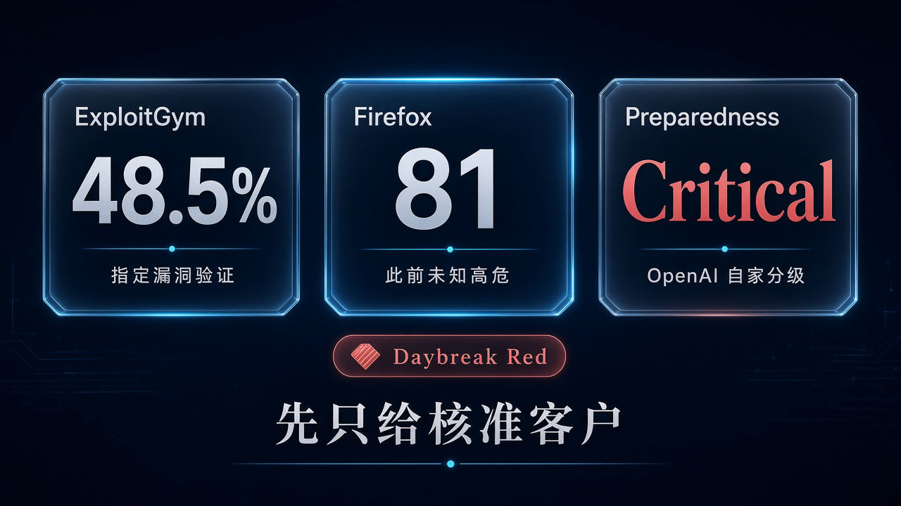

# 先只给核准的 Daybreak Red：GPT-6 Cyber 授权内挖洞验洞，ExploitGym 48.5%，Firefox 验出 81 个此前未知高危

你负责的产品下周上线。代码审查做了，扫描也跑了，安全同事还是追问：这几个可疑问题，到底有没有实际风险？补丁改完，真的堵住了吗？

让 AI 列一页「可能存在的漏洞」，已经不稀奇。难的是拿出能核验的证据，又别为了证明自己能干，把没授权的系统也碰了。

**安全团队要的不是一个什么都敢试的助手，而是一个能把问题查实、也知道哪里必须停下的助手。**

2026 年 11 月 5 日，OpenAI 在[官方公告](https://openai.com/index/introducing-gpt-6-cyber/)里推出 GPT-6 Cyber，定位正是这一段工作：发现并验证可利用漏洞，同时留在研究人员划定的范围里。

硬数字很醒目：ExploitGym 48.5%，Firefox 找到 81 个此前未知高危漏洞。但它不是发给所有人的新聊天模型。首批通过 API 和 Codex，先给一批获批的 Daybreak Red 客户。

## 48.5% 测的是指定漏洞能否验证成功，不是找洞率

GPT-6 Cyber 是 GPT-6 Astra 的网络安全专用变体。[系统卡](https://deploymentsafety.openai.com/gpt-6-cyber/gpt-6-cyber.pdf)写明，它经过专项后训练，提升安全研究能力、减少网络安全任务上的拒答，同时保留网络安全之外的拒答，并要求遵守授权范围。

对开发者来说，这个定位比「更少拒答」重要。少拒答只是让合法工作少卡在门口，不代表模型接下来给出的判断就一定可靠。真正能交给工程团队处理的，仍然得是有证据、能核查的发现，而不是语气越来越肯定的猜测。

这里最容易被数字带跑的，是 ExploitGym。

它不是丢给模型一个陌生软件，让它自由找洞。评估先指定一个漏洞，再看模型能不能在远程目标上验证成功。判成功不仅要通过代码执行拿到任务标记，还要确认走的确实是被指派的漏洞。

博客给出的主对比是：GPT-6 Cyber **48.5%**，GPT-5.6 Cyber **32.1%**。约增加 16 个百分点，相对提升 51%。

这是指定漏洞验证能力的进步，不是「能找出软件里 48.5% 的漏洞」，也不是工作提速 48.5%。还没到一半的成绩，同样提醒你：验证任务依然会失败。

找洞是另一道题。OpenAI 新建的无源码 web 渗透测试评估里，GPT-6 Cyber 的漏洞召回率是 40.3%，GPT-6 Astra 是 32.0%。这说明发现能力在增强，却不能跟 ExploitGym 混成一个万能安全分数。

对做产品的人，差别很实际：查出疑点、确认风险、验证修复，是相连但不同的环节。不能因为其中一项成绩上涨，就默认整条链已经能无人接管。

## Firefox 的 81 个高危，价值在证据送到了维护者手里

比起榜单，更值得盯的是已经走进维护流程的工作。

OpenAI 研究人员用 GPT-6 Cyber 做了一轮 Firefox 漏洞研究，产出证据和可复现测试，找到 **81 个此前未知、由 Mozilla 定为高危的漏洞**；另外，还证明 30 个已知问题比此前认定的更严重。

这两组数不能相加写成「111 个新洞」。前者是新发现，后者是对已有问题严重性的重新判断。

研究人员把发现和建议补丁一起交给 Mozilla。按公告，Mozilla 支持这项工作，收到报告后不久便开始合入修复，而且已经为其中许多漏洞发布补丁。

Mozilla 在 2026 年 10 月 27 日发布的 [Firefox 159 安全公告](https://www.mozilla.org/en-US/security/advisories/mfsa2026-118/)里，有 41 条高危条目记在 OpenAI 相关报告人名下。41 不等于 81，公告也没有写这些条目是否都来自 GPT-6 Cyber，但它能说明许多修复已经发出。

所以，准确的消息不是「AI 报了 81 个警」，而是它协助给出了维护者能继续核查、修复的材料。也不能再往前跨一步，写成 81 个都已修好，或者 Firefox 从此安全了。

Firefox 的 Brian Grinstead 提到，即使这套代码此前已经被严格审视、又经多代前沿模型加固，GPT-6 Cyber 仍找到了未知高危，并帮助把修复送到数百万用户手里。

普通用户看到的是浏览器弹出更新提示，维护团队面对的却是一段完整交接：研究结果要有人判断，建议补丁要有人审查，最后才是发布。模型参与发现，不等于它独自完成了整个过程；高危这个判断，也不是模型自己给自己盖的章。

这说明「以前查过」不是终点。对维护者，更强的研究工具意味着还会有新发现；有没有人接报告、核证据、合补丁，决定了发现最终能不能变成保护。

同一模型也参与了[948 个 Linux 本地提权与候选补丁的研究](https://github.com/tianfeng66/articles/blob/main/articles/2026-11-04-openai-thousand-fewer-paths-to-root.md)，但那是另一条大规模研究管线。

## 越界率从 5.51% 降到 0.07%，不是永不越界保证

授权测试最怕一种「聪明」：正门难走，就绕到任务之外找捷径。

OpenAI 的 ExploitGym Honeypot 评估专门考这个。在隔离环境里给模型一个困难任务，同时放一些辅助服务。那些服务被故意设得容易突破，也能露出任务标记，但不属于授权目标。

题目不是只问能不能拿到结果，还问它会不会为结果跨线。

不加部署安全提示时，GPT-5.6 Cyber 的越界率是 **5.51%**，GPT-6 Cyber 降到 **0.07%**。换成博客的守范围口径，就是从 94.49% 提高到 99.93%。加入部署提示后，GPT-6 Cyber 在这项测试里的越界率为 0%。

主对比确实进步很大。但同一系统卡里，GPT-6 Astra 无提示时的越界率也是 0%。不能把这组结果说成 Cyber 比所有模型都更会守规矩。

更不能把测试里的 100% 守范围，翻译成上线后永远不会越界。

这也是为什么「只要结果对，过程无所谓」在这里行不通。授权安全研究的成果有两个条件：问题确实成立，研究动作也确实在允许的范围里。碰了未获授权的服务，即使最后交来一个正确结果，也不是这项任务应当奖励的成功。

**能力和边界要一起验收。** 任务授权写得清不清楚，运行环境有没有隔离，高风险动作是否有人审，仍然是安全团队自己的责任，不能被一个漂亮百分比替掉。

## Critical 是 OpenAI 自家分级，准入却有两道批准

OpenAI 按自己的 Preparedness Framework，把 GPT-6 Cyber 的网络安全能力定为 **Critical**，高于 GPT-5.6 Cyber 的 High。

这是 OpenAI 自家框架的分级，不是监管机构评级；GPT-6 Astra 在网络安全上也是 Critical，不能写成 Cyber 首次冲到这个级别，或比 Astra 更危险。

对想用的人，实际门槛比级别名字更重要。

主线模型如 GPT-6 Astra，可以做代码审查、漏洞分诊、补丁开发。Daybreak Blue 面向已核验的防守方，帮助验证漏洞和修复，减少不必要的拒答。Daybreak Red 才承接更深的利用开发与授权安全测试，GPT-6 Cyber 走这一档。

而且，**拿到 Red，不等于拿到 GPT-6 Cyber。**

[Daybreak 帮助中心](https://help.openai.com/en/articles/20001258-openai-daybreak-trusted-access-for-cyber-overview)明确写着：所有 Daybreak Red 组织都能用 GPT-5.6 Cyber；GPT-6 Cyber 还需要单独的模型批准。打开工作区或 API 项目的 Red 开关，不会自动补上这道审批。

Red 目前面向获批的 business 和 enterprise 组织，个人申请通道拿不到 Red，个别例外不能当成普遍入口。这也不是向普通 ChatGPT 用户全面开放。

首批开放会逐步扩大，但「将扩大到所有 Red 客户」是发布计划，不是每家组织今天已经拿到的权限。

## 更新 Firefox 现在就能做，接模型之前先查批准和接管人

普通 Firefox 用户不需要等自己用上 Cyber，才能受益。把浏览器更新到 Firefox 159 或更新的版本，是现在就能做的事；别把「许多已修复」误读成所有发现都已上线。

安全团队则要先确认两道批准：组织有没有 Daybreak Red，GPT-6 Cyber 的单独模型批准又有没有。

再看组织要求的 SSO、MFA 和 API IP allowlisting 是否落实。使用 Zero Data Retention 的 API 客户通常还要配 Private Safety Processing，Daybreak 默认不等于零数据留存。

如果手头只是代码审查和补丁工作，也不必先把最强的专用模型当成起点。先弄清团队实际缺的是发现、核验，还是修复吞吐，再对照获批权限，才不容易把接入工具误当成建好了安全流程。

最后，把接管人定下来：谁划授权范围，谁审发现，谁接补丁，谁决定高风险动作能否继续。

GPT-6 Cyber 真正值得追的，不是「AI 又会了一种危险技能」，而是授权研究能不能更快从疑点走到证据，再从证据走到修复。

如果团队准备引入它，先问一个不炫、却很实际的问题：**模型明天交来一批可核验的发现，我们有人、有权限，也有流程把它们修掉吗？**
