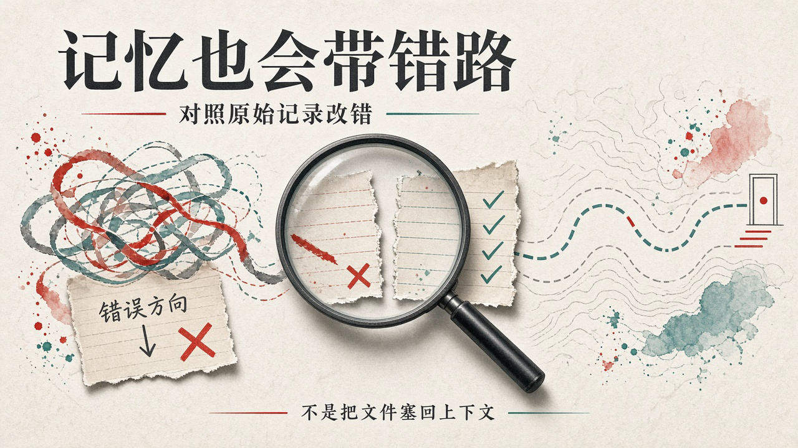
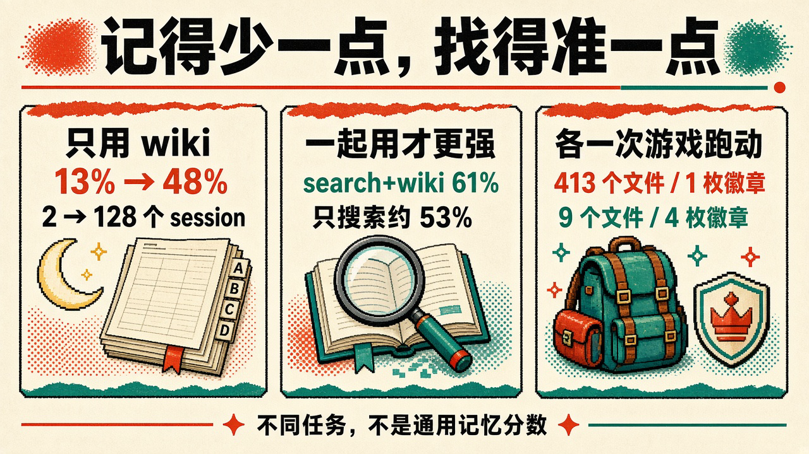

# 413 个记忆文件，只拿到 1 枚徽章：Anthropic 让 Claude 在会话之间「做梦」改错、写 wiki

你把项目交给 AI，第二天接着干。它没忘昨天，甚至翻出了一份写得很认真的笔记。

麻烦是，那份笔记从一开始就错了。现在它带着昨天的错误，继续往前走。

对做长任务、接公司知识库的人来说，这比「记不住」更难处理：忘了还能重查，记错了却可能直接当成前提。

Anthropic 在 2026 年 11 月 6 日的[《The components of agent memory》](https://www.anthropic.com/research/components-of-agent-memory)里，拆的就是这件事。所谓让 Claude「做梦」，不是模型像人一样睡觉，也不是面向所有用户的新功能，而是在会话之间回看记录、核对笔记、重新组织记忆。

**有用的记忆，不是把昨天的一切留下，而是让明天少走一次已经走错的路。**

## 写下「Mt Moon DONE」时，它根本没过山

宝可梦里，月见山入口在西、出口在东。入口附近有一道单向断崖，跳下去就掉回原路。

Claude 把山口的宝可中心当作地标，却把它错记在东边。走出中心，它宣布「Mt Moon is behind me」，顺手把笔记更新成「Mt Moon DONE」。

实际上，山还没过。

几步后，它跳下断崖。导航工具没显示这段掉落，它反而解释成自己往西走过头了，仍相信刚才在正确一侧。

笔记错了，解释还在替笔记打圆场。

研究人员让它做了一轮 dreaming：把记忆和原始会话转录对照，抓出地标方位错误，重写笔记。改完后，它直接回到山洞，最终到了华蓝市。

没改笔记的那次跑动，三次掉回原路。第三次后它表示不想再循环，被自动回复要求继续，结果退回山前的深灰市。跑动结束也没到华蓝市。完全不用记忆的跑动，同样没能过山。

关键不是又生成了一段更顺的总结，而是**原始记录能推翻总结。**

## 413 个文件、225 个文件夹，只换来 1 枚徽章

记忆太多，也会把主任务挤走。

研究人员在约 10,000 步时，分别看了 Claude Sonnet 3.7 和 Claude Fable 5 各一次游戏跑动的记忆目录。这不是大样本统计实验。

Sonnet 3.7 写了 413 个记忆文件、225 个文件夹，拿到 1 枚徽章；Fable 5 写了 9 个文件、2 个文件夹，另有顶层的 global.md，拿到 4 枚徽章。

前者觉得什么都可能有用，战斗、道具、路人都记。可游戏状态一直变，详细记录也一直过期。约第 10,000 步，它开始建第四组「主记忆」文件夹，接下来 17 步新建 6 个文件、删除 9 个，游戏里一步没走。

钱有多少、人站哪里，每回合看屏幕就知道，何必再维护一套副本？

Fable 5 留下的是屏幕不会直接告诉它的东西：当前目标、路线计划、自己试出来的策略。global.md 像仪表盘，另外两个文件夹分别放路线和玩法。

连续 7 个精灵球没抓住鲤鱼王后，它记下的不是流水账，而是一条经验：连续 3 个球失败，就换按键节奏。

这也解释了记忆的难处：写下一条规则，其实是在预测未来还会用到它。当下却不知道，下一步到底会遇见什么。

## 35 万个文件没有塞回上下文，而是长出了一份 wiki

这里的记忆，是 Claude 从任务和互动里带走、留到下一会话能读回的知识。不包括更新模型权重，也不包括单次会话内学习，或用摘要替换旧轮次的 compaction。

Letta 与加州大学伯克利分校提出过 sleep-time compute，在交互空档重组上下文。dreaming 沿着类似思路，把一部分整理工作挪到后台。

不只纠错，还能写笔记、合并重复、建索引。

Anthropic 拿今年 5 月收购的 Stainless 的内部文档做了测试：约 350,000 个文件、约 4.2 亿 tokens，出了 25 道题。

Opus 5 agent 在 128 个 session 里探索文件，写和改带链接的 wiki 页面，合并重复内容，按原文核查说法，并用共享日志协调。

dreaming 从 2 个 session 扩到 128 个后，**只靠 wiki 回答的成绩，按评分标准从 13% 到了 48%。**

不是「整体记忆能力从 13% 涨到 48%」，更不是把整个语料库变成了可靠答案。它是在这组题上，逐渐把散落的文档整理成可找的知识地图。

## wiki 单用没赢搜索，搭着用才到了 61%

同一测试里，只用搜索约 53%，只用 wiki 最好 48%。单独交给 wiki，并没有更强。

搜索加 wiki，随着 wiki 增长从 54% 到 61%，还约节省 20,000 tokens/题。

这个组合更像公司里熟悉业务的人：知道该去哪个角落找，但遇到具体说法，仍能回原文件核对。目录不是档案，地图也不能代替现场。

另一组并购问答有 24 道题，超过一半需要跨文档，很多还要判断或算术。在那些需要跨文档或判断、算术的条目上，wiki 是 87%，只搜索是 73%。这不是全部 24 道题的总分。

反例也很直接：Harvey LAB 的一项任务，许多评分要求从单个文档文本搜索就能找到，wiki 没有明显帮助。另一项任务里，wiki 甚至比原文档还大。

整理了一圈，什么都没抽象出来。

## 57 条合同事实，几个 agent 挤一张表只留下 41 条

法律任务更能看出，「记得多」为什么不等于「记得对」。

一项模拟公司收购的 LAB 任务，要求根据合同写法律意见书。最初几个 agent 同时往共享条款表里写，互相覆盖，摘要也丢了细节。57 条事实只留下 41 条，72%。

随后 Claude 反思失败、改指令、重建 wiki：每份合同独立一页，只让一个 agent 写，逐字引用条款，不再挤进共享摘要表。

改完后，57/57，100%。这是这项任务的条款事实覆盖，不是法律工作从此全对。

有效的变化，不是多做几遍摘要，而是组织方式终于贴住了任务：法律意见书要依赖条款，条款就不能在汇总时被磨没。

第二遍整理还能补漏：有次 dreaming 找出 9 条指向缺页的链接，改指向已有的同文档页面，又补了 3 个新页，包括一个索引。记忆维护并不神秘，有时就是把断掉的路接回来。

## 只记失败，反而丢掉了不少提升

怎么写记忆，也不是规则越细越好。

CL-Bench 的一道数据库任务，每题都开新会话，答完给正确答案，只有记忆目录一直保留。Sonnet 4.6 留下一堆「可能为什么答错」的猜想；Opus 4.7 开始区分已核查和未证实；到了 Opus 5，才形成更完整的闭环：规则、相信它的理由、以前的答案，以及踩过的坑。

差别不是文件有没有写，而是猜想有没有变成验证过的规则。

只告诉 Opus 4.7 和 Opus 5「有个记忆文件夹」，它们就能用起来。反过来，硬性规定「只记失败」，两者反而丢掉了记忆带来的很大一部分提升。成功时摸清的规律，也可能值得带走。

旧模型则更需要提醒。提示 Sonnet 4.6 答前读记忆、明确测试猜想，它的基准分接近翻倍。引导有用，但不能把给旧模型补的拐杖，当成所有模型永久的走法。

## 地图比领土还大，记忆就成了另一份负担

整理好的笔记也不能全部塞进下一会话。它们占 token，错误还可能被带进每一次工作。装进上下文，不等于模型一定照做。

Claude Code 的 auto memory 就只预装 MEMORY.md 的前 200 行或 25 KB，让它当索引，而不是灌入所有记忆。

后台整理也不是免费午餐。现场写笔记会抢主任务注意力，后台做梦的结果又可能不能立刻用上；记忆会过期，核查要算力，不可能一直把所有条目重查一遍。

所以转录搜索仍可以是底座，wiki 是需要维护、也允许被推翻的一层。

真正难的不是模型会不会「做梦」，而是整理过的记忆还能不能对回原始记录。否则，昨天一句「山已经过了」，明天就能变成它继续走错路的全部理由。
