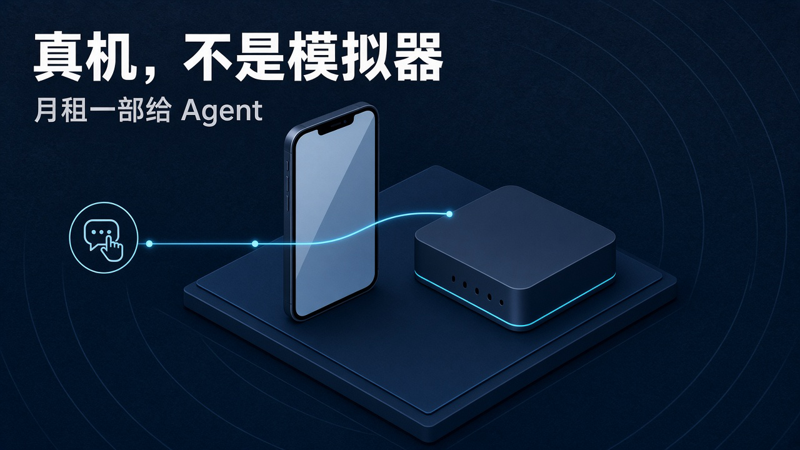
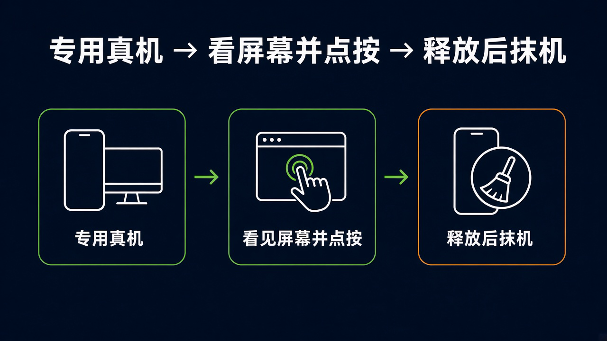

# 不是模拟器：月租 60 / 90 美元，Glasshand 给 Agent 租真 iPhone 和 Mac，抹机不等于副本消失

你让 agent 去刷一条抖音、测一遍原生登录，或是收一条短信验证码。

聊天框里它能写脚本、能开浏览器。可一碰到 App Store 里的真 App、真机号码、iMessage，它就停了——**没有一部真机，很多原生动作根本做不完。**

[Glasshand](https://glasshand.com) 想卖的，正是这件事：按月把数据中心里的真 iPhone 或 Mac 租给你的 agent。官网口号写得很直：Give your agent a real iPhone or Mac；接上 Claude Code、Codex、Cursor 或其他 agent，他们「bring the device and the fingers」。

运营方是 Delaware 公司 Codapt Inc.。[服务条款](https://glasshand.com/terms)与[隐私政策](https://glasshand.com/privacy)自 **2026 年 10 月 22 日**起生效。官网已开放个人账户注册与付费租赁——这是官网口径，不是我们租过机的实测。

真正让人在意的，不是又多了一个远程桌面，而是：**agent 第一次被认真当成「要有一部手机」的东西来卖。**

## 模拟器过不了 App Store，远程浏览器也拿不到短信

过去做 agent 自动化，常见两条路：模拟器，或远程浏览器里点网页。

模拟器能跑一部分调试，但装不了 App Store 上的 Instagram、TikTok、WhatsApp 这类真应用；浏览器自动化能点网页，却摸不到原生结账流，也收不到绑在手机号上的验证短信。

Glasshand 的硬件口径写在首页：[Real iPhones and Macs in our data center, not virtual machines, emulators, or simulators](https://glasshand.com)。架构是 Agent → Glasshand → 专用 Controller → iPhone / Mac。通过 dedicated controller，agent 看见屏幕，再 taps、types、clicks。

为什么非真机不可，官网给了三条：进 Apple 生态、用真号码、自己设密码。

- 从 App Store 下载真 App
- 给 iPhone 加带 SMS 的 eSIM 套餐，收验证短信、用 iMessage
- 用自己选的密码锁机

eSIM 是「Add / Activate an eSIM plan」，**不是写进 60 美元月租的打包项**；官网没标这笔套餐价，就不能当已含。

首页还列了三类用法：跑 Instagram / TikTok / LinkedIn 等社媒；在托管 Mac 上用 Xcode 做原生构建，并在真机或 Mac 上测登录与结账；登录 iCloud 和日常 App，让 agent 碰日历、通讯录、消息和文件。这些都是官网场景描述，不是我们跑通的成绩单。

## 增量是专用真机加按月租，不是又一个聊天模型

Glasshand 不卖更强的模型。它卖的是**专用真机 + 按月租 + agent 看屏点按**。

[定价页](https://glasshand.com/pricing)写得很干脆：

| 设备 | 月租 |
| --- | --- |
| iPhone | $60 / 月 |
| Mac | $90 / 月 |

美元计价，另加适用税费。按月计费，随时可取消；取消后设备用到当期结束。首页 FAQ 明确：**不能按小时或按天租。** 一个下午的实验，也要付整月。

更具体的机型写在给 agent 读的说明里，[agents.md](https://glasshand.com/agents.md)：目前是 **iPhone SE（第三代）60 美元/月**，以及 **Mac mini M4（16 GB / 256 GB）90 美元/月**。首页只笼统写 iPhone / Mac；写到具体型号，必须以这份说明为准。不是想选就有最新款。

每台租赁各自一条订阅。续费失败后最多有 **72 小时**挽回窗口；过期未恢复，设备释放并重置。目录**不保证现货**；确认缺货时，订阅取消并全额退初次付款，默认可进 waitlist——通知不等于预留，也不扣费。条款还写：付款确认后 **30 分钟内**完不成初始履约，同样取消并全额退首笔付款。

接入方式：不需要安装，也不需要 MCP。API 基址 `https://api.glasshand.com/v1`，控制台在 `https://app.glasshand.com`。官网写法是：Just ask your agent；选设备，把 prompt 贴进 agent 的聊天。人在 Stripe 里核对订阅与总额再付款；agent 去准备结账，**不应收集用户的 OTP、浏览器 cookie 或卡片信息**。批准链接本身不授予 API 访问。

不要把「结账页创建成功」或浏览器跳转成功，当成已经付完款、设备已经就绪。agents.md 要求等到 `deviceReady:true`，且状态是 `active` 或 `grace`，再去连设备。

API 提供屏幕捕获与键盘/鼠标输入。**没有 native shell、文件系统挂载或剪贴板 API。** 文字输入主要是 printable US-layout ASCII 加换行/制表，最多 512 字符；Unicode 剪贴板插入不可用。人可以从浏览器接管控制。任务之间，设备上的应用、文件和登录会留着，直到你主动 release——它是按月租的专用机，不是用完即焚的一次性沙箱。

## 你拿不到这台物理机，屏幕画面却会经过 Glasshand

服务条款把边界写得很硬：Glasshand 是远程访问服务；**物理设备留在 hardware provider 处，你没有所有权，也不会寄给你。** 他们用 Solid 和其他基础设施商来供应、连接、维护和释放设备。

生命周期按首页：开机出厂重置；专属于你、不与其他客户共享，你自己设密码；任务之间设置会保留，直到你 release；释放后擦除数据并恢复出厂，controller 一并擦掉重置。

但「擦掉」有范围。条款说：device reset 删除设备上的文件、应用、设置和已登录会话；**不等于立刻删掉每一份副本，也不删除 agents、cloud accounts 或其他服务里的副本。** 账户、支付、客服、备份记录另按隐私政策保留。你得在租期结束前自己存好需要的副本——运营备份不是客户备份服务。

隐私政策补了一层更日常的提醒：设备屏幕和输入会经过 Glasshand 以提供远程访问；**屏幕画面可以露出任何可见内容，包括私密消息和登录信息**；被授权的 agent 能收到屏幕图像，并按自己提供商的做法保留副本。撤销不会收回 agent 已经拿到的信息。实时传输与持久的账户/账单/客服记录是两回事。

还有一组容易踩的开关：停止使用、登出或撤销 agent，**都不等于取消订阅**。除初始履约退款、条款明确承诺或法定权利外，付款不可退，不按剩余天数折算。续费失败过了挽回窗，设备释放后，再付款也恢复不了那份数据，也不保证还是同一台机。

## 租机不等于平台允许自动化，批准 agent 也不等于批准每一笔动作

条款要求：只用你有权做的活动。禁止欺诈、冒充、凭据窃取、恶意软件、非法监控、未授权访问、垃圾信息、骚扰或非法利用；不要转售账户，也不要禁用管理和 reset 能力。

Glasshand 订阅**不给你** Apple、App 发行商、网站、agent、支付服务等第三方的许可证。它无法保证第三方会允许你的用法。租到一部真机，不等于抖音、Instagram 或任何 App 允许自动化操作。

批准 agent 权限，和在结账批准订阅，是分开的两步。被授权的 agent 可在权限内行动，不必每次再经 Glasshand 批准；其操作可能改文件、发通讯，或通过你在设备上打开的账户产生消费。撤销拦不住已经完成的动作，也收不回已经到手的信息。

官网也没承诺特定可用时间。缺货、排队、履约失败全额退——这些都写在明处，不是我们加的冷水。

## 为了让 agent 能点开原生 App 和验证码，你愿意把哪一块屏幕交给它看

我的判断是，Glasshand 最值得盯的，不是「远程手机又火了」，而是 agent 产品开始按「需要一部真机」来卖基础设施。

聊天框能写代码、能开网页；但要装 App Store 真应用、收短信验证、在 Xcode 里做原生构建并测真机登录结账，模拟器和远程浏览器都不够。按月 60 / 90 美元租一台专用真机，是把那条缺口产品化了。

它也把几件麻烦事摊开：月租不能散着按小时跑；机型目前是 SE 和 Mac mini M4；你不碰得到物理机，屏幕却经过中间层；抹机清设备，清不掉 agent 和云盘里的副本；停用或撤销不等于取消订阅；第三方平台有自己的条款。

这些限制不说明产品必然不能用，也不能被包装成「抹机就零保留、通吃所有 App、一定有现货」。我们没有租过机，上面写的是官网与条款能核到的边界。

愿不愿意试，取决于你是不是真的需要 agent 去碰原生 App 和验证码——以及你愿不愿意让那块屏幕，持续经过 Glasshand，再进到被你批准的那个 agent 手里。
