# AI 是怎么画画的？一篇讲给小白的生图模型原理

在 ChatGPT 或即梦里输入一句“一只戴墨镜的橘猫，坐在海边，夕阳”，几秒钟后，一张图就出来了。

第一次用的时候我很好奇：这几秒里，电脑到底做了什么？它是从网上找了几张图拼起来的，还是真的“画”出来的？

带着这个问题，我把生图模型的原理从头捋了一遍，整理成这篇文章。读它不需要数学基础，也不需要会写代码。全文用同一个例子贯穿：那只戴墨镜的橘猫。

---

## 一、在电脑眼里，图片就是一堆数字

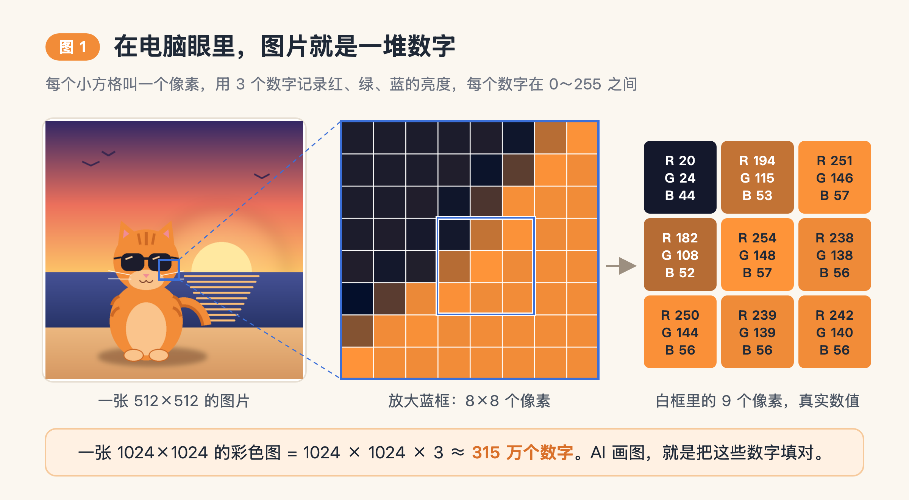

把任何一张图片放大到极致，你会看到它由很多小方格组成。每个小方格叫一个**像素**。

每个像素用 3 个数字记录颜色：红、绿、蓝各有多亮，每个数字在 0 到 255 之间。比如图 1 里，墨镜边缘的一个像素是 (20, 24, 44)，三个数都很小，所以接近黑色；旁边猫脸上的像素是 (251, 146, 57)，红很亮、绿中等、蓝很暗，合起来就是橘色。

一张 1024×1024 的彩色图，就是 1024 × 1024 × 3，大约 **315 万个数字**。

所以“AI 画一张图”，换成电脑的说法就是：写出 315 万个数字。

难的地方在于，如果随便乱填，得到的几乎都是电视雪花屏。在所有可能的数字组合里，看起来像一张正常图片的只占极小的一部分；还要符合“戴墨镜的橘猫”这个描述，范围就更小了。

生图模型要做的，就是在天文数字般的可能性里，找到那一小撮对的组合。

## 二、模型是怎么学会画画的

想象一个学徒，看过几十亿张配了文字说明的图片。他没有把每一张背下来，而是慢慢摸出了规律：天空一般在画面上方；猫有两只尖耳朵和胡须；“夕阳”往往意味着橙红色调和长长的影子；“水彩风”意味着边缘会晕开。

生图模型的训练大体就是这样：

- **训练数据**是海量的“图片 + 文字描述”配对，叫**图文对**。比如开源数据集 LAION-5B，从网上收集了约 58 亿对。
- **模型本身**是一个巨大的数学函数，里面有几亿到几百亿个可以调节的“旋钮”，叫**参数**。
- **训练**就是反复让模型做题、对答案、按错误微调旋钮。做了几亿道题之后，旋钮的位置就“记住”了图片的规律。

有一点值得说明：模型学到的主要是规律，它并没有存一个图库拿来拼贴。不过研究也发现，如果某张图在训练数据里重复出现太多次，模型可能会把它“背”下来。这也是 AI 绘画版权争议的来源之一。

那么，模型做的到底是什么“题”？这取决于它用哪种方法画画。

## 三、三种“画家”

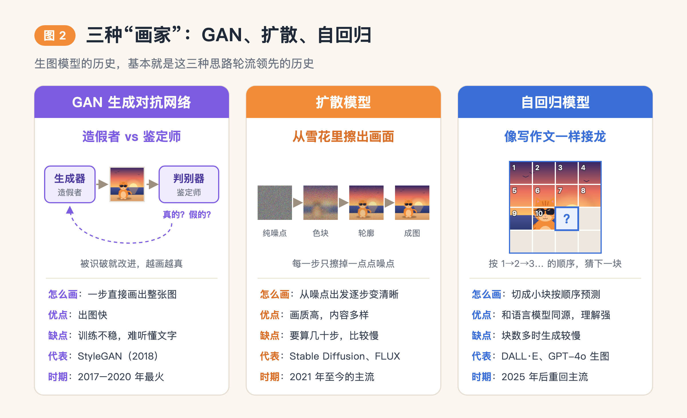

过去十年，生图模型主要出现过三种思路。

**GAN：造假者和鉴定师。** GAN 由两个模型组成。生成器负责画假图，判别器负责判断一张图是真照片还是假的。两个模型互相较劲：鉴定师越来越会挑毛病，造假者就被逼得越画越真。到 2018 年前后，GAN 生成的人脸已经能以假乱真。但它有两个毛病：训练很不稳定，两个模型容易“打崩”；而且很难做到“根据任意一句话画任意内容”。

**扩散模型：从雪花里擦出画面。** 这是 2022 年以来的主流，Stable Diffusion、FLUX 都属于这一类。下一节详细讲。

**自回归模型：像写作文一样接龙。** ChatGPT 写文章时，是根据前文一个字一个字地预测下一个字。自回归生图用的是同一个办法：把图片切成很多小块，每块用一个“图像词”表示，这种词叫 **token**；然后根据你的描述和已经画好的部分，一块一块往下猜。2021 年 OpenAI 的第一代 DALL·E 就是这么做的。后来扩散模型在画质上胜出，这条路沉寂了几年，到 2025 年又回到了舞台中央，第十节会讲到。

## 四、扩散模型：从一团雪花里擦出一只猫

扩散模型分两个阶段：先**学去噪**，再**用去噪来画图**。

### 训练：把照片弄脏，让模型练习还原

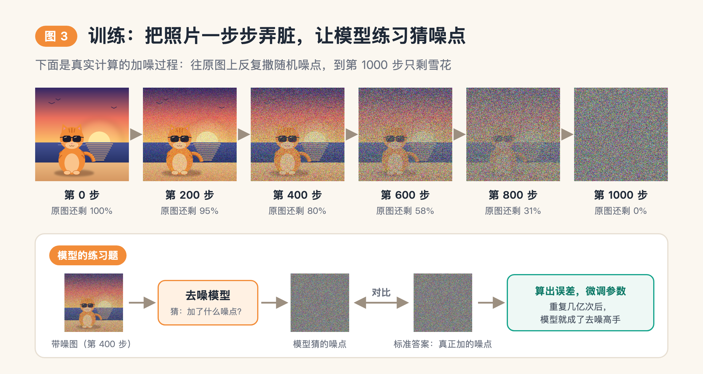

训练过程是这样的：

1. 拿一张真实照片。
2. 往上面撒一点随机噪点，再撒一点……一直撒 1000 次，照片就变成了纯雪花。
3. 随便挑其中某一步的带噪图给模型看，让它猜：“这张图上被撒了什么样的噪点？”
4. 噪点是我们自己撒的，有标准答案，所以可以给模型打分、纠错。

图 3 上半部分是用程序真实计算的加噪过程。到第 400 步，猫还看得清；到第 800 步，只剩一点模糊的影子；到第 1000 步，原图的成分降到 0。

这就像教徒弟修复被泼了墨的老照片。你先自己把好照片弄脏，所以你知道它原本的样子，然后让他反复练习还原。几亿张图，每张在各种“脏”的程度上反复练，模型就成了去噪高手。

### 生成：从一张纯雪花开始

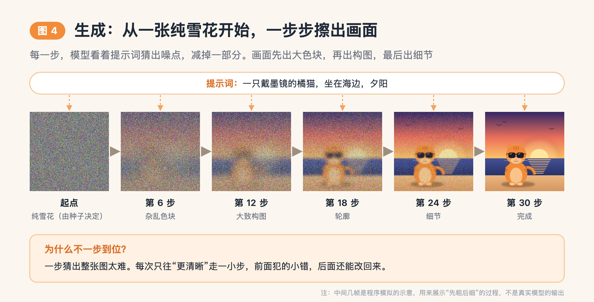

学会去噪以后，画图就是把这个过程倒过来：

1. 先生成一张完全随机的雪花图。雪花长什么样，由一个叫**种子（seed）**的随机数决定。
2. 模型看着雪花和你的提示词，猜“哪些是噪点”，然后减掉一部分。
3. 重复 20 到 50 次。2020 年的早期模型要重复 1000 次。

画面会经历这样的变化：先是杂乱的色块，然后出现大致构图，接着是轮廓，最后是细节。有点像雾慢慢散去，风景一点点露出来。

这里有个关键点：雪花里本来没有猫。每一步往哪个方向“擦”，是提示词告诉模型的。同一团雪花，提示词换成“一只柴犬在雪地里”，最后擦出来的就是柴犬。

**为什么不一步到位？** 因为一步猜出整张图太难了。每次只往“更清晰”走一小步，前面犯的小错，后面的步骤还能改回来。

补充一个你可能会见到的词：**流匹配（Flow Matching）**。SD3、FLUX 等较新的模型用的是扩散的改进版。可以理解为从噪声走到图片时尽量走直线、少绕弯路，所以需要的步数更少。它仍然属于“从噪声逐步变成图”这一大家族。

## 五、文字是怎么指挥画面的

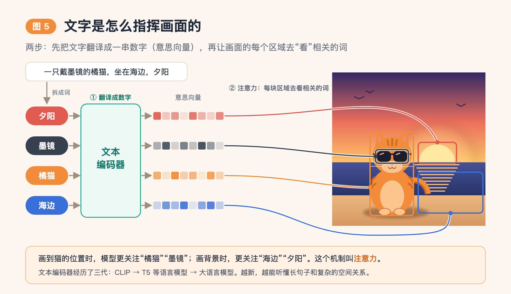

上一节说“提示词告诉模型往哪擦”，具体是怎么告诉的？分两步。

**第一步：把文字翻译成数字。** 模型看不懂汉字，只认数字。所以需要一个**文本编码器**，把你的提示词变成一串数字，叫**向量**。可以把它理解成“意思向量”：意思相近的话，得到的数字也相近，“橘猫”和“橙色的猫”会挨得很近。

文本编码器经历了三代：

- **CLIP**（OpenAI，2021 年）：用 4 亿个图文对训练，专门学“这段话和这张图配不配”。Stable Diffusion 1.5 用的就是它，缺点是只能理解比较短、比较简单的句子。
- **T5 等语言模型**：Google 在 2022 年发现，用更强的语言模型理解提示词，比单纯把画图部分做大更有效。
- **大语言模型本身**：现在很多模型直接用大语言模型理解提示词，所以能听懂长段落、复杂的位置关系和常识。

**第二步：画的每一步都“看一眼”提示词。** 去噪的每一步，画面上的每个区域都会去看提示词，问：“我这块该画什么？”画到猫的位置，它更关注“橘猫”“墨镜”；画到背景，更关注“海边”“夕阳”。这个机制叫**注意力（Attention）**。

### CFG：控制图片有多“听话”

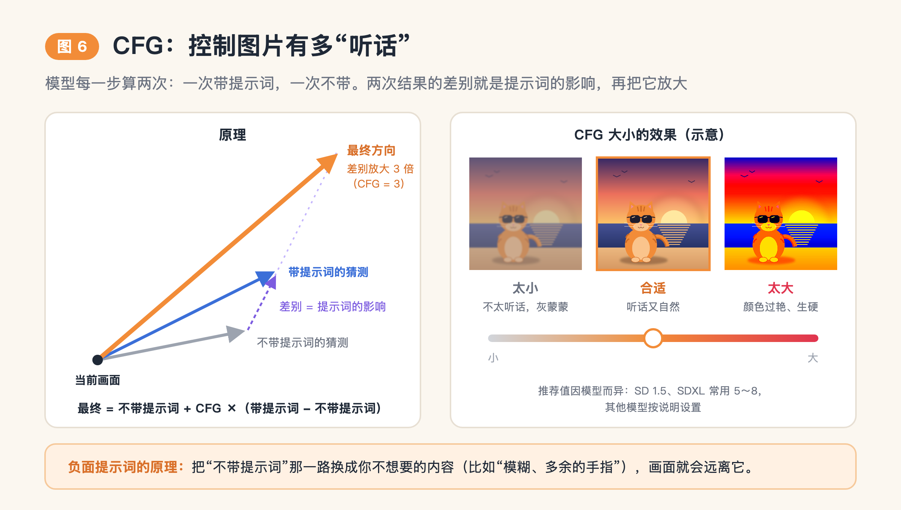

用过 Stable Diffusion 的人，基本都调过一个叫 **CFG Scale** 的参数。它的原理很直观：

1. 模型每一步算两次：一次带着提示词，一次不带。
2. 两次结果的差别，就是“提示词带来的影响”。
3. 把这个差别放大几倍，图就更听提示词的话。

CFG 太小，图不太听话，画面灰蒙蒙，和描述对不上；太大，颜色过艳、画面生硬。不同模型的推荐值差别很大，SD 1.5、SDXL 常用 5 到 8，其他模型按说明来。

**负面提示词**的原理也在这里：把“不带提示词”那一路换成你不想要的内容，比如“模糊、多余的手指”，模型就会往相反的方向走。

## 六、为什么要先压缩：潜空间

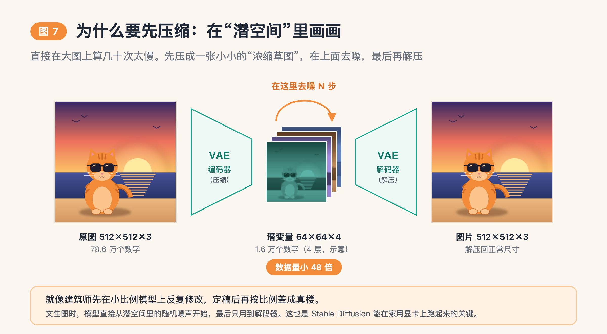

前面说过，一张 1024×1024 的图有 315 万个数字。在这么大的图上去噪几十次，计算量非常大，普通电脑跑不动。

解决办法是：先用一个叫 **VAE** 的“压缩器”，把图片压成一张小得多的浓缩草图。这个浓缩版叫**潜变量（latent）**，它所在的空间就叫**潜空间**。

以 Stable Diffusion 1.5 为例：一张 512×512 的彩色图有 512 × 512 × 3 ≈ 78.6 万个数字；压成潜变量后是 64 × 64 × 4 ≈ 1.6 万个数字，小了 48 倍。

所有去噪都在这张小图上完成，最后再用 VAE 的解码器把它“解压”成正常尺寸的图片。文生图的时候，模型直接从潜空间里的一团随机噪声开始，最后只用到解码器。

这就像建筑师先在小比例模型上反复修改，定稿后再按比例盖成真楼。这个想法来自 2021 年底的“潜在扩散模型”论文，也是 Stable Diffusion 能在家用显卡上跑起来的关键。顺便一提，Stable Diffusion 名字里的 Diffusion，就是“扩散”。

## 七、串起来：一张图的诞生全过程

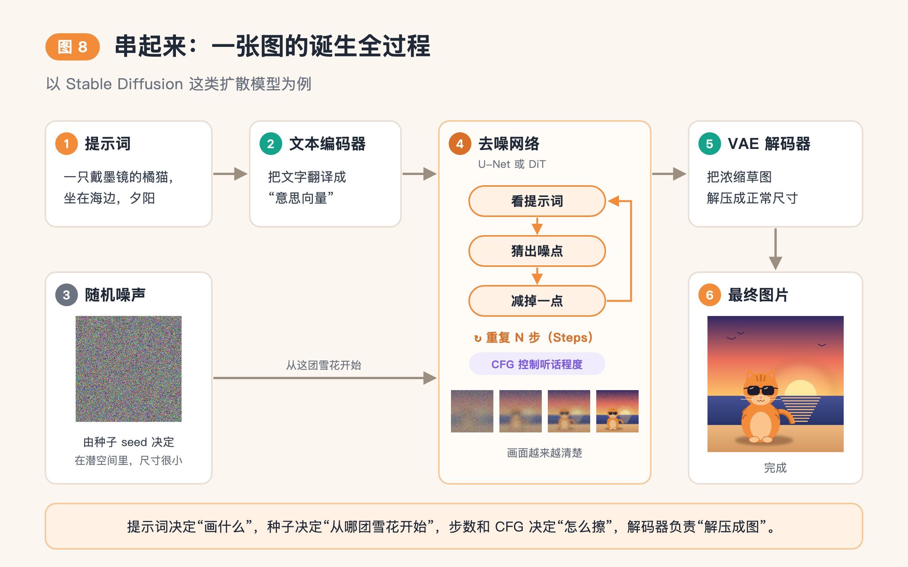

现在把前面的零件拼起来：

1. 你写下提示词。
2. 文本编码器把它翻译成意思向量。
3. 系统按种子，在潜空间里生成一团小尺寸的随机噪声。
4. 去噪网络一遍遍地“看提示词、猜噪点、减掉一点”，重复 N 步，CFG 控制它有多听话。
5. VAE 解码器把浓缩草图解压成正常尺寸。
6. 图片出炉。

第 4 步的去噪网络有两种常见结构。一种叫 **U-Net**，形状像个沙漏，先把图缩小看整体构图，再放大补细节，SD 1.5 和 SDXL 用的是它。另一种叫 **DiT**，把 ChatGPT 所用的 Transformer 结构拿来做去噪，特点是模型做得越大，效果提升越明显。SD3、FLUX、腾讯混元、阿里 Qwen-Image，还有 OpenAI 的视频模型 Sora，都用了 DiT 或它的变体。

一句话记住：**提示词决定“画什么”，种子决定“从哪团雪花开始”，步数和 CFG 决定“怎么擦”，解码器负责“解压成图”。**

## 八、软件里的参数，分别管什么

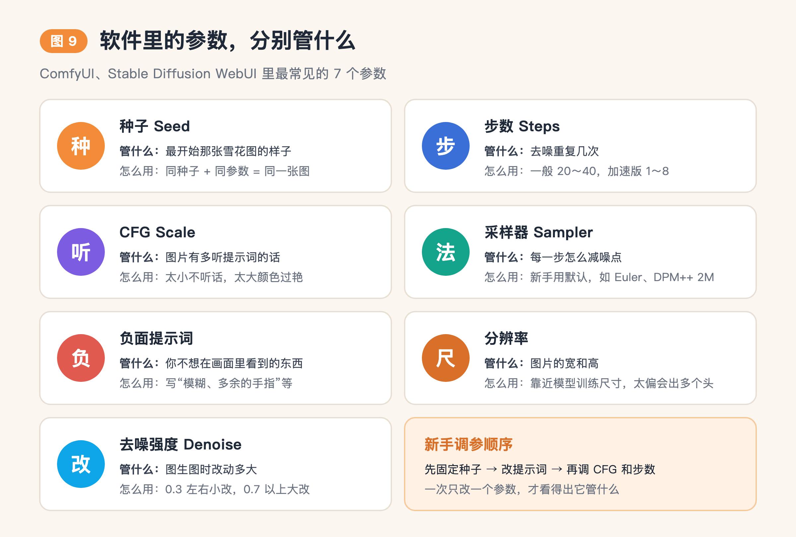

理解了上面的流程，再打开 ComfyUI 或 Stable Diffusion WebUI，那些参数就不再是天书了。图 9 是一张速查卡，可以存下来对照着用。

几个新手容易踩的坑：

- **想复现一张喜欢的图，一定要记下种子。** 种子、提示词和其他参数都不变，就能得到同一张图。
- **步数不是越多越好。** 超过一定次数后，画质提升很小，时间却成倍增加。
- **分辨率尽量靠近模型训练时的尺寸。** 偏离太多，模型容易画出多个头或者重复的人。
- **一次只改一个参数**，才看得出它到底管什么。

## 九、进阶玩法背后的原理

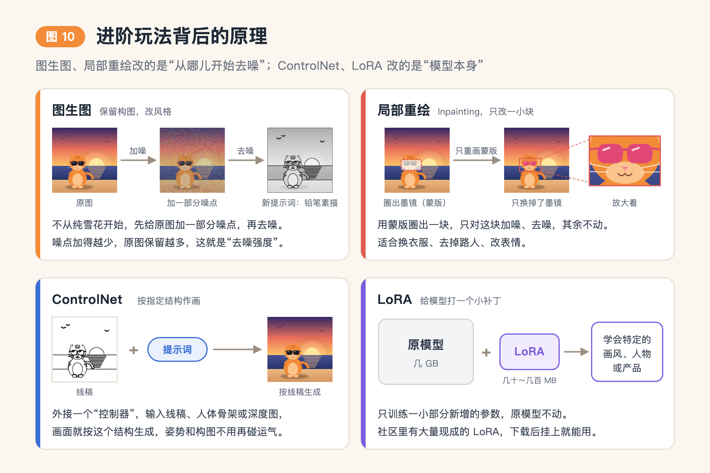

很多看起来很高级的功能，原理都能用前面的知识解释。它们可以分成两类。

**第一类，改的是“从哪儿开始去噪”。**

- **图生图**：不从纯雪花开始，先给你的图加一部分噪点，再按新的提示词去噪。噪点加得越少，原图保留越多，这个比例就是“去噪强度”。
- **局部重绘（Inpainting）**：用蒙版圈出一块区域，只对这块加噪、去噪，其他地方不动。适合换衣服、去掉路人。图 10 里就是只把墨镜换成了粉色。

**第二类，改的是模型本身。**

- **ControlNet**（2023 年）：给模型外接一个“控制器”，输入线稿、人体骨架或深度图，画面就按这个结构生成。它解决了“姿势和构图很难用文字说清楚”的问题，让 AI 绘画从抽卡碰运气变成了可控的生产。
- **LoRA**：给模型打一个小补丁，专门学某种画风、某个人物或某件产品。原模型通常有几 GB，LoRA 一般只有几十到几百 MB。它只训练一小部分新增的参数，原模型不动。
- **蒸馏加速**（LCM、Turbo、Lightning 等）：让一个“学生模型”学会用 1 到 8 步完成“老师模型”几十步的工作，出图接近实时。

## 十、最新一代：画图能力长进了大语言模型里

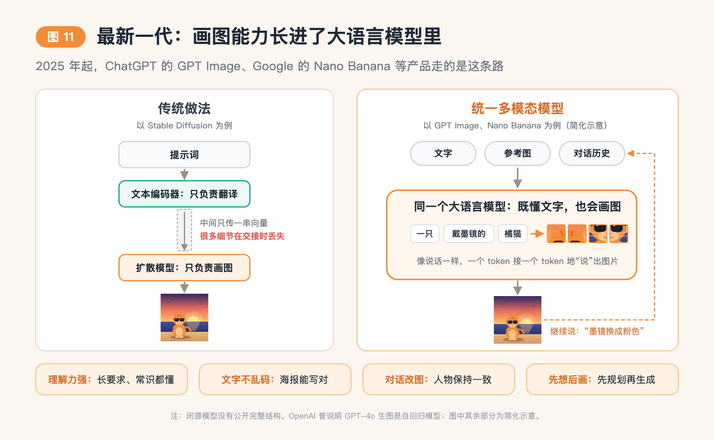

2025 年起，主流的闭源产品出现了一个大变化：**生图能力直接长进了大语言模型里。**

代表产品是 ChatGPT 的 GPT Image 系列（从 2025 年 3 月的 GPT-4o 生图开始）和 Google 的 Nano Banana 系列。开源方面有腾讯混元 Image 3.0、DeepSeek Janus-Pro 等。

传统做法像两个人分工：文本编码器只负责翻译提示词，扩散模型只负责画。两者之间只靠一串向量沟通，很多细节在交接时就丢了。

统一多模态模型则是同一个“大脑”既懂语言，也能输出图像。常见做法是把图片也变成 token，让模型像说话一样把图片“说”出来，有的再接一个扩散模型补细节。

这带来了几个看得见的变化：

1. **理解力强**：能处理又长又复杂的要求，也懂常识，比如“画出这道菜的四步做法示意图”。
2. **文字不再乱码**：海报、菜单、信息图上的中英文都能写对。早几年的模型画出来的字，基本是鬼画符。
3. **对话式改图**：“把背景换成雪天，人物别动”，多轮修改后人物长相还能保持一致。
4. **先想后画**：2026 年 4 月发布的 GPT Image 2 加入了“思考”模式，生成前先推理、规划布局，再动笔。

需要说明的是，闭源厂商没有公开完整的技术细节。OpenAI 说明过 GPT-4o 生图是自回归模型，和 DALL·E 系列的扩散方式不同；其他闭源模型的内部结构，大多是外界的推测。

---

## 写在最后

回到开头的问题：输入“一只戴墨镜的橘猫，坐在海边，夕阳”之后的几秒钟里，发生了什么？

如果用的是 Stable Diffusion 这类扩散模型：你的话先被翻译成一串数字；系统按种子生成一团雪花；模型看着那串数字，把雪花一步步擦成一只橘猫；最后解压成你看到的图片。

如果用的是 GPT Image、Nano Banana 这类新模型：一个大语言模型读懂你的话，然后像说话一样，把图片一块一块“说”了出来。

下次再用 AI 画图，不妨试着动一动种子、步数和 CFG，看看画面怎么变。知道了背后的原理，这些参数就都有迹可循了。

---

**配图说明**：文中配图均由程序绘制。图 3 的加噪过程按扩散模型常用的余弦噪声表真实计算；图 4、图 6、图 7、图 10 中的部分效果是示意，用来说明原理，不是真实模型的输出。

**延伸阅读**

- [The Illustrated Stable Diffusion](https://jalammar.github.io/illustrated-stable-diffusion/)（Jay Alammar，英文图解）
- [What are Diffusion Models?](https://lilianweng.github.io/posts/2021-07-11-diffusion-models/)（Lilian Weng，英文，含数学推导）
- [Introducing GPT Image 2](https://community.openai.com/t/introducing-gpt-image-2-available-today-in-the-api-and-codex/1379479)（OpenAI 开发者社区公告）
