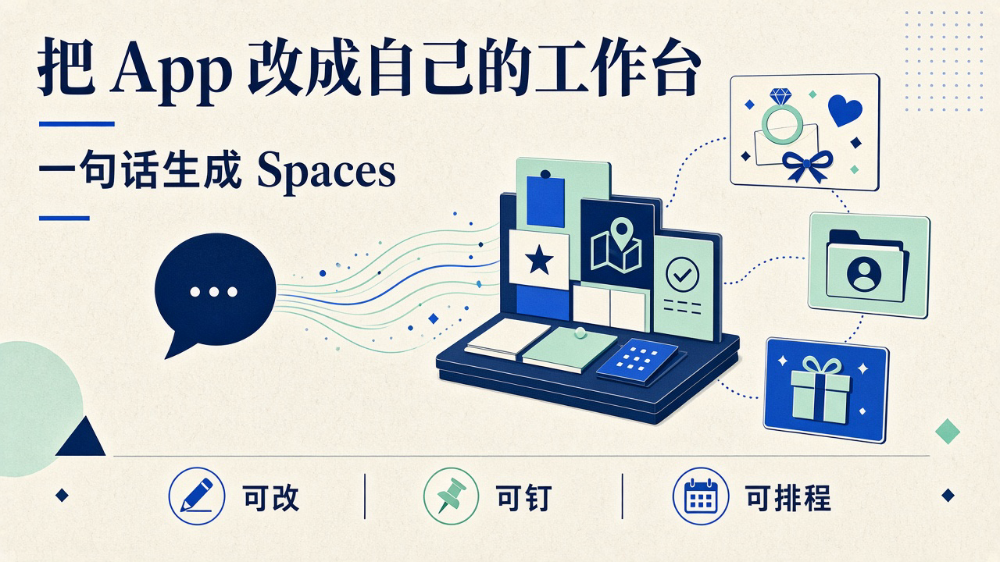
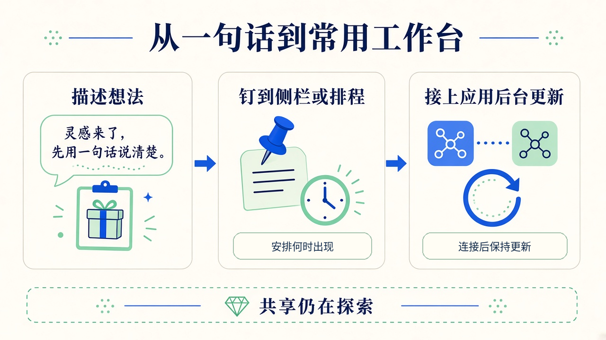

# 可改、可排程、能钉侧栏：Muse 推出 Spaces，把 App 变成个人工作台，共享仍在探索

你想给家里人买礼物，收藏夹存着几个点子，备忘录记着生日，表格里还有预算。

每次真要下单，还是得把这些东西重新拼一遍。问 AI，它能列建议；关掉对话，下次又得去聊天记录里捞那张表。

**你缺的可能不是一个更会聊天的头像，而是一块下次打开还在、事情变了也能跟着变的工作台。**

2026 年 11 月 6 日，Meta 在[产品公告](https://about.fb.com/news/2026/11/introducing-spaces-customize-muse-app/)里推出 Muse Spaces：用自然语言描述想法，在 Muse App 里生成一个定制体验。生成后还能继续改，把它放进侧栏或主标签，甚至安排它什么时候出现。

这不是说一句话就能替代所有软件。官方举的是礼物追踪、婚礼筹备、客户中枢这类具体场景；共享给别人一起用，**还在探索，不是已经上线的能力。**

吸引人的地方很实在：不用先找一款差不多的软件，再迁就它的栏目。你先说自己要做什么，再让 App 长出相应的一块。下面的能力来自官网和研究博客，不是我们在 Muse 里跑过的实测。

## 你要的不是一段建议，是下次打开还能接着用的那一块

单窗口对话适合问一个问题、拿一份答案。但生活里的事情往往不在一次问答里结束。

婚礼名单要反复改，供应商发票陆续来，待办做完一项少一项。自由职业者的客户项目也一样，交付日期和发票不是问完就能扔掉的信息。

Spaces 的定义是 Muse 里的定制体验。按公告，你描述一个礼物追踪器、每日文字游戏或 DIY 项目规划板，Muse 把它建出来；这个 space 成为 App 的一部分，之后还能回来继续用。

**差别不只在「生成了什么」，还在「以后从哪里找到它、怎么继续动它」。**

官方的婚礼例子把宾客回复名单、供应商发票和待办放在一起；面向自由职业者的客户中枢，则把项目、截止日期和发票聚到一处。这些场景不需要先讲模型参数，忙过一轮的人就能懂。

礼物中枢也是同样的逻辑。真正费劲的不是让 AI 再推荐十个礼物，而是把点子、愿望清单和相关买卖消息放到一个能持续处理的地方。

别把这些例子听成跑通保证。公告展示的是想做成的使用方式，没有给出每类需求的生成成功率，也没有证明复杂婚礼或整个小生意都能交给它兜底。

## 外观能改还不够，它连什么时候出现都让你安排

很多生成式工具最惊艳的一刻，是第一屏出来的时候。之后想加一个栏目、换一种操作方式，才发现自己又开始迁就成品。

Meta 给 Spaces 的说法是：初始想法只是起点。用起来以后，你可以继续跟 Muse 调整，补缺的内容、换外观，或者改变它的工作方式。

这让它更像一件能边用边修的工具，而不是聊天框里一次性的漂亮答案。

更值得注意的是入口。你能把 space 加到侧栏，移到主标签，藏起暂时不用的，还能安排它出现的时间。

官网给了一个很日常的例子：工作日把周计划放在前面，到周六换成周末安排。**这里的排程说的是 space 什么时候出现，不等于承诺任意任务都能定时自动执行。**

这一步看似只是界面摆放，实际改变了使用的起点。以前先打开同一个聊天窗，再解释自己正在忙什么；现在可以先看到那块正在忙的事，再决定往里加什么。

对开发者，这也提示了一个变化：一部分个人工具需求，可能先在现有 App 里长成一块小体验，不一定从一个独立网站或新 App 开始。它仍然不是官网承诺的通用应用开发平台，不能直接推演成能导出代码、独立部署或替代现有业务系统。

## 接上应用以后，后台更新才是工作台最难的那半截

一个礼物板如果永远停在生成那天，很快就会变成另一个没人维护的表格。

Meta 在公告里说，连接你使用的应用之后，spaces 会在后台保持更新。新的演出日期、价格变化或储蓄进度，可以不等你再问就出现在里面。

你也能直接在 space 里勾掉事项、加笔记、做修改，回来时这些内容仍然在。

**生成解决的是从零到一，后台更新解决的才是你愿不愿意第二周还打开它。**

但「连接你使用的应用」不是一张无限连接器通行证。公告没有在这里列出完整的应用支持名单，也没有给出刷新频率、延迟或每次都能更新成功的保证。

所以，看到客户中枢里有一张发票，和确认它已经包含最新一张发票，是两件事。看到待发货列表，也不等于能省掉发货前的核对。这是判断这类工具是否好用的标准，不是我们发现了 Muse 的某个具体故障。

我的判断是，工作台越像日常入口，用户越需要分清哪些内容是自己填的，哪些来自连接的应用，哪些还没同步。页面看起来整齐，不能替代数据真的跟上了事情。

Meta 同时写明：从发布当天起，Muse 能用到的地方都能用 Spaces。这个范围跟着 Muse 走，不能换个说法就叫「全球上线」，更不能据此断言中国大陆可用。

## 遗忘约降 2.4×，不等于你所有的事都能放心交出去

同一天，[Meta 的研究博客](https://research.meta.ai/blog/specialized-models-for-muse-and-metaai)还宣布，把用 Muse Wonder 训练的现有模型专项版本，推向 Muse 和 Meta AI 用户。

措辞要分清：**这是现有模型的 specialized versions，用 Wonder 来训练；不是 Muse 直接等于 Wonder，也不是把 Wonder 本体装进每个人的 App。**

Spaces 是 Muse App 里的产品能力。这批专项模型则同时面向 Muse 和 Meta AI，不能反过来写成 Meta AI 聊天机器人也能创建 Spaces。

研究博客把两种能力带到了这批模型：Active Memory 和 Active Focus。前者关心什么该记、什么时候该想起来；后者关心做事遇到意外以后，能不能继续推进。

这跟个人工作台的需求正好接上：客户截止日期不是你每次都想重说的东西，任务遇到一个卡点，也不该立刻把所有麻烦丢回给你。但两则公告放在一起，不等于下面这些数字就是 Spaces 专项测试的结果。

Meta 给出的数字，要拆开读：

| 官方口径 | 数字 | 不能替它证明什么 |
| --- | --- | --- |
| Muse 遗忘实现目标所需关键信息的减少幅度 | 约 2.4× | 不是保证不再遗忘 |
| Active Memory Eval 中正确使用关键上下文完成任务 | 当前 90%，此前 76% | 不是把 2.4× 换算成这两个数 |
| Muse 在出现意外问题的日常任务中的完成表现 | 提升约 67% | 没有给出可据此声称的基线完成率 |
| Personal Superintelligence Index | 当前 47%，此前 38% | 是 Meta 自家指标，不是所有任务的通用胜率 |

这些都是 Meta 的自家评测口径，不是我们的实测。**提升 67% 不等于完成率达到 67%，更不是增加了 67 个百分点。**

Active Memory 的训练描述也比「记得更多」具体：分辨临时和长期信息，跨时间推理，区分仍然相关的内容和已经过时的内容。工作台怕的不只是忘，还怕把上个月的旧安排当成现在的硬要求。

Active Focus 则训练模型面对接近现实的各种卡点，尝试继续努力、恢复或寻找替代办法。官方还称，这批模型更能处理中途的指引与澄清，知道什么时候独立推进，什么时候跟用户实时协作。

这是值得关注的方向。但一个总指标变好，不会自动保证你的每条客户记录都对、每次异常都能自救，更不能拿来补上公告没写的权限和外部操作边界。

## 下次打开 Muse，你想先看见聊天头像，还是那件没做完的事

我更在意的不是 Muse 又多了几个功能，而是它把「个人化」往前推了一层。

过去很容易把个人化理解成声音像谁、头像长什么样、回答记不记得你的喜好。Spaces 瞄准的则是：你手头那件事，能不能在 App 里有一个固定位置。

描述想法，生成可互动的体验，继续改外观和机制，再决定它放哪里、什么时候出现；接上应用后，官方称它还会在后台更新。这几步连起来，才是从聊天头像走向可编排个人工作台的增量。

它还没有把所有难题抹平。**共享仍在探索，不能当团队协作平台来介绍；能生成一个 space，也不等于任何复杂想法都能变成可靠工具。** 官网那句半成品点子有机会变成 space，是邀请你试，不是通吃承诺。

想象一下，到了周一，你打开的不是一张等你输入问题的脸，而是客户快到期的交付、没处理完的发票，或家里那份还差两件的礼物计划。

那会是一个很直观的变化。但它值不值得留下，最后不看第一屏有多惊艳，而看下一次事情变了，它是不是还接得住。

你愿意反复打开的，到底是一个更像人的聊天对象，还是一块真的跟得上你生活的工作台？
