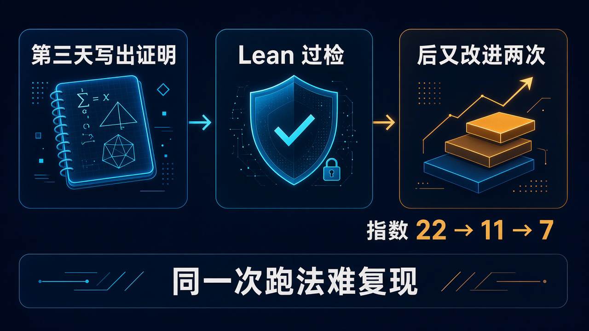

# 第三天写出证明：PSI 用未公开 Anthropic 模型证出 Aaronson-Ambainis 猜想，Lean 过检不等于跑法可复现

你在做一个新项目，会上有人说：现在优化这些算法有什么用，量子计算机来了不就全推平了？

另一个人接话：吹了这么多年，量子计算根本没用。

两句话都省事，也都把真正的问题跳过去了。**量子机的优势，到底从哪儿来，又在哪儿停下来？** 做算法、选技术路线的人，需要的不是站队，而是知道哪一种「快」真的有依据。

2026 年 11 月 6 日，Physical Superintelligence，也就是 PSI，在[官方公告](https://psi.inc/research/aaronson-ambainis/)里给出一个很硬的进展：内部研究系统使用未公开 Anthropic 模型，找到了 Aaronson-Ambainis 猜想的证明。

这道从 2008 年讲座起悬着、约 18 年没解决的问题，系统在运行的第三天写出了完整证明，Lean 接受了它。后来又改进两次。

但先别把消息转成「量子计算没用了」，也别转成「Anthropic 的聊天机器人三天包办数学」。这次值得看的，恰恰是它把边界说得更具体了。

## 要比的是少读多少次输入，不是谁的秒表更快

想象面前是一长串 0 和 1。你要回答一个是或否的问题，每读一次输入，就算看一眼。

普通计算机一眼读一位。量子计算机的一眼可以叠加在许多位置上。这不是说它一次就把所有位置的答案拿到手，但确实给了算法另一种利用输入的方式。

这里讨论的是**查询复杂度，也就是要看多少眼，不是墙上的钟走了多少秒。** 它不直接告诉你今天哪台量子设备跑业务更快，更不是一份硬件实测榜单。

1994 年的 Shor 算法能快速分解大整数，关键在于利用问题里隐藏的周期结构。Simon 问题也有类似的承诺结构。这类稀有图样，放到所有可能输入里，只占极小一部分。

真正难的是下一问：如果给的是随机输入，几乎没有这样的结构，量子机还能指数级少看几眼吗？

PSI 公布的结果给出的答案是：在这类是或否的问题和查询模型里，指数级优势不能凭空来，得靠结构。

更准确地说，量子算法看了 T 次输入，普通算法就能用关于 T 的多项式次数查询，近似它说「是」的概率。前提是误差容忍度和允许例外的输入比例固定；结论覆盖大部分输入，而不是每个输入都精确模拟。

这仍允许多项式级加速，也没有推翻 Shor。它限制的是一种优势来源，不是宣布量子计算退场。

如果你正在评估一个算法项目，先把需求里的「快」写清楚：究竟是少访问数据，还是缩短整个任务的耗时？这份结果回答前一种问题，不能直接拿来替后一种问题做采购决定。

而且，对没有输入承诺的总布尔函数，量子与经典查询复杂度多项式相关，本来就是已知结果。这次补上的，是平均情况、随机输入上的接受概率近似，不能把旧边界也算成新发现。

## 卡了约 18 年的地方，是总能不能找到一个重要开关

这道量子问题，最后被收成了一道纯数学题。

一个做了 T 次查询的量子算法，它接受输入的概率，可以写成次数至多 2T、取值在 0 到 1 之间的多项式。这是已有结果，不是 PSI 这次才发现的。

把它想成一块接着很多开关的仪表盘。每个输入位是一个开关，表针显示接受概率。翻动哪个开关，读数会有明显变化？

所谓「影响力」，在这里就是翻转一位造成的读数变化，平方后对所有输入取平均。

Aaronson 和 Ambainis 的猜想说：只要这个有界、低次的多项式不是恒定读数，就一定有某个开关，影响力不至于小得离谱。

这很关键。普通算法知道仪表盘的接线方式，就能优先去读有影响力的输入位；等剩下那些位怎么变都影响不大，再用平均读数作预测。猜想保证的，是中途总能找到值得读的位。

[公开论文](https://github.com/physical-superintelligence/aaronson-ambainis/blob/main/paper/aaronson_ambainis_paper.pdf)给出了明确的界：在输入为 0/1、取值在 0 到 1、方差至少 ε、次数至多 d 的归一化下，存在某个位满足：

**Infᵢ[p] ≥ [8√15 / (125π⁴)] · ε^{5/2} / d⁶ ≥ (ε/d)⁷。**

前面的常数约为 0.0025。不用记住它；重要的是原猜想要的「某个固定次方」，现在被落实成了 7。这个 7 不是完成率，也不是量子机和普通机的加速比。

2008 年是 Aaronson 在 Banff 工作坊讲座中提出相关猜想的时间；后来那篇《The need for structure in quantum speedups》正式发表于 2014 年，不能把两个年份揉成一件事。

路上也不是没人接近过。2019 年，Nathan Keller 和 Ohad Klein 宣布过一次证明尝试，后来撤回。到 2026 年 8 月，Stanford 的 Guy Blanc、Jordan Docter、Carmen Strassle 和 Li-Yang Tan 证明了固定轮数并行查询量子算法的特例，还不是完整猜想。

所以这次的分量，不是又多解了几道数学题，而是把一个有关量子优势的长期缺口补上了。

## 第三天拿到初证，22 到 7 是后面磨出来的

「三天」最抓眼球，也最容易被讲错。

论文附录 A 记录的是：运行第三天，第一份完整证明写出来，随即用 Lean 检过。**不是整个研究总共只跑了三天，也不是初证就有最终的界。**

| 阶段 | 对应的指数 | 验证进展 |
| --- | --- | --- |
| 第三天，第一份完整证明 | 22 | Lean 过检 |
| 第一次改进，对所有层级积分 | 11 | Lean 过检 |
| 第二次改进，对坐标求平均，并用上 L(f) ≤ 4d² | 7 | Lean 过检 |

这些指数指的是原始归一化下，把影响力下界写成 ε/d 的固定次方时的指数。不是拿三种不同的性能成绩排榜。

证明也不是从真空里冒出来的。

它沿着 Shachar Lovett 和 Jiapeng Zhang 的计划走，用一条新的全配对不等式，替代原计划里仍是猜想的一步。配对由行列式产生；David Reimer 的 Butterfly Lemma 已经给过更弱的配对，新结果还限制了配对在每个开关上保持一致的次数。

不必顺着公式推下去，也能看清这类系统在做什么：沿着前人的路找到缺口，再把缺口补成能用的步骤，而不是让模型凭空发明整套数学。

论文披露，模型在系统里搜寻已有想法、提出新想法、组合和测试，还监督其他模型实例的工作与沟通。

但人没有消失。作者 David Turturean 开发系统、确定问题范围，在 PSI 基础设施上运行，提示模型把结果整理成论文初稿，再亲自审订编辑，并对正确性负责。Jim Halverson 审计证明，Phiala Shanahan 评论了 Lean 形式化。

这是 PSI 的研究工作。PSI 是自称面向物理的 AI 原生实验室、公益公司，不是 Anthropic 子公司；用到了 Anthropic 的模型，也不等于 Anthropic 官方交出这项成果。

## Lean 检的是形式化证明，不是替所有叙述盖章

这次不只放出一句「我们证明了」。[论文与 Lean 4 仓库](https://github.com/physical-superintelligence/aaronson-ambainis)已经公开，可以继续往里核。

仓库固定了 Lean 4.33.0 和 Mathlib v4.33.0。按它披露的验证记录，四条最终定理没有占位证明、没有新增公理，经过 Lean kernel 与独立实现 lean4lean 重放，还记录了 comparator 用 nanoda 和 Lean kernel 做的检查。

这比模型说「相信我」强得多。但它强在一个明确范围里。

**机器核的是形式化陈述之下的证明步骤；形式化陈述有没有准确表达原猜想，仍要人读。** 仓库把这一步指向 Conjecture.lean 和 problem_statement.md。

给人读的论文，也不是被机器逐句核过的。Lean kernel、编译器、Mathlib 定义，以及运行检查的机器，仍在信任基础里。

还有一个容易误读的小地方：第四条定理带着 FbsDegreeBound 假设。这是 Agarwal 与 Ben-David 的一个结果，没有在这个仓库里形式化；用上它，可以把显式界的常数从 8√15/(125π⁴) 改进到 32√15/(125π⁴)。

**主定理 aaronson_ambainis : PrintedConjecture 不依赖这条假设。** 不能因为一个加强版带条件，就把主结果说成还欠着同一个洞。

目前公开的是 GitHub 预印本与 Lean 形式化，不等于已经期刊录用，也不等于同行评审完成。检查链条很重要，准确说清它检查到哪儿，同样重要。

## 证明可以公开检查，发现它的那次运行却难以重来

对想把 AI 用进研究的人，这里有一条很实际的分界。

拿到公开仓库，你能核对论文、形式化陈述和验证记录。但要重做「发现这个证明」的那次运行，就没这么直接了。

模型未公开，没有公布名字；研究系统是 PSI 内部开发的。公开成果可以检查，不代表外人已经拿到了同一套发现条件。模型成本、总运行时长、成功率，也不能靠想象补齐。

这不抹掉证明的价值，却会影响你怎么把它变成自己的工作方法。把问题交给一个聊天框，和搭出一套能搜想法、组织实例、反复验证的研究系统，不是一回事。

想象下次团队群又弹出一条消息：「AI 证出了一个悬了很多年的猜想。」你正准备把它放进方案，作为路线改变的理由。

这时最值得打开的，可能不是那句最响的转述，而是原陈述和检查记录：机器究竟核过哪句话，它和你准备引用的那句话，真的是同一句吗？
